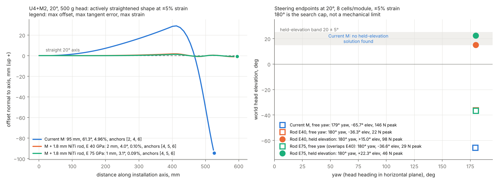
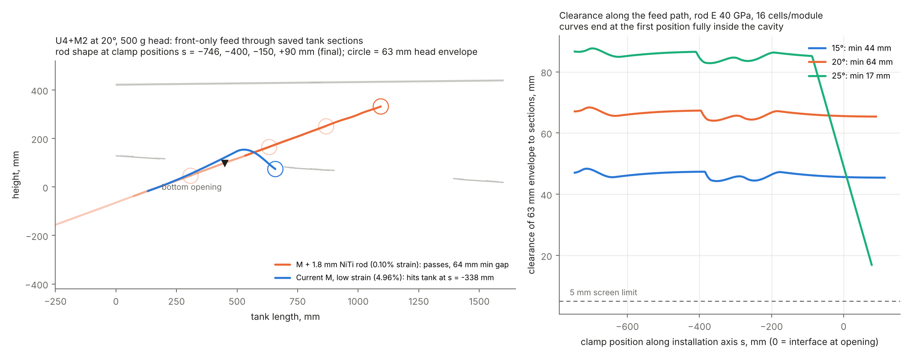
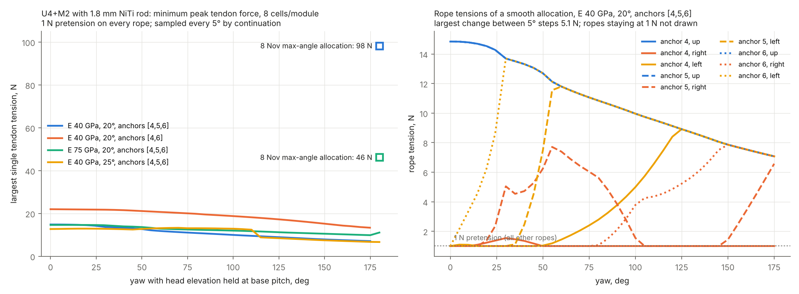
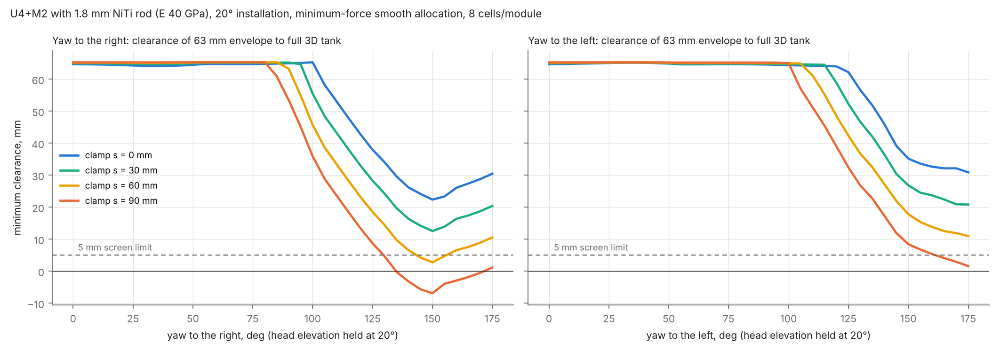
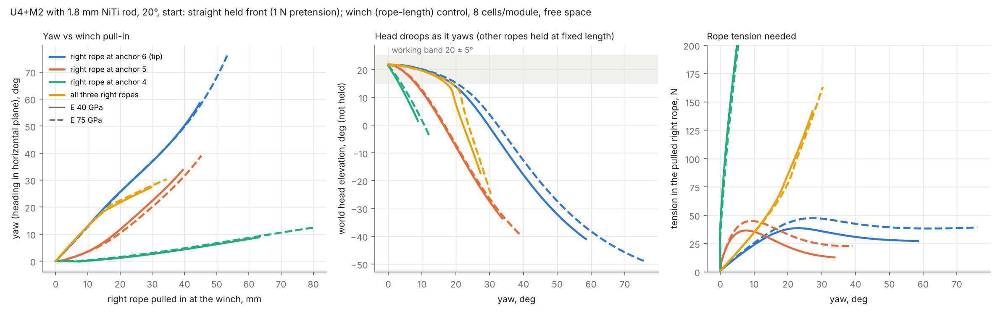
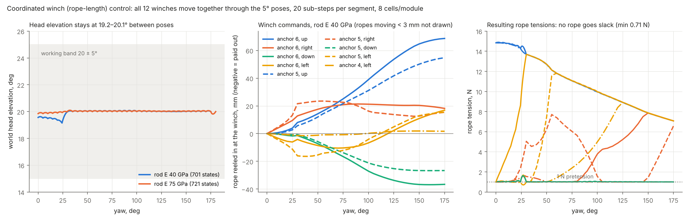
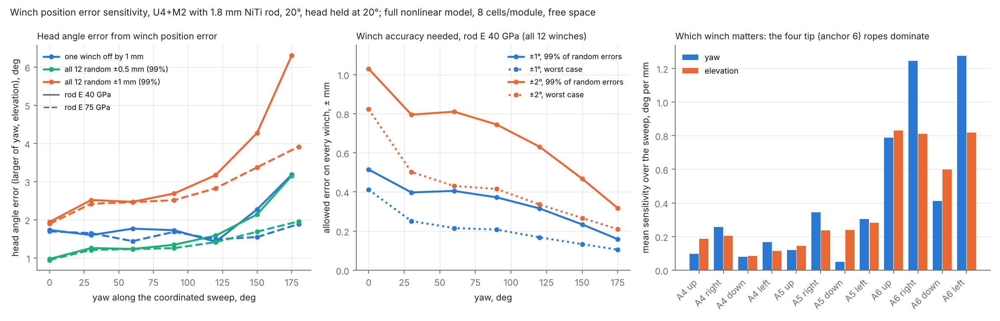

## Position-controlled round-trip study (11 November 2026)

See [the generated report](length_cycle_results/REPORT.md) for the forward-solved
12-rope length-control cycle, full-tank sampled clearance, consistent elastic-rope
stability and one-factor sensitivity cases. This extends the earlier force-based
sweeps; it does not establish hardware performance or continuous collision safety.

- `length_cycle.py`: straighten from a defined slackened equilibrium, enter,
  right/return, left/return and withdraw; 8 cells/module.
- `summarize_length_cycle.py`: acceptance failures, provenance and comparison plot.
- `test_length_cycle.py`: numerical energy/gradient/Hessian and mesh-query checks.
- `length_cycle_results/`: per-step CSV/JSON, states and aggregate report.

# M module with 1.8 mm NiTi backbone: straightening and steering

2026-11-08 · 63 mm · 24 mm tendon radius · 500 g head · follow-up to `../m_axial_sweep_20261108`

This study adds a central Ø1.8 mm NiTi rod to every M module, including its mass, and re-runs two of the 2026-11-06 studies:

- the planar active-straightening study (U4+M2, U6+M3 and U8+M4 at 15°, 20° and 25°);
- the spatial steering and held-elevation study (U4+M2).

The physical build and test plan is in [`M_BACKBONE_TEST_PLAN.md`](M_BACKBONE_TEST_PLAN.md).



## Rod model

| | M (database) | + rod, E = 40 GPa | + rod, E = 75 GPa |
|---|---:|---:|---:|
| EA, N | 166.7 | 101,954 | 191,018 |
| EI, N·m² (both planes) | 0.0441 | 0.0647 | 0.0828 |
| Module torsion, N·m/rad | 0.437 | 0.599 | 0.740 |
| Mass per M module, g | 23.948 | 25.524 | 25.524 |

- The rod is modelled as central, bonded to the module end disks and bending with the module, so its stiffness adds to the module's.
- E = 40 GPa represents a martensite or low-modulus lower bound; 75 GPa represents austenite. Torsion uses ν = 0.33.
- Rod end fittings and guides are not included in the mass. Neither are friction, NiTi phase transformation or contact.
- All other inputs are identical to the 2026-11-06 studies. The kernels are reused through `backbone.py` and are not modified.

## 1. Planar active straightening (`backbone_planar.py`)

The best stable result at ≤5% strain at 8 cells per module is shown below. "Pass" means all straightness checks pass: offset ≤ 10 mm, tangent error ≤ 5°, axial projection ≥ 95%, strain ≤ 5%, and stable.

| Configuration | Pitch | Current M | Rod, E = 40 GPa | Rod, E = 75 GPa |
|---|---:|---|---|---|
| U4+M2 | 15° | 89.7 mm / 57.5° — fail | **1.8 mm / 4.1° / 0.10% — pass** | **1.2 mm / 3.2° — pass** |
| U4+M2 | 20° | 94.7 mm / 61.3° — fail | **1.7 mm / 4.0° / 0.10% — pass** | **1.2 mm / 3.1° — pass** |
| U4+M2 | 25° | 99.1 mm / 64.9° — fail | **1.7 mm / 3.7° / 0.09% — pass** | **1.2 mm / 3.0° — pass** |
| U6+M3 | 20° | 176.8 mm / 87.2° — fail | 10.5 mm / 15.1° — fail | 9.6 mm / 10.5° — fail |
| U8+M4 | 20° | 278.0 mm / 98.1° — fail | 135.2 mm / 102.5° — fail | 19.2 mm / 29.9° — fail |

- **U4+M2 passes at all three pitches**, with anchors [4,5,6]. At 20° and E = 40 GPa, the top-rope tensions are 91.5, 21.4 and 8.5 N.
- **U6+M3 and U8+M4 do not pass** with three or fewer anchor sets. A search of every three-set layout with one set at the head (28 for U6+M3 and 55 for U8+M4, each at both moduli, 20°, `--all-three`) found no passing case. The closest was U6+M3 with anchors [7,8,9], at 5.04° tangent error but a 24.5 mm offset. Their M sections are longer, and gravity bending between anchor disks grows with the length of each span.
- The current-M (no rod) column reproduces the 2026-11-06 report values, for example 94.68 mm at 20° for U4+M2.

## 2. Spatial steering and held elevation, U4+M2 (`backbone_steering.py`, `refine_backbone_steering.py`)

The procedure, bounds and acceptance rules follow 2026-11-06:

- tendon tension 0–250 N;
- coarse strain bound ±4.75%;
- 180° angle search cap;
- geometry, capsule and fixed-winch stability checks.

Candidates start at 2 cells per module and are refined to 4 and then 8. A candidate is reported only if it passes at 8 cells. "Held elevation" means yaw with the world head elevation within base pitch ± 5°.

| Variant | Pitch | Free yaw (elevation, peak N) | **Yaw with held elevation** (elevation, peak N) | Up / down |
|---|---:|---|---|---|
| Current M | 20° | 179.4° (−65.7°, 146.5 N) | **none found** | −56.6° / 113.8° |
| Rod, E = 40 GPa | 15° | 180°* (−33.3°, 24.4 N) | **165°** (+10.0°, 56.5 N)† | 180°* / 180°* |
| Rod, E = 40 GPa | 20° | 180°* (−36.3°, 22.2 N) | **180°*** (+15.0°, 98.3 N) | 180°* / 180°* |
| Rod, E = 40 GPa | 25° | 180°* (−39.5°, 21.1 N) | **180°*** (+30.0°, 246.9 N) | 180°* / 180°* |
| Rod, E = 75 GPa | 20° | 180°* (−36.6°, 29.3 N) | **180°*** (+22.3°, 46.2 N) | 180°* / 180°* |

\* Reaches the 180° search cap. This is not a demonstrated mechanical limit.
† At 15°, no 180° held state survived the 8-cell check: it was unstable at +10° elevation. The largest lower cap that passed was 165°.

- The no-rod control reproduces the 2026-11-06 results exactly at 8 cells: 179.42°, −65.67°, 146.48 N, and no held-elevation solution.
- **With the rod, the head can be swept through the full ±180° yaw search range while held near the working elevation**, at well under 1% strain. This was the main unsolved problem (priority 2) in the 2026-11-06 report.
- Strain is no longer limiting: it stays at or below 0.62% everywhere. The constraints that now decide the result are tension, stability and the elevation band.
- **The tensions are one allocation found by the optimizer, not minimum-force solutions.** The 8-cell re-optimization maximizes angle only, so tensions can rise during refinement: at 20° and E = 40 GPa, the 2-cell candidates needed about 33 N, while the 8-cell result needs 98 N. The 25° held case sits near the 250 N bound and at the edge of the elevation band. Minimum-tension allocation is a recommended next step.
- "Up 180° at elevation = −pitch" means the head has turned over the top and points back. Whether the intermediate postures form a continuous controllable path is not established.
- Full tension sets for every endpoint are in `results/steering_summary_8cell.json`. Each row is one anchor set, in the order [up, right, down, left], in N.

## 3. Tank entry screen with the straight low-strain shape (`entry_screen.py`, 2026-11-09)

This re-runs the 2026-11-06 front-only entry screen, reusing `path_check()` from `../stiffness_63mm_20261106/postprocess.py` unchanged. The best stable shape at ≤5% strain is held at fixed tension and translated along the installation axis through the bottom opening at x = 449 mm. The run starts with the whole front and head outside the tank and steps 4 mm, then 2 mm. Pass requires:

- the 63 mm envelope stays at least 5 mm clear of the five saved CAD width sections (628–668 mm) along the whole path;
- the front ends fully inside the sampled cavity.

Passing shapes are re-solved at 16 cells per module with the same tensions and re-checked. As a control, the 2026-11-06 U4+M2 20° shape-only result (62.06 mm) is reproduced exactly.

| U4+M2 | Pitch | Strain | Min gap, 8 cell | Min gap, 16 cell | Final clamp s | Result |
|---|---:|---:|---:|---:|---:|---|
| Current M | 15° / 20° / 25° | 4.96% | hits the tank at s ≈ −336 mm | — | — | fail |
| Rod, E = 40 GPa | 15° | 0.10% | 44.5 mm | 44.3 mm | 114 mm | **pass** |
| Rod, E = 40 GPa | 20° | 0.10% | 64.3 mm | 64.0 mm | 90 mm | **pass** |
| Rod, E = 40 GPa | 25° | 0.09% | 16.6 mm | 16.9 mm | 78 mm | **pass** (tight) |
| Rod, E = 75 GPa | 15° / 20° / 25° | 0.09% | 44.6 / 64.6 / 16.1 mm | 44.5 / 64.4 / 16.2 mm | 114 / 90 / 78 mm | **pass** |

- **This is the first low-strain shape to pass the entry screen.** On 2026-11-06, only shapes at 17% or more strain passed; every low-strain shape sagged into the tank.
- The margins match the 2026-11-06 high-strain straight shapes (44 / 62 / 20 mm), so the rod gives the same geometry at about 1/170 of the strain.
- **Where the limit is:**
  - At 15° and 20°, the tightest point is the distal M section passing internal structure just after the head enters, at clamp s ≈ −355 mm.
  - At 25°, crossing the opening is comfortable (about 50 mm), but at the final placement the head is only about 19 mm below the roof. 20° remains the preferred installation angle.
- U6+M3 with the E = 75 GPa rod passes only at 15° (40 mm). It fails at 20° and 25°, and every U8+M4 case fails. U4+M2 remains the development length.



**Limits, unchanged from 2026-11-06:**

- Planar sweep of a fixed shape with a translating clamp.
- The five width planes do not cover the full 616.5–679.5 mm band of a 63 mm front.
- Not included: sleeve or guide contact, rear storage, rope take-up, retraction, tension changes during feed, and real head CAD.

This is a geometric screen, not a validated deployment.

## 4. 3D stability needs pretension on every rope (`pretension_recheck.py`, 2026-11-09)

The straightened states in sections 1 and 3 tension only the up ropes. They pass the planar stability check, but **in the 3D model they are laterally unstable** under the fixed-winch check (minimum eigenvalue −0.20 to −0.50), because the 2D model cannot see sideways buckling.

A **1 N pretension on all four ropes of every anchor set** stabilises every case. The straightening was then re-optimised with this pretension:

| U4+M2, anchors [4,5,6], +1 N on all ropes | 15° | 20° | 25° |
|---|---|---|---|
| E = 40 GPa: offset / tangent / strain | 1.86 mm / 4.2° / 0.11% | 1.82 mm / 4.0° / 0.11% | 2.00 mm / 3.5° / 0.10% |
| E = 40 GPa: top-rope tensions, N | 95.1, 21.8, 8.7 | 92.7, 21.2, 8.5 | 89.5, 20.5, 8.2 |
| E = 75 GPa: offset / tangent / strain | 1.28 mm / 3.3° / 0.10% | 1.25 mm / 3.1° / 0.10% | 1.21 mm / 3.0° / 0.10% |
| All straightness checks, 3D stable | yes | yes | yes |
| Tank entry minimum gap, E = 40 / 75 GPa | 44.6 / 44.7 mm | 64.2 / 64.6 mm | 17.2 / 16.1 mm |

The conclusions of sections 1 and 3 stand **with a minimum 1 N pretension on every rope**. This should become a control rule.

## 5. Minimum tendon force for held-elevation yaw (`min_force_sweep.py`, 2026-11-09)

**Method.** The yaw target is stepped from 0° to 180° by continuation, each step seeded from the previous solution. At each step the optimiser minimises the **largest single rope tension** subject to:

- equilibrium;
- yaw equal to the target;
- world head elevation within pitch ± 5°, or held exactly at pitch;
- the 2026-11-06 geometry and projection constraints;
- strain within ±4.75%;
- 1–250 N per rope.

Each state is solved at 4 cells per module, then re-solved at 8 cells (re-optimised if needed). It is accepted with the unchanged 2026-11-06 rules, including fixed-winch stability, and must be within 1° of the target yaw. An optional penalty on changing tensions between steps (`--smooth`) selects a smooth allocation among the many allocations with nearly the same peak.

| Run (elevation held exactly at pitch, 5° steps) | Passing states (8 cell) | Peak rope tension | Largest change per step |
|---|---|---|---|
| E = 40 GPa, 20°, anchors [4,5,6], smooth | 36/37 (0–175°) | **7.1–14.8 N** | 5.1 N |
| E = 40 GPa, 20°, anchors [4,5,6] | 37/37 (0–180°) | 7.0–14.8 N | 13.8 N (allocation jumps) |
| E = 40 GPa, 20°, anchors [4,6] | 36/37 (0–175°) | 13.3–22.0 N | 20.9 N |
| E = 75 GPa, 20°, anchors [4,5,6], smooth | 37/37 (0–180°) | 9.8–14.6 N | 4.4 N (10 N at the 180° step) |
| E = 40 GPa, 25°, anchors [4,5,6] | 37/37 (0–180°) | 6.7–13.3 N | 12.3 N |

Runs with the elevation anywhere in the ±5° band (15° steps) also pass at every step: E = 40 GPa at 15°, 20° and 25°, and E = 75 GPa at 20°; 7–21 N peak.



- **Peak tendon force drops from 46–247 N (2026-11-08 allocations, which maximised angle only) to about 7–15 N** with anchors [4,5,6] and 13–22 N with [4,6]. Strain stays at or below 0.09%, and every reported state is stable.
- **Continuity.** With elevation held exactly at 20°, consecutive 5° states move the head at most 33–56 mm, consistent with yaw swept by the front. The smooth allocation changes no rope by more than 5.1 N per step (E = 40 GPa). This is strong evidence of a continuous quasi-static path from 0° to 175°, but sampled states do not prove one.
- **How the posture works.**
  - Mid-range yaw (30–90°) uses sideways M bending together with **30–55° of material twist** along the front.
  - Yaw near 180° is reached by curling M **up and back over itself** (about 140° of upward bend). The head ends up looking back toward the base at 20° elevation, about 270 mm above the interface.
  - Hardware must confirm that twist is acceptable, and the up-and-over posture must be checked against the tank roof, which was not part of this free-space study.
- The minimum-peak objective is degenerate: many allocations share the same peak. Without smoothing, the optimiser re-allocates freely between steps. Use the smooth allocation as the control reference.
- These are local optima, not proven global minima. The 1 N pretension and the 250 N bound are numerical choices, not hardware ratings.

## 6. Full 3D tank clearance (`tank3d_screen.py`, 2026-11-09)

**Method.**

- All 362 solids of the named tank subtree in `../inputs/tank-v2.step` (external frame excluded) are triangulated: 461,524 triangles at 0.5 mm deflection, cached in `_cache/`, not committed.
- Clearance is the exact distance from the front centreline to that surface, minus the 31.5 mm envelope radius. The minimum is found by a 20 mm pass refined at 2 mm near the closest region; this matches brute-force sampling exactly.
- The insertion plane is width 648 mm, the centre of the 2026-11-06 section band. The insertion point and axis are those of the 2D entry screen.
- Control: points on the boundaries of the five saved 2D sections lie within 0.23 mm of the 3D mesh.

**Entry path, full 3D, straight shape with 1 N pretension.** Minimum clearance up to the first fully-inside clamp position:

| Pitch | 2D sections (5 planes) | Full 3D |
|---:|---:|---:|
| 15° | 44.6 mm | 46.8 mm |
| 20° | 64.2 mm | 64.6 mm |
| 25° | 17.2 mm | 19.3 mm |

The full-width 3D result confirms the 2D screen. The 2D values were slightly conservative because they measured in-plane distance to planes up to 20 mm away sideways. **This closes the "5 planes do not cover the full 63 mm width" limitation of the 2026-11-06 entry screen.**

**Held-elevation yaw sweep in the tank.** The minimum-force states of section 5 were placed with the clamp held at depth s, yawing both right and left; the tank is not symmetric about the insertion plane.

| 20°, anchors [4,5,6], head held at 20° | s = 0 mm | s = 30 mm | s = 60 mm | s = 90 mm |
|---|---|---|---|---|
| E = 40 GPa, right (0–175°) | all clear, min 22.4 mm | all clear, min 12.6 mm | 33/36, min 2.8 mm | 26/36: clear to 130° |
| E = 40 GPa, left (0–175°) | all clear, min 30.9 mm | all clear, min 20.9 mm | all clear, min 11.0 mm | 33/36: clear to 160° |
| E = 75 GPa, right (0–180°) | all clear, min 23.5 mm | all clear, min 13.6 mm | 35/37, min 3.7 mm | 25/37 |
| E = 75 GPa, left (0–180°) | all clear, min 30.1 mm | all clear, min 20.1 mm | all clear, min 10.2 mm | 34/37 |



- **At 20° with the clamp at s = 0–30 mm, the whole held-elevation sweep (0–175°/180°, both sides) clears the full 3D tank by at least 12.6 mm.** Clearance up to about 85° yaw stays at about 65 mm. It drops only for the up-and-over posture beyond about 100°, and the limit is always the **tank roof**, near height 365–430 mm.
- Pushing deeper (s ≥ 60 mm) raises the base and brings the curled M section into the roof. Recommended steering depth: **s ≈ 0–30 mm**, with the interface at or just past the opening.
- **25° fails** at every depth tested (s = 0–300 mm; at most 15 of 37 states clear). The front sits too close to the roof. **20° is the recommended installation angle.**
- Not included: the actual sensor head shape (a 63 mm envelope is assumed), cables and ropes outside the front, tolerances, dynamics, and contact with any sleeve. The steering states are free-space minimum-force equilibria placed in the tank, not tank-aware optimised postures.

## 7. Horizontal flexibility: yaw vs side-rope pull (`side_pull.py`, 2026-11-09)

**Start pose:** the straight held front at 20° (anchors [4,5,6], straightening tensions on the up ropes, 1 N on every rope).

**Test:** only the right rope is pulled — at anchor 6 (tip), 5, 4, or all three together. Each step is solved from the previous state at 8 cells per module, in free space; the left side is the mirror image.

**Two control modes:**

- **Tension control:** rope forces are prescribed.
- **Winch control** (realistic): rope lengths are set by the winches. Each rope is an elastic PA6 line (EA = 10.4 kN) with 1 m of free length, and the right rope is reeled in 0.25 mm per step.

**Finding 1: tension control is unsafe for the straight pose.**

- Under constant tensions the straight held front is laterally unstable (constant-tension eigenvalue −0.51 at E = 40 GPa, −0.28 at 75 GPa). Adding 0.5 N to the tip's right rope makes the head **snap 258 mm** to 124° yaw.
- Under winch control the same pose is stable (fixed-winch eigenvalue +0.73 / +0.76), because the elastic ropes resist the motion.
- **Rope length (position) control, or fast feedback, is required.** Tension-only control must not be used to hold the straight front.

**Finding 2: winch-controlled side pull**

| Pulled rope | Initial gain | Yaw while head stays in 20 ± 5° | Maximum yaw reached (head elevation) | Limit | Largest head jump per step |
|---|---|---|---|---|---|
| Anchor 6 right, E = 40 GPa | 1.27°/mm | **18.6°** (14 mm, 37 N) | 58.5° (−41°), 27 N | no further equilibrium | 1.0 mm |
| Anchor 6 right, E = 75 GPa | 1.23°/mm | **20.2°** (16 mm, 43 N) | 76.1° (−49°), 39 N | bend radius / capsule | 1.0 mm |
| All three right, E = 40 / 75 GPa | 1.36 / 1.35°/mm | 16.9° / 18.7° (65–71 N) | 27–30° (−17 to −25°), 142–163 N | bend radius / capsule | 4.3 mm |
| Anchor 5 right | 0.12–0.14°/mm | 8° | 34–39° (−34 to −40°) | bend radius / capsule | 1.6 mm |
| Anchor 4 right | ≈ 0 | 3–4° | 9–12° at 288–364 N | — | 1.3 mm |



- **The tip rope (anchor 6) is the effective yaw actuator.** It gives about 1.25° of yaw per mm of pull-in, roughly 2 N per degree at small angles. The motion is smooth and stable at every step.
- Anchors 4 and 5 are ineffective for yaw. The U section barely bends sideways and the force goes into compressing the front: up to 364 N for 12° at anchor 4. Pulling all three right ropes adds force without adding yaw.
- **Pulling only the side rope makes the head droop.**
  - The head stays in the 20 ± 5° band only up to about **±19–20° yaw**. Beyond that the head drops below horizontal while the up-rope lengths stay locked; at the maximum yaw of 58–76° it points 41–49° downward.
  - To yaw further at the working elevation, the up ropes must be reeled in together with the side rope. Section 5 shows that coordinated tensions reach 0–175° at only 7–15 N; up to about 60° that motion stays close to a horizontal sweep (section 5 posture table).

**Not modelled:** the rope stiffness depends on the assumed 1 m free length (shorter ropes give a stiffer, more precise response). Rope friction, winch backlash, NiTi hysteresis and the tank are not included.

## 8. Coordinated winch control between poses (`coordinated_winch.py`, 2026-11-10)

This test combines sections 5 and 7. It settles the open question of what happens **between** the 5° poses when the ropes are driven by length.

**Method.**

- For every stored 8-cell minimum-force pose (head held at 20°, anchors [4,5,6], 1 N pretension), the winch length of each of the 12 ropes is computed with the fixed-winch rope model of section 7 (elastic PA6 line, 1 m free length).
- All 12 winch lengths are then moved **together**, linearly from one pose's values to the next, in 20 sub-steps per 5° segment. Each equilibrium is solved from the previous state. The result is the quasi-static motion a length-controlled drive would produce.
- The sweep is run forward and backward.

| Check | Rod E = 40 GPa (0–175°) | Rod E = 75 GPa (0–180°) |
|---|---|---|
| States solved, forward | 701, no failure | 721, no failure |
| Stable (fixed winch) and within geometry limits | all (minimum eigenvalue 0.148) | all (minimum eigenvalue 0.260) |
| World head elevation between poses | 19.15–20.08° | 19.82–20.10° |
| Yaw vs commanded (linear between poses) | monotonic, within 0.78° | monotonic, within 0.90° |
| Head movement per sub-step (0.25° of yaw) | median 0.62 mm, max 1.68 mm | median 0.62 mm, max 2.53 mm |
| Rope tension | 0.71–14.9 N, no slack rope | 0.90–14.7 N, no slack rope |
| Each segment ends on the stored pose | head within 0.00002 mm | head within 0.00002 mm |
| Backward sweep vs forward sweep | identical (head ≤ 0.00004 mm, tension ≤ 0.00001 N) | identical |
| 3D tank clearance of in-between states, clamp s = 0 / 30 mm | all clear, minimum 22.4 / 12.6 mm | all clear, minimum 23.2 / 13.4 mm |
| Strain / twist | ≤ 0.06% / ≤ 55° | ≤ 0.07% / ≤ 50° |



- **Under coordinated rope-length control the head moves smoothly and reversibly through the whole sweep at the 20° working elevation.** There is no snap, no unstable state and no slack rope at any of the 701 / 721 states, and the in-between states clear the 3D tank with the same margins as the poses. This closes the "motion between poses" question for the quasi-static model.
- **Winch requirements (E = 40 GPa).**
  - The largest travel is 68.6 mm, on the tip's up rope.
  - The fastest winch moves 1.67 mm per degree of yaw.
  - The anchor-4 ropes move less than 3.5 mm over the whole sweep. For steering they could be held at fixed length; they are only needed for straightening.
- The command table is saved in `results/coordwinch_E40_winch_table.csv` and `results/coordwinch_E75_winch_table.csv`: pull-in in mm for each rope at each 5° pose, relative to the straight pose, with the expected tension.
- **Not covered:**
  - winch position errors and rope stretch calibration, which are a sensitivity study still to do;
  - friction, dynamics and NiTi hysteresis;
  - the assumed 1 m free rope length; a different length rescales the pull-in values.

## 9. Winch position error and rope stretch sensitivity (`winch_sensitivity.py`, 2026-11-10)

**Method.** At seven poses of the coordinated sweep (yaw 0–175°, or 0–180° for E = 75 GPa; head held at 20°), using the full nonlinear model at 8 cells per module:

- Each of the 12 winch lengths was offset by ±0.5 and ±1 mm, one at a time, and the equilibrium re-solved: 336 solves per rod.
- From these, a sensitivity matrix (degrees and mm per mm of winch error) was built. It was used to predict 2,000 random cases with all 12 winches wrong at once (independent, uniform within ±e) and the worst case.
- The 10 worst predicted 1 mm cases per pose were re-solved with the full model; the linear prediction is within 1.2°.
- Rope stretch calibration: rope EA ±10% on all ropes, with the winch commands unchanged.

| Rod E = 40 GPa (E = 75 GPa similar or smaller) | yaw 0° | 60° | 120° | 150° | 175° |
|---|---|---|---|---|---|
| One winch off by 1 mm: largest head angle error | 1.7° | 1.8° | 1.4° | 2.3° | 3.2° |
| All 12 random ±1 mm (99%): yaw / elevation | 1.9° / 1.9° | 2.3° / 2.5° | 2.6° / 3.2° | 4.3° / 3.3° | 6.3° / 2.1° |
| All 12 random ±1 mm (99%): head position | 6 mm | 7 mm | 9 mm | 15 mm | 20 mm |
| **Winch accuracy for ±1° (99%)** | ±0.51 mm | ±0.41 mm | ±0.32 mm | ±0.23 mm | **±0.16 mm** |
| Winch accuracy for ±2° (99%) | ±1.03 mm | ±0.81 mm | ±0.63 mm | ±0.47 mm | ±0.32 mm |
| Winch accuracy for ±1° (worst case) | ±0.41 mm | ±0.22 mm | ±0.17 mm | ±0.13 mm | ±0.10 mm |



- **Required accuracy.** Open-loop length control needs about **±0.2–0.5 mm on every winch for ±1° of head angle**, tightening to ±0.16 mm near 175°, where the front curls up. ±2° roughly doubles these values. The 75 GPa rod is slightly less sensitive at large yaw (±0.26 mm at 180°).
- **The four tip ropes (anchor 6) dominate:** 0.4–1.3° per mm. Anchor 4 and 5 ropes are 0.05–0.35° per mm. Precision is needed mainly on the four tip winches.
- **Rope stretch calibration is not critical:** a ±10% error in rope EA moves the head by at most 0.42°.
- **Robustness.**
  - All 672 single-winch cases and all 140 combined-error checks (both rods) stay stable and within geometry limits; none fails to converge.
  - However, a rope at the 1 N pretension stretches only about 0.15 mm, so a payout error above that leaves it **slack**. This happened in 58 of 168 single 0.5 mm cases (E = 40 GPa) and in most combined cases. Stability held in every case tested, but the margin is small.
- **Recommendations.**
  1. Close the loop on head angle, for example with an IMU or encoder in the head, at least for the four tip winches; ±0.2 mm on rope length through guides is unlikely in open loop once friction and creep are included.
  2. Test a higher pretension (3–5 N) to keep ropes taut under winch error. This trades a few newtons of peak force for robustness and has not been simulated yet.
  3. Use winches with encoder resolution well below 0.1 mm. For a 10 mm drum radius, 0.1 mm is 0.6° of drum rotation.
- **Not covered:** friction and stick-slip in the guides, winch dynamics, rope creep and temperature, NiTi hysteresis, and the 1 m free-rope assumption (a shorter rope is stiffer, which reduces the slack problem).

## Conclusions

1. A Ø1.8 mm NiTi backbone in M resolves both blocking problems for **U4+M2** in the simulation: straightening within the strain limit, and loaded head recovery at the working elevation. This holds at 15–25° and for both moduli. The straight low-strain shape also passes the front-only tank entry screen at 15–25° (2026-11-09).
2. **U4+M2 remains the only viable length** with three or fewer anchor sets. Longer fronts would need more anchor sets inside M, or a stiffer M again.
3. **Every rope needs at least about 1 N pretension** for 3D lateral stability (section 4). With that, holding the head near 20° while sweeping yaw needs only about 7–15 N peak tendon force (section 5).
4. The conclusions now depend on the rod's real EI, its end attachment and its buckling between guides. Run the physical tests in `M_BACKBONE_TEST_PLAN.md` before any further simulation refinement.

## Limitations

- Linear-elastic constant EA and EI.
- Frictionless tendons.
- No contact, NiTi hysteresis or fatigue.
- Local optimization only.
- Free-space steering with no tank geometry.
- The rod is assumed perfectly bonded and guided.

The 5% strain value, 250 N bound and 180° cap are numerical diagnostics, not hardware ratings.

## Reproduction

The commands below take about 10 minutes in total on 4 cores.

```bash
python backbone_planar.py --u 4 --m 2
python backbone_planar.py --u 6 --m 3
python backbone_planar.py --u 8 --m 4
python backbone_planar.py --u 6 --m 3 --all-three --pitches 20 --variants niti18_E40 niti18_E75
python backbone_planar.py --u 8 --m 4 --all-three --pitches 20 --variants niti18_E40 niti18_E75
python summarize_planar.py
python backbone_steering.py validate
python backbone_steering.py run --variant niti18_E40 --pitch 20
# repeat for: --variant niti18_E75 --pitch 20 ; --variant none --pitch 20 ; --variant niti18_E40 --pitch 15 / 25
python refine_backbone_steering.py --variant niti18_E40 --pitch 20
# same set; for 15 deg add: --top 4 --maxiter8 150
python plot_backbone.py
python entry_screen.py   # tank entry screen (needs ../results/cad_sections.json)
python plot_entry.py
python pretension_recheck.py
python min_force_sweep.py --exact --step 5 --smooth 1 --variant niti18_E40 --pitch 20 --anchors 4 5 6   # ~10 min; see summarize_minforce.py for all runs
python summarize_minforce.py
python plot_minforce.py
python tank3d_screen.py entry          # needs cadquery-ocp + vtk + trimesh + rtree; builds _cache/ mesh
python tank3d_screen.py sweep --run 0  # runs 0-2; add --depths 0 30 60 for shallower clamp positions
python plot_tank3d.py
python side_pull.py --pull a6               # winch control; --pull a5/a4/all, --variant niti18_E75, --mode tension
python summarize_sidepull.py
python plot_sidepull.py
python coordinated_winch.py --case E40            # also --case E75, --reverse
python coordinated_winch_tank.py --case E40       # 3D tank clearance of in-between states
python coordinated_winch_table.py                 # winch command tables (CSV)
python plot_coordwinch.py
python winch_sensitivity.py --case E40          # also --case E75 --yaws 0 30 60 90 120 150 180
python summarize_winch_sensitivity.py
python plot_winch_sensitivity.py
```

