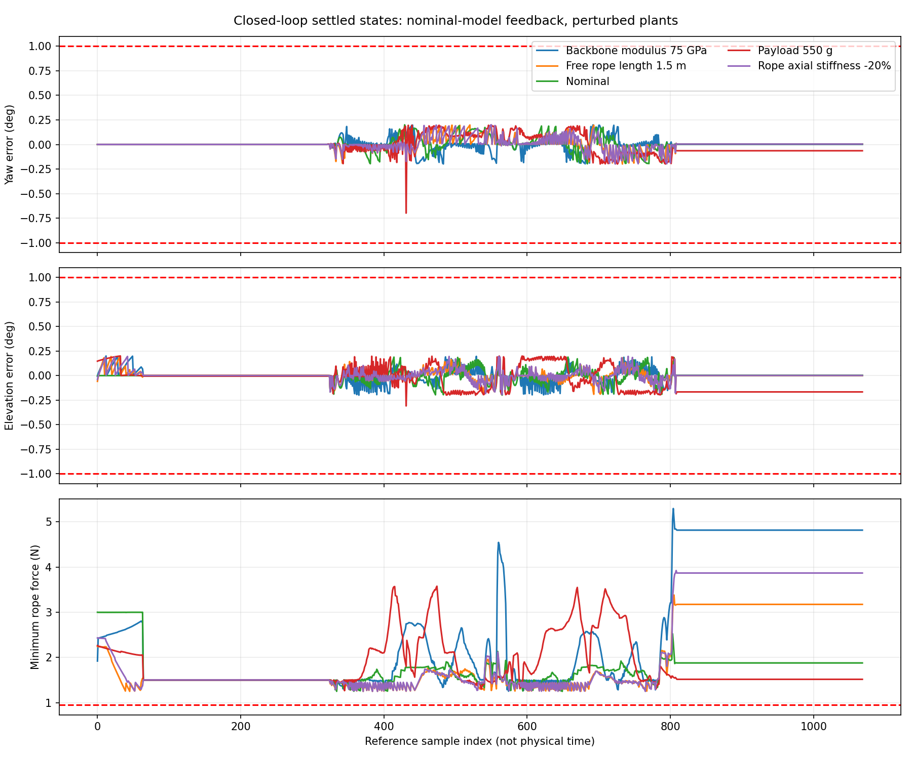

# U4+M2 Closed-Loop Round-Trip Simulation

Output feedback uses ideal simulated measurements of head yaw/elevation and all 12 rope tensions. Controller gains come only from the nominal E40, 500 g, 1 m model; plant perturbations are not supplied to the gain calculation. The plant is a quasi-static equilibrium solver, not a dynamic or hardware model.

## Control structure

Nominal reference lengths + accumulated feedback correction -> elastic rod equilibrium -> head yaw/elevation and 12 tension measurements -> constrained correction -> next length command. The gain schedule is prepared from the nominal reference states. No full-body shape measurement is supplied to the controller.

## Settled-state results

| Case | Open-loop failed samples | Closed-loop failed samples | Max yaw error, open / closed (deg) | Max elevation error, open / closed (deg) | Closed-loop minimum rope force (N) | Closed-loop minimum clearance (mm) |
|---|---:|---:|---:|---:|---:|---:|
| Backbone modulus 75 GPa | 909 | 0 | 6.280 / 0.200 | 7.180 / 0.200 | 1.255 | 19.76 |
| Free rope length 1.5 m | 634 | 0 | 0.879 / 0.199 | 4.830 / 0.196 | 1.250 | 21.64 |
| Nominal | 543 | 0 | 0.239 / 0.200 | 3.930 / 0.199 | 1.250 | 22.04 |
| Payload 550 g | 925 | 0 | 8.965 / 0.699 | 7.679 / 0.309 | 1.267 | 21.93 |
| Rope axial stiffness -20% | 547 | 0 | 0.677 / 0.200 | 4.637 / 0.196 | 1.250 | 21.67 |

The comparison is recomputed on the same 1,069 nominal reference samples for both modes. During straightening the target follows the saved nominal startup elevation; all subsequent phases target 20 degrees. A previous report accepted elevation within 20 +/- 5 degrees; this study checks both yaw and elevation error within 1 degree, so failure counts must not be compared directly across reports.

## Feedback corrections and limitations

Each reference command is followed by up to 16 output-feedback corrections. A nominal implicit-equilibrium sensitivity maps changes in rest length to head angles and tensions. A constrained quadratic step minimizes angular error, with predicted rope forces at least 1.5 N and at most 250 N. Tension feedback enforces bounds; it does not track an independently specified force on every rope. Each correction is bounded to 0.25 mm per rope; accumulated correction relative to feedforward is bounded to 5 mm. The feedback target of 1.5 N is lower than the preceding 3 N feedforward pretension floor; this exploratory controller does not enforce a 3 N operating requirement. These are study settings, not validated actuator ratings.

After an applied correction, if angular error above 0.2 degrees grows by more than 5%, the next correction scale is halved, down to 1/16. The scale is retained across references, while error comparisons restart at each new feedforward command. This damping uses only previously observed errors, not plant parameters or a look-ahead simulation. The QP proposes a full correction toward the 1.5 N predicted floor; damping may approach that floor over several updates.

The initial undamped controller failed near large yaw in the 550 g case. The incomplete diagnostic prefix and original source are retained in [undamped_diagnostic](undamped_diagnostic/README.md). The final controller applies the same output-based damping rule to every case. This is a controller-development study on these cases, not an independent validation set.

The stopping target is 0.2 degrees for both angles and measured tension at least 1.25 N. Every applied correction, including the pre-correction arrival state, is recorded in the feedback trace. Passing the settled state does not mean every intermediate correction passes. Quasi-static correction iterations are not a timing or closed-loop dynamic stability claim.

| Case | Feedback trace samples | Trace samples failing any check | Unstable trace states | Geometry failures | Clearance failures | Max cumulative correction (mm) | Minimum correction scale |
|---|---:|---:|---:|---:|---:|---:|---:|
| Backbone modulus 75 GPa | 872 | 9 | 0 | 0 | 0 | 3.087 | 1.0000 |
| Free rope length 1.5 m | 706 | 7 | 0 | 0 | 0 | 3.325 | 1.0000 |
| Nominal | 640 | 6 | 0 | 0 | 0 | 1.778 | 1.0000 |
| Payload 550 g | 1396 | 69 | 0 | 0 | 0 | 3.163 | 0.2500 |
| Rope axial stiffness -20% | 703 | 5 | 0 | 0 | 0 | 3.389 | 1.0000 |

## Tension during feedback transitions

| Case | Minimum trace tension (N) | Arrival states below 0.95 N | Post-correction states below 0.95 N |
|---|---:|---:|---:|
| Backbone modulus 75 GPa | 0.568 | 3 | 0 |
| Free rope length 1.5 m | 0.914 | 2 | 0 |
| Nominal | 0.931 | 1 | 0 |
| Payload 550 g | 0.839 | 1 | 0 |
| Rope axial stiffness -20% | 0.964 | 0 | 0 |

A settled-state pass does not establish a passing complete control sequence. A feedforward command can reduce pretension before feedback responds. Raising the operating pretension margin and subdividing or guarding the feedforward transitions remain necessary.


Collision and equilibrium-stability checks are diagnostics, not constraints in the feedback quadratic program. Acceptance also requires positive fixed-winch tangent eigenvalue (>1e-7), original geometry and strain diagnostics, rope forces between 0.95 and 250 N, and sampled tank clearance at least 5 mm after subtracting a 1.5 mm allowance. The 63 mm envelope is retained. No actual head CAD, external cables, friction, backlash, hysteresis, sensor noise, latency, motor dynamics or continuous swept-volume proof is included.

The feedback gains use nominal reference shapes, not measured full-body shape. A known free-rope installation-length difference is represented as a command-zero offset, as in the preceding sensitivity study. Its changed elastic response is not passed to the controller gains.

## Next simulation work

1. Resolve any failed correction states and enforce the chosen operating pretension requirement throughout each update, rather than only accepting the final equilibrium.
2. Refine the corrected path and check motion between feedback states; add actuator speed/travel, sampling time, latency, noise and saturation before making transient-performance claims.
3. Include identified friction, backlash and NiTi hysteresis, plus actual head/cable geometry and measured stiffness. Repeat the uncertainty study with these calibrated models.

## Deliverables

- Per-case CSV: paired open/closed outputs, rest-length commands, offsets and all rope forces.
- Per-case JSON and state NPZ: numerical results and full solved centrelines.
- Feedback JSON: every applied correction, including any failed intermediate checks.
- `validation.json`: numerical consistency checks and maximum displacement between settled centreline samples. The corrected path is evaluated on the inherited nominal grid; it is not adaptively resampled to enforce a 5 mm displacement bound.
- `settings.json`: controller settings and reference-data hashes; code hashes are in `validation.json`.
- Full-cycle MP4 and steering GIF show paired settled sampled states. The feedback-convergence GIF re-solves the saved correction commands at a fixed reference sample and checks the replayed angles against the trace. Both show equilibria, not physical transients; playback speed is illustrative.



## Reproduction

```bash
python closed_loop_cycle.py --prepare
python closed_loop_cycle.py --case nominal
python closed_loop_cycle.py --case E75
python closed_loop_cycle.py --case payload550g
python closed_loop_cycle.py --case free1500mm
python closed_loop_cycle.py --case ropeEA80pct
python -m unittest test_closed_loop.py -v
python validate_closed_loop_results.py
python render_closed_loop.py --case E75
python render_closed_loop.py --case payload550g --convergence-only --convergence-index 432
```

## Numerical verification

Five focused unit tests cover sensitivity derivatives, command constraints, the forward solver, observed-error damping and yaw wrapping. Export validation checks all sample counts, residuals, finite states, command reconstruction and every recorded feedback step against the controller equation. Numerical validation passed; it does not establish physical safety.

| Case | Maximum feedback iterations | Samples above the internal 0.2-degree target | Maximum settled node step (mm) |
|---|---:|---:|---:|
| Nominal | 5 | 0 | 5.249 |
| Backbone modulus 75 GPa | 5 | 0 | 5.451 |
| Payload 550 g | 16 | 1 | 6.822 |
| Free rope length 1.5 m | 5 | 0 | 5.089 |
| Rope axial stiffness -20% | 5 | 0 | 5.198 |

One 550 g sample reaches the 16-correction budget with a 0.699-degree yaw error: it meets the 1-degree acceptance criterion but misses the internal 0.2-degree stopping target. Maximum corrected-path node motion is 6.822 mm, exceeding the earlier 5 mm sampling bound. Further subdivision and continuous-motion checks are required.

## 3D animations

- [Backbone modulus 75 GPa: full round trip](E75_full_cycle.mp4)
- [Steering comparison](E75_steering.gif)
- [Feedback correction sequence](E75_feedback_convergence.gif)

- [550 g large-yaw feedback damping](payload550g_feedback_convergence.gif)
