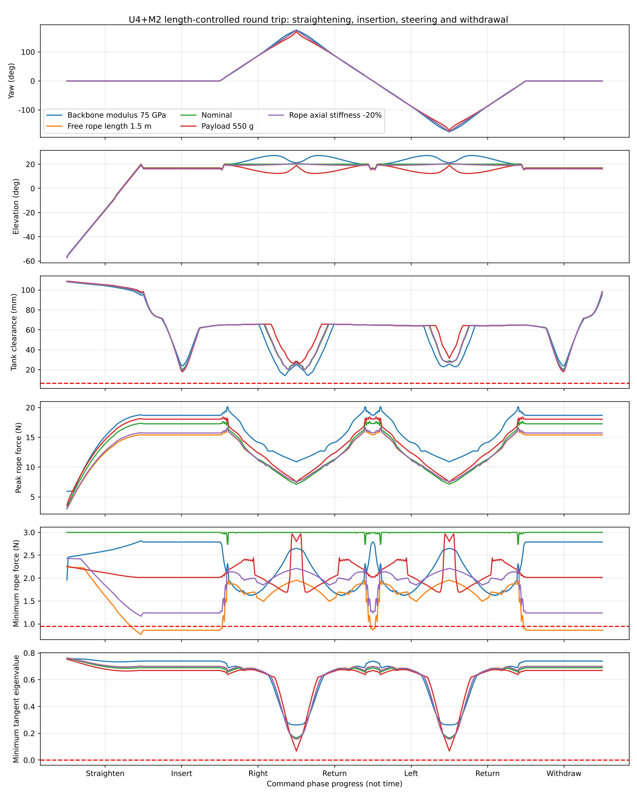
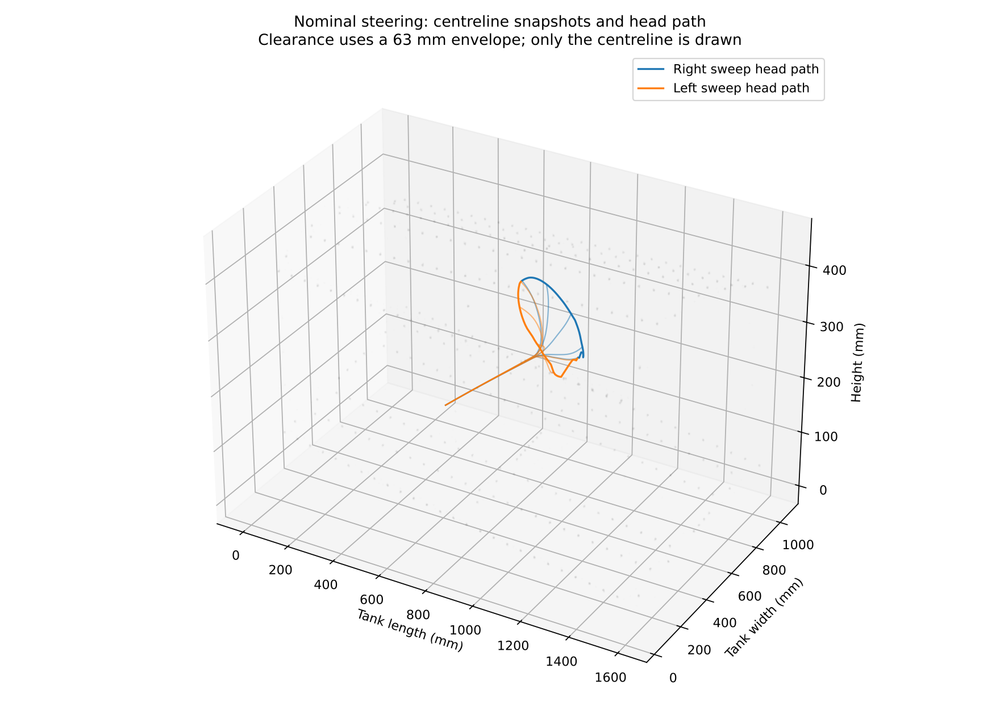

# U4+M2 Length-Controlled Round Trip: 3 N pretension and stable startup

Rest-length commands for 12 ropes are derived from E40, 20-degree, anchor [4,5,6] reference states with a **3 N minimum on every rope** (`minforce_niti18_E40_p20_a456_pre3_exact_smooth1_fromstartup_states.npz`) and a **stable startup** (`startup_niti18_E40_p20_pre3_states.npz`), at eight cells per module. Model parameters: `model_data/MODEL_DATA.md`. Each commanded state is then solved forward from the preceding equilibrium, rather than replaying the stored posture.

## Engineering interpretation

Numerical completion does not establish an executable trajectory. Negative tangent eigenvalues identify equilibria that cannot be treated as stable quasi-static motion.

- Nominal case: 1069 samples; 0 fail at least one check. Failure counts overlap: None.
- Maximum steering/elevation error: 0.239 / 3.930 deg. Peak rope force: 17.65 N.
- Minimum sampled tank clearance: 20.46 mm; 18.96 mm after the 1.5 mm sampling/mesh allowance.
- Outbound sample prefixes passing all checks from zero yaw: Right sweep: 175 deg; Left sweep: 175 deg. These are not continuous safety guarantees or geometric limits.
- Minimum straightening tangent eigenvalue: 0.6853. The startup raises the head from natural sag (all ropes at 3 N) to 20 degrees through held-elevation states.
- Insertion: 0 of 258 samples fail; minimum rope force 3.000 N; minimum stability eigenvalue 0.6893.
- Right sweep: 0 of 122 samples fail; minimum rope force 2.736 N; minimum stability eigenvalue 0.1659.
- Return from right: 0 of 122 samples fail; minimum rope force 2.736 N; minimum stability eigenvalue 0.1667.
- Left sweep: 0 of 122 samples fail; minimum rope force 2.736 N; minimum stability eigenvalue 0.1659.
- Return from left: 0 of 122 samples fail; minimum rope force 2.736 N; minimum stability eigenvalue 0.1667.
- Withdrawal: 0 of 259 samples fail; minimum rope force 3.000 N; minimum stability eigenvalue 0.6893.

- Sensitivities replay the same open-loop commands. Changes in backbone stiffness or payload affect posture; rope stiffness and free length also affect pretension. Good angular tracking alone is insufficient.
- This run implements the pretension margin (3 N floor in the reference poses) and the redesigned startup. Remaining failures in the sensitivity cases are open-loop calibration effects (posture tracking, or rope tension with a longer free rope).

## Results

| Case | Numerical cycle completed | All checks pass | Samples | Minimum tank clearance (mm) | Minimum stability eigenvalue | Peak force (N) | Maximum yaw error (deg) |
|---|---|---|---:|---:|---:|---:|---:|
| Backbone modulus 75 GPa | Yes | No | 1063 | 14.37 | 0.2629 | 20.14 | 6.28 |
| Free rope length 1.5 m | Yes | No | 1070 | 18.73 | 0.1559 | 16.45 | 0.88 |
| Nominal | Yes | Yes | 1069 | 20.46 | 0.1659 | 17.65 | 0.24 |
| Payload 550 g | Yes | No | 1067 | 18.11 | 0.06797 | 18.41 | 8.96 |
| Rope axial stiffness -20% | Yes | Yes | 1071 | 19.16 | 0.1586 | 16.60 | 0.68 |

Completion means stationary solutions were obtained throughout the numerical cycle. Failed samples are retained to locate limitations; their presence does not authorize execution of the commands.

### Backbone modulus 75 GPa

- Samples failing one or more checks: 318.
- Failure counts: Yaw error above 1 deg: 278 samples; Elevation error above 5 deg: 180 samples.
- Head position error after returning to zero yaw at equal clamp depth: 0.0000 mm.
- Outbound passing sample prefixes: Right sweep: 32.5 deg; Left sweep: 32.5 deg; not a continuous safety guarantee.
- First failure locations: see `E75.json` and `comparison.json`.

### Free rope length 1.5 m

- Samples failing one or more checks: 543.
- Failure counts: Pretension below 0.95 N: 543 samples.
- Head position error after returning to zero yaw at equal clamp depth: 0.0000 mm.
- Outbound passing sample prefixes: Right sweep: 0 deg; Left sweep: 0 deg; not a continuous safety guarantee.
- First failure locations: see `free1500mm.json` and `comparison.json`.

### Nominal

- Samples failing one or more checks: 0.
- Failure counts: None.
- Head position error after returning to zero yaw at equal clamp depth: 0.0000 mm.
- Outbound passing sample prefixes: Right sweep: 175 deg; Left sweep: 175 deg; not a continuous safety guarantee.
- First failure locations: see `nominal.json` and `comparison.json`.

### Payload 550 g

- Samples failing one or more checks: 262.
- Failure counts: Elevation error above 5 deg: 208 samples; Yaw error above 1 deg: 230 samples.
- Head position error after returning to zero yaw at equal clamp depth: 0.0000 mm.
- Outbound passing sample prefixes: Right sweep: 78.3333 deg; Left sweep: 78.3333 deg; not a continuous safety guarantee.
- First failure locations: see `payload550g.json` and `comparison.json`.

### Rope axial stiffness -20%

- Samples failing one or more checks: 0.
- Failure counts: None.
- Head position error after returning to zero yaw at equal clamp depth: 0.0000 mm.
- Outbound passing sample prefixes: Right sweep: 175 deg; Left sweep: 175 deg; not a continuous safety guarantee.
- First failure locations: see `ropeEA80pct.json` and `comparison.json`.

## Method and limitations

- Baseline: U4+M2, 20-degree installation, 500 g payload, E40 backbone, 1 m free rope length, database rope EA, eight cells per module.
- Initial condition: clamp at s=-750 mm outside the tank, front in natural sag with every rope at 3 N. Startup follows the held-elevation states of `startup_sweep.py` (head raised in 2.5 degree steps to 20 degrees, all ropes >= 3 N, each state stable at 8 cells).
- Cycle: straighten; insert to s=15 mm while holding posture; right sweep to 175 degrees; return; left sweep to -175 degrees; return; withdraw to s=-750 mm while holding posture.
- Reference poses are spaced by 5 degrees. Rest lengths are linearly interpolated with command increments no greater than 1 mm. Steps exceeding 5 mm displacement at any centreline node are recursively subdivided to depth nine; unresolved excess is a failure. This controls sampled resolution and does not prove continuous safety.
- Rope force: T = EA max(0, L + Lfree - R) / R. Stability uses the same rest lengths, rope stiffness and active-rope set in the elastic energy Hessian.
- Left commands swap the right/left rope channels. Both directions are forward-solved independently; the tank geometry is not mirrored.
- One-factor sensitivities replay identical open-loop commands without reoptimization: E75 backbone; 550 g payload; rope EA scaled by 0.8; free rope length 1.5 m, with a matching 0.5 m command-zero offset. These are assumed scenarios, not measured probability distributions.
- Tank screen: 362 solids, 0.5 mm mesh deflection; centreline distances sampled at about 2 mm spacing, minus a 31.5 mm envelope radius. A further 1.5 mm sampling/mesh allowance is subtracted. Mesh deflection is not a verified global error bound.
- Acceptance: clearance after allowance at least 5 mm; stability eigenvalue above 1e-7; existing self-collision/local-curvature constraints; axial strain at most 5%; each rope between 0.95 and 250 N; yaw error at most 1 degree; elevation within 20 +/- 5 degrees. Elevation/yaw tracking is not required during straightening. The 0.95 N threshold permits numerical tolerance around 1 N. The 250 N and 5% bounds are diagnostics, not hardware ratings.
- Excluded: dynamics, friction, backlash, NiTi hysteresis, actual sensor-head geometry, external cables, the rear telescopic mechanism, contact forces and recovery control. Withdrawal is rigid translation of the clamped front.
- Per-step output includes rest lengths, pull-in relative to baseline, forces for all 12 ropes, head position/orientation, clearance, geometry checks, equilibrium residual and stability. No time scale, motor speed or torque commands are provided.

## Reproduction

```bash
python length_cycle.py --source results/minforce_niti18_E40_p20_a456_pre3_exact_smooth1_fromstartup_states.npz --startup results/startup_niti18_E40_p20_pre3_states.npz --out length_cycle_results_pre3
python summarize_cycle_run.py length_cycle_results_pre3 --source results/minforce_niti18_E40_p20_a456_pre3_exact_smooth1_fromstartup_states.npz --startup results/startup_niti18_E40_p20_pre3_states.npz --pretension 3
python -m unittest test_length_cycle.py -v
```

Dependencies: NumPy, SciPy, Numba, Matplotlib, cadquery-ocp, VTK, trimesh and rtree. The original STEP model and reference states are supplied by the repository.

## Figures




