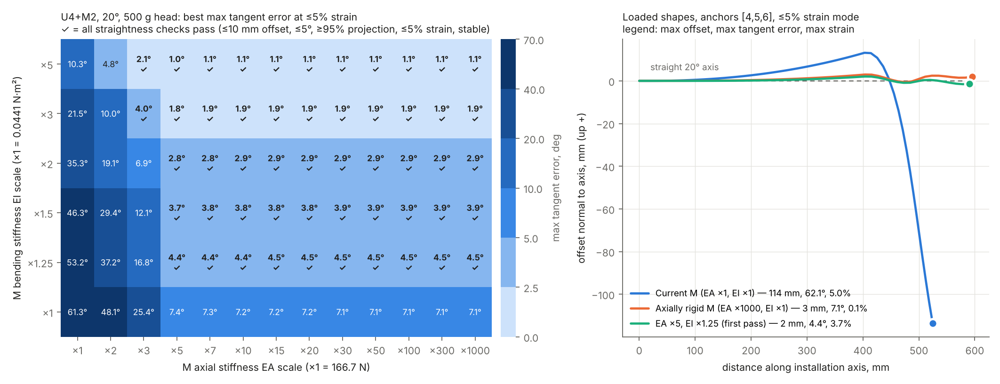

# M module stiffness requirement sweep / M模組剛度需求掃描

2026-11-08 · U4+M2 · 20° · 500 g head · 63 mm · 24 mm tendon radius

Follow-up to priority 1 in [Report — 6 November 2026](../../../reports/daily/Report_2026_11_06.pdf) ("M axial load transfer"). The question: how much stiffer must the M module be before an actively straightened U4+M2 front exists within the 5% axial strain diagnostic?

## Method

- Reuses the 2026-11-06 planar kernel and `DatabaseRod` from `../stiffness_63mm_20261106/run_study.py` without modifying them. Only the M module's axial stiffness EA and bending stiffness EI are multiplied by scale factors. U properties, M mass, geometry, the head, tendon routing, the 0–250 N bounds and the optimizer settings are unchanged.
- Grid: EA ×{1, 2, 3, 5, 7, 10, 15, 20, 30, 50, 100, 300, 1000} × EI ×{1, 1.25, 1.5, 2, 3, 5}. Anchor layouts are single [6], two [4,6], three [2,4,6] and three_distal [4,5,6]. Each case is optimized in two modes: shape_only (strain up to 30%) and low_strain (coarse strain bound 4.85%). Seeds are sag, moment compensation, and continuation from the previous EA scale.
- Optimization runs at 4 cells per module, and the selected solutions are re-solved at 8 cells. Seven threshold cases are re-checked at 16 cells (`verify_16cell.py`).
- Pass criterion: the same straightness checks as 2026-11-06. Maximum offset ≤ 10 mm, maximum tangent error ≤ 5°, axial projection ≥ 95%, strain ≤ 5%, and stable with 1 m of extra rope.
- Reproduction check: the EA ×1, EI ×1 case reproduces the 2026-11-06 low-strain result of 94.68 mm at 8 cells, against 94.77 mm at 16 cells in the report.

## Results

1. **Increasing EA alone does not pass.** With EA ×5 or more, the offset drops to about 3 mm and the strain to below 4%. The maximum tangent error, however, levels off at about 7.1°, even at EA ×1000.
2. **The 7° floor comes from M bending stiffness (EI).** Between anchor disks, the head weight produces a bending moment that changes linearly along each M module, while the tendons can only apply a constant moment over that span. A hand estimate of the residual rotation, ΔM·L/(8·EI) = 0.44 × 0.096 / (8 × 0.044) ≈ 0.12 rad ≈ 6.9°, matches the solver.
3. **Minimum passing combination: EA ×5 (about 830 N) and EI ×1.25 (about 0.055 N·m²), anchors [4,5,6].** At 16 cells this gives a 2.07 mm offset, 4.29° tangent error and 3.73% strain, and the case is stable. The per-rope top tensions are 94.7, 20.8 and 8.4 N. At EA ×3 (500 N), a pass needs EI ×3 or more.
4. Anchors [4,5,6], with one set anchored inside M, give the best result in every passing case.
5. Every 8-cell pass and fail classification was unchanged at 16 cells, with a maximum tangent-error change of 0.09°.

| EI scale | First passing EA scale | Offset mm | Tangent error ° | Strain | Top tensions N |
|---:|---:|---:|---:|---:|---|
| ×1 | none (max ×1000) | 2.96 | 7.12 | 0.11% | — |
| ×1.25 | ×5 (833 N) | 2.04 | 4.38 | 3.73% | 94.7, 20.8, 8.4 |
| ×1.5 | ×5 | 1.58 | 3.75 | 3.74% | 88.8, 20.8, 8.4 |
| ×2 | ×5 | 1.01 | 2.80 | 3.74% | 81.6, 20.9, 8.4 |
| ×3 | ×3 (500 N) | 8.65 | 3.98 | 4.86% | 177.6, 6.8, 15.5 |
| ×5 | ×3 | 4.62 | 2.11 | 4.86% | 129.6, 7.6, 14.8 |

The table shows 8-cell values. 16-cell values are in `results/verify_16cell.json`.

## Engineering interpretation: central NiTi backbone in M

The requirement is approximately EA ≥ 830 N and EI of about 0.055–0.09 N·m². A central NiTi rod in parallel with the PA12 M skeleton can meet both. Estimates for E = 40 GPa (martensite) to 75 GPa (austenite) are below. They are not measured values.

| Rod diameter | Added EA N | Added EI N·m² | M EI scale | Max guide spacing* | Bending strain at 180°/192 mm |
|---:|---:|---:|---:|---:|---:|
| 1.5 mm | 71k–133k | 0.010–0.019 | ×1.23–1.42 | 20–27 mm | 1.2% |
| 1.8 mm | 102k–191k | 0.021–0.039 | ×1.47–1.88 | 29–39 mm | 1.5% |
| 2.0 mm | 126k–236k | 0.031–0.059 | ×1.71–2.34 | 35–48 mm | 1.6% |

\* Euler pinned–pinned buckling length that carries 2 × 124 N, where 124 N is the sum of the passing tensions.

- **A 1.8 mm rod is the suggested starting point.** It gives about 600 times the required EA, and its EI scale of ×1.47–1.88 passes with margin. A 1.5 mm rod is marginal in the martensite phase.
- **Steering cost.** A stiffer M needs more tendon tension to bend. A rough estimate for a 180° turn over the M section is EI·κ/r ≈ 0.065 × 16.4 / 0.024 ≈ 44 N of extra tension. The spatial steering study must be re-run with the revised M.
- **The rod needs lateral support.** Rod guides inside the M module must be spaced no more than about 30 mm apart, and both rod ends must carry axial load into the anchor disks.

## Limitations

This study keeps the scope of 2026-11-06:

- planar model with constant linear EA/EI;
- no friction, contact, NiTi phase transformation, fatigue or printed-part buckling;
- local optimization only, not a proof of global optimality;
- 20° pitch only;
- rod superposition assumes the rod is central and bends with the module.

The added rod mass (1.8 mm: about 3.2 g per 192 mm at 6.45 g/cm³, small next to the 48 g of M modules) is **not included**.

## Next steps

1. Re-run this sweep with the added backbone mass, at 15° and 25°, and for U6+M3.
2. Re-run the spatial steering and held-elevation (20 ± 5°) search (`../steering_63mm_20261106`) with M at EA ×≥5 and EI ×1.5–2.
3. Build and test an M module with a 1.8 mm NiTi backbone: tension/compression, EI, and buckling at the chosen guide spacing.

## Files

- `run_sweep.py`: the sweep (`python run_sweep.py`, about 2 minutes).
- `verify_16cell.py`: 16-cell re-check of the threshold cases.
- `plot_sweep.py`: the figure.
- `results/sweep_rows.json` and `.csv`, `sweep_states.npz`, `optimizer_attempts.csv`, `verify_16cell.json`, `sweep_log.txt`.

## 中文摘要

- 只提高M的EA不足以拉直：EA×5以上偏差約3 mm、應變<4%，但最大切線誤差停在約7.1°（即使EA×1000）。原因是錨點之間頭部重力彎矩沿M模組線性變化，拉索只能提供定值力矩，殘餘轉角約ΔM·L/(8EI)≈6.9°，由M的EI決定。
- 最小通過組合：**EA×5（約830 N）+ EI×1.25（約0.055 N·m²），錨點[4,5,6]**。16單元/節結果：偏差2.07 mm、切線4.29°、應變3.73%、穩定。
- 建議M內加中心NiTi棒，起點直徑1.8 mm。導向間距≤約30 mm以防屈曲。轉向所需張力會增加，須重跑空間轉向研究。棒質量尚未計入。
- 仍為平面線性彈性診斷，非硬體額定值。
