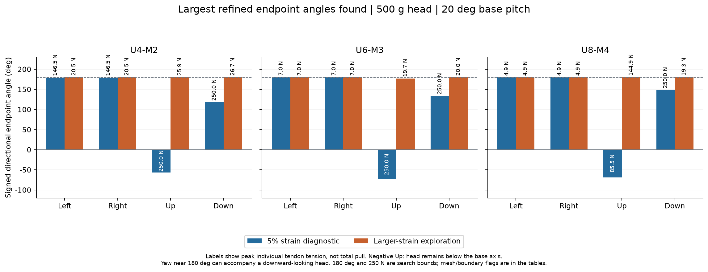
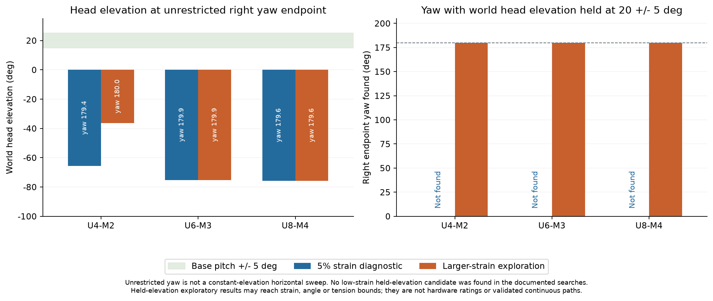
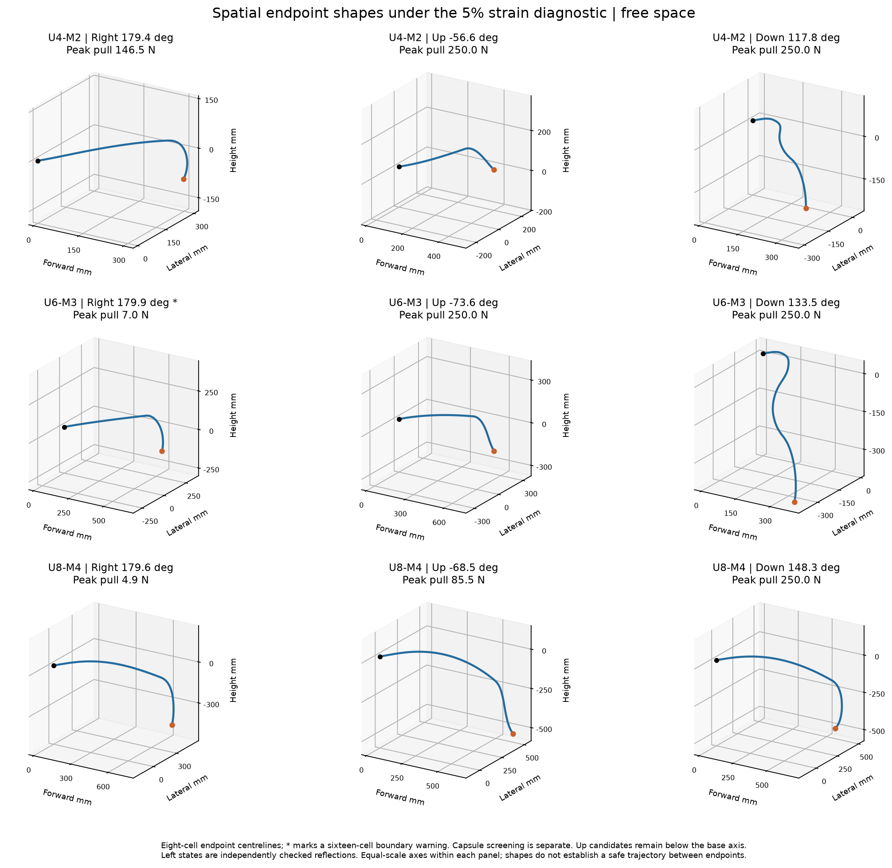
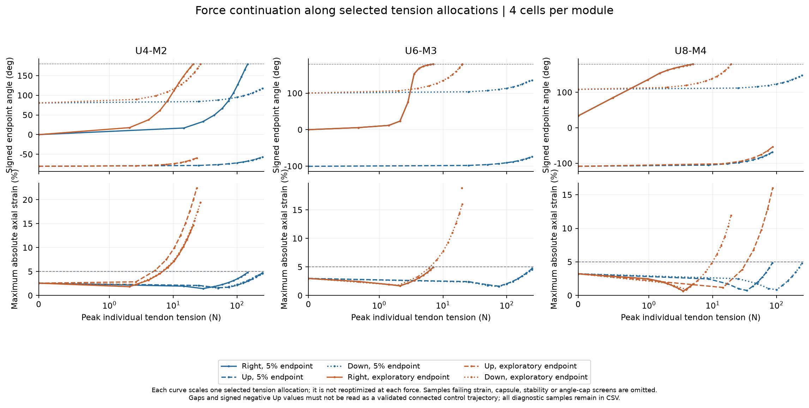

# 水平及垂直轉向角與拉索張力 / Spatial steering angles and tendon tensions

2026-11-06 · 63 mm外徑 / diameter · 24 mm導孔半徑 / guide radius · 500 g頭部 / head

## 中文

### 先看結論

本研究完成U4+M2、U6+M3、U8+M4的自由空間帶載三維轉向搜尋，主算基部仰角20°。下表是有明確數值界限的「最大已找到端點」，不是材料、繩索或馬達的物理額定極限。

**水平方位角與可用的水平姿態必須一起看。** 例如U4+M2低應變診斷候選的左右方位角約179.42°，但頭部世界仰角為-65.67°，即明顯朝下。這不表示前端已能在水平或基部方向完成約360°掃描，也沒有驗證端點之間的連續路徑。

三組配置在本輪5%應變診斷搜尋中，都未找到頭部世界仰角維持20±5°的水平轉向候選。上轉搜尋的最佳低應變姿態也仍低於基部軸線。以U4+M2為例，上拉後相對基部角度為-56.59°，向下端點為-117.77°；最大單繩張力分別為250.00與250.00 N。這些端點之間的角度差不等於已驗證可連續掃過的範圍。

### 角度及張力定義

- 世界X為基部朝前的水平方向，Y向上，Z向右；基部在X-Y平面仰起20°。
- 水平方位角：末端切線在世界X-Z平面的有號投影角。左、右分開記錄，表內方向角以對應方向為正。
- 垂直轉角：末端切線在世界X-Y平面的有號投影角減去基部20°，沿桿的框架序列展開。正值代表從基部方向上轉，負值代表下轉；這與世界仰角不是同一個量。
- 世界仰角：末端切線相對水平面的仰角，範圍±90°。同時輸出真正三維軸線夾角、材料總扭轉及頭部位置。投影模長低於0.1的近奇異姿態不作主方向候選。
- 自然下垂只作各配置的參照。`upward_recovery_from_natural_deg`表示相對帶500 g自然下垂姿態抬高了多少。
- 每組拉索依序為 **[上, 右, 下, 左]**；每一項都是N。`maximum_single_tendon_n`是最大單繩張力，`sum_tensions_n`才是全部張力總和。

### 輸入與模型

資料直接來自唯讀`module_stiffness.sqlite3`，輸入快照為`module_stiffness_input.sqlite3`。U為PA12+NiTi，96 mm、37.990 g、EA=128122 N、垂直EI=22.2052 N·m²、水平EI=1.67184 N·m²；M為PA12，96 mm、23.948 g、EA=166.694 N、各方向EI=0.0441178 N·m²。63 mm沒有再次觸發剛度或質量縮放。三組柔性長度為576/864/1152 mm，加20 mm無質量接口後為596/884/1172 mm。

資料庫的扭轉欄位為整節`T/θ`，U=4.70037、M=0.437396 N·m/rad。轉成連續桿係數時乘上0.096 m，並在細分時保持整節扭轉能量一致。U剛度已包含NiTi效果，沒有額外再加金屬棒。資料未提供正反向不同的剛度，因此各主彎曲方向暫採對稱線性係數。

頭部為500 g集中質量，沒有偏心力矩；模組本身及實際繞行長度的繩質量已計入。各組四條2 mm拉索，沿用先前PA6實心代理EA與密度、無摩擦。每條繩從基部經真實模組端盤到自己的錨點，遠端繩索仍壓縮近端。新增錨定硬體、外皮、線路及真實接頭質量未量測。

| 配置 | 單組 | 兩組 | 三組U分段 | 三組M分段 |
|---|---|---|---|---|
| U4+M2 | [6] | [4,6] | [2,4,6] | [4,5,6] |
| U6+M3 | [9] | [6,9] | [3,6,9] | [6,7,9] |
| U8+M4 | [12] | [8,12] | [4,8,12] | [8,10,12] |

採可軸向伸縮、有限旋轉Kirchhoff桿，包含兩個材料彎曲方向及獨立扭轉。所有繩張力與重力同時作用；最大角不靠鎖住另一平面的自由度取得。左轉由精確對稱模型的右轉狀態鏡像，並重新檢查力平衡、幾何及穩定性；真實列印誤差和摩擦不一定對稱。

### 5%應變診斷結果

| 配置 | 方向 | 角度 deg | 最大單繩 N | 最大應變 % | 世界仰角 deg | 16網格檢查 |
|---|---|---|---|---|---|---|
| U4-M2 | Right | 179.42 | 146.48 | 4.83 | -65.67 | 通過 |
| U4-M2 | Left | 179.42 | 146.48 | 4.83 | -65.67 | 通過 |
| U4-M2 | Up | 未達上轉；最佳 -56.59 | 250.00 | 4.86 | -36.59 | 通過 |
| U4-M2 | Down | 117.77 | 250.00 | 4.49 | -77.91 | 通過 |
| U6-M3 | Right | 179.94 | 7.04 | 5.00 | -75.24 | 邊界/未確認 |
| U6-M3 | Left | 179.94 | 7.04 | 5.00 | -75.24 | 邊界/未確認 |
| U6-M3 | Up | 未達上轉；最佳 -73.55 | 250.00 | 4.84 | -53.55 | 通過 |
| U6-M3 | Down | 133.52 | 250.00 | 4.38 | -60.15 | 通過 |
| U8-M4 | Right | 179.64 | 4.90 | 1.80 | -75.76 | 通過 |
| U8-M4 | Left | 179.64 | 4.90 | 1.80 | -75.76 | 通過 |
| U8-M4 | Up | 未達上轉；最佳 -68.54 | 85.54 | 4.84 | -48.54 | 通過 |
| U8-M4 | Down | 148.33 | 250.00 | 4.82 | -50.23 | 通過 |


「未達上轉」表示最高合格頭部方向仍低於基部軸線，並非0°。該列張力對應最佳抬升候選。左右鏡像的最大張力相同，但左右繩分量互換。U6+M3左右候選在16單元/節的應變為5.0015%，嚴格超過5%；因此179.94°不能當作已通過細網格低應變診斷的最大角。接近邊界的值不能只看四捨五入。



### 大應變探索結果

| 配置 | 方向 | 角度 deg | 最大單繩 N | 最大應變 % | 世界仰角 deg | 16網格檢查 |
|---|---|---|---|---|---|---|
| U4-M2 | Right | 180.00 * | 20.50 | 14.79 | -36.44 | 邊界/未確認 |
| U4-M2 | Left | 180.00 * | 20.50 | 14.79 | -36.44 | 邊界/未確認 |
| U4-M2 | Up | 180.00 * | 25.91 | 30.00 | -19.86 | 邊界/未確認 |
| U4-M2 | Down | 180.00 * | 26.67 | 19.85 | -19.83 | 邊界/未確認 |
| U6-M3 | Right | 179.94 | 7.04 | 5.00 | -75.24 | 通過 |
| U6-M3 | Left | 179.94 | 7.04 | 5.00 | -75.24 | 通過 |
| U6-M3 | Up | 177.09 | 19.73 | 18.96 | -17.03 | 通過 |
| U6-M3 | Down | 180.00 * | 19.99 | 16.02 | -19.79 | 邊界/未確認 |
| U8-M4 | Right | 179.64 | 4.90 | 1.80 | -75.76 | 通過 |
| U8-M4 | Left | 179.64 | 4.90 | 1.80 | -75.76 | 通過 |
| U8-M4 | Up | 180.00 * | 144.86 | 30.00 | -19.29 | 邊界/未確認 |
| U8-M4 | Down | 180.00 * | 19.30 | 11.97 | -16.55 | 邊界/未確認 |


星號表示達到180°方向角搜尋上界，不代表找到了真正機械極限。上/下180°代表投影框架轉到反向附近，不是頭部世界仰角180°。部分16單元/節核對會跨出角度、應變、幾何或姿態限制，因此表中邊界案例只能作探索，不作已收斂的最大能力。

### 保持頭部仰角的水平轉向補查

另外要求頭部世界仰角落在20±5°；此條件與不限制俯仰的方位角搜尋分開報告。低應變候選未找到，大應變候選仍受數值邊界與細網格敏感性限制。

| Configuration | Mode | Yaw deg | Peak tendon N | Max strain % |
|---|---|---:|---:|---:|
| U4-M2 | low_strain | Not found | — | — |
| U4-M2 | exploratory | 180.00 * | 24.08 | 29.08 |
| U6-M3 | low_strain | Not found | — | — |
| U6-M3 | exploratory | 180.00 * | 69.70 | 29.93 |
| U8-M4 | low_strain | Not found | — | — |
| U8-M4 | exploratory | 180.00 * | 40.86 | 29.06 |



### 對應完整拉索張力

下面各括號對應一組錨點，順序與錨點列表一致，括號內為[上,右,下,左] N。表中顯示到0.01 N，原始精度保存在JSON及CSV。左轉的數據在`tendon_tensions.csv`完整列出；它與右轉的右/左分量互換。這些是找到該端點的一組張力解，不宣稱是最小張力解。

| 配置 | 類別 | 方向 | 錨點節號 | 各組張力 [上,右,下,左] N |
|---|---|---|---|---|
| U4-M2 | low_strain | Right | [2, 4, 6] | [9.69, 47.04, 10.81, 0.16] ; [11.37, 146.48, 22.08, 0.49] ; [0.00, 10.86, 0.00, 0.00] |
| U4-M2 | exploratory | Right | [6] | [0.13, 20.50, 5.88, 0.25] |
| U4-M2 | low_strain | Up | [2, 4, 6] | [250.00, 250.00, 0.00, 250.00] ; [250.00, 250.00, 0.00, 250.00] ; [7.02, 0.00, 0.00, 0.00] |
| U4-M2 | exploratory | Up | [4, 5, 6] | [4.60, 0.45, 2.23, 25.91] ; [0.02, 0.01, 16.77, 0.00] ; [21.33, 1.55, 6.10, 0.02] |
| U4-M2 | low_strain | Down | [2, 4, 6] | [0.00, 0.00, 250.00, 250.00] ; [0.00, 250.00, 250.00, 89.55] ; [0.00, 0.00, 9.99, 0.00] |
| U4-M2 | exploratory | Down | [4, 5, 6] | [0.08, 4.93, 0.44, 0.00] ; [0.31, 2.70, 3.52, 0.77] ; [0.89, 1.17, 26.67, 0.14] |
| U4-M2 | exploratory | Right at held elevation | [6] | [24.08, 0.02, 20.17, 0.02] |
| U6-M3 | low_strain | Right | [9] | [0.00, 2.02, 7.04, 0.00] |
| U6-M3 | exploratory | Right | [9] | [0.00, 2.02, 7.04, 0.00] |
| U6-M3 | low_strain | Up | [6, 7, 9] | [0.00, 250.00, 250.00, 250.00] ; [0.00, 0.00, 0.00, 0.00] ; [9.11, 0.00, 0.00, 0.00] |
| U6-M3 | exploratory | Up | [9] | [0.01, 6.76, 4.11, 19.73] |
| U6-M3 | low_strain | Down | [3, 6, 9] | [0.00, 0.00, 250.00, 250.00] ; [0.00, 250.00, 250.00, 67.61] ; [0.00, 0.00, 10.74, 0.00] |
| U6-M3 | exploratory | Down | [9] | [1.75, 6.48, 19.99, 0.75] |
| U6-M3 | exploratory | Right at held elevation | [6, 9] | [4.13, 69.70, 55.50, 15.22] ; [17.72, 8.27, 4.83, 19.74] |
| U8-M4 | low_strain | Right | [4, 8, 12] | [0.01, 0.00, 0.00, 0.00] ; [0.13, 0.21, 0.00, 0.00] ; [1.26, 4.90, 0.01, 0.01] |
| U8-M4 | exploratory | Right | [4, 8, 12] | [0.01, 0.00, 0.00, 0.00] ; [0.13, 0.21, 0.00, 0.00] ; [1.26, 4.90, 0.01, 0.01] |
| U8-M4 | low_strain | Up | [8, 10, 12] | [85.54, 58.78, 0.00, 0.00] ; [0.00, 0.00, 0.00, 0.63] ; [0.00, 0.00, 0.00, 12.21] |
| U8-M4 | exploratory | Up | [8, 10, 12] | [0.07, 144.86, 12.37, 2.97] ; [0.74, 16.67, 2.25, 0.05] ; [0.03, 0.01, 7.20, 26.53] |
| U8-M4 | low_strain | Down | [8, 10, 12] | [0.00, 9.56, 250.00, 0.00] ; [0.00, 0.00, 0.00, 0.00] ; [0.00, 12.31, 0.00, 0.00] |
| U8-M4 | exploratory | Down | [12] | [0.07, 19.30, 3.67, 0.20] |
| U8-M4 | exploratory | Right at held elevation | [8, 10, 12] | [0.00, 0.03, 40.86, 27.93] ; [0.01, 0.01, 18.31, 2.68] ; [27.98, 0.26, 0.00, 0.04] |




### 搜尋、加密及限制

初始搜尋用2單元/節，包含帶載下垂、小張力、上一輪主動拉直及非平面起始分支。使用平衡等式、非負張力和幾何不等式作局部優化。每根繩的數值範圍0–250 N；低應變粗網格限制±4.75%以預留加密餘量，大應變為−30%至+15%。這些是數值域，不是任何部件的強度或額定值。每格旋轉分量亦有數值界限，另以rκ≤0.98作局部曲率餘量。非局部63 mm膠囊檢查只比較材料弧長相隔至少126 mm的段，未驗證詳細模組接觸或材料壓屈。

最大候選加密到4及8單元/節；必要時重新局部優化或沿控制向量縮放恢復可行邊界。每個最終候選再做同張力16單元/節核對。局部穩定以固定捲筒、彈性繩並額外1 m自由繩長的切線Hessian檢查；另保留恆張力Hessian結果。這是局部診斷，不是動態閉迴路控制或實物穩定性證明。

本輪共310次初始/補充局部優化，16網格核對21個候選，最大角度變化1.790°。詳細收斂、回復方法及邊界分類在`mesh_checks.csv`和各配置的`refinement_checks.json`。

15°及25°只對20°選定張力重新求平衡，數據見`pitch_sensitivity.csv`；沒有把它稱作重新優化後的最大角。若姿態或應變條件改變，該點會標為不通過。

力—角度—應變曲線以4單元/節、按比例縮放一組選定張力向量求平衡，並非把不同錨定的最優點直接連線。曲線中間點可能跨過應變、自包絡或穩定篩選，不能當作已驗證連續控制路徑。



尚未驗證NiTi轉變、本構非線性、列印材料局部失效、接頭間隙、拉索摩擦、馬達/繩索強度、動態或油箱三維碰撞。尤其不能把250 N數值上限當成可施加的硬體張力。當前優先問題仍是M段的軸向承載及帶載頭部抬升，而非只追求較大的投影角。

## English

### Findings and interpretation

This is a bounded free-space spatial steering study of U4+M2, U6+M3 and U8+M4 carrying a 500 g point head at 20 degrees base pitch. Results are the largest refined endpoints found in documented local searches, not physical material or actuator ratings.

Unrestricted yaw must be read with head elevation. For U4+M2, the low-strain right/left yaw is 179.42 degrees, while world head elevation is -65.67 degrees. A downward-looking head can have large azimuth changes with much smaller true axis changes. This does not establish a constant-elevation or continuous 360 degree inspection sweep.

No tested configuration produced a low-strain candidate with world head elevation held at 20 +/- 5 degrees. The highest low-strain upward candidates remain below the base axis. For U4+M2 the signed upward candidate is -56.59 degrees relative to the base, and the downward endpoint is -117.77 degrees; peak tendon tensions are 250.00 and 250.00 N. The difference between endpoint angles is not a proven connected controllable range.

### Definitions and inputs

World X points horizontally forward, Y upward and Z right. The base is pitched 20 degrees in X-Y. Yaw is the signed endpoint tangent projection in world X-Z. Vertical turning is the unwrapped tangent projection in world X-Y minus base pitch. World elevation is separately measured against the horizontal plane and lies between +/-90 degrees. True 3D axis angle, material twist and head position are also saved. Projection norms below 0.1 are rejected as near singular. Negative signed Up means the head still points below the base; it is not a zero-degree upward maximum.

Every set is ordered **[up, right, down, left]**, in N. Peak individual tendon force and sum of all tendon forces are distinct columns. Natural loaded sag is a reference, not a required insertion or steering shape. Vertical recovery from natural sag is recorded separately.

The read-only source database supplies 96 mm modules. U is PA12+NiTi, 37.990 g, EA 128122 N, vertical EI 22.2052 N m² and horizontal EI 1.67184 N m². M is PA12, 23.948 g, EA 166.694 N and EI 0.0441178 N m² in all directions. Diameter is 63 mm and tendon radius 24 mm; no stiffness or mass scaling is applied. Flexible lengths are 576, 864 and 1152 mm, or 596, 884 and 1172 mm including a massless 20 mm interface. Both U and M length and weight change across configurations.

Whole-module torsion coefficients are U 4.70037 and M 0.437396 N m/rad. They are multiplied by 0.096 m to form the rod coefficient, preserving module twist energy under subdivision. No additional metal backbone is added. Positive/negative bending is assumed symmetric because asymmetric data were not supplied. EA/EI remain constant; NiTi transformation and local component failure are not modeled.

Four 2 mm tendons per anchor set use the prior solid PA6 proxy properties with no friction. Every tendon runs from the base through actual module disk guides to its anchor, so distal tendons still compress proximal modules. Routed rope mass and supplied module mass are included; new anchors, sheaths, wiring, head eccentricity and actual joint mass are unmeasured.

Layouts are head-only [N], two sets [U,N], three sets [U/2,U,N], and three sets [U,U+floor(M/2),N]. Left results are independently checked reflections of right states under the exact symmetric model, not additional independent optimization searches. Real manufacturing and friction may break this symmetry.

### Low-strain diagnostic endpoints

| Configuration | Direction | Angle deg | Peak tendon N | Max strain % | World elevation deg | 16 cell check |
|---|---|---|---|---|---|---|
| U4-M2 | Right | 179.42 | 146.48 | 4.83 | -65.67 | Pass |
| U4-M2 | Left | 179.42 | 146.48 | 4.83 | -65.67 | Pass |
| U4-M2 | Up | Not above base; best -56.59 | 250.00 | 4.86 | -36.59 | Pass |
| U4-M2 | Down | 117.77 | 250.00 | 4.49 | -77.91 | Pass |
| U6-M3 | Right | 179.94 | 7.04 | 5.00 | -75.24 | Boundary or unconfirmed |
| U6-M3 | Left | 179.94 | 7.04 | 5.00 | -75.24 | Boundary or unconfirmed |
| U6-M3 | Up | Not above base; best -73.55 | 250.00 | 4.84 | -53.55 | Pass |
| U6-M3 | Down | 133.52 | 250.00 | 4.38 | -60.15 | Pass |
| U8-M4 | Right | 179.64 | 4.90 | 1.80 | -75.76 | Pass |
| U8-M4 | Left | 179.64 | 4.90 | 1.80 | -75.76 | Pass |
| U8-M4 | Up | Not above base; best -68.54 | 85.54 | 4.84 | -48.54 | Pass |
| U8-M4 | Down | 148.33 | 250.00 | 4.82 | -50.23 | Pass |


The 5% value is a comparison diagnostic, not a measured allowable strain. The Up force belongs to the best recovery candidate when no positive upward angle is found. U6+M3 yaw reaches 5.0015% strain at sixteen cells per module, strictly above 5%; its 179.94 degree candidate is not a confirmed fine-mesh low-strain maximum. Boundary values must not be rounded into acceptance.

### Larger-strain exploratory endpoints

| Configuration | Direction | Angle deg | Peak tendon N | Max strain % | World elevation deg | 16 cell check |
|---|---|---|---|---|---|---|
| U4-M2 | Right | 180.00 * | 20.50 | 14.79 | -36.44 | Boundary or unconfirmed |
| U4-M2 | Left | 180.00 * | 20.50 | 14.79 | -36.44 | Boundary or unconfirmed |
| U4-M2 | Up | 180.00 * | 25.91 | 30.00 | -19.86 | Boundary or unconfirmed |
| U4-M2 | Down | 180.00 * | 26.67 | 19.85 | -19.83 | Boundary or unconfirmed |
| U6-M3 | Right | 179.94 | 7.04 | 5.00 | -75.24 | Pass |
| U6-M3 | Left | 179.94 | 7.04 | 5.00 | -75.24 | Pass |
| U6-M3 | Up | 177.09 | 19.73 | 18.96 | -17.03 | Pass |
| U6-M3 | Down | 180.00 * | 19.99 | 16.02 | -19.79 | Boundary or unconfirmed |
| U8-M4 | Right | 179.64 | 4.90 | 1.80 | -75.76 | Pass |
| U8-M4 | Left | 179.64 | 4.90 | 1.80 | -75.76 | Pass |
| U8-M4 | Up | 180.00 * | 144.86 | 30.00 | -19.29 | Boundary or unconfirmed |
| U8-M4 | Down | 180.00 * | 19.30 | 11.97 | -16.55 | Boundary or unconfirmed |


An asterisk denotes the 180 degree orientation search cap. It is not a demonstrated mechanical limit. Up/down 180 degree projected turning does not mean 180 degree world elevation. Some same-tension 16-cell checks cross an angular, strain, geometry or posture boundary; those points remain exploratory rather than converged maxima.

### Horizontal inspection-attitude diagnostic

The following additional search holds world head elevation at 20 +/- 5 degrees. It is separate from unrestricted yaw of a sagged tip. No low-strain candidate was found in the documented searches.

| Configuration | Mode | Yaw deg | Peak tendon N | Max strain % |
|---|---|---:|---:|---:|
| U4-M2 | low_strain | Not found | — | — |
| U4-M2 | exploratory | 180.00 * | 24.08 | 29.08 |
| U6-M3 | low_strain | Not found | — | — |
| U6-M3 | exploratory | 180.00 * | 69.70 | 29.93 |
| U8-M4 | low_strain | Not found | — | — |
| U8-M4 | exploratory | 180.00 * | 40.86 | 29.06 |

### Full tendon forces

Each bracket corresponds to one listed anchor, ordered [up,right,down,left] N. Printed values are rounded to 0.01 N. Exact arrays and complete left-force records are in `tendon_tensions.csv` and `maximum_steering.json`; left swaps the right/left entries. These are force allocations found for the endpoint, not certified minimum-force solutions.

| Configuration | Mode | Direction | Anchors | Tensions per set [up right down left] N |
|---|---|---|---|---|
| U4-M2 | low_strain | Right | [2, 4, 6] | [9.69, 47.04, 10.81, 0.16] ; [11.37, 146.48, 22.08, 0.49] ; [0.00, 10.86, 0.00, 0.00] |
| U4-M2 | exploratory | Right | [6] | [0.13, 20.50, 5.88, 0.25] |
| U4-M2 | low_strain | Up | [2, 4, 6] | [250.00, 250.00, 0.00, 250.00] ; [250.00, 250.00, 0.00, 250.00] ; [7.02, 0.00, 0.00, 0.00] |
| U4-M2 | exploratory | Up | [4, 5, 6] | [4.60, 0.45, 2.23, 25.91] ; [0.02, 0.01, 16.77, 0.00] ; [21.33, 1.55, 6.10, 0.02] |
| U4-M2 | low_strain | Down | [2, 4, 6] | [0.00, 0.00, 250.00, 250.00] ; [0.00, 250.00, 250.00, 89.55] ; [0.00, 0.00, 9.99, 0.00] |
| U4-M2 | exploratory | Down | [4, 5, 6] | [0.08, 4.93, 0.44, 0.00] ; [0.31, 2.70, 3.52, 0.77] ; [0.89, 1.17, 26.67, 0.14] |
| U4-M2 | exploratory | Right at held elevation | [6] | [24.08, 0.02, 20.17, 0.02] |
| U6-M3 | low_strain | Right | [9] | [0.00, 2.02, 7.04, 0.00] |
| U6-M3 | exploratory | Right | [9] | [0.00, 2.02, 7.04, 0.00] |
| U6-M3 | low_strain | Up | [6, 7, 9] | [0.00, 250.00, 250.00, 250.00] ; [0.00, 0.00, 0.00, 0.00] ; [9.11, 0.00, 0.00, 0.00] |
| U6-M3 | exploratory | Up | [9] | [0.01, 6.76, 4.11, 19.73] |
| U6-M3 | low_strain | Down | [3, 6, 9] | [0.00, 0.00, 250.00, 250.00] ; [0.00, 250.00, 250.00, 67.61] ; [0.00, 0.00, 10.74, 0.00] |
| U6-M3 | exploratory | Down | [9] | [1.75, 6.48, 19.99, 0.75] |
| U6-M3 | exploratory | Right at held elevation | [6, 9] | [4.13, 69.70, 55.50, 15.22] ; [17.72, 8.27, 4.83, 19.74] |
| U8-M4 | low_strain | Right | [4, 8, 12] | [0.01, 0.00, 0.00, 0.00] ; [0.13, 0.21, 0.00, 0.00] ; [1.26, 4.90, 0.01, 0.01] |
| U8-M4 | exploratory | Right | [4, 8, 12] | [0.01, 0.00, 0.00, 0.00] ; [0.13, 0.21, 0.00, 0.00] ; [1.26, 4.90, 0.01, 0.01] |
| U8-M4 | low_strain | Up | [8, 10, 12] | [85.54, 58.78, 0.00, 0.00] ; [0.00, 0.00, 0.00, 0.63] ; [0.00, 0.00, 0.00, 12.21] |
| U8-M4 | exploratory | Up | [8, 10, 12] | [0.07, 144.86, 12.37, 2.97] ; [0.74, 16.67, 2.25, 0.05] ; [0.03, 0.01, 7.20, 26.53] |
| U8-M4 | low_strain | Down | [8, 10, 12] | [0.00, 9.56, 250.00, 0.00] ; [0.00, 0.00, 0.00, 0.00] ; [0.00, 12.31, 0.00, 0.00] |
| U8-M4 | exploratory | Down | [12] | [0.07, 19.30, 3.67, 0.20] |
| U8-M4 | exploratory | Right at held elevation | [8, 10, 12] | [0.00, 0.03, 40.86, 27.93] ; [0.01, 0.01, 18.31, 2.68] ; [27.98, 0.26, 0.00, 0.04] |


### Search bounds and verification

The spatial extensible Kirchhoff rod retains finite rotations, two anisotropic bending components and independent twist. Gravity and all tendons act simultaneously. Initial two-cell-per-module searches use loaded-sag, small-tension, previously straightened and nonplanar branches. Each rope is bounded at 0 to 250 N. Coarse low-strain bounds are +/-4.75% with refinement margin; exploratory strain bounds are -30% to +15%. Per-cell rotation bounds and an optimization margin r*kappa <= 0.98 are numerical. Nonlocal 63 mm capsules are checked only for segments separated by at least 126 mm reference arc length, not detailed module contact.

Candidate maxima are re-equilibrated and, when needed, locally re-optimized at four and eight cells per module. Documented force-ray recovery is used for some fine boundary states. Each selected state receives a same-tension sixteen-cell check. Fixed-winch elastic-tendon local stability includes 1 m additional free rope; constant-tension Hessian results are retained separately. Local stability does not validate dynamics or a transition path.

There are 310 initial/supplementary local optimization attempts and 21 sixteen-cell checks, with 1.790 degrees maximum change. Energy gradients, planar energy/deformation equivalence and module twist energy are independently checked. Left mirror energy/gradient symmetry is verified. Numerical consistency does not establish physical material validity.

Pitch sensitivities at 15 and 25 degrees re-equilibrate the selected 20-degree tensions; they are not re-optimized maxima. Force curves use four cells per module and scale one fixed allocation vector through equilibrium solves. Intermediate samples can cross strain, geometry or stability screens, so these curves are not certified trajectories.

The angular cap, tendon cap or strain boundary can limit a result. No global optimum, physical maximum, real actuator rating or fuel-tank collision clearance is established. M axial load transfer and loaded head recovery remain the main design concerns.

### Files and reproduction

- `results/maximum_steering.csv` and `.json`: all selected endpoints and mesh flags.
- `results/tendon_tensions.csv`: one row per anchor set, with all four rope forces.
- `results/pitch_sensitivity.csv`: same-force 15/25 degree checks.
- `results/mesh_checks.csv`: fine mesh changes and boundary recovery records.
- `results/force_continuations.csv`: force-angle-strain samples.
- Four English PNG figures are linked above; the source database and earlier simulations remain unchanged.

Input SHA256: `584a1486f96af7603d794cc9a243706ee5344161054479b4e12d769d63588374`. Existing Python NumPy/SciPy/Numba/Matplotlib packages are used; no large dependencies or CAD runtimes are installed. The original project planar kernel and tendon catalogue remain read dependencies. From the project root:

```powershell
python telescopic_planar_study/steering_63mm_20261106/search_steering.py validate
python telescopic_planar_study/steering_63mm_20261106/search_steering.py coarse --u 4 --m 2
python telescopic_planar_study/steering_63mm_20261106/extend_search.py --u 4 --m 2
python telescopic_planar_study/steering_63mm_20261106/refine_steering.py --u 4 --m 2
python telescopic_planar_study/steering_63mm_20261106/force_curves.py --u 4 --m 2
# Repeat the preceding four study steps for --u 6 --m 3 and --u 8 --m 4
python telescopic_planar_study/steering_63mm_20261106/report_results.py
```

To reproduce a frozen source after the main database changes, set `ASRC_STIFFNESS_DB` to this study's `module_stiffness_input.sqlite3` before running. Input and code hashes are stored with the validation output. Existing results must be preserved before rerunning.
