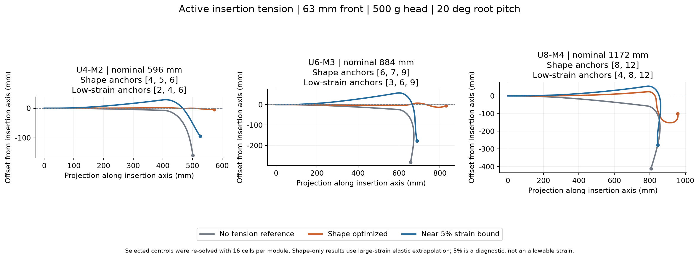
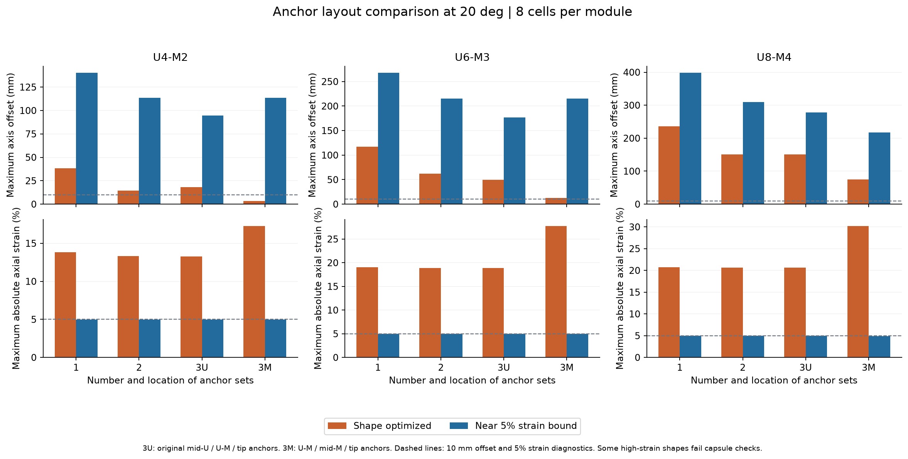
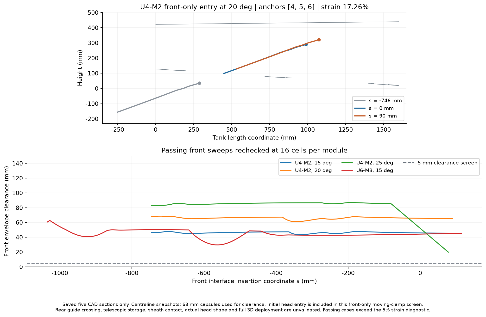
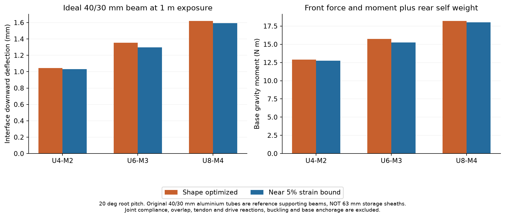

# 63 mm U/M 模組主動張力入箱研究 / Active tension insertion study

2026-11-06 · 最新資料庫 / latest database · 外徑 / diameter 63 mm · 導孔半徑 / tendon radius 24 mm

## 中文

### 結論

進入油箱時允許主動拉索張力；本輪**沒有要求前端以自然下垂形狀進入**。自然下垂只作對照。

主動張力確實改善形狀，短配置U4+M2最值得繼續研究。在20°、錨點[4,5,6]的代表解中，16單元/節結果的最大軸線偏差為4.21 mm、切線誤差4.75°，但M段最大軸向應變為17.26%。因此不能把「已拉直」解讀為已通過實際承載要求。

本輪沒有找到同時通過接近直線幾何條件、5%軸向應變診斷及局部穩定篩選的案例。這是有限控制搜尋及局部優化的結果，**不是全域無解證明**。5%仍是診斷門檻，並非實測破壞或允許應變。

### 資料與尺寸

直接讀取根目錄的`module_stiffness.sqlite3`，資料庫以唯讀方式開啟；原資料和舊模擬均未修改。輸入快照為`module_stiffness_input.sqlite3`，完整參數及來源雜湊見`input_parameters.json`。

| 參數 | U / PA12+NiTi | M / PA12 |
|---|---:|---:|
| 節長 mm | 96 | 96 |
| 單節質量 g | 37.990 | 23.948 |
| EA N | 128122 | 166.694 |
| 垂直抗重力EI N·m² | 22.2052 | 0.0441178 |
| 水平EI N·m² | 1.67184 | 0.0441178 |
| 模組扭轉彈簧剛度 N·m/rad | 4.70037 | 0.437396 |

GJ欄位按資料庫定義理解為整節`T/θ`，沒有誤當作N·m²。本輪為平面計算，未使用扭轉自由度。U數據已包含NiTi結構效果，沒有再疊加一根中心金屬棒。剛度及質量不按63 mm再次縮放。

| 配置 | 柔性段 mm | 加20 mm接口後 mm | 模組質量 g |
|---|---:|---:|---:|
| U4+M2 | 576 | 596 | 199.856 |
| U6+M3 | 864 | 884 | 299.784 |
| U8+M4 | 1152 | 1172 | 399.712 |

頭部為500 g集中質量，沒有偏心力矩；幾何包絡暫用直徑63 mm，實際檢測頭外形仍未知。接口長20 mm、質量暫為零。模組尺寸按96 mm實際節長保留，因此三組前端不是0.5 m。增加U的同時也增加M長度及整體質量，這不是單純只改變U數量的比較。

### 拉索及錨點

比較15/20/25°、U近端/M遠端、高剛度方向抵抗重力。每組四條2 mm拉索，以舊模型的PA6實心代理剛度及密度計算，無摩擦；本平面主要調整上繩。每條繩都從基部經真實模組端盤到自身錨點，遠端繩索仍壓縮近端模組。新增繩質量已計入；錨定、導向、外皮、線路及接頭額外質量未量測。

| 配置 | 單組 | 兩組 | 原三組 3U | 補充三組 3M |
|---|---|---|---|---|
| U4+M2 | [6] | [4,6] | [2,4,6] | [4,5,6] |
| U6+M3 | [9] | [6,9] | [3,6,9] | [6,7,9] |
| U8+M4 | [12] | [8,12] | [4,8,12] | [8,10,12] |

3M是仍不超過三組的補充對照，用來檢查M段內部錨定是否改善形狀；不是新增第四組。既有四孔不能視為已能容納多組繩，實際布線尚待設計。

單組有限掃描使用上繩額外0–200 N、每繩共同基準0或2 N。局部優化各組上繩數值界限0–250 N，並使用下垂、估算重力補償、較簡單架構嵌入等初始分支。這些張力是數值搜尋界限，**不是繩、馬達或模組額定值**；部分解碰到250 N上限，不能宣告為真正最大能力。

### 20度代表結果

以下取局部穩定、中心線與非局部63 mm包絡及局部半徑曲率初篩通過的候選；按軸線偏差加投影損失分數選取，不宣稱全域最優。表中代表解已按相同張力加密至16單元/節。

**允許較大應變、以形狀為目標**

| 配置 | 錨點節號 | 最大軸線偏差 mm | 最大切線誤差 deg | 軸向投影 mm | 最大絕對軸向應變 |
|---|---|---:|---:|---:|---:|
| U4-M2 | [4, 5, 6] | 4.21 | 4.75 | 573.4 | 17.26% |
| U6-M3 | [6, 7, 9] | 12.88 | 23.44 | 830.1 | 27.73% |
| U8-M4 | [8, 12] | 151.97 | 102.27 | 956.6 | 20.77% |

U8+M4另有3M高應變解在8單元/節達約74.49 mm偏差、30.17%應變，但局部半徑曲率包絡篩選未過，因此沒有將它當作有效幾何候選。

**接近5%應變診斷上限的代表解**

| 配置 | 錨點節號 | 最大軸線偏差 mm | 最大切線誤差 deg | 軸向投影 mm | 最大絕對軸向應變 |
|---|---|---:|---:|---:|---:|
| U4-M2 | [2, 4, 6] | 94.77 | 61.23 | 526.0 | 5.00% |
| U6-M3 | [3, 6, 9] | 176.86 | 87.19 | 688.7 | 4.97% |
| U8-M4 | [4, 8, 12] | 278.03 | 98.13 | 844.5 | 4.98% |

應變受限後仍有顯著彎曲；單看低應變或頭部位置，不能視為已拉直。接近直線的暫定比較條件為最大偏差≤10 mm、最大切線誤差≤5°、沿軸投影≥各自名義長度95%，再另檢查應變及局部穩定。原475 mm投影門檻沒有錯套到不同長度上。





### 入箱路徑

對18個代表狀態，保持各自**主動張力平衡形狀**沿斜軸平移。起點接口s=−名義前端長度−150 mm，確認頭部及前端在箱外；不是從頭部已入箱的位置開始。路徑先4 mm初查，存在最終全前端入腔位置時再以2 mm重查。間隙下界另外扣除半個平移步長，利用剛性平移下距離函數的1-Lipschitz性處理步間漏查。

下列四個前端路徑在16單元/節重查仍通過保存截面的5 mm間隙篩選：

| 配置 | 安裝角度 deg | 最大應變 | 路徑最小間隙 mm | 最終接口 s mm |
|---|---:|---:|---:|---:|
| U4-M2 | 15 | 17.48% | 43.65 | 114 |
| U4-M2 | 20 | 17.26% | 61.18 | 90 |
| U4-M2 | 25 | 17.08% | 19.85 | 78 |
| U6-M3 | 15 | 28.08% | 29.58 | 114 |

所有通過案例都超過5%應變診斷。低應變代表的固定主動形狀未找到通過路徑；尚未優化「隨深度改變張力及形狀」的完整避障軌跡，因此不能說所有主動部署方式都失敗。

**這是前端移動夾持基座的幾何路徑，不是完整伸縮機構驗證。** 計算允許接口在原箱外導向基準後方，沒有虛構套管接觸支承；尚未解決前端在後端套管中的存放、導向基準穿越、拉索收放與完整收回。保存的五個寬度截面628/632/648/664/668 mm也不足以覆蓋63 mm前端的616.5–679.5 mm全寬，仍非全三維通過結論。



### 後端及主要限制

以新前端質量及實際平衡形狀計算重力反力和力矩，重算原40/30 mm分段鋁梁及單30 mm梁在0.6/1.0 m外露長度的參考響應，見`rear_reference.csv`。這些管體是原有支撐梁對照，不能容納63 mm前端，不能作為新套管選型結論。尚未耦合接頭間隙、重疊質量、拉索/驅動局部載荷及基座柔度。

M的EA只有166.694 N，在5%線性應變下對應約8.33 N軸向力。作為直線姿態的量級估算，三組M段根部頭部及模組重力彎矩除以24 mm力臂，對應約38.64/59.28/80.81 N。這不是實際平衡張力或強度極限，但說明M段軸向承載與抗彎要求之間的矛盾。優先研究U4+M2，縮短M的無支撐長度、增加M的軸向承載路徑，或加入實際插入支撐。NiTi本構非線性、列印材料、接觸、屈曲及疲勞未由本輪線性EA/EI模型驗證。



### 數值檢查與文件

- 單組掃描504次，306個平衡；局部優化178次；保存90個8單元/節候選及9個自然下垂對照。
- 能量梯度、Hessian向量及控制導數已檢查，等張力軸向壓縮與獨立解析式一致。數值檢查是實作檢查，並非材料校準。
- 4→8單元/節最大頭部變化11.115 mm，不能忽略；對25個主要或敏感案例再做8→16加密，最大變化3.944 mm。所選低應變代表最大變化0.119 mm。已檢查案例的5%及近直線分類未改變，但靠近門檻的值仍對網格敏感。
- 舊CAD參考間隙重現誤差小於1e-6 mm；新增程式沒有安裝大型CAD依賴，也沒有複製STEP。
- 主要數據：`results/comparison_20deg.csv`、`all_equilibria.csv`、`refined_equilibria.json`、`summary.json`、`front_only_path_screen.json`、`refined_passing_path_checks.json`。

## English

### Findings

Active tendon tension is allowed during insertion. Passive sag is only a reference and is not imposed as the entry shape. U4+M2 is the most promising of the three tested lengths. At 20 degrees, anchors [4,5,6] give a 16-cell solution with 4.21 mm maximum axis offset and 4.75 degrees maximum tangent error, but 17.26% maximum axial strain in M. Shape improvement does not establish physical load capability.

No saved solution simultaneously passes the provisional straightness checks, the 5% strain diagnostic and local stability. These are finite searches and local optima, not a proof of global infeasibility. The 5% value is not a measured allowable or failure strain.

### Inputs and configurations

The database is opened read only. Its original values are retained without diameter scaling: U is PA12+NiTi, length 96 mm, mass 37.990 g, EA 128122 N, vertical EI 22.2052 N m² and horizontal EI 1.67184 N m². M is PA12, length 96 mm, mass 23.948 g, EA 166.694 N and EI 0.0441178 N m² in all directions. The database GJ entries 4.70037 and 0.437396 N m/rad are whole-module torsional spring stiffnesses T/theta. Torsion is not exercised in this planar study; no extra metal backbone is added to the U properties.

| Configuration | Flexible length mm | Including 20 mm interface mm | Bare module mass g |
|---|---:|---:|---:|
| U4+M2 | 576 | 596 | 199.856 |
| U6+M3 | 864 | 884 | 299.784 |
| U8+M4 | 1152 | 1172 | 399.712 |

All modules have 63 mm outer diameter and 24 mm tendon guide radius. U is proximal and its stiff bending plane opposes gravity. A 500 g point head and massless 20 mm rigid interface are assumed. The provisional head envelope is also 63 mm; actual head CAD and eccentricity are unknown. The requested counts retain their 96 mm lengths and do not produce a 0.5 m front. Both U and M length and mass increase across the configurations.

Each anchor set has four 2 mm ropes with the prior solid PA6 proxy properties, friction omitted. Every tendon runs from the base through real module guides to its own anchor; distal tendons still compress proximal modules. Rope mass is counted along each routed portion; new anchor hardware, sheaths, wiring and interface mass are not measured. Four existing holes do not establish space for multiple sets.

Layouts are head-only [N], two sets [U,N], original three sets [U/2,U,N], and a supplementary three-set layout [U,U+floor(M/2),N]. The supplementary layout remains three sets and tests an anchor inside M. Pitches are 15, 20 and 25 degrees. Single-anchor extra upper tension is sampled from 0 to 200 N with 0 or 2 N common tension per rope. Optimization bounds each upper set at 250 N; these are numerical bounds, not hardware ratings. Several results reach the bound.

### Representative results at 20 degrees

Candidates are selected among locally stable states passing the preliminary centreline, nonlocal 63 mm capsule and local radius-curvature checks. The selection score combines axis offset and projection loss. These representatives are re-solved at unchanged tensions with 16 cells per module, not re-optimized globally.

**Shape objective with larger strain permitted**

| Configuration | Anchors | Axis offset mm | Tangent error deg | Projection mm | Max absolute axial strain |
|---|---|---:|---:|---:|---:|
| U4-M2 | [4, 5, 6] | 4.21 | 4.75 | 573.4 | 17.26% |
| U6-M3 | [6, 7, 9] | 12.88 | 23.44 | 830.1 | 27.73% |
| U8-M4 | [8, 12] | 151.97 | 102.27 | 956.6 | 20.77% |

The U8+M4 three-set M-anchor alternative reaches about 74.49 mm offset and 30.17% strain at eight cells per module, but fails the local radius-curvature envelope screen and is excluded from the geometric candidate table.

**Candidates near the 5% strain diagnostic bound**

| Configuration | Anchors | Axis offset mm | Tangent error deg | Projection mm | Max absolute axial strain |
|---|---|---:|---:|---:|---:|
| U4-M2 | [2, 4, 6] | 94.77 | 61.23 | 526.0 | 5.00% |
| U6-M3 | [3, 6, 9] | 176.86 | 87.19 | 688.7 | 4.97% |
| U8-M4 | [4, 8, 12] | 278.03 | 98.13 | 844.5 | 4.98% |

The provisional straightness checks are offset at most 10 mm, tangent error at most 5 degrees, and projection at least 95% of each configuration's nominal length. The old fixed 475 mm threshold is not applied to the new lengths. Large-strain results extrapolate constant EA/EI and do not model material transformation, damage, local buckling or fatigue.

### Front-only entry screening

Eighteen selected actively tensioned shapes are translated along the installation axis, starting with the head and front outside the tank. The start interface is s = minus nominal front length minus 150 mm. Four millimetre searches locate final placements; possible complete front sweeps are rechecked at 2 mm. A half-step clearance deduction provides a conservative continuous-translation lower bound for the sampled section polygons.

The following four front-only sweeps remain clear when rechecked at 16 cells per module:

| Configuration | Pitch deg | Max strain | Minimum path clearance mm | Final interface s mm |
|---|---:|---:|---:|---:|
| U4-M2 | 15 | 17.48% | 43.65 | 114 |
| U4-M2 | 20 | 17.26% | 61.18 | 90 |
| U4-M2 | 25 | 17.08% | 19.85 | 78 |
| U6-M3 | 15 | 28.08% | 29.58 | 114 |

All four exceed the 5% strain diagnostic. No selected low-strain fixed-shape sweep passes. A trajectory that changes tendon tensions and equilibrium shape with depth has not been optimized; failed fixed-shape sweeps do not prove that all active deployment paths fail.

This is a translating-front-clamp screen, not a completed telescopic mechanism. The front base may move behind the previous front guide; tube storage, crossing the guide, sheath support/contact, rope take-up and complete retraction remain unvalidated. Five saved width planes at 628/632/648/664/668 mm do not cover the full 616.5 to 679.5 mm band of a 63 mm front. Neither complete width clearance nor full 3D installation is established.

### Rear reference and engineering implication

New front gravity reactions and moments are applied to the original ideal 40/30 mm aluminium beam and single 30 mm beam at 0.6 and 1.0 m exposure. These supporting beams cannot store a 63 mm front and are not a new sheath design. Joint compliance, overlap mass, local tendon/drive reactions, buckling and anchorage are excluded.

M has only 166.694 N axial rigidity: 5% linear strain corresponds to 8.33 N. For scale, the straight M-root moment from the head and M self weight divided by the 24 mm tendon arm is approximately 38.64, 59.28 and 80.81 N. This is not a solved tendon tension or a failure threshold, but indicates why improving U alone does not resolve M compression. Prioritize U4+M2 and investigate shorter unsupported M length, a distinct axial load path or a real insertion support.

### Verification and reproduction

The study contains 504 single-anchor attempts (306 equilibria), 178 local optimization attempts, 90 eight-cell candidates and nine natural baselines. Energy, Hessian-vector and control derivatives and an independent axial load case are checked. Four-to-eight-cell head changes reach 11.115 mm; 25 selected or sensitive cases receive eight-to-sixteen-cell checks, reaching 3.944 mm maximum change (0.119 mm for selected low-strain cases). Checked strain and straightness classifications remain unchanged; near-threshold values are still mesh-sensitive. These checks verify implementation consistency, not physical calibration.

The database snapshot is `module_stiffness_input.sqlite3`. SHA256: `584a1486f96af7603d794cc9a243706ee5344161054479b4e12d769d63588374`. Run from the project root with an existing NumPy/SciPy/Matplotlib environment. No CAD runtime installation is needed for these saved-section checks. To reproduce the frozen input in PowerShell:

```powershell
$env:ASRC_STIFFNESS_DB = (Resolve-Path 'telescopic_planar_study/stiffness_63mm_20261106/module_stiffness_input.sqlite3').Path
python telescopic_planar_study/stiffness_63mm_20261106/run_study.py validate
python telescopic_planar_study/stiffness_63mm_20261106/run_study.py mechanics --u 4 --m 2
python telescopic_planar_study/stiffness_63mm_20261106/run_study.py mechanics --u 6 --m 3
python telescopic_planar_study/stiffness_63mm_20261106/run_study.py mechanics --u 8 --m 4
python telescopic_planar_study/stiffness_63mm_20261106/postprocess.py
python telescopic_planar_study/stiffness_63mm_20261106/refine_study.py
python telescopic_planar_study/stiffness_63mm_20261106/render_and_document.py
Remove-Item Env:ASRC_STIFFNESS_DB
```

The original project rod kernel, tendon catalogue and saved CAD polygons are read dependencies. Previous simulations and the source database are preserved. Results and figures are in `results`; the README is bilingual and figure text is English. No new large dependencies or STEP copies were created.
