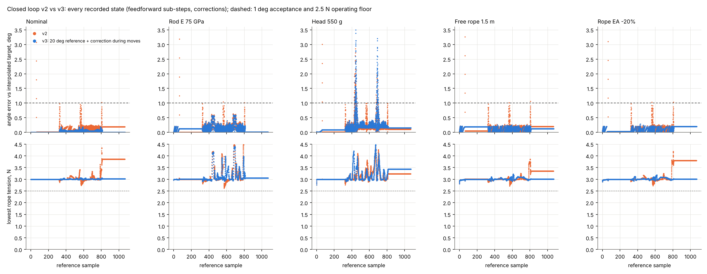
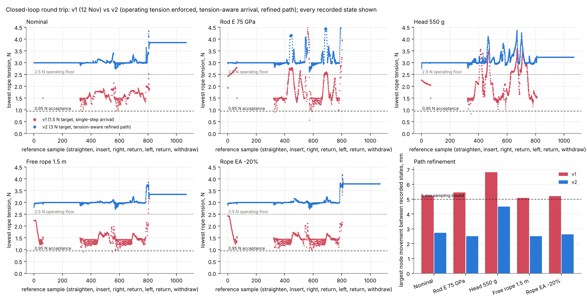
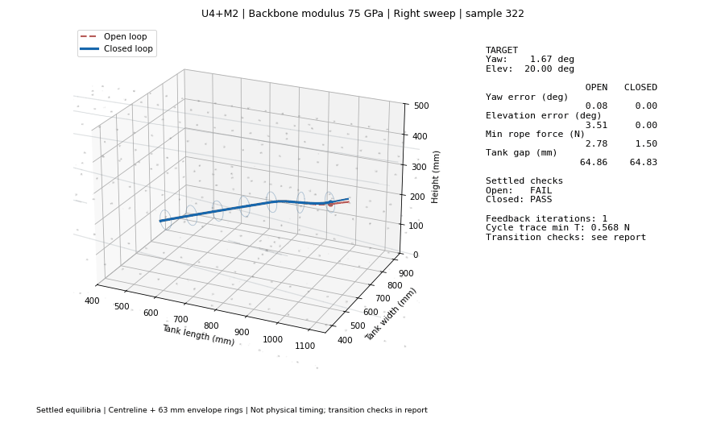

# ASRC Project Index

[GitHub repository](https://github.com/KevinQianjin/ASRC_snake_body_design) · Updated 12 November 2026

Fuel tank inspection robot: an externally supported telescopic rear with a 63 mm tendon-driven flexible front. The front has proximal U modules (PA12 + NiTi) and distal M modules (PA12), 96 mm each. It carries a 500 g camera and induction thermography head. Development targets are a 500 g payload, about 1.5 m reach and a diameter below 100 mm.

## Daily updates

The latest update is detailed below. Earlier dates have short summaries and links to the full reports and research history. All results described here are simulations unless explicitly stated otherwise.

### 13 November 2026 (latest): separate rope lanes and lane-routed 3D modules

- **Rope lanes (radial spread):** each anchor set now has its own holes: A (ends at U4) 21 mm, B (M5) 24 mm, C (M6) 27 mm, on the same up/right/down/left rays. The whole 3 N pipeline was re-run. All 32 startup states and all 36 yaw holds pass, and the reference round trip passes every check. Peak rope force falls by about 1 N (17.4 → 16.4 N) and the stability margin rises slightly. In closed loop, all five cases complete and every settled sample passes. The 550 g head's moving error at 174–178° yaw shrinks (48 states above 1°, max 2.3°; previously up to 3.8°) but is not gone. [Lane study](simulations/u4m2/lanes_20261113/README.md).
- **New 3D modules ([`cad/lanes_u4m2/`](cad/lanes_u4m2)):** built from the STEP bodies with lane holes, rope anchors, a Ø1.85 mm bore + 15 mm sleeves for the Ø1.8 mm NiTi rod in M5/M6, and joint holes. The STEP strips lie exactly on the rope rays, so the bodies had to be re-clocked: U by −45°, which also puts its stiff leaf-spring direction vertical, and M by −22.5°. That gives the ropes 4–17 mm of straight clearance. The README there explains how to anchor a rope (groove + return-hole loop, crimp inside) and how to join modules (rigid disk-to-disk, 2 dowels + M2 screws, rod bonded in both M bores).
- **Limit found:** ropes are guided only at the end disks. M5 bends 14° at the hold but 25–103° when steering beyond 15° yaw, so its rope chords leave their lanes by 7–33 mm and would rub the M spring strips. Large-yaw steering needs intermediate rope guides in M and a model that routes the ropes through them.

### 12 November 2026: exact 20° reference — four of five cases pass every check

The 3 N reference poses at 0° and 5° yaw had been accepted at 16–17° instead of 20°. They were regenerated at exactly 20.0° on the fine mesh, and the reference cycle and controller gains were rebuilt from them.

With this reference, the **nominal, 75 GPa rod, 1.5 m free rope and rope EA −20% cases pass every check in every recorded state**:

- angle error during motion ≤ 0.18–0.61° (v2: 3.1–3.3°);
- rope tension ≥ 2.81 N;
- step movement ≤ 2.5 mm;
- peak rope force falls to 17.7–22.5 N (v2: 25–27 N).

The **550 g head** still shows temporary angle error at 155–175° yaw (about 115 states above 1°, up to 3.1°). These states pass every tension, stability and clearance check, and all samples settle within 0.2°. Correcting during moves made it worse: the nominal gains have the wrong sign there for the heavier head.

Next: update the controller gains online from measured responses.

[Daily report](reports/daily/Report_2026_11_12.pdf) · [Detailed results](simulations/u4m2/backbone_20261108/README.md#13-exact-20-reference-and-correction-during-moves-closed-loop-v3-2026-11-12) · [Results](simulations/u4m2/backbone_20261108/closed_loop_v3_results/)

### 12 November 2026 (later): operating pretension enforced and refined closed-loop path

The closed-loop round trip was re-run with a revised control sequence (`closed_loop_v2.py`). The model, reference cycle, nominal gains and five cases are the same; the controller still uses only measured head angles and rope tensions.

- The correction target is **3 N** instead of 1.5 N.
- Tensions are predicted before each new command, and a small pre-correction is added if any would drop below 3 N.
- Every move is subdivided until no point on the front moves more than 4.5 mm.
- Every intermediate state is solved and checked.

| Case | Lowest rope tension, any recorded state (v1 → v2) | Largest node move (v1 → v2) | Settled angle error (v2) |
|---|---|---|---|
| Nominal | 0.93 → **2.73 N** | 5.25 → **2.74 mm** | 0.20° |
| Rod E 75 GPa | 0.57 → **2.62 N** | 5.45 → **2.50 mm** | 0.20° |
| Head 550 g | 0.84 → **2.76 N** | 6.82 → **4.49 mm** | 0.20° |
| Free rope 1.5 m | 0.91 → **2.72 N** | 5.09 → **2.50 mm** | 0.20° |
| Rope EA −20% | 0.96 → **2.73 N** | 5.20 → **2.62 mm** | 0.20° |

- **Tension and movement are fixed.** No state is below 2.5 N or 0.95 N, no step exceeds the 5 mm bound, and there is no unstable, geometry or tank-clearance failure. All samples settle within 0.2° at ≥ 2.5 N.
- **Cost.** Peak rope tension rises to 25–27 N.
- **What remains: temporary angle error during motion.**
  - Up to 3.3° at the straighten-to-insertion hand-off, where the 3 N reference holds about 17° instead of 20°.
  - Up to 2.85° at 155–175° yaw with the 550 g head.

[Daily report](reports/daily/Report_2026_11_12.pdf) · [Detailed results](simulations/u4m2/backbone_20261108/README.md#12-closed-loop-round-trip-v2-operating-pretension-and-refined-path-closed_loop_v2py-2026-11-12) · [Controller source](simulations/u4m2/backbone_20261108/closed_loop_v2.py) · [Results](simulations/u4m2/backbone_20261108/closed_loop_v2_results/)

### 12 November 2026: closed-loop control, 3D visualisation and repository organisation

#### What was completed

Implemented head-angle and tendon-tension feedback for the continuous 96 mm U4+M2 front, using the stable-startup round trip as its reference. The complete sequence is **straightening → insertion → right sweep and return → left sweep and return → withdrawal**. Each of five parameter cases follows the same **1,069 reference samples**, giving **5,345 corrected settled states**.

The controller observes ideal simulated head yaw/elevation and all 12 tendon tensions, then adjusts the commanded rope lengths. Gains are prepared from the nominal **40 GPa backbone, 500 g payload and 1 m free-rope model**; changed stiffness and payload are not supplied to the gain calculation. The known free-rope installation-length difference is handled as a command-zero offset.

- Each feedback correction is limited to **0.25 mm per rope**, with at most **5 mm accumulated correction** relative to feedforward and **16 corrections per reference sample**.
- The internal stopping target is **0.2° angle error** with measured minimum tension at least **1.25 N**. The proposed correction targets a **1.5 N** tension floor; damping can approach that floor over several updates.
- The initial undamped controller overcorrected near large yaw with the **550 g payload**. Halving subsequent correction steps when measured angular error grows resolved the failed settled-angle checks. This rule uses past measured errors, not knowledge of the true plant parameters. The [initial diagnostic](simulations/u4m2/backbone_20261108/closed_loop_results/undamped_diagnostic/README.md) is retained.

#### Results across five conditions

All five cases pass the selected **settled-state** checks: yaw/elevation errors within **±1°**, tendon force bounds, positive fixed-winch tangent stiffness, geometry/strain diagnostics and sampled tank clearance.

| Condition | Maximum open-loop angle error (°) | Maximum closed-loop angle error (°) | Failed closed-loop settled samples |
|---|---:|---:|---:|
| Nominal: E40, 500 g, 1 m free rope | 3.930 | 0.200 | 0 / 1,069 |
| Backbone modulus 75 GPa | 7.180 | 0.200 | 0 / 1,069 |
| Payload 550 g | 8.965 | 0.699 | 0 / 1,069 |
| Free rope length 1.5 m | 4.830 | 0.199 | 0 / 1,069 |
| Rope axial stiffness -20% | 4.637 | 0.200 | 0 / 1,069 |

The angle metric is the larger of the maximum absolute yaw and elevation errors. The worst corrected error is **0.699°** in the 550 g case; the other four cases remain below 0.2° before rounding. One 550 g sample reaches the 16-correction budget and misses the internal 0.2° target, while still meeting the ±1° acceptance criterion. Minimum tension across corrected settled states is approximately **1.25 N**, and minimum sampled tank clearance is **19.76 mm** before subtracting the 1.5 mm allowance.

These comparisons use a stricter elevation criterion than the previous **20 ± 5°** study, so failure counts should not be compared directly between reports. The damping rule was developed on these cases; they are not an independent validation set.

#### What remains unresolved

**A passing settled state does not establish a passing complete control sequence.** Seven feedforward arrival states fall below **0.95 N** before correction; the minimum is **0.568 N**. No post-correction trace state falls below that threshold, and no recorded trace state fails the equilibrium-stability, geometry or sampled tank-clearance checks, but the arrival tension deficit still needs to be corrected.

The exploratory **1.5 N** feedback target does not enforce the project's **3 N** operating pretension recommendation. Maximum node movement between corrected samples is **6.822 mm**, exceeding the previous **5 mm** sampling bound. The model remains quasi-static: it does not include motor dynamics, sensor noise or delay, friction, backlash, NiTi hysteresis, or the real head/cable geometry. Positive static stiffness does not establish dynamic closed-loop stability.

The next simulation priority is to enforce tension throughout feedforward transitions and feedback corrections, refine the corrected path, and then add actuator and sensing dynamics. See [current limitations](docs/limitations.md) and the [engineering roadmap](docs/roadmap.md).

#### Reports, data and 3D animations

The animations compare **blue closed-loop** and **red open-loop** shapes, with angle errors, tension and clearance displayed alongside. They show solved equilibria; playback speed does not represent a validated physical execution speed.

- [Full English report](simulations/u4m2/backbone_20261108/closed_loop_results/REPORT.md) — assumptions, per-case results, correction traces and reproduction commands.
- [Full round-trip MP4](simulations/u4m2/backbone_20261108/closed_loop_results/E75_full_cycle.mp4) · [Steering GIF](simulations/u4m2/backbone_20261108/closed_loop_results/E75_steering.gif) · [Large-yaw feedback correction GIF](simulations/u4m2/backbone_20261108/closed_loop_results/payload550g_feedback_convergence.gif).
- [Controller source](simulations/u4m2/backbone_20261108/closed_loop_cycle.py) · [CSV/JSON/NPZ results](simulations/u4m2/backbone_20261108/closed_loop_results/) · [Numerical validation record](simulations/u4m2/backbone_20261108/closed_loop_results/validation.json).

#### Repository and verification work

Reorganised the project into `simulations/`, `cad/`, `data/`, `reports/`, `archive/` and `docs/`, with updated source/data paths and document links. Verification after relocation passed **43 model tests**, the five-case closed-loop data checks, four daily PDF builds and the presentation build. The **1,903 checked data, CAD and publication/media files** retained their original bytes. See the [repository map](docs/repository_map.md), [file-by-file migration table](docs/path_migration.csv) and [simulation entry points](simulations/README.md).

### 11 November 2026: stable startup and 3 N pretension

A stable startup and 3 N pretension reference made the nominal open-loop round trip pass all 1,069 samples, with minimum tendon tension of 2.74 N. The rope-stiffness -20% case also passed; the 75 GPa, 550 g and 1.5 m free-rope cases still exposed open-loop calibration limits. The model input sheet and prototype review were documented.

[Daily report](reports/daily/Report_2026_11_11.pdf) · [Detailed study](simulations/u4m2/backbone_20261108/README.md#10-round-trip-cycle-with-3-n-pretension-and-a-stable-startup-2026-11-11) · [Model data sheet](simulations/u4m2/backbone_20261108/model_data/MODEL_DATA.md) · [Earlier 1 N findings](docs/history.md#original-1-n-cycle-limitations-11-november-2026).

### 10 November 2026: coordinated winch control and accuracy

Coordinated rope-length commands produced smooth, stable and reversible steering while maintaining working elevation. Winch-position sensitivity showed that roughly ±0.2–0.5 mm accuracy was needed for ±1° open-loop head-angle accuracy, motivating angle feedback and additional pretension margin.

[Daily report](reports/daily/Report_2026_11_10.pdf) · [Weekly presentation](reports/weekly/Weekly_report_2026_11_10.pptx) · [Detailed results and figures](docs/history.md#10-november-2026-coordinated-winch-control-and-winch-accuracy).

### 9 November 2026: tank entry, stability and steering

Screened loaded entry, fixed-winch stability, tendon forces and clearance against the full 3D tank. A 20° installation with limited insertion depth supported the tested steering envelope; pulling only one side rope lost working elevation beyond about ±20° yaw.

[Daily report](reports/daily/Report_2026_11_09.pdf) · [Detailed results and figures](docs/history.md#9-november-2026-entry-stability-tendon-force-3d-tank-and-horizontal-flexibility).

### 8 November 2026: M stiffness requirement and NiTi backbone

Identified insufficient M-module stiffness and evaluated a central Ø1.8 mm NiTi backbone. The revised U4+M2 model passed the studied straightening and held-elevation steering checks; the module test plan defines the measurements still required.

[Daily report](reports/daily/Report_2026_11_08.pdf) · [Backbone results](docs/history.md#8-november-2026-m-stiffness-requirement-and-niti-backbone) · [Build and test plan](simulations/u4m2/backbone_20261108/M_BACKBONE_TEST_PLAN.md).

### 6 November 2026: original M-module baseline

The original M-module model required excessive strain for straightening and did not achieve loaded steering at the required head elevation. These results became the control cases for the later backbone studies.

[Daily report](reports/daily/Report_2026_11_06.pdf) · [Baseline studies](docs/history.md#previous-baseline-studies-6-november-2026-current-m-module).

### 5 November 2026: initial design and analysis

Established the earlier design and analysis baseline for the subsequent stiffness, deployment and tendon-control investigations.

[Daily report](reports/daily/Report_2026_11_05.pdf).

## Prototype

**Ignore `archive/superseded_cad/full_length/` (marked 11 November 2026).** It uses 84 mm shells with 12 mm pin joints and two separate backbone rods with a free joint. The design and all simulations use continuous 96 mm modules with one Ø1.8 mm NiTi rod along the full length of each M module; see [model data](simulations/u4m2/backbone_20261108/model_data/MODEL_DATA.md) and [why the folder is marked](archive/superseded_cad/full_length/NOT_THE_SIMULATED_DESIGN.md). The uploaded U/M STEP files have a STEP-derived OpenSCAD viewing package in [`cad/previews/u4m2/`](cad/previews/u4m2). **The newest modules (rope lanes, anchors, backbone bore, joints) are in [`cad/lanes_u4m2/`](cad/lanes_u4m2).**

The U STEP contains one full-envelope body solid (96 mm long, about 63.24 mm across) and four separate leaf-spring solids (about 94 mm long). The M STEP contains one full-envelope body solid. The STEP product tree lists wing and disk items, but not as separate solid meshes; the full-envelope body geometry means that alone does not show the module body is missing. The STEP files do not encode material labels. The intended split is U body in PA12 with four NiTi spring elements, and M body in PA12. The current M study adds a separate Ø1.8 mm NiTi backbone to each M module.

The original SCAD preview arranges the six modules in a straight line without the backbone or inter-module connection; `cad/lanes_u4m2/` adds both. Confirm material assignments and connection details before ordering a full print.

- [Original U STEP](cad/modules/UniDirectional_96.step) · [Original M STEP](cad/modules/Medium_Stiffness_96.step).
- [Preview instructions](cad/previews/u4m2/README.md) · [Complete OpenSCAD/STL bundle](cad/previews/u4m2/final_u4m2_openSCAD_bundle.zip).
- [Backbone module test plan](simulations/u4m2/backbone_20261108/M_BACKBONE_TEST_PLAN.md) · [Superseded CAD cleanup review](archive/superseded_cad/full_length/CLEANUP_REVIEW_CONFIRMATION.md).

## Next steps

1. ~~Enforce operating pretension throughout the control sequence and refine the corrected path below the 5 mm sampling bound~~ — done in simulation on 12 November (v2). The 17° insertion reference was then fixed (v3); four of five cases pass every check. Next: online gain update for the 550 g large-yaw transient.
2. Add intermediate rope guides to the M modules and route the ropes through them in the model (per-cell chords); without them the M5 ropes rub the spring strips beyond about 15° yaw (13 November).
3. Add actuator dynamics, sensing noise/delay and calibrated friction, backlash and hysteresis.
4. Test the backbone module and interfaces, then integrate the actual head, cables and rear deployment mechanism.

[Detailed roadmap](docs/roadmap.md) · [Current limitations](docs/limitations.md) · [Module test plan](simulations/u4m2/backbone_20261108/M_BACKBONE_TEST_PLAN.md).

## Geometry and input data

- [Telescopic rear and tank geometry study](simulations/u4m2): tank sections, rear beam calculations and deployment screening. The 3D tank model is `cad/tank/tank-v2.step`.
- [Module stiffness database](data/materials/module_stiffness.sqlite3): module mass, EA, EI and torsional stiffness. Use each study's saved input snapshot when reproducing its results.

## Earlier studies

- [H8U12 rear and 500 g head](simulations/shared/h8u12_front5to8_payload500g): comparison of 5–8 front modules.
- [Four tendon inverse study](archive/legacy_studies/four_rope_inverse_5_to_11): methods, frozen inputs and results.
- [Front module count sweep](archive/legacy_studies/front_sweep_5_to_11): comparison of 5–11 front modules.
- [Reach and extension screening](archive/legacy_studies/reach_extension/results): earlier passive reach study with different dimensional assumptions.

Start with the latest daily update above. Earlier results use different geometry or material assumptions and should not be combined directly with the latest baseline.
