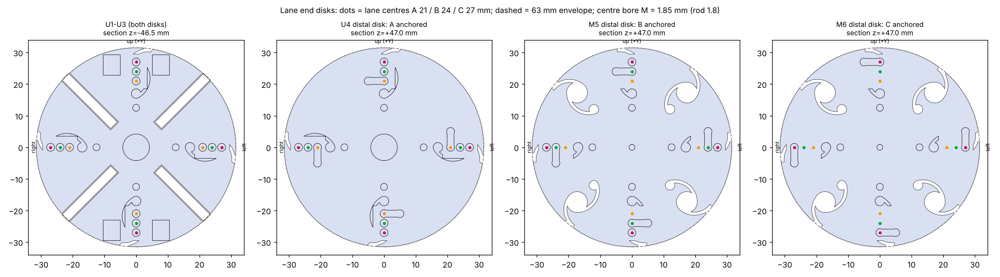
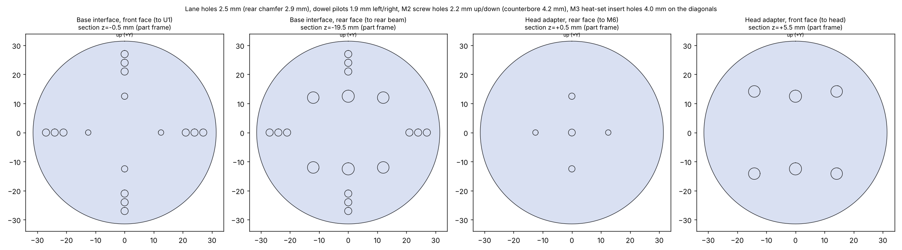

# Build guide — U4+M2 front with separate rope lanes

This guide takes you from the files in this folder to an assembled, tensioned U4+M2 front: six 96 mm modules, a 20 mm base interface and a head adapter. It covers printing, purchased parts, finishing, the NiTi leaf springs and backbone, joining the modules, threading and anchoring the 12 ropes, and the checks before first use.

All geometry comes from `build_lane_modules.py` and `build_ends_and_check.py`. The second script also checks the whole assembly automatically. The last run passed every check (`assembly_check.json`, `"all_pass": true`):

- **Joints:** all 7 joints (base–U1 … M6–head) have their 4 joint holes open and aligned.
- **Ropes:** all 12 ropes have a clear straight path from the base to their anchor disk, with groove and return hole present, and no hole beyond the anchor.
- **Backbone:** the bore is open through M5 and M6, and the U4 distal centre is solid (the rod end stop).
- **Leaf springs:** no contact with the U bodies even when shifted 1.5 mm in any direction.
- **Nuts:** an M2 nut fits on the inner face of every joint hole of every module.
- **Envelope:** every part stays within r ≤ 31.66 mm (the same as the original STEP bodies).

> Status: these parts are checked geometrically only. Printed strength, rope friction and the stiffness of the modified bodies have not been tested yet; section 10 lists what to measure on the first build.

---

## 1. What you are building

```
 rear beam ─┤ BASE ├─┤ U1 ├─┤ U2 ├─┤ U3 ├─┤ U4 ├─┤ M5 ├─┤ M6 ├─┤ HEAD ADAPTER ├─ head
 z (mm):   -20     0     96    192   288   384   480   576    582
 rope set A (21 mm) ───────────────────────────► anchored on U4 distal face
 rope set B (24 mm) ─────────────────────────────────────► anchored on M5 distal face
 rope set C (27 mm) ──────────────────────────────────────────────► anchored on M6 distal face
 NiTi rod Ø1.8                                  ◄──── 192 mm ────►  (M5 + M6 only)
```

**Frame.** Z runs along the robot, from the base to the head. **+Y is up**, +X is left and −X is right when you look from the base toward the head. Every rope lies on one of four rays (up, right, down, left). Each ray carries three ropes: A at 21 mm, B at 24 mm and C at 27 mm from the axis.

**Joints.** Every joint is rigid: two end disks face to face, located by 2 dowel pins (left/right holes) and clamped by 2 M2 screws (up/down holes). There is no hinge or gap. The simulation assumes the joints cannot open.




## 2. Files

| File | Qty to make | What it is |
|---|---:|---|
| `base_interface.stl` | 1 | 20 mm block, mounts to the rear beam, guides all 12 ropes into U1 |
| `U_lane_pass.stl` | 3 | U1, U2, U3 (all three are identical) |
| `U4_lane_anchorA.stl` | 1 | U4, with the 4 anchors for rope set A |
| `M5_lane_anchorB.stl` | 1 | M5, with the 4 anchors for set B and the rod bore |
| `M6_lane_anchorC.stl` | 1 | M6, with the 4 anchors for set C and the rod bore |
| `head_adapter.stl` | 1 | 6 mm plate on M6, closes the C anchors and carries the head |
| `U_leaf_springs.stl` | reference | the 4 leaf springs of one U module (exact shape: `../modules/UniDirectional_96.step`, solids 2–5) |
| `lane_assembly.scad` | – | OpenSCAD view of the full stack (`explode = 20` to separate the parts) |
| `lane_design.json`, `spring_strip.json`, `assembly_check.json` | – | dimensions and check results |

To regenerate everything after a change:

```bash
cd cad/lanes_u4m2
python build_lane_modules.py && python build_ends_and_check.py && python plot_disks.py
```

This needs `trimesh`, `manifold3d`, `shapely` and `matplotlib`.

## 3. Bill of materials

### Printed parts (8)

| Part | Qty | Volume, cm³ | Est. mass, g (SLS PA12 0.93 g/cm³) |
|---|---:|---:|---:|
| Base interface | 1 | 60.1 | 56 |
| U_lane_pass (U1–U3) | 3 | 23.9 each | 22.2 each |
| U4_lane_anchorA | 1 | 25.1 | 23.3 |
| M5_lane_anchorB | 1 | 31.4 | 29.2 |
| M6_lane_anchorC | 1 | 31.6 | 29.4 |
| Head adapter | 1 | 18.3 | 17.0 |

### Purchased parts

| Item | Qty | Spec / notes |
|---|---:|---|
| NiTi leaf spring strip | 16 (4 per U) | Superelastic NiTi flat strip about **6.0 × 1.1 mm**, cut to **94.0 mm**. The STEP section varies from 1.03 to 1.18 mm; use 1.0 or 1.2 mm stock and confirm with the U designer. Order 4 spares. |
| NiTi backbone rod | 1 | Superelastic NiTi, **Ø1.80 mm**, straight-annealed, cut to **192.0 mm** (or 2 × 96.0 mm) |
| Rope | 12 lengths | **Ø2.0 mm PA6 (nylon) monofilament**: this is what the simulation uses (EA ≈ 10.4 kN). A braided rope stretches differently, so re-calibrate EA if you change rope. Cut lengths are in section 8. |
| Crimp sleeves | 12 (+6 spare) | Aluminium or copper single-barrel sleeves for 2.0 mm line, **OD ≤ 3.5 mm**, about 6 mm long |
| Dowel pins | 14 | Steel, **Ø2 m6 × 8 mm** (2 per joint, 7 joints) |
| Socket-head screws | 14 | **M2 × 10**, A2 stainless (2 per joint) |
| Nuts | 14 | Plain M2 hex, 4 mm across flats, 1.6 mm thick (this is the size checked inside every module; nylon-insert locknuts are taller and were not checked) |
| Heat-set inserts | 8 | **M3 × 4 mm long, for a 4.0 mm hole**: 4 in the base rear face (6 mm deep holes) and 4 in the head adapter front face (4.5 mm deep holes) |
| Epoxy | – | Structural 2-part epoxy (e.g. 20–30 min working time) for the springs and rod |
| Thread-locker | – | Medium strength, plastic-safe |
| Cyanoacrylate | – | Optional, to lock the crimps |

### Tools

- Drill bits: Ø1.85 (rod bore), Ø2.2 (screw holes), Ø2.5 (rope holes), Ø4.2 (counterbores).
- **Reamers:** Ø2.00 H7, plus a Ø2.02 drill or reamer for the slip side of the dowels.
- Pin vise and a soldering iron with an insert tip.
- Crimping pliers for the sleeves.
- Abrasive cut-off disc for NiTi (it dulls and chips ordinary cutters).
- Fine file and 240-grit paper.
- Feeler gauge 0.05 mm, spring balance or force gauge (0–50 N), calliper.

## 4. Printing

- **Process and material:** SLS (or MJF) **PA12**, as intended for the U and M bodies. Layer height 0.1 mm. No supports are needed.
- **Orientation:** print every part **with its axis (Z) vertical**. All rope, rod and joint holes are then round, axial and as accurate as the printer allows. The 0.5 mm walls between neighbouring rope holes also lie in the plane of the layers, where SLS is strongest.
- **Minimum features:** the thinnest feature is the **0.5 mm wall between neighbouring rope holes** (3 mm lane pitch, 2.5 mm holes, 0.25 mm chamfers). Ask the print service to confirm they can hold a 0.5 mm wall. If they cannot:
  - reduce `HOLE_D` to 2.3 mm in `build_lane_modules.py` (gives a 0.7 mm wall), or
  - move the lanes to 21 / 24.5 / 28 mm and re-run the simulation with `lanes_study.py --radii 21 24.5 28`.
- **Powder removal:** blow out every rope hole, the rod bore and the spring pockets. Push a Ø2.4 mm wire through each rope hole from end to end before finishing.

## 5. Finishing the printed parts

Do this for every part before assembly.

1. **Rope holes (Ø2.5):** run a Ø2.5 drill through by hand in a pin vise, disk by disk. Do not use a power drill: it can walk into the 0.5 mm walls. Lightly break every edge where the rope enters or leaves a disk. The rope runs straight in each module, so a sharp edge is where it would wear.
2. **Anchor grooves and return holes** (distal face of U4, M5, M6): clean the 2.2 × 2.2 mm groove with a needle file so the rope lies fully below the face. Lay a piece of rope in it and check with a straight edge that nothing stands proud.
3. **Joint holes:**
   - **Up/down holes (Ø2.2, screws):** drill through with Ø2.2.
   - **Left/right holes (Ø1.9 pilots, dowels):** on the **distal** disk of every module and in the base interface front face, ream **Ø2.00 H7** for a press fit. On the **proximal** disk of every module and in the head adapter rear face, ream **Ø2.02** for a slip fit. This way each pin sits in the part behind and the part in front slides onto it.
4. **Counterbores** (base rear face and head adapter front face, screw holes only): clean them to Ø4.2. 3 mm of material must remain under each screw head.
5. **Rod bore (M5 and M6 only):** drill Ø1.85 through from both ends, so the bore stays straight through the end disk and the 12 mm sleeve at each end. Check that a straight Ø1.8 rod slides through the whole module with no binding.
6. **Leaf-spring pockets (U modules only):** the **proximal** pocket goes through the disk and the **distal** pocket is blind, 2 mm deep. Clean both with a needle file. The spring's end block shape is 7.05 × 6.33 mm.
7. **Heat-set inserts:** press 4 × M3 inserts into the base rear face (4.0 mm holes on the diagonals at r = 17 mm) and 4 into the head adapter front face (r = 20 mm). Insert them square and flush, then let them cool before loading.

## 6. Leaf springs (U1–U4, 4 per module)

Each U module carries four NiTi strips near the up and down rays, at r = 27.45 mm and ±16° from vertical. They give the U module its high **vertical** bending stiffness, which the simulation relies on (EI vertical 22.2 N·m² vs horizontal 1.67 N·m²).

1. Cut 16 strips to **94.0 mm** with the abrasive disc, cooling with water. Deburr the ends and roughen 3 mm at each end with 240-grit paper. Degrease with isopropanol.
2. Hold the module with its **proximal** face up.
3. Slide each strip down through the proximal pocket, along the inside of the module, into the blind distal pocket. Orient the strip so its **wide side (6 mm) matches the long side of the pocket**. The path is clear (checked: no contact even 1.5 mm off the nominal position).
4. Fill both pockets with epoxy around the strip. The distal end sits on the pocket bottom; the proximal end sits 1 mm below the proximal face. Wipe the proximal face flat, because the next part must seat on it. The epoxy acts as the end block, which the original design had as a 7.05 × 6.33 × 2 mm solid end.
5. Cure with the module standing on its distal face, so the strips are straight and fully seated.

## 7. Backbone rod (M5 + M6)

1. Cut the rod to **192.0 mm**. One continuous rod is preferred; two 96.0 mm rods are acceptable. Deburr the ends square.
2. Roughen the rod over the four bonded zones: 15 mm at each end of each M module. With a single rod these are 0–15, 81–111 and 177–192 mm from the M5 end. Degrease.
3. **Dry-fit** M5 and M6 together with their 2 dowels and 2 screws (section 9, steps 2–4). Slide the rod through both bores until it is flush with the **proximal face of M5** and with the **distal face of M6**.
4. Remove the rod, apply a thin film of epoxy to the bonded zones, and slide it back in from the M6 end in one movement. Re-check that it is flush at both ends, wipe off excess epoxy, and cure with the M5+M6 pair lying straight.
5. After curing, hand-bend the M5+M6 pair gently. The rod must bend with the modules and must not slide in the bores.

The rod stops against the solid centre of U4's distal disk at one end and sits in the 1 mm relief in the head adapter at the other. At the largest simulated M5 bend (103°) its strain is about 1.7%, inside the superelastic range.

## 8. Ropes: lengths and preparation

Every rope runs from its winch, through the base interface, straight along its lane, to its anchor. Cut length = 1,000 mm free length to the winch (as in the simulation) + 20 mm base + routed length + about 100 mm for the anchor loop, crimp and handling. Adjust the 1,000 mm to your real winch layout.

| Set | Lane radius | Anchor | Routed length (base face → anchor face) | Cut length (4 of each) | Colour suggestion |
|---|---:|---|---:|---:|---|
| A | 21 mm | U4 distal disk | 384 mm | **1,510 mm** | orange |
| B | 24 mm | M5 distal disk | 480 mm | **1,600 mm** | green |
| C | 27 mm | M6 distal disk | 576 mm | **1,700 mm** | red |

1. **Pre-stretch** every rope: hang 25 N on it (above the 16.5 N simulated peak) for 10 minutes, release, and repeat three times. New nylon creeps, and the length-controlled winches assume a stable rope.
2. Mark each rope with its set and ray (e.g. "B-up") at the winch end.
3. Cut the anchor end square and melt it lightly with a hot knife, so it threads easily without fraying the hole.

## 9. Assembly sequence

Work on a flat bench, base first. Use thread-locker on every M2 screw. Tighten them **snug only (about 0.15–0.2 N·m)**: the clamping disks are 3 mm printed PA12.

**Joint procedure** (used for every joint below):

1. Make sure both mating faces are clean and flat. Remove epoxy beads and check the anchor grooves are below the face.
2. Press the **2 dowel pins** into the reamed press-fit holes (left/right) on the distal face of the part behind, so they stand **5 mm proud**. Use a 5 mm spacer; in the base the holes are deeper, so the spacer sets the height. Each pin passes 3 mm into the next disk and 2 mm into the module beyond. For the M6–head joint the 5 mm fits the 5 mm blind hole in the adapter.
3. Slide the next part on. Its slip-fit holes take the pins. Check that the rope holes line up by sighting through them or pushing a Ø2.4 mm wire through both disks.
4. Insert the **2 M2 × 10 screws** through the up/down holes, with a nut on the far side, inside the module. The open strip cage gives access with tweezers and a 1.5 mm hex key. For the base–U1 and M6–head joints, the screw head sits in the counterbore of the base or adapter, and the nut goes inside U1 or M6.
5. Check with a 0.05 mm feeler gauge that **no gap** exists anywhere around the joint.

**Order:**

| Step | Action |
|---:|---|
| 1 | Springs fitted and cured in U1–U4 (section 6); rod bonded in M5+M6 (section 7, which already makes the M5–M6 joint). |
| 2 | Base interface → **U1** (joint procedure). The pins go into the base front face. |
| 3 | U1 → U2 → U3 → **U4**. Every module has its proximal face toward the base. |
| 4 | U4 → **M5+M6 pair**. Check the rod end touches, but is not pushed into, U4's distal face. |
| 5 | Thread rope set **C** (outermost, longest): see below. |
| 6 | Thread set **B**, then set **A**. |
| 7 | Head adapter → **M6**. It closes the C anchor grooves. The 1 mm centre relief takes the rod end. |
| 8 | Mount the base interface to the rear beam (4 × M3 into the inserts) and the head to the adapter (4 × M3). |

**Threading and anchoring one rope** (example: set B, up ray):

1. From the rear of the base interface, push the rope's anchor end into the **B-up hole** (24 mm, up). Feed it through every disk: base, U1, U2, U3, U4, M5. Rope holes beyond a set's anchor do not exist, so you cannot take a wrong turn.
2. At the anchor disk's **distal face** (M5 for B), pull 80 mm of rope through.
3. Lay the rope in the **groove** and push it back down the **return hole** into the inside of the module:
   - **B and C:** the groove runs sideways (tangentially) 5 mm from the lane.
   - **A (on U4):** the groove runs **radially inward** 3.5 mm toward the axis. This keeps rope A clear of the U4 leaf springs.
4. Inside the module, slide a **crimp sleeve** onto the tail. Push it up against the inner face of the anchor block and crimp. Cut the tail 3 mm beyond the sleeve, melt the end, and optionally add a drop of cyanoacrylate.
5. Pull the rope from the winch end with about 10 N. The loop must seat in the groove, flush with the face, and the crimp must bear on the inner face. Nothing may stand proud on the distal face.

Repeat for all 4 rays of the set, then the next set.

**Tensioning:**

1. Attach all 12 ropes to their winches.
2. With the front straight and supported, set every rope to **3 N**: the operating pretension the controller is designed for.
3. Remove the support. The front should hold itself at the startup pose; the simulation's stable startup has every rope at ≥ 2.5 N.

## 10. Checks before first use

| Check | How | Pass |
|---|---|---|
| Joints | 0.05 mm feeler gauge around every joint, before and after tensioning | no gap |
| Straightness | Front straight and supported; straight edge along the up and right rays | < 1 mm over 576 mm |
| Rope routing | Pull each rope 5 mm by hand at the winch end with the front straight; repeat bent 20° up/down/left/right | slides smoothly, no catching at any disk |
| Rope friction | Spring balance on each rope at the winch end, anchor end loaded with 10 N | friction < 1 N (the model has none) |
| Anchors | One spare anchor block (cut from a test print) loaded to **50 N** (3× the simulated peak) | no bridge crack, no crimp slip |
| Rod | Bend M5 by hand to about 30°, release | returns straight, no clicking or rod slip |
| Stiffness | Tests in `../../simulations/u4m2/backbone_20261108/M_BACKBONE_TEST_PLAN.md` on one spare U and M module | within ±15% of `MODEL_DATA.md` |
| Mass | Weigh each part | see section 3 |

## 11. Known limits and open points

- **Steering beyond about 15° of yaw.** Ropes are guided only at the end disks. M5 bends 25–103° beyond 15° of yaw, and its ropes would then rub the M spring strips (rope offset 7–33 mm vs 6.7–7.8 mm clearance). Limit first tests to **±15° of yaw** until intermediate rope guides are added to M5/M6.
- **Mass differs from the model.** The filled disks, anchor blocks, plugs and sleeves make the parts heavier than in `MODEL_DATA.md`:

  | Part | Model mass (bare) | Printed mass (est.) |
  |---|---:|---:|
  | Each U | 38.0 g (incl. 17.1 g of NiTi springs) | +1.3 g |
  | M5 / M6 | 25.5 g (incl. rod) | +5.3 / +5.5 g |

  Joint hardware adds about 1.3 g per joint. The head adapter's 17 g counts toward the 500 g head budget. Re-run the simulation with the measured masses before relying on its tension numbers.
- **Stiffness may differ from the model.** The 2 mm strip-root reliefs in the original end disks were filled, so the strip roots are bonded over 3 mm instead of 1 mm. The modules were also re-clocked (U −45°, M −22.5°), so U's stiff direction is vertical. Measure both (section 10) before trusting the simulated stiffness.
- **Leaf-spring end blocks** are formed by epoxy in the pockets, not by the original solid ends. Check with the U designer that this is acceptable for the spring loads.
- **No path for head wiring.** U modules have no centre hole. Run head cables outside the modules, or ask for a cable hole to be added. Any added hole must clear the lanes, springs and joint hardware; `build_ends_and_check.py` will check it.
- **Base and head mounting patterns are placeholders:** 4 × M3 on the diagonals, at r 17 mm (base) and r 20 mm (head). Change `MOUNT_R_BASE`, `MOUNT_R_HEAD` and `MOUNT_ANGLES` in `build_ends_and_check.py` to match the real rear beam and head, then rebuild.
