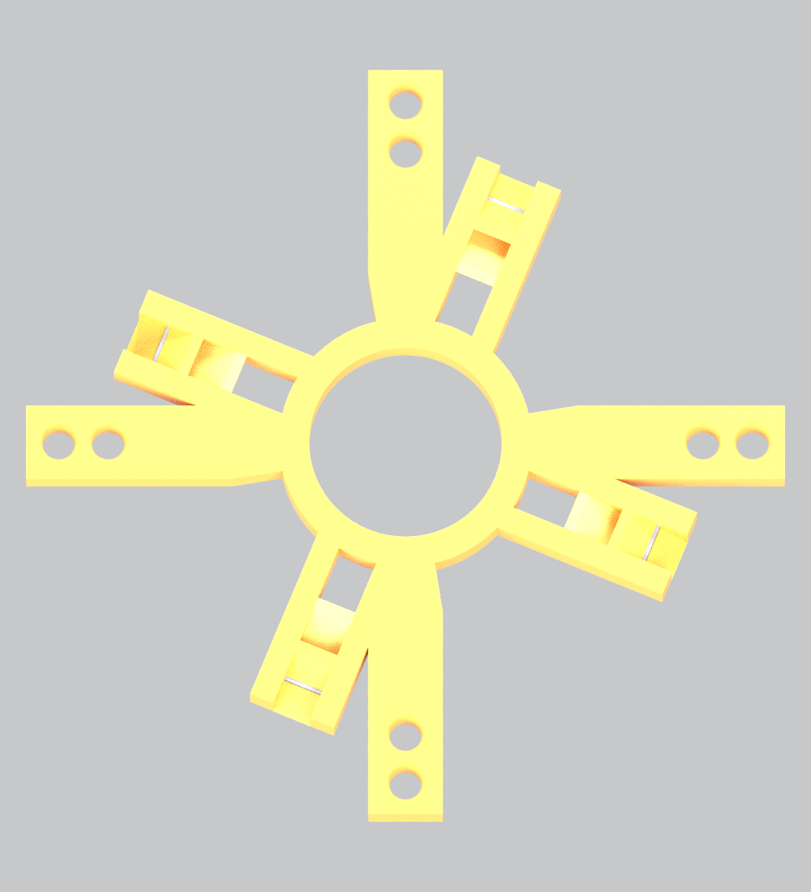

# Guided M-module candidate V2 — 14 November 2026

**Engineering candidate; not released for manufacture.** Straight assembly checks pass, but rigid guide mounting intersects the beam-mapped M body in bent poses. Some ideal rope spans also penetrate finite end-region material at large yaw. The simulation uses ideal guide constraints and does not include the forces caused by this interference. See the [validation report](../../../simulations/u4m2/lanes_20261113/GUIDED_VALIDATION.md).

## What this revision fixes

The previous four-station design used the same inner-web clips at all stations. Actual CAD sections show inner webs at radius about 6.896 mm at z = ±24 mm, but no such webs at z = ±12 mm. The latter stations have suitable outer webs at radius about 19.229 mm. A zero-overlap check alone did not detect those unsupported clips.

This folder contains eight distinct guide frames, each generated from nine sections through its actual station. Four keyed rectangular saddles attach to existing webs. The ±12 mm frames use forked arms to reach the outer webs. The ±24 mm frames attach to inner webs. Neither clamps the central NiTi backbone.

| Feature | V2 candidate |
|---|---|
| Rope lane radii, A / B / C | 21 / 24 / 28 mm |
| Internal stations in each 96 mm M module | −24, −12, +12, +24 mm |
| Maximum unsupported rope span | 24 mm |
| Guide arm/ring plate thickness | 3.2 mm |
| Socket/cap axial span | 3.24 mm, including 0.02 mm Boolean margin per face |
| Rope arm width | 4 mm at the root, expanding to 6 mm |
| Rope bore / mouth | Ø2.6 / Ø3.0 mm for nominal Ø2 mm rope |
| Entry profile | Elliptical rounded bellmouth; 1 mm straight throat |
| B–C material bridge | 1.4 mm at bore; 1.0 mm at mouth |
| Outer wall beyond C mouth | 1.1 mm |
| Socket wall / nominal adhesive gap | 0.85 / 0.15 mm |
| Non-mounting web clearance in straight CAD | 0.30 mm |
| Radial cap retention | Ø0.35 mm stainless lockwire in a 0.45 mm groove |

C is moved outward by 1 mm to increase the B–C bridge. All module disks, anchor blocks and the base interface are regenerated with that lane position; do not mix them with the older 27 mm C-lane parts. A–B disk-hole wall remains only 0.5 mm and still needs printer qualification. Full parameters are in [design.json](design.json) and [lane_design.json](lane_design.json).



Orange is the frame, lighter caps close the four actual outer-web sockets, and grey is the retaining-wire envelope. This view does not establish installation access or bent-pose compatibility.

## Installation concept and limits

Each saddle has an inward removable cap. Install the frame before threading the ropes, seat the four real webs in their shaped sockets, fit the caps, and retain each cap with lockwire. A qualified structural adhesive in the nominal 0.15 mm socket gap is intended to fix axial station and resist sliding. The adhesive and PA12 surface preparation have not been selected or tested. The wire is radial retention; no friction-only axial holding capacity is assumed.

The wire STL is a conservative square-section envelope of the nominal round wire. Twisted closure tails, adhesive fillets and assembly-tool access are not modelled. The 0.03 mm cap-seat separation is a Boolean construction clearance, not a qualified printer fit tolerance. Socket opening and installation access must be demonstrated on a physical or articulated assembly mock-up before release. Do not interpret an exploded CAD view as proof that the assembly sequence is feasible.

The NiTi backbone remains Ø1.8 mm, with the existing end-disk/sleeve support. No end ferrule is added to the backbone. Guide reactions are carried into the M-body webs. Bonding four webs to one rigid guide can change module stiffness; the current rod simulation retains the previous homogenised stiffness and cannot validate that effect.

## Files and checks

For every `M5` or `M6` and station `z-24`, `z-12`, `z+12`, `z+24`:

- `*_guide.stl`: one connected frame.
- `*_caps.stl`: four removable inward caps.
- `*_wire_envelope.stl`: four retaining-wire envelopes.

[geometry_check.json](geometry_check.json) records supported-web locations, component counts, volumes and straight-body intersections. All eight frames reload as watertight single-component meshes. Boolean cleanup removes isolated numerical fragments below 0.0001 mm³; it does not remove structural pieces. [assembly_check.json](assembly_check.json) checks the regenerated disk stack and lane alignment.

[mass_model.json](mass_model.json) estimates the six module masses from CAD volumes and material densities. Guide frame, cap and retaining-wire masses are included; adhesive and closure tails are excluded. The 500 g head is a separate payload including its adapter. The supported base is excluded from front mass. Each module total is distributed uniformly over the rod cells; the individual guide locations do not carry separate point masses. These are estimates, not weighed parts.

## Reproduce

From this folder, with NumPy, trimesh, manifold3d, shapely, mapbox-earcut, rtree, networkx and the parent CAD dependencies installed:

```bash
python build.py
python build_mass.py
```

`python build.py --guides-only` reuses the regenerated module bodies. Rebuild the mass file after any geometric change, then rerun the simulation. The separate [mount audit](../../../simulations/u4m2/lanes_20261113/guide_mount_audit.py) tests bent poses; straight CAD success is not its acceptance criterion.

## Release blockers

1. Resolve rigid guide/web interference during bending. Investigate articulated or compliant supports and relief around non-mounting webs, while maintaining the intended guide coordinates under load.
2. Revise finite end-hole and anchor-block entry/exit geometry, or include rope contact, so the bending rope spans do not pass through material.
3. Include the actual support stiffness and deformation in a local structural model, then update the rod model if stiffness or guide position changes.
4. Verify printed eyelet, arm, socket, adhesive and wire strength and cyclic wear against the exported guide loads. The load factor of three is a proposed screening assumption, not a measured safety factor.
5. Demonstrate threading, cap installation and wire closure without scraping ropes or interfering with adjacent moving strips.

The thicker, better-supported V2 geometry addresses the thin bridge and floating clips. It does not yet establish a mechanically valid large-angle guide assembly.
