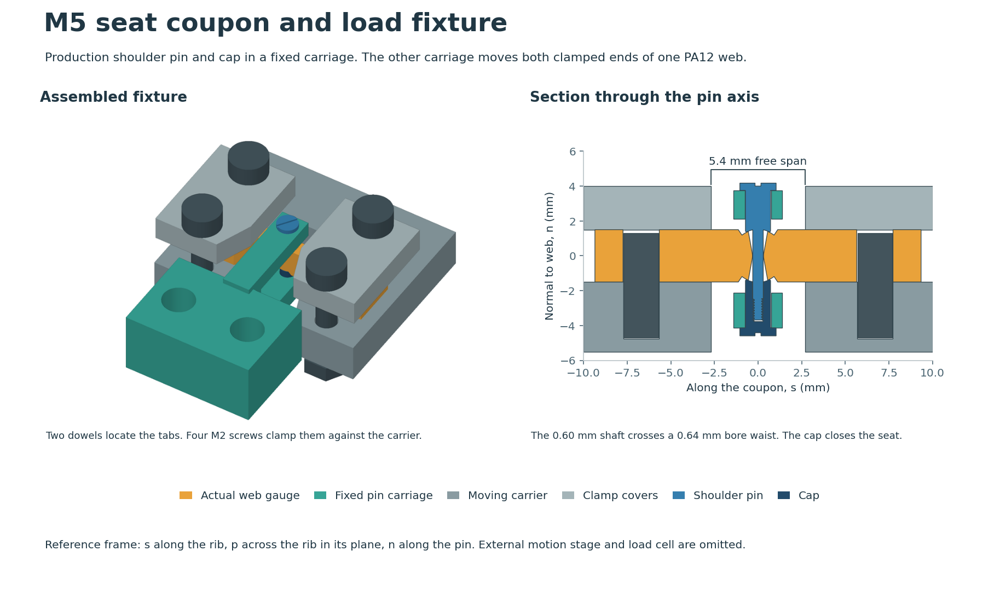

# M5 retained-seat coupon and loading fixture

This fixture tests one production-shape PA12 web against the shoulder pin and threaded thrust cap from the M5 retained guide. The teal carriage holds the metal parts. A separately controlled carriage grips both ends of the web. The stage supplies the relative orientation and the three components of load. Dimensions are in millimetres. [Assembly model](assembly.scad) · [Exported solids and inspection](parts/manifest.json) · [Test procedure and data forms](../../../simulations/u4m2/lanes_20261113/m5_seat_bench_20261119/README.md)

## Parts and interfaces

| Item | Quantity | Assembly detail |
|---|---:|---|
| [Web coupon](parts/web_coupon.stl) | 1 per specimen | Print with the same PA12 process, conditioning and build orientation as the nominated M5 rib. The central 5.4 mm is cut directly from the exported +12 mm, 67.5° production web. Raised end tabs outside the free span carry the grips. |
| [Coupon carrier](parts/coupon_carrier.stl) | 1 | Rigid fixture part. Machine the faces and dowel bores relative to the free-span datum. The two Ø3.20 through holes at `s = ±6.70, p = +8.90` mount to the moving stage. |
| [Tab cover](parts/tab_cover.stl) | 2 | Place one at positive s and mirror the second about s = 0. Tighten each cover against a tab with two M2 screws. The inward corners face the fixed carriage. |
| [Pin carriage](parts/pin_carriage.stl) | 1 | Rigid fixture part. The two coaxial Ø1.50 pilot bores reproduce the position of the production pilots. The Ø3.20 stage holes lie at `s = ±3.70, p = −13.0`. |
| [Shoulder pin](../retained_seat_20261118/parts/shoulder_pin.stl) and [threaded cap](../retained_seat_20261118/parts/threaded_cap.stl) | 1 each | Use the retained-seat parts with their actual shoulders and threads. Ø0.60 shaft, nominal Ø0.64 bore waist, 1.0 mm bore crown radius. The shoulder head is at positive n in the fixture coordinates. |
| Clamp hardware | 4 bolts, 4 nuts, 2 dowels | M2 × 12 screws, nominal cylindrical head Ø3.8 × 2.0, and M2 nuts 4 mm across flats. Set Ø2 × 6 dowels 3.20 mm below the support face. Blind pilot depth is 3.25 mm, tab holes are Ø2.08. The dowels locate the specimen while the covers grip it. |
| External instrumentation | Per bench | Independent rigid stages with suitable travel, force and rotation control, calibrated multi-axis load measurement and two optically tracked frames. Inspect the bearing separately. Stage adapters must fit the measured fixtures. |

The local axes are s along the web, p across its 1.50 mm width, and n normal to the web along the pin. The material thickness away from the machined seat is 3.00 mm. The carrier faces at s = ±2.70 are the FE cut planes. Nominal PA12 geometry from all four rotated positive-station source ribs was compared with the delivered free-gauge STL. Register upright parts in the original module coordinate frame before choosing print orientation. The three force targets come from two web azimuths. A second specimen orientation may be needed to reproduce the build anisotropy of the second web.

## Setup

1. Record the specimen, material lot, build direction and conditioning. Inspect the free span, shaft, waist, crown, thrust radii and narrow side ligament. The published dimensions are nominal. Enter the drawing or process acceptance limits before scoring a build.
2. Seat the two dowels to the specified projection. Seat the tab faces, install the covers and register both stages to the nominal pivot. Locate the pivot from several fiducials on each carriage. A displacement measured away from the pivot includes rotation unless transformed to the pivot.
3. Centre the coupon at neutral orientation. Insert the shoulder pin from positive n and install the cap from negative n while restraining the opposite end. Use the torque range qualified for the actual fastener. Record the delivered torque, retention, fixture compliance and measurement uncertainty.
4. Rotate the coupon carriage about the registered pivot to the prescribed quaternion. Keep this orientation through a cycle. Apply the opposite of the listed pin-on-web force to the moving carrier. Re-seat with the same +1 N bias before measuring residual travel. Follow the signed [load program](../../../simulations/u4m2/lanes_20261113/m5_seat_bench_20261119/results/load_program.csv).
5. Use a separate assembled cage for the 96.19° bend and in-cage tool demonstration. The single-web fixture gives access to both pin faces and cannot demonstrate the cage lap-screw tightening torque. [Cage installation and side-drive envelope](../retained_seat_20261118/README.md)

The CAD check covers 94 unloaded pairs within the carriages and 40 unintended cross-carriage pairs per pose. The closest sampled unintended approach is 0.4255 mm. A conservative bound is 0.0328 mm throughout the commanded interpolated paths. The original square grip corner came to 0.0325 mm. The relieved grip surfaces now stay at least 0.7904 mm from the fixed carriage in the tested nonzero load states. The 0.4255 mm whole-fixture minimum occurs between the coupon and pin carriage. The ordered pin and cap installation also cleared the nominal solids at 461 sampled positions. Both 30 mm long, Ø1 mm driver probes have at least 0.506 mm of radial envelope clearance. Real joint torque and retention still need measurements. The pin and cap bear against the elastic coupon by design. Continuous force-controlled motion at zero load, misalignment, fixture flex, manufacturing errors and real stage envelopes require bench checks. [Clearance results](../../../simulations/u4m2/lanes_20261113/m5_seat_bench_20261119/results/fixture_clearance.json)

Regenerate the four STLs with `python bench_cad.py --out /tmp/asrc-coupon-parts` from this directory. Open `assembly.scad` and select `assembled` or `exploded`. The viewer imports the production hardware directly.
