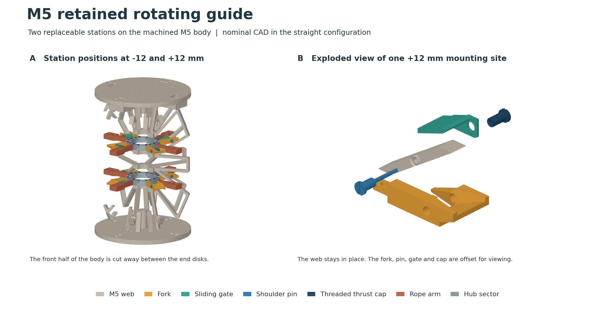
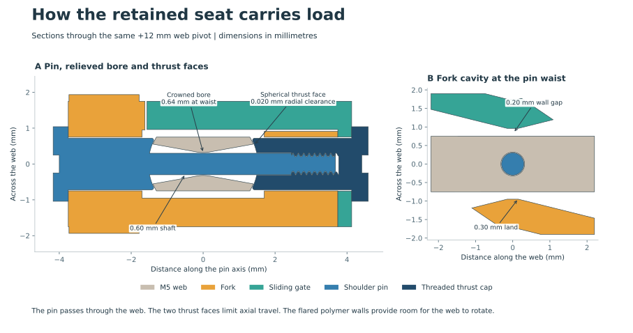

# Retained rotating guide for M5 at -12 and +12 mm

This assembly replaces the two M5 inner guide **stations by axial position**. Both grip the *outer* diagonal webs at a pivot radius of 19.229 mm. The payload specification is 500 g. The drawing uses the [original bellmouth-equipped M5 body](../end_bellmouth_v1/README.md) and the [V3 guide rope arms](../guides_v3/README.md). The two M5 stations at ±24 mm and all four M6 stations retain their existing designs.

## Opening the model

Open [assembly.scad](assembly.scad) alongside the [STL part library](parts/). Select the full module, either station or one mounting site with the `view` parameter. The grey body is the actual modified M5. Each STL represents a single closed, connected component. The full module contains 88 station parts and one body. The central Ø1.8 mm NiTi rod remains independent of the guides and passes through the open hub. The module attachment and backbone installation follow the existing design. The CAD view shows the station hardware and body.

## How a web is retained

At each station four forks attach to the original webs at −22.5°, 67.5°, 157.5° and 247.5°. Each web is 1.50 mm across and 3.00 mm thick in the design section. A Ø0.60 mm steel shaft passes tangentially through it. The negative-tangential side has a slotted head. A separate steel thrust cap screws onto the other end and traps the sliding gate. The pin shank, gate and screw-on cap carry load in either direction. That load path is being tested in simulation.

| Feature | Nominal geometry | Function |
|---|---|---|
| Waist of the hole in the web | Ø0.64 mm around a Ø0.60 mm shaft | Provides 0.020 mm radial play at the centre. |
| Relief on both sides of the hole | 1.00 mm profile radius, followed by a 0.18 slope | Permits the web to tilt about the shaft as well as to turn around it. |
| Thrust faces | 1.50 mm spherical radius on the web, 1.52 mm on the metal, 0.060 mm metal rim fillet | Locates the web along the pin axis. The spherical contact normals pass near the pivot. |
| Polymer cavity | 0.30 mm land measured along the web, 0.20 mm running gap per face, 0.25 flare slope | Clears the corners of the tilting web. This gap is measured between the web and fork walls. |
| Fork radial reach | Truncated at 24.60 mm from the module axis | Clears the returning leg of the same rib in the extreme bend. The pivot stays at 19.229 mm. |
| Centre hub | Eight overlapping aluminium sectors, 7.80 mm clear central radius, 3.20 mm plate thickness | Permits radial installation inside the existing cage. Eight small lap screws join the sectors. |
| Arm attachments | One radial tongue per rope arm and one off-axis tongue per fork, each locked by a screw | Locates the removable arms at the original positions. The four forks and four rope arms sit on separate radii and azimuths. |
| Rope geometry | B and C at radii 24 and 28 mm on four cardinal axes, nominal Ø2.6 mm throat and Ø3.0 mm mouth | Preserves the M5 route for the Ø2 mm ropes. The head, end anchors and other module lanes are unchanged. |

The model includes the mating helical threads. The custom pin tail uses a 0.15 mm pitch, the lap screws use a 0.20 mm pitch and the tongue screws use a 0.25 mm pitch. A machined steel pin/cap, aluminium sectors and PA12 printed fork, gate and rope arms are **design assumptions**. Supplier availability, engagement strength, wear, locking torque and print capability remain open.

## Assembly sequence assessed

1. Use the original M5 datum to form the relieved bore and thrust seats on the eight mounted webs. Support the body in its straight configuration.
2. Feed each hub sector radially through a gap in the cage. The sector sits 1.4 mm toward the corresponding outer end during insertion, then moves axially to its installed plane. At −12 mm fit the upper-lap sectors first. At +12 mm fit the lower-lap sectors first. Support the loose sectors until the lap screws engage.
3. Insert the forks radially. The off-axis root leaves the mouth open to the web. Seat and lock each tongue in the appropriate hub pocket.
4. Introduce each pin from the negative-tangential side. Slide in the gate from the positive side and install its threaded cap. The slotted ends permit opposing tools to react the installation torque.
5. Install the four rope arms through the cardinal openings, lock their tongues and thread the ropes through the assigned B/C holes. The station parts can be installed before the original outer guides, backbone and ropes.

The tightest hub screw has 3.45 mm of coaxial tool space. A side-entry enclosure 2.50 mm across and 1.15 mm above the screw face, connected to a Ø0.80 mm lateral shaft, clears all 16 lap screw sweeps. The minimum gap is 0.134 mm. The 1.55 mm high, Ø2.50 mm enclosure with a Ø1.10 mm shaft fouls the body. Blade engagement, internal drive, torque, fixture and tolerances still require a physical installation trial. [Engineering report](../../../reports/daily/M5_Retained_Seat_2026_11_18.md) · [Tool envelope and approach directions](../../../simulations/u4m2/lanes_20261113/m5_retained_seat_20261118/results/side_drive.json)

[Part volumes and topology checks](parts/parts.json) · [Parametric geometry](build.py) · [Joint dimensions](joint.py) · [Numerical evidence and reproduction](../../../simulations/u4m2/lanes_20261113/m5_retained_seat_20261118/README.md)
