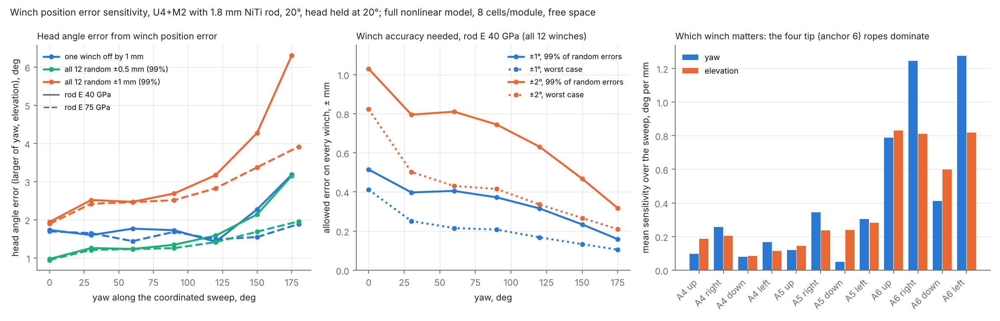
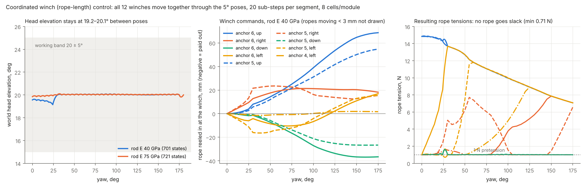
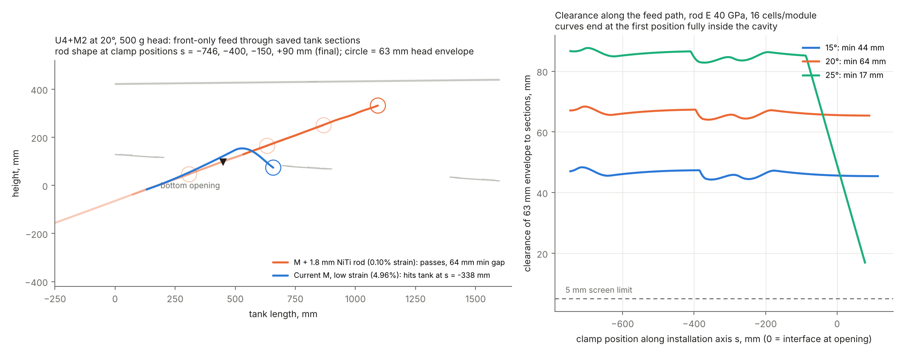
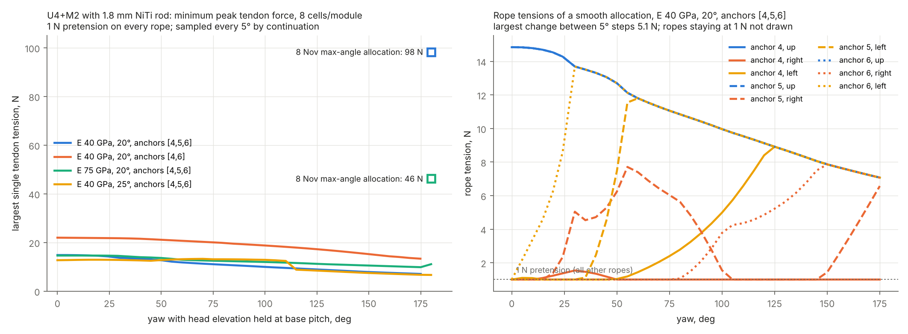
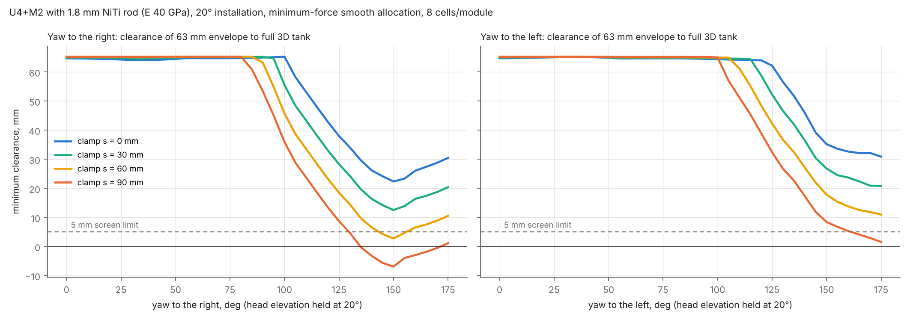
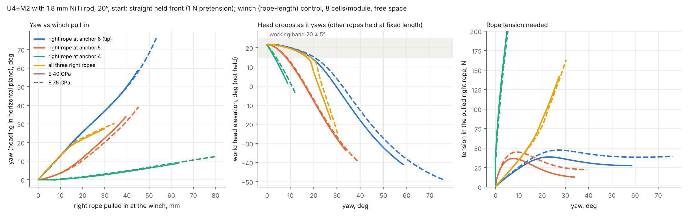
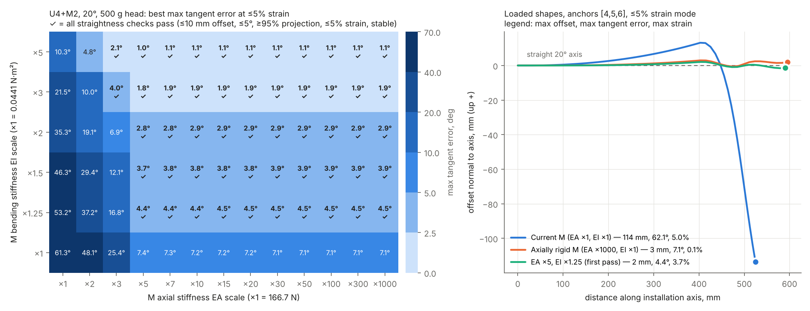
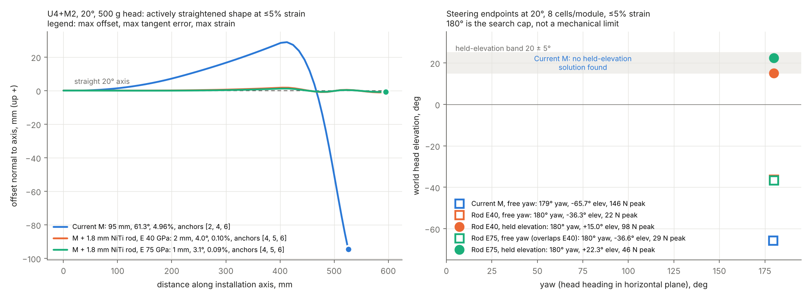

# Research history

[Project home](../README.md) · [Current design](current_design.md) · [Current limitations](limitations.md)

Historical findings below retain their original study context. The original 1 N cycle failures were followed by a stable 3 N startup study and then the closed-loop study. They are not all current blockers.

## Original 1 N cycle limitations (11 November 2026)

**The U4+M2 design has not yet passed an integrated, hardware-validated deployment cycle.** Passing selected static poses or a steering-only sweep does not establish a stable startup, adequate pretension, robustness to parameter changes, or safe operation of the complete robot.

The [length-controlled round-trip report](../simulations/u4m2/backbone_20261108/length_cycle_results/REPORT.md) extends the earlier steering studies with a specified straightening startup, insertion, right/left sweeps and returns, withdrawal, and identical-command sensitivity cases. Its results apply to that command sequence and acceptance criteria; they do not replace the separately dated studies below.

| Limitation | Evidence or current assumption | Engineering consequence |
|---|---|---|
| Startup and straightening are unresolved | With the three upper ropes initially paid out 10 mm, the nominal straightening phase contains 13 unstable stationary samples. | Redesign the startup and pretension-establishment sequence. Solver convergence to a stationary point is not proof of stable motion; this failure does not show that every straightening procedure fails. |
| Pretension margin is insufficient | Nominal steering reaches a minimum rope force of **0.713 N**; each of the four steering legs has 9 samples below the **0.95 N** acceptance tolerance around the 1 N target. | Add pretension margin and tension constraints when generating rope-length trajectories. No slack in an earlier nominal sweep does not establish sufficient pretension throughout this cycle. |
| Open-loop commands depend on calibrated parameters | Replaying the same commands with E75 backbone stiffness gives maximum yaw/elevation errors of **6.60° / 7.41°**; a **550 g** payload gives **9.85° / 8.17°**. Rope EA reduced by 20% or free length increased to 1.5 m also causes inadequate pretension. | Measure the assembled stiffness, payload and rope properties; evaluate head-angle and tension feedback. These are assumed sensitivity cases, not measured failure probabilities. |
| Single-side-rope steering loses elevation | Pulling only the tip side rope maintains the head within 20 ± 5° elevation only to about **±20° yaw**. | Larger working-elevation sweeps need coordinated upper and side ropes. |
| Tank workspace is restricted | Earlier full-tank screening recommends **20° installation** and steering with the clamp **0–30 mm** past the opening. Deeper insertion and 25° installation cause roof interference in portions of the large-yaw sweep. | Define and enforce a deployment envelope; yaw capability alone does not establish reachability at arbitrary insertion depths. |
| Longer fronts remain unproven | U6+M3 and U8+M4 fail the existing checks with at most three anchor sets. | Do not extend the front by adding modules without revising stiffness, anchor layout and control. |
| Backbone attachment and module interfaces are not validated | The model assumes axial load transfer at the NiTi ends and adequate lateral guidance. The STEP-derived assembly does not establish the M backbone integration, inter-module connections or tendon continuity. | Test joint slip, guide spacing, buckling, interface compliance and the assembled tendon route before a full build. The backbone-layout screening in `moving_prototype/full_length/` assumed a 12 mm pin gap and is marked to be ignored. |
| Head and cable geometry remain provisional | Collision screening uses a **63 mm envelope** and a nominal **500 g** tip payload; actual head shape, centre-of-mass offset and external cables are not fully represented. | Update gravity loads and clearance using the real head, mounting and cable geometry. |
| Constitutive and actuator behaviour is idealised | No rope friction, winch backlash, NiTi hysteresis, fatigue or wear is included in the round-trip model. Motor torque, speed, travel and encoder resolution are not validated as an integrated drive system. | Identify these properties experimentally and include them in forward simulation and controller verification. |
| Motion and clearance checks are sampled and quasi-static | The nominal cycle has **17.48 mm** minimum sampled tank clearance, but dynamics and continuous collision safety are not established. | Check transient response, self-collision and the swept envelope; sampled clearance is not a guarantee between samples. |
| Rear deployment and inspection performance are incomplete | Withdrawal is represented as rigid translation of the clamped front. Rear telescopic deployment, storage, sleeve contact and task coverage are not integrated. | Validate the full mechanism and map camera field of view, focus distance, coil standoff and incidence angle to usable inspection coverage. |

**Update (11 November, later): with a 3 N pretension floor and a stable startup, the nominal round trip passes every check** (0 of 1,069 samples fail; rope tension ≥ 2.74 N; no unstable state), and so does the rope EA −20% case. The 75 GPa rod, 550 g head and 1.5 m free-rope cases still fail, but only on open-loop calibration (posture tracking, or rope tension with a longer rope). Same model parameters; see [backbone study section 10](../simulations/u4m2/backbone_20261108/README.md#10-round-trip-cycle-with-3-n-pretension-and-a-stable-startup-2026-11-11). The paragraph below describes the original 1 N cycle.

Across the five round-trip scenarios, **none passes every check**. The nominal case has **56 failed samples out of 1,033**: 20 during the specified straightening phase and 36 across the four steering legs. Its insertion and withdrawal samples pass, and its steering samples pass the stability and geometry checks, but pretension is insufficient at some intermediate commands. The passing outbound sample prefix reaches **21.25° on either side** before the first failed sample; this is a limit of the tested command sequence and criteria, not a mechanical yaw limit or continuous safety guarantee.

The **5% strain threshold**, **250 N tendon bound** and **180° search cap** are numerical diagnostics or search bounds, not validated hardware ratings. The 1.5 mm sampling/mesh allowance in the round-trip report is an error budget, not a certified global clearance bound. Small simulated return error reflects the ideal reversible model and does not establish physical repeatability.

### Priorities to close these limitations

1. Generate a stable startup and complete rope-length trajectory with pretension margin and consistent fixed-winch stability checks; repeat the same round-trip and sensitivity cases.
2. Build and test the backbone M module and interfaces: both bending planes, axial stiffness, torsion, guide buckling and end-attachment slip. Replace assumed properties with measured values.
3. Calibrate winches and ropes, add friction/backlash/hysteresis where supported by measurements, and evaluate posture/tension feedback against actuator limits.
4. Integrate the actual head, cables and rear mechanism; verify tank-aware motion, dynamic behaviour and inspection coverage before claiming full-system performance.

## Design status before closed-loop feedback (11 November 2026)

All results below are simulations for **U4+M2 with a central 1.8 mm NiTi rod in each M module**, compared with the 6 November design. Rod properties are calculated, not yet measured.

| Check | 6 November design (current M) | With 1.8 mm NiTi rod |
|---|---|---|
| Straightening at ≤ 5% strain, 15–25° | 90–99 mm offset: **fails** | 1.2–2.0 mm offset, about 0.1% strain: **passes** |
| Tank entry, 2D sections and full 3D | Every low-strain shape hits the tank | **Passes**: 47 / 65 / 19 mm minimum clearance at 15 / 20 / 25° |
| 3D lateral stability | — | Needs **≥ 1 N pretension on every rope**; with it, all cases are stable |
| Yaw with the head held at 20° | No solution found | **0–175°** in smooth 5° steps at **7–15 N** peak rope force |
| Coordinated winch (rope-length) control between poses | — | **Smooth, stable and reversible** over 0–175° at 19.2–20.1° elevation; no slack rope; winch travel ≤ 69 mm |
| Winch position error | — | ±1° head angle needs about **±0.2–0.5 mm on every winch** (±0.16 mm near 175°); the 4 tip winches dominate; rope EA ±10% gives ≤ 0.4°. Stable in all cases, but 1 N pretension ropes go slack beyond about 0.15 mm error: **use head-angle feedback** |
| Yaw sweep inside the full 3D tank | — | At 20° with the clamp 0–30 mm past the opening: **clear by ≥ 12.6 mm**; 25° hits the roof |
| One side rope pulled (winch control) | — | About **1.25° yaw per mm**, smooth and stable; holds 20 ± 5° elevation only to **about ±20°** |
| Full round trip, length control (straighten, insert, sweep both sides, withdraw) | — | With **3 N pretension and a stable startup: nominal passes every check** (0 of 1,069 samples fail; rope ≥ 2.74 N; no unstable state). Rod 75 GPa, 550 g head and 1.5 m free rope fail on open-loop calibration only |
| Tension-only rope control | — | Straight front **snaps** (258 mm jump at +0.5 N): **use rope-length control** |
| Longer fronts U6+M3, U8+M4 | Fail | Still fail with ≤ 3 anchor sets |

**Decisions:** develop U4+M2 with the 1.8 mm NiTi backbone. Install at **20°**, steer with the clamp **0–30 mm** past the opening, keep **≥ 3 N** on every rope (1 N is the stability minimum; 3 N gives margin through the round trip), start up through held states from natural sag, and drive the ropes by **length (winch position)**, coordinating the up and side ropes to hold the working elevation. Build and test the backbone M module next.

## Latest studies

### 10 November 2026: coordinated winch control and winch accuracy

**Winch accuracy** ([section 9](../simulations/u4m2/backbone_20261108/README.md#9-winch-position-error-and-rope-stretch-sensitivity-winch_sensitivitypy-2026-11-10)):

- One winch off by 1 mm moves the head 1.3–3.2°. All 12 winches off by up to ±1 mm at random give up to 1.9–6.3° (99%).
- Holding ±1° open-loop needs about ±0.2–0.5 mm per winch. The four tip (anchor 6) winches matter most, and rope stiffness calibration hardly matters.
- Every perturbed state stays stable, but 1 N pretension ropes can go slack. Head-angle feedback and a higher pretension are recommended.

**Coordinated winch control:**

[Study README, section 8](../simulations/u4m2/backbone_20261108)

All 12 winches follow the rope lengths of the 5° minimum-force poses together, in 20 sub-steps per segment.

- The head moves smoothly from 0° to 175° (40 GPa rod) or 180° (75 GPa rod) while staying at 19.2–20.1° elevation.
- Every one of the 701 / 721 states is stable, no rope goes slack, and the motion is identical forward and backward.
- The in-between states clear the 3D tank by at least 12.6 mm.
- The largest winch travel is 69 mm, and the anchor-4 ropes barely move.
- Winch command tables are saved as CSV.

### 9 November 2026: entry, stability, tendon force, 3D tank and horizontal flexibility

[Study README, sections 3–7](../simulations/u4m2/backbone_20261108)

- **Tank entry:** the straight low-strain rod shape feeds through the bottom opening at 15–25°, re-checked at 16 cells per module. The current-M low-strain shape hits the tank.

  

- **3D stability:** with only the up ropes pulled, the straight front is laterally unstable in 3D. A 1 N pretension on every rope stabilises it, and straightening and entry still pass.
- **Minimum tendon force:** holding the head at 20° while sweeping yaw needs about 7–15 N peak (anchors [4,5,6]), against 46–98 N for the 8 November allocations. With smoothing, no rope changes by more than about 5 N per 5° step. Beyond about 90° the front curls up and back over itself, and it uses 30–55° of twist at mid yaw.

  

- **Full 3D tank:** all 362 tank solids were meshed from the STEP file, which agrees with the saved 2D sections within 0.23 mm. Entry is confirmed across the full front width. At 20° with the clamp 0–30 mm past the opening, the whole yaw sweep clears the tank by at least 12.6 mm on both sides.

  

- **Horizontal flexibility:** reeling in only the tip's right rope turns the head about 1.25° per mm. The head droops beyond about 20° of yaw unless the up ropes are reeled in together with it. Anchors 4 and 5 hardly turn the head. Tension-only control makes the straight front snap.

  

### 8 November 2026: M stiffness requirement and NiTi backbone

- [M stiffness requirement sweep](../simulations/u4m2/m_axial_sweep_20261108):
  - Raising M axial stiffness alone leaves a 7.1° tangent-error floor.
  - The first passing combination is **EA ×5 (about 830 N) with EI ×1.25 (about 0.055 N·m²)**, anchors [4,5,6].
- [NiTi backbone study](../simulations/u4m2/backbone_20261108) and [build and test plan](../simulations/u4m2/backbone_20261108/M_BACKBONE_TEST_PLAN.md):
  - The Ø1.8 mm rod gives M an EA of 102–191 kN and an EI of 0.065–0.083 N·m² (E = 40–75 GPa).
  - With it, U4+M2 passes straightening at 15–25° and reaches 180° yaw at held elevation.

The 5% strain threshold, 250 N tendon bound and 180° angle cap are numerical diagnostics or search bounds, not validated hardware ratings.

## Previous baseline studies (6 November 2026, current M module)

- [Active straightening and tank entry](../simulations/u4m2/stiffness_63mm_20261106): near-straight shapes need 17–28% axial strain, and only high-strain shapes pass the entry screen.
- [Spatial steering and tendon forces](../simulations/u4m2/steering_63mm_20261106): U4+M2 reaches about 179° yaw at low strain, but with head elevation at −65.7°. No held-elevation solution was found.

These studies are the controls for the 8–9 November work, and their results are reproduced exactly by the new scripts.

## Earlier studies

- [H8U12 rear and 500 g head](../simulations/shared/h8u12_front5to8_payload500g): comparison of 5–8 front modules.
- [Four tendon inverse study](../archive/legacy_studies/four_rope_inverse_5_to_11): methods, frozen inputs and results.
- [Front module count sweep](../archive/legacy_studies/front_sweep_5_to_11): comparison of 5–11 front modules.
- [Reach and extension screening](../archive/legacy_studies/reach_extension/results): earlier passive reach study with different dimensional assumptions.

These dated studies preserve the research history. Their assumptions and acceptance criteria differ; use the current design page and latest report for the active baseline.
