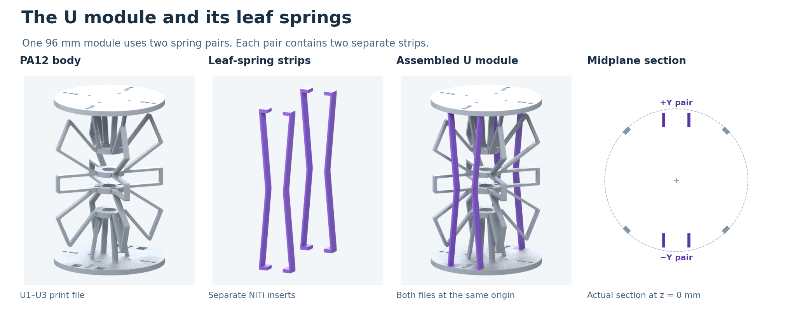
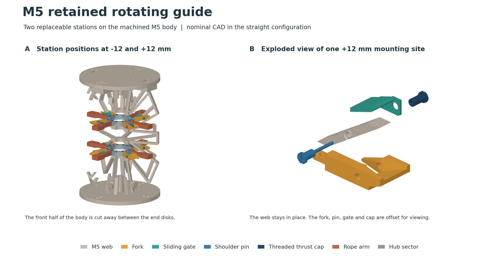

# U4+M2 prototype installation guide

This guide covers the 500 g inspection front simulated on 19 November 2026, from the rear mounting face to the head adapter. Start with the M5 test coupon and the M6 guide fit below. The remaining quantities are for **one complete six-module bench prototype**. The published P3 measurement log has zero specimen rows. Print tolerances, joint strength, friction and fatigue are still open. [Full-cycle engineering report](../reports/projects/motion_control/Yaw_Pitch_Closeout_2026_11_19.md) · [Hardware validation plan](500g_validation_plan.md)

[First test parts](#first-test-parts) · [Full-front print list](#full-front-print-list) · [Materials and hardware](#materials-and-hardware) · [Assembly](#assembly) · [Commissioning](#commissioning)

## Build configuration

From base to tip, the stack is **20 mm base interface → U1 → U2 → U3 → U4 → M5 → M6 → 6 mm head adapter**. Each module is 96 mm long. The six bodies span 576 mm, with seven rigid face-to-face joints including the base and adapter. The **500 g head load includes the adapter**. The sensor housing, harness, rear beam and drive system need their own measured interfaces.

Use the file links below when sending parts to a supplier. Several older directories contain identically named meshes. The current front uses **21 / 24 / 28 mm** lanes, **two separate Ø1.80 × 96 mm NiTi rods**, and eight M guide stations. In module CAD, +Z points towards the head. Each module has local end faces at −48 and +48 mm. Station positions are measured from that module's centre. [Lane and joint dimensions](../cad/lanes_u4m2/guides_v2/lane_design.json) · [Backbone specification](../simulations/u4m2/backbone_20261108/model_data/MODEL_DATA.md#3-niti-backbone-rod)

| Rope set | Radius from centre | Path from the base | Fixed end |
|---|---:|---|---|
| A, four ropes | 21 mm | U1 through U4 | U4 distal disk |
| B, four ropes | 24 mm | All four U modules and all four M5 guide stations | M5 distal disk |
| C, four ropes | 28 mm | All four U modules, all four M5 stations, the M5/M6 interface and all four M6 stations | M6 distal disk |

Label each set **up (+Y), right (−X), down (−Y), left (+X)** in the straight CAD frame. These names stay with the same holes as the body bends. For example, C-up is at (0, +28) mm and C-down at (0, −28) mm on M6. [CAD ray directions](../cad/lanes_u4m2/end_bellmouth_v1/design.json)

For the current M6 fit trial, use the 0.25 mm sockets at −12 and +12 mm. The nominal yaw/pitch archive used the earlier 0.15 mm V3 sockets at those two stations. The four ±24 mm fixed stations use V3 in both configurations. [Wider-socket CAD](../cad/lanes_u4m2/m6_bond_gap_20261119/README.md) · [Round 2 guide checks](../simulations/u4m2/extreme_tests/round2_20261119/results/m6_guides/m6_full.json)

## First test parts

These quantities are for the first bench checks. The fixture stays on the bench. A conforming M6 body and guide from this batch can count towards the full-front quantities.

| Test | Print | Machine, buy or reuse | What to measure |
|---|---|---|---|
| M5 web and pin, P3 fixture | One [PA12 web coupon](../cad/lanes_u4m2/m5_seat_bench_20261119/parts/web_coupon.stl) per specimen. Match the intended M5 process, build direction and conditioning. | One [Ø1.46 mm pin carriage](../cad/lanes_u4m2/p3_pin_fixture_20261119/pin_carriage_bore_1p46.stl), one [coupon carrier](../cad/lanes_u4m2/m5_seat_bench_20261119/parts/coupon_carrier.stl), two [tab covers](../cad/lanes_u4m2/m5_seat_bench_20261119/parts/tab_cover.stl), one [steel shoulder pin](../cad/lanes_u4m2/retained_seat_20261118/parts/shoulder_pin.stl) and one [threaded cap](../cad/lanes_u4m2/retained_seat_20261118/parts/threaded_cap.stl). Provide rigid fixture stock with finish-machined datums, four M2 × 12 screws and nuts, and two Ø2 × 6 mm dowels. | Pilot diameters and coaxiality, pin/cap seating, signed web travel on reversal, residual motion and visible damage. |
| M6 guide-to-body fit at −12 mm | One [M6 bellmouth body](../cad/lanes_u4m2/end_bellmouth_v1/M6_lane_anchorC.stl), one [−12 mm frame](../cad/lanes_u4m2/m6_bond_gap_20261119/M6_z-12_guide.stl) and one [four-cap file](../cad/lanes_u4m2/m6_bond_gap_20261119/M6_z-12_caps.stl). | Four Ø0.35 mm stainless wire closures and four short Ø2 mm rope samples for the C rays. For a loaded module comparison, also fit the module rod and the other three guide stations. | Straight assembly access, the nearest guide/web gap during bending, and pull-through force on each ray in both directions. Measure both the cured tilt and the bore position under load. The nominal 0.25 mm candidate reached 0.0667 mm guide/body clearance at this station. |

For P3, seat the coupon between the carrier and the two mirrored covers. Locate it with the dowels, clamp its end tabs, and register both stages to the web pivot. Fit the shoulder pin and cap from opposite sides using the fixture drawing. Measure the actual Ø1.44 mm pilots and the two nominal Ø1.46 mm bores. Run the P3 rows of the signed load program with calibrated force and two-view displacement measurement. Record both the coupon and the pin-face motion under the same specimen ID. The older bench illustration shows the Ø1.50 mm carriage. [Fixture layout and setup](../cad/lanes_u4m2/m5_seat_bench_20261119/README.md) · [Current carriage and fit limits](../cad/lanes_u4m2/p3_pin_fixture_20261119/README.md) · [Load program](../simulations/u4m2/lanes_20261113/m5_seat_bench_20261119/results/load_program.csv) · [Measurement forms and scoring](../simulations/u4m2/lanes_20261113/p3_pin_fixture_20261119/README.md)

## Full-front print list

Use millimetres at 1:1 scale in the slicer. The candidate material for these parts is **PA12**. Record the powder process, part orientation and finishing route so the coupons reproduce the full build. The earlier print guide proposes SLS or MJF and a vertical module axis. Confirm the supplier can reproduce the 0.50 mm A–B disk wall, the 0.544 mm M5 distal bellmouth bridge and the small web features on a sample. [Disk dimensions](../cad/lanes_u4m2/guides_v2/lane_design.json) · [Bellmouth sections](../cad/lanes_u4m2/end_bellmouth_v1/README.md)

| Printed part | Installed quantity | Use this geometry |
|---|---:|---|
| Base interface | 1 | [28 mm C-lane base](../cad/lanes_u4m2/guides_v2/base_interface.stl) |
| U1, U2, U3 | 3 identical PA12 bodies | [U pass-through body](../cad/lanes_u4m2/guides_v2/U_lane_pass.stl). Fit two separate spring pairs in each one. |
| U4 | 1 PA12 body | [U4 body with A anchors](../cad/lanes_u4m2/guides_v2/U4_lane_anchorA.stl). The same two spring pairs fit U4. |
| M5 | 1 | [Machined-body geometry](../cad/lanes_u4m2/retained_seat_20261118/parts/M5_machined_body.stl). Quote the PA12 body to this final geometry, including the bellmouth exits and eight relieved pin seats. Inspect the seats after printing or finish-machining. |
| M6 | 1 | [Bellmouth body with C anchors](../cad/lanes_u4m2/end_bellmouth_v1/M6_lane_anchorC.stl) |
| Head adapter | 1 | [6 mm plate](../cad/lanes_u4m2/guides_v2/head_adapter.stl) |
| M5 retained-seat forks and gates | 8 forks + 8 gates | At −12 mm print four [negative-station forks](../cad/lanes_u4m2/retained_seat_20261118/parts/fork_-12.stl) and four [matching gates](../cad/lanes_u4m2/retained_seat_20261118/parts/gate_-12.stl). At +12 mm print four [positive-station forks](../cad/lanes_u4m2/retained_seat_20261118/parts/fork_+12.stl) and four [matching gates](../cad/lanes_u4m2/retained_seat_20261118/parts/gate_+12.stl). |
| M5 retained-seat rope arms | 8 | Four [B/C rope arms](../cad/lanes_u4m2/retained_seat_20261118/parts/rope_arm.stl) per retained station |
| Fixed guide frames and inward caps | 6 frames + 24 caps | Print one frame and one cap file from each row below. Each cap file already contains four separate caps. |

| Module | Station z (mm) | Frame STL | Four-cap STL |
|---|---:|---|---|
| M5 | −24 | [M5 −24 frame](../cad/lanes_u4m2/guides_v3/M5_z-24_guide.stl) | [M5 −24 caps](../cad/lanes_u4m2/guides_v3/M5_z-24_caps.stl) |
| M5 | +24 | [M5 +24 frame](../cad/lanes_u4m2/guides_v3/M5_z+24_guide.stl) | [M5 +24 caps](../cad/lanes_u4m2/guides_v3/M5_z+24_caps.stl) |
| M6 | −24 | [M6 −24 frame](../cad/lanes_u4m2/guides_v3/M6_z-24_guide.stl) | [M6 −24 caps](../cad/lanes_u4m2/guides_v3/M6_z-24_caps.stl) |
| M6 | −12 | [M6 −12 frame](../cad/lanes_u4m2/m6_bond_gap_20261119/M6_z-12_guide.stl) | [M6 −12 caps](../cad/lanes_u4m2/m6_bond_gap_20261119/M6_z-12_caps.stl) |
| M6 | +12 | [M6 +12 frame](../cad/lanes_u4m2/m6_bond_gap_20261119/M6_z+12_guide.stl) | [M6 +12 caps](../cad/lanes_u4m2/m6_bond_gap_20261119/M6_z+12_caps.stl) |
| M6 | +24 | [M6 +24 frame](../cad/lanes_u4m2/guides_v3/M6_z+24_guide.stl) | [M6 +24 caps](../cad/lanes_u4m2/guides_v3/M6_z+24_caps.stl) |

The six bodies, two end plates, six fixed frames, 24 separate caps, eight forks, eight gates and eight rope arms total **62 PA12 pieces**. The wire-envelope STLs show the space occupied by real lockwire. The U leaf-spring STL shows the shape of the NiTi inserts. Keep both off the polymer print order. [V3 part definitions](../cad/lanes_u4m2/guides_v3/README.md) · [Spring sections](../cad/lanes_u4m2/guides_v2/spring_strip.json)

## Materials and hardware

Quantities below are installed quantities for one front. Add stock separately for trimming, test coupons or spares. The P3 fixture hardware is listed above.

| Buy or source | Quantity | Specification and use |
|---|---:|---|
| Superelastic NiTi leaf-spring strips | 16 individual strips (8 pairs) | Each U uses two opposed pairs of two strips, 94.0 mm long. The central strip is about 6 mm wide and 1.03–1.18 mm thick across the sampled sections. Quote the inward bend and shaped ends from the [spring geometry](../cad/lanes_u4m2/guides_v2/U_leaf_springs.stl) and [source STEP, solids 2–5](../cad/modules/UniDirectional_96.step). A substitute made from flat stock needs a profile, fit and stiffness check. |
| Straight superelastic NiTi round stock | 2 finished lengths | Ø1.80 × 96.0 mm each. One separately end-bonded rod per M module. Order enough stock for cutting and deburring. |
| Ø2.0 mm PA6 monofilament test line | 12 runs, four per set | The solver uses a solid PA6 surrogate with axial stiffness EA about 10.4 kN. For a 1 m external run, initial handling blanks are approximately A 1.51 m, B 1.60 m, C 1.70 m each, or **19.24 m** total. Measure the actual winch span and add drum wraps, termination allowance and test stock before purchase. The controller's unstretched-length entries serve a different purpose from these cutting lengths. |
| Rope-tail crimp sleeves | 12 | One aluminium or copper sleeve matched to Ø2 mm line per anchor, outer diameter up to 3.5 mm, about 6 mm long in the original anchor proposal. Pull-test the chosen sleeve, line and crimp tool on a spare anchor. These sleeves are fitted to rope tails only. |
| Module-joint dowels, screws and nuts | 14 of each | Ø2 × 8 mm steel dowels, M2 × 10 A2 socket-head screws, and plain M2 hex nuts (4 mm across flats, 1.6 mm thick). Two of each per joint. |
| Base and adapter inserts and screws | 8 of each | M3 × 4 mm heat-set inserts for the nominal Ø4.0 mm pockets, four per end. Select the length of the eight mating M3 screws after measuring the rear plate, head plate and available thread depth. Both external bolt patterns are provisional. |
| Stainless lockwire | 24 closures | Ø0.35 mm wire, one closure per fixed saddle/cap. Allow stock for the actual closing tails. |
| Adhesives | Per test lot | Source a two-part structural adhesive candidate compatible with PA12 and NiTi for springs/rod ends, and qualify a PA12 guide-land adhesive and preparation. Record the product, preparation, bond line and cure. Glue belongs only on the specified fixed interfaces. |

**Custom retained-seat hardware.** Quote these shapes against their drawings or meshes. The small thread forms, material grades, torque and retention still require supplier and specimen checks. Per M5 there are two retained stations with 44 components each, excluding the common body. [Part materials](../cad/lanes_u4m2/retained_seat_20261118/parts/parts.json) · [Assembly layout](../cad/lanes_u4m2/retained_seat_20261118/assembly.scad)

| Custom item | Per station | Total | Geometry for the order |
|---|---:|---:|---|
| Aluminium hub sectors | 4 upper + 4 lower | 8 upper + 8 lower | Use the 19 November sectors with a 0.15 mm inner-edge chamfer. [Upper sector](../cad/lanes_u4m2/m5_hub_relief_20261119/parts/hub_upper_sector.stl) · [Lower sector](../cad/lanes_u4m2/m5_hub_relief_20261119/parts/hub_lower_sector.stl) |
| Steel shoulder pins and threaded thrust caps | 4 pairs | 8 pairs | Ø0.60 mm shaft, 0.15 mm tail-thread pitch. [Pin](../cad/lanes_u4m2/retained_seat_20261118/parts/shoulder_pin.stl) · [Cap](../cad/lanes_u4m2/retained_seat_20261118/parts/threaded_cap.stl) |
| Steel sector-lap screws | 8 | 16 | 0.20 mm pitch. [Lap screw](../cad/lanes_u4m2/retained_seat_20261118/parts/lap_screw.stl) |
| Steel tongue-lock screws | 8 | 16 | 0.25 mm pitch. Four secure forks and four secure rope arms per station. [Tongue screw](../cad/lanes_u4m2/retained_seat_20261118/parts/hub_screw.stl) |

**Bench equipment.** Arrange a straight alignment jig, pin gauges and reamers, suitable NiTi cutting and deburring tools, controlled insert tooling, the matched crimp tool, a low-profile side drive and opposed pin/cap drivers. For instrumented tests, arrange calibrated force measurement at both ends of a test line, dimensional/optical measurement fine enough to resolve the target gap, and a scale. The full rig needs 12 independently commanded rope channels with displacement and tension readout, head-axis tracking, a supported rear clamp, and a measured head/harness or registered test surrogate. The repository supplies load and travel data for sizing that equipment. Motor, sensor and adhesive products have not been qualified. [Winch and load data](../simulations/u4m2/lanes_20261113/cycle_closeout_20261119/README.md) · [In-cage driver envelope](../simulations/u4m2/lanes_20261113/m5_retained_seat_20261118/results/side_drive.json)

## Assembly

### 1. Inspect and mark the loose parts

1. Mark the proximal face (base end), distal face (head end) and +Y ray on each body. The exported bodies already include the U −45° and M −22.5° internal clocking. Align like-marked rays when stacking. Depowder all passages, inspect the webs and check each anchor groove with a sample of the actual Ø2 mm rope.
2. Gauge the Ø2.5 mm disk bores and the M guides' Ø2.6 mm throats and Ø3.0 mm rounded mouths. Inspect the curved entry and exit surfaces and the bridges between adjacent holes under magnification. Keep the bellmouth profiles intact when removing powder. The M centre bores are nominally Ø1.85 mm. Check a straight Ø1.80 mm rod through each end sleeve by hand. [End sections and bridge measurements](../cad/lanes_u4m2/end_bellmouth_v1/README.md)
3. Prepare the seven module joints on the 12.5 mm radius. Left/right holes are Ø1.9 mm dowel pilots. The proposed finish is Ø2.00 H7 in the distal face of the part behind and nominal Ø2.02 mm slip fit in the proximal face of the next part. Check the Ø2 m6 dowel fit on a spare print first. The up/down screw holes are Ø2.2 mm. The base rear and adapter front receive the screw heads in Ø4.2 mm counterbores. [Joint details](../cad/lanes_u4m2/guides_v2/lane_design.json)
4. Check the real mounting plates against the diagonal M3 patterns at 17 mm radius on the base rear and 20 mm on the adapter front. On matched plates, trial the insert process on a spare, then set the four inserts per end square and flush. Weigh the parts and record as-built dimensions before bonding.

### 2. Install the U-module leaf springs

For an adhesive-free single-leaf fit trial, use the [proximal and distal mechanical joint coupons](../cad/lanes_u4m2/u_leaf_mechanical_joint/README.md). They include section drawings and U4 anchor clearances. The bonded assembly below is the existing full-module baseline.

The dark-purple, nearly straight members in the CRAFT U-module illustration are the **leaf springs**. Each illustrated spring is a pair of blades that draw closer together near the middle. In the 96 mm ASRC module one pair runs along +Y and the other along −Y. The four zigzag Octo-Flex ribs are integral to the PA12 body. The dark-purple blades are separate inserts. [Original labelled CRAFT figure](https://github.com/ContinuumRoboticsLab/CRAFT/blob/d90b56b1eef5c3dbd116e9e19423d34a606f3b29/media/craft_overview.png)

To inspect either U body before assembly, open the [U spring assembly view](../cad/lanes_u4m2/guides_v2/U_spring_assembly.scad) in OpenSCAD beside the two body STLs and [spring STL](../cad/lanes_u4m2/guides_v2/U_leaf_springs.stl). Press **F5**, choose **U1-U3** or **U4**, and switch between **assembly**, **body** and **springs**. The meshes share an origin and clocking. The strip centres in each pair are 18.12 mm apart at z = ±40 mm and 11.20 mm apart at the midplane. The two pairs lie on opposite sides at y = ±26.41 mm. Send the body STL to the PA12 printer and the strip geometry to the spring supplier.

Fit the four 94 mm NiTi strips in each of U1–U4. Support the straight module and feed each strip through its proximal through-pocket into its 2 mm deep distal blind pocket. Match its broad face to the long side of the pocket. Check the nominal 7.05 × 6.33 mm shaped end against the pocket. Seat the distal end on the bottom and check the proximal end sits about 1 mm below its disk face. Bond the end seats using the preparation and cure verified on a PA12/NiTi sample. Keep the free spring length, ropes and disk mating surfaces clear. After cure, check seating, bend and release the module, and measure the bending response of a representative U. [Spring geometry](../cad/lanes_u4m2/guides_v2/spring_strip.json) · [Module test plan](../simulations/u4m2/backbone_20261108/M_BACKBONE_TEST_PLAN.md)

### 3. Assemble the two rotating guides inside M5

Use the relieved M5 body in the print list. Hold it straight and work with the cage open, before fitting the outer guides, rod or ropes. Each of the two stations at z = −12 and +12 mm mounts to four diagonal webs at radius 19.229 mm. The pivots are at −22.5°, 67.5°, 157.5° and 247.5° about the axis.

1. Inspect all eight relieved web seats, including the nominal Ø0.64 mm waist and crowned thrust faces. Check the Ø0.60 mm steel shaft and cap on a coupon first. These profiles allow the web to rotate and tilt.
2. Insert the **19 November chamfered hub sectors** radially through the cage. Offer each sector 1.4 mm towards the nearer outer end of the module and then slide it axially into the station plane. At −12 mm install the four upper-lap sectors first. At +12 mm install the four lower-lap sectors first. Alternate the eight sectors every 45°. Support them until the eight lap screws engage.
3. At each diagonal web insert the fork for that station radially, seat its off-axis tongue in the hub and install its tongue-lock screw. Introduce the shoulder pin from the negative local tangential side. Slide the matching gate in from the positive side, then fit the threaded thrust cap using opposing drivers. Check that the gate is retained and the web can still move. Keep adhesive away from this bearing.
4. Fit the four rope arms through the cardinal openings. Lock each arm tongue and check that the B and C holes are at 24 and 28 mm. Verify tool access and record engagement before closing the cage. The simulated side drive for the lap screws was 2.50 mm across, 1.15 mm high with a Ø0.80 mm lateral shaft. Actual tool engagement and tightening torque need a specimen trial. [Assembly and section views](../cad/lanes_u4m2/retained_seat_20261118/README.md) · [Current hub edges](../cad/lanes_u4m2/m5_hub_relief_20261119/README.md)

The 18 November view shows how the components fit together. Use the 19 November sector files in the hardware table for the current hub.

### 4. Fit the six fixed guides and the two backbones

1. Dry-fit the labelled frame from the specified revision at each station in the print list. M5 and M6 at ±24 mm locate on four **inner** webs near radius 6.896 mm. Only M6 uses this fixed guide at ±12 mm, on four **outer** webs near radius 19.229 mm. Demonstrate insertion of the closed frame through the real cage, cap access and rope alignment on the first sample. Set aside any station that requires forcing or permanent deformation.
2. Seat each web in its socket and close from the inside with its matching cap. At M6 ±12 mm the proposed adhesive land is only 0.5 mm long axially, with a nominal 0.25 mm gap per side in the fit-test candidate. Keep the 1.5:1 flared relief clear. At ±24 mm use the original inner-web socket geometry. Once the adhesive and surface preparation have passed the sample test, bond at the intended fixed interfaces and secure each cap with a separate Ø0.35 mm wire in its 0.45 mm groove. The design relies on the bond to resist axial slip. The wire closes the cap radially. Trim and position closure tails clear of the ropes and moving webs, then verify clearance through a bend. [M6 fit-test socket and land](../cad/lanes_u4m2/m6_bond_gap_20261119/README.md) · [Original V3 socket and land](../cad/lanes_u4m2/guides_v3/README.md) · [Inner-web socket and closure](../cad/lanes_u4m2/guides_v2/README.md)
3. Deburr the **two Ø1.80 × 96.0 mm rods**. Fit one flush from face to face in M5 and one independently in M6. Each end has a 3 mm disk and a 12 mm integral sleeve. Trial-fit the rod, then bond only the 15 mm at each end using the qualified sample process. This leaves 66 mm free to bend. Keep the central guide hubs clear, the M5/M6 joint free of adhesive and the mating faces clean. Cure each module straight. Check for slip, binding and return after bending. U4 supplies the proximal stop and the head adapter has 1 mm tip relief. The build has no backbone end ferrule. [Backbone model](../simulations/u4m2/backbone_20261108/model_data/MODEL_DATA.md#3-niti-backbone-rod) · [Sleeve dimensions](../cad/lanes_u4m2/guides_v2/lane_design.json)

### 5. Stack the bodies and terminate each rope while its distal face is exposed

At each joint place two Ø2 × 8 mm dowels in the left/right press-fit holes of the rearward part, nominally 5 mm proud. Slide the next part over them. Fit two M2 × 10 screws and plain nuts in the up/down holes. At the ends the heads sit in the base or adapter counterbores and the nuts sit inside U1 or M6. Use a clamping torque established on the matched PA12 joint. Check face seating around the circumference with a 0.05 mm feeler gauge and verify that a tagged line passes the aligned holes before proceeding.

| Stage | Threading and closure sequence |
|---|---|
| Base → U1 → U2 → U3 → U4 | Join the bodies in order on the straight jig. Feed or draw the twelve labelled ropes through the base and all four U modules. Keep each rope on its own ray and radius. Leave enough free end or a tagged threading leader on B and C. On the still-exposed **U4 distal face**, finish the four **A** anchors. |
| U4 → M5 | Feed the four B and four C ropes through their corresponding M5 guide arms and disks, check each path, then close the U4/M5 joint. Finish the four **B** anchors on the still-exposed **M5 distal face**. Leave the four C ropes free. |
| M5 → M6 | Feed the four C ropes through M6 before closing the joint. Each C rope crosses the M5/M6 shared bore and can move laterally there. Keep it clear of adhesive, ties and liners at the interface. Finish the four **C** anchors on the still-exposed **M6 distal face**. |
| M6 → head adapter | Inspect all four C terminations and the rod tip. Offer the adapter to the dowels. Check the 1 mm central relief and seat the plate flush before tightening. |

**Making one anchor.** Lay the Ø2 mm rope in the 2.2 × 2.2 mm groove on its distal disk. The U4/A groove runs 3.5 mm **radially inward**. The M5/B and M6/C grooves run 5 mm **tangentially**. Return the tail through its separate Ø2.5 mm hole into the anchor block. Crimp the matched sleeve onto the tail against the block's inner face. Check that the loop is below the mating face, the sleeve holds under the established specimen test load and the free tail clears the adjacent ropes and screws. Repeat on all four rays and inspect each termination **before** the next part covers it. [Anchor geometry](../cad/lanes_u4m2/guides_v2/lane_design.json) · [C-rope shared interface](../simulations/u4m2/lanes_20261113/shared_bore_20261119/README.md)

### 6. Mount the head, clamp and winches

Fasten the base to the supported rear plate and mount the head on the adapter with the matched M3 screws. Weigh the complete installed head assembly **including the adapter** against the 500 g model input. Measure the housing, centre of mass and cable exit relative to the adapter. The U centres are solid. Trial the external harness through the full bend and withdrawal envelope. Support the front while connecting each labelled rope to its corresponding winch, then record its free span, drum reference, zero load and direction of pull. For comparison with the simulated tank run, set the fixture inclination to 20° and register the steering clamp position 15 mm past the opening. [Mission boundary conditions](../simulations/u4m2/lanes_20261113/cycle_closeout_20261119/results/provenance.json) · [Adapter sweep and housing limits](../reports/projects/motion_control/Yaw_Pitch_Closeout_2026_11_19.md)

## Commissioning

| Order | Bench action | Record before advancing |
|---:|---|---|
| 1 | On separate specimens test the crimp and anchor, the rod/spring bonds, the fixed saddle retention and the M5 pin coupon. Check unloaded and reversed loads, then inspect for cracks, set, slip or wire contact after cycling. | Actual print condition, dimensions, applied forces, residual displacement and damage. The P3 form distinguishes motion of the web from motion of the pin/fixture. [P3 measurement forms](../simulations/u4m2/lanes_20261113/p3_pin_fixture_20261119/README.md) |
| 2 | Check each line by hand with the module straight and gently bent. Measure applied and distal force for both pull directions through the real guide and bellmouth, including reversal. Inspect M6 at −12 mm while bending. | Force loss, hysteresis, guide movement, smallest observed gap and measurement uncertainty. The earlier 0.15 mm V3 socket reached 0.02047 mm in the selected cycle checks. The minimum with the 0.25 mm candidate at −12 mm was 0.0667 mm over the full mission. [Candidate guide gaps](../simulations/u4m2/extreme_tests/round2_20261119/results/m6_guides/m6_full.json) · [Earlier CAD witness](../simulations/u4m2/lanes_20261113/cycle_closeout_20261119/results/yaw_pitch/solid_motion_0p5.json) |
| 3 | On the supported straight rig, calibrate all twelve channels and bring each line to the nominal 3 N pretension. Run small commands first. Recheck every joint, rope tail, guide, harness and rod end under load. | All twelve winch tensions and lengths, available distal force, head direction and clamp position. Pause and support the front if a rope falls below the 2.5 N operating floor, a joint shifts or a line catches. |
| 4 | Once the preceding checks pass, progress towards the 500 g mission on the instrumented bench. Straighten under load, insert, turn to +175° then return, turn to −175° then return, pitch to +90° then return, pitch to −90° then return, and withdraw. Neutral is at 0° yaw and +20° elevation. Both pitch limits are absolute elevations from horizontal. | Compare each event against the recorded forces and the measured head axis, especially at vertical. Use actual housing and harness clearance. Inspect wear and residual set after withdrawal. [Twelve-rope event table](../simulations/u4m2/lanes_20261113/cycle_closeout_20261119/results/yaw_pitch/ROPE_TENSIONS.md) · [Full cycle data and commands](../simulations/u4m2/lanes_20261113/cycle_closeout_20261119/README.md) |

The ideal cycle reached 21.554 N on C-up near +69° pitch. A separate sliding-friction calculation at assumed μ = 0.15 reached only 1.152 N distally across the four turning commands. Use these figures to select the measurement range and compare the prototype. Working-load ratings and test loads for the chosen line, crimps and joints still require physical evidence. Release decisions also require measured stiffness, actuator response, full housing clearance and durability. [Full-cycle engineering results and open tests](../reports/projects/motion_control/Yaw_Pitch_Closeout_2026_11_19.md) · [Validation plan](500g_validation_plan.md)
