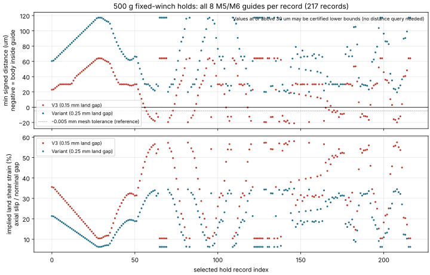

# Evening Engineering Report — 2026-11-16

**Edition: Evening Report.** Run start and reporting cutoff:
**16 November 2026 20:02:13 EST (17 November 2026 01:02:13 UTC)**. Execution
deadline: **22:02:13 EST (03:02:13 UTC)**, a 120-minute limit. Expensive work
was due to stop by 21:37:13 EST (02:37:13 UTC). Run records:
[run context](../../simulations/u4m2/lanes_20261113/evening_20261116/run_context.json).

## Outcome

The V3 guide-to-web interference is **more widespread than the selected-pose
audits showed**. Its cause is mechanical, not a meshing artefact.

- A new full-coverage screen checks all **217 saved 500 g holds against all
  eight M5/M6 guides** (1736 checks), and its pass/fail result agrees with the
  manifold Boolean in all 54 comparisons. Published V3 penetrates the M5 body
  in **59 of 217 records** (103 checks), at both M5 ±12 mm outer saddles,
  during insertion holds and both yaw excursions and returns. The worst depth
  is **−0.0211 mm**. The morning audit had 6 failures out of 48 checks on six
  selected poses.
- **Mechanism:** module curvature reaches 0.0175 rad/mm. Across the 3.24 mm
  socket, the bent section moves web points just outside the bonded 0.5 mm land
  axially by up to 0.127 mm into the land-to-flare corner. The same motion
  shears the land itself by up to **0.087 mm**, which is **58% shear strain** in
  the 0.15 mm bond line.
- **Candidate improvement:** increasing the land bond gap to **0.25 mm** (land,
  relief slope, stations and rope bores unchanged) clears **all 1736 checks**
  (minimum +0.0182 mm). Independent Booleans also find no overlap: 10 checks at
  0.25 mm on the five worst records and 48 checks at 0.5 mm on six poses × 8
  guides. Implied land shear strain falls to **35%**.

**Not released for manufacture.** The 35% shear demand is far beyond what a
rigid structural bond can be assumed to carry. No adhesive is selected or
tested. The kinematics come from a homogenised beam map, whereas at ±12 mm
the real section is four inclined struts. The next step is a strut-level
joint model, not more geometric relief.

## Reporting period and repository state

- **Interval:** 15 November 2026 20:02:13 EST → 16 November 2026 20:02:13 EST,
  equivalent to 16 November 2026 01:02:13 UTC → 17 November 2026 01:02:13 UTC.
- **Fetched refs at start:** `origin/main` = `e9c4858`;
  `codex/guide-validation` = `df19061` (one commit ahead of main);
  `claude/great-goodall-1wf2yh` = `e804068`, already contained in main.
  No other branch had commits in the interval.
- **Reconciliation:** the working branch was reset to `origin/main`, which is
  a fast-forward from its contained remote tip, and `codex/guide-validation`
  was merged without conflicts. The morning work is therefore on this branch;
  it has not been merged into `main` by this run.

### Repository updates in the interval (counted once)

| Commit | Time (Eastern / UTC) | Update | Status |
|---|---|---|---|
| `e804068` | 11-15 20:35:30 EST / 11-16 01:35:30 UTC | Evening Report 2026-11-15: finite-rope end exits, M5/M6 bellmouth CAD | Reported in the [15 Nov Evening Report](Evening_Report_2026_11_15.md); counted there |
| `e9c4858` | 11-15 21:32:30 EST / 11-16 02:32:30 UTC | Merge of PR #28 into `main` | Integration only |
| `df19061` | 11-16 08:18:31 EST / 11-16 13:18:31 UTC | Morning Report 2026-11-16: constrained bellmouth routing in the solver, 217 re-solved fixed-winch holds, rigid-end and tank checks, mount refinement | Previous work, see below |

**Same-day morning work** ([Morning Report](Morning_Report_2026_11_16.md)).
The morning run added constrained frictionless bellmouth paths that close at
the actual guide centres. It re-solved 217 fixed-winch holds (199 unique) with
reconstructed rest lengths, changing head pose by up to 3.48 mm, 1.15° yaw and
0.63° elevation. It found 0/5208 rigid-end rope failures within the 0.005 mm
mesh tolerance and exported simultaneous guide/station load tables. It ran a
16-cell check on five holds. Its mount study found 6/48 V3 contacts at 0.5 mm,
and all six persisted at 0.25 mm (maximum 0.009765 mm³). This evening's run
starts from that last open item, the morning handoff's first priority.

## 1. Why the priority was chosen

The morning handoff ranked the guide-to-web joint first. The user constraints
prioritise actual guide/body interference. The morning evidence covered only
six poses for this failure. A defensible joint concept needs to know:

- how often and where the contact happens across the whole saved path;
- what relative motion the joint must absorb.

That fits an 80-minute window; a strut-level FE model does not. This run
therefore built the full-coverage measurement and tested one geometric
variant against it. The joint's load path is handed over rather than claimed.

## 2. New full-coverage compatibility screen

[`guide_web_compatibility.py`](../../simulations/u4m2/lanes_20261113/guide_web_compatibility.py)
works as follows:

- It samples the complete, watertight bellmouth-body surface near each guide
  (0.03 mm spacing; 139k–262k points per guide).
- It maps the points with the same exact constant-strain-cell beam map and
  station frames used by the Boolean audits.
- It evaluates their signed distance to every closed guide, cap and lockwire
  envelope component.

Points whose straight clearance minus displacement exceeds 0.03 mm are
certified clear (the signed distance is 1-Lipschitz), which cuts run time
without approximation. Shards partition unique geometries. A merge tool
rejects mismatched inputs or incomplete coverage.

**Calibration against the manifold Boolean:**

| Comparison | Boolean | Screen | Agreement |
|---|---|---|---|
| Morning 0.5 mm audit, 6 poses × 8 guides | 6 fail / 42 pass | same 6 fail / 42 pass, same worst case | 48/48 |
| Morning 0.25 mm, records 63/64/146 × M5 ±12 | 6 fail | 6 fail | 6/6 |
| New V3 0.25 mm: records 143, 208 | 0.009675, 0.008132 mm³ | −0.0210, −0.0199 mm | 2/2 |
| New V3 0.25 mm near threshold: records 118, 105 | 1.9e−6, 2.0e−6 mm³ | −0.00035, −0.00038 mm | 2/2 |
| New V3 0.25 mm near threshold: records 168, 205 | 0 | +0.0018, +0.0029 mm | 2/2 |

Halving the sample spacing to 0.015 mm changes the worst V3 result from
−0.02111 to −0.02108 mm and leaves the variant's +0.0182 mm unchanged.
Point sampling detects body points inside guide parts. It cannot prove zero
intersection, so Boolean confirmation on the worst records remains part of
the acceptance procedure.

## 3. Published V3 result (all 217 holds)

| Phase | Records | Penetrating records | Worst signed distance (mm) | Max implied land shear |
|---|---:|---:|---:|---:|
| startup | 29 | 0 | +0.0229 | 36% |
| straighten | 6 | 0 | +0.0229 | 36% |
| entry / exit | 4 / 4 | 0 / 0 | +0.0640 | 10% |
| inverse (insertion holds) | 36 | 9 | −0.0179 | 57% |
| right out / right return | 34 / 34 | 12 / 13 | −0.0179 | 57% |
| left out / left return | 36 / 34 | 10 / 15 | −0.0211 | 58% |

| Guide | Penetrating records | Minimum (mm) | Max land axial slip (mm) |
|---|---:|---:|---:|
| M5 z+12 | 59 | −0.0211 | 0.0871 |
| M5 z−12 | 44 | −0.0111 | 0.0846 |
| M6 z−12 / z+12 | 0 / 0 | +0.0209 / ≥0.030 | 0.0551 / 0.0472 |
| M5 ±24, M6 ±24 | 0 | ≥ +0.030 | ≤ 0.0339 |

The straight assembly has only **0.0844 mm** minimum clearance at the outer
saddles, less than the 0.15 mm nominal gap, because the lofted socket follows
the sloped web. At record 146, the worst sampled web point starts 0.358 mm
from the station plane and moves −0.127 mm axially, which carries it into the
corner where the land meets the flare. Phase labels are those of the saved
holds. These are sampled holds from the full path (startup, insertion, both
excursions and returns, withdrawal-side straightening), **not** a continuous
trajectory replay.

## 4. Variant: 0.25 mm land bond gap

`cad/lanes_u4m2/guides_v3/build.py` gained `--land` and `--bond-gap` options.
With default arguments its output is byte-identical to the unmodified
builder, so the published V3 files are unchanged. The variant is
`build.py --bond-gap 0.25`, saved as evidence CAD in
[`cad_v3_gap0p25/`](../../simulations/u4m2/lanes_20261113/evening_20261116/cad_v3_gap0p25/design.json).
All eight straight assemblies are clear; each guide is one watertight
component and caps/wires are four watertight components each. Rope-bore
regions match V3 to **0.0 mm** in all eight guides.

| Metric | V3 | Variant |
|---|---:|---:|
| Straight min clearance, outer / inner (mm) | 0.0844 / 0.1477 | 0.1406 / 0.2462 |
| Penetrating checks of 1736 | 103 | **0** |
| Minimum signed distance (mm) | −0.0211 | **+0.0182** |
| Boolean 0.25 mm, five worst records × M5 ±12 | 8 of 8 tested fail | **10/10 clear** |
| Boolean 0.5 mm, six poses × 8 guides | 6/48 fail | **0/48** |
| Max implied land shear strain | 58% | **35%** |
| Net module mass change | — | ≈ −0.0003 g |

The +0.018 mm margin is above the 0.005 mm mesh tolerance used elsewhere. It
is still small, and no print tolerance or assembly stack-up is included. The
variant also enlarges the inner ±24 mm socket gaps, because the builder
shares `bond_gap_mm`. The mass change is negligible, so the holds were not
re-solved. Guide stations and routing are unchanged, so the solver inputs
stay consistent. A thicker bond line, however, lowers positional stiffness;
that support compliance is **not** in the rod model.

## 5. Failed checks, rejected options and interruptions

- **V3 rejected again** with fuller evidence: 59/217 records penetrate.
- **The variant is not a joint design.** It removes kinematic contact. It
  does not show that the 0.5 mm land, about 5.67 mm² per saddle, can carry
  35% cyclic shear or the 28.45 N peak station load.
- **Dependency failures:** the environment had no geometry packages. The
  system Pillow was broken and had to be reinstalled. The first control-test
  run errored because `OCP` was missing, and the second because
  `cadquery-ocp 8.0` lacks `TDF_LabelSequence`. With 7.8.1.1.post1 all 14
  pass. Both failure logs are kept.
- No study was interrupted. All screens and Booleans completed within their
  time caps.

## 6. Validation

- 35 geometry tests (31 existing + 4 new) and 14 control tests pass.
  `validate_configs.py` reports 11 valid configuration files.
- Merged summaries verify that each of 217 records appears once per guide in
  each design, with identical archive, body and guide hashes across shards.
- Published-V3 rebuild check: the maximum relative volume difference from the
  committed STLs is 5.8e−12 (library float noise). Those files were not
  regenerated.
- Hashes of the new evidence are in
  [SHA256SUMS](../../simulations/u4m2/lanes_20261113/evening_20261116/SHA256SUMS).
  Relative links in the changed Markdown were checked. The repository's
  English-only publication check was run on the outgoing files.

## 7. Remaining limitations

- Results come from a **homogenised beam map**: CAD sections move rigidly with
  the rod section. Strut-level bending and twist near the saddle are not
  modelled, and the shear-strain figure is a demand estimate.
- Guide support compliance, bond strength, fatigue, creep, friction, print
  tolerance and assembly access are unquantified. Positive quasi-static
  tangents from the morning holds are not dynamic-stability proof.
- No closed-loop trajectory was replayed. The 0.359° historical 8-to-16-cell
  elevation discrepancy is not resolved by this work.
- No hardware evidence exists.

## 8. Next-run handoff (summary)

1. **Strut-level model of the ±12 mm saddle joint.** Compare its local slip
   with the 0.087 mm homogenised estimate, and quantify bonded versus
   unbonded module stiffness.
2. **Choose a joint concept from that slip.** Candidates are an elastomeric
   bond line, a single-web axial datum with sliding saddles, or the 0.25 mm
   variant. Accept only with 0/1736 screen failures, Boolean confirmation,
   unchanged rope bores and a stated load path.
3. **Re-solve and replay only after** mount stiffness or guide positions
   change materially.

Full details, acceptance checks and resource notes are in the
[HANDOFF](../../simulations/u4m2/lanes_20261113/evening_20261116/HANDOFF.md)
and the [evidence README](../../simulations/u4m2/lanes_20261113/evening_20261116/README.md).
