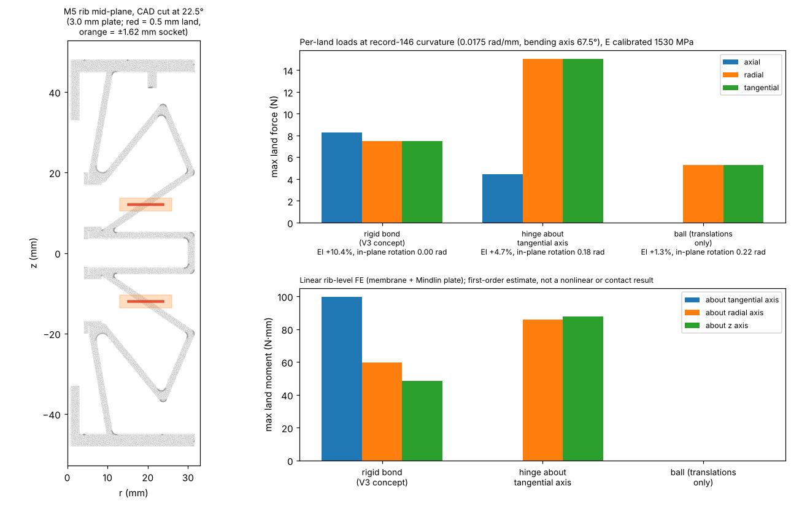

# Evening Engineering Report — 2026-11-17

**Edition: Evening Report.** Run start and reporting cutoff:
**17 November 2026 20:02:11 EST (18 November 2026 01:02:11 UTC)**. Execution
deadline: **22:02:11 EST (03:02:11 UTC)**, a 120-minute limit. Expensive work
was due to stop by 21:37:11 EST (02:37:11 UTC). Run records:
[run context](../../simulations/u4m2/lanes_20261113/evening_20261117/run_context.json).

## Outcome

This run carried out the first priority of the previous handoff: a
**strut-level model of the M5 ±12 mm guide joint**. It shows that the
published rigid bonded land is mechanically intrusive. It also shows that the
homogenised beam map used in all earlier joint checks understates the local
motion.

- **The CAD corrected the handoff premise.** The M body is **eight 3.0 mm
  flat radial ribs**, joined only by the end disks and four small inner rings.
  It is not "four 16 mm² struts". Each ±12 mm guide grips one 1.53 × 3.0 mm
  inclined strut on each of four ribs.
- **New calibrated model.** A membrane plus Mindlin plate superelement of the
  actual CAD rib is assembled in 3D. One PA12 modulus, **E = 1530 MPa ± 1%**,
  reproduces all three database stiffnesses (EA, EI and GJ) with that single
  free parameter. Two meshes agree within 1%.
- **The rigid bond fights the module.** At the worst V3 hold (record 146)
  each bonded land carries about **8.3 N axial, 7.5 N radial and tangential,
  and up to 100 N·mm moment**. The bond stiffens the module by **+10.4% in
  bending and +11.8% in torsion**, which the solver does not include. This
  also applies to the 16 November 0.25 mm bond-gap candidate.
- **The homogenised map understated the incompatibility 6.2-fold**: 0.535 mm
  versus 0.086 mm at the four lands (in-plane stage). The earlier 35–58%
  bond-shear estimates were therefore optimistic.
- **The least intrusive idealisation is a translation-only (ball/point)
  attachment**: about 5.3 N radial and tangential, no moments, EI +1.3%,
  GJ unchanged. It needs about 0.22 rad of rotation freedom, and strut motion
  inside the socket reaches up to 0.92 mm. The V3 socket cannot provide this,
  so new CAD is required. A tangential-axis pin is **not** load-free once
  out-of-plane rib stiffness is included.

**Status.** Nothing was released and no CAD or solver input was changed. All
results are linear, scaled to a module rotation of about 1.68 rad, and they
are first-order estimates. A nonlinear check is the next step.

## Reporting period and repository state

- **Interval:** 16 November 2026 20:02:11 EST → 17 November 2026 20:02:11 EST,
  equivalent to 17 November 2026 01:02:11 UTC → 18 November 2026 01:02:11 UTC.
- **Fetched refs at start:**
  - `origin/main` = `b8c0f3a`;
  - `claude/great-goodall-1wf2yh` = `db34ee0`, already contained in main;
  - `codex/guide-validation` = `df19061`, contained in main.
  - The other branches (`codex/internal-rope-guides`, `codex/kevin`,
    `codex/reach-extension-study`, `copilot/review-outdated-prototype-files`)
    have no commits after 14 November.
- **Reconciliation:** the working branch was fast-forwarded to `origin/main`;
  nothing needed merging.
- **No Morning Report** for 17 November exists on GitHub. The most recent
  morning work is the [16 November Morning Report](Morning_Report_2026_11_16.md).

### Repository updates in the interval (counted once)

| Commit | Time (Eastern / UTC) | Update | Status |
|---|---|---|---|
| `db34ee0` | 11-16 20:37:13 EST / 11-17 01:37:13 UTC | Evening Report 2026-11-16: full-coverage guide/web screen, 0.25 mm bond-gap candidate | Previous run; reported in the [16 Nov Evening Report](Evening_Report_2026_11_16.md) |
| `b8c0f3a` | 11-16 21:41:02 EST / 11-17 02:41:02 UTC | Merge of PR #29 (the commit above, and the 16 Nov Morning Report already merged in it) into `main` | Integration only |

No other engineering commits were made in the interval. Everything below is
new work by this run.

## 1. Why this priority

Both the previous handoff and the user constraints put guide/body
interference first. The 16 November run had removed the kinematic contact
with a 0.25 mm bond gap, but it left open whether a 0.5 mm bonded land can
work at all. That answer depends on how the real M structure deforms near
the land, and the homogenised beam map cannot show that.

A calibrated rib-level model fitted the 80-minute window. A new joint CAD
would not have fitted, and it would have been premature without the model.

## 2. Geometry found in the CAD

The run sliced `cad/lanes_u4m2/end_bellmouth_v1/M5_lane_anchorB.stl` (the
body used by the compatibility screen) every 2 mm and cut it along rib
mid-planes:

- Eight identical polygons per section, at 22.5° + k·45°. At z = ±12 mm each
  is 8.0 mm² (64 mm² total), radial span 17.9–20.6 mm.
- Ray casting normal to the rib plane gives a **3.000 mm** thickness for every
  deformable element (median 3.000; no missing rays).
- Inner rings: r 4.19–8.49 mm at z = ±3.48…6.48 and ±16.97…19.97 mm, measured
  on the inter-rib section.
- Each rib is a compliant mechanism. A central U links the z = ±5 mm rings to
  an outer column at r ≈ 31 mm. Inclined struts run from the rings to the
  outer corners at z = ±20 mm. Triangular frames then connect to the end
  disks.

## 3. Model and validation

[`rib_joint_3d.py`](../../simulations/u4m2/lanes_20261113/rib_joint_3d.py)
builds the model as follows:

- **Mesh:** the CAD rib cut is meshed with linear triangles (0.02 and
  0.01 mm² maximum area; up to 105 903 triangles).
- **Rib stiffness:** a constant-strain membrane field and a Mindlin bending
  field (shear factor 5/6) on the same mesh.
- **Condensation:** each rib is condensed onto rigid masters with six DOFs:
  two disks, four rings and the two guide lands (|z ∓ 12| ≤ 0.25 mm).
- **Assembly:** the eight ribs are assembled in 3D.
- **Joint variants:** each tied land component either connects to a rigid
  guide body or is released.

Six new unit tests pass. They check membrane and plate rigid-body modes, the
plane-stress and pure-bending patch tests, the 3D-to-rib projections and the
rigid fit.

| Validation (0.01 mm², E = 1700 MPa) | Model | Database | Ratio | Matching E |
|---|---:|---:|---:|---:|
| EA | 185.40 N | 166.694 N | 1.112 | 1528 MPa |
| EI | 48 469 N·mm² | 44 118 N·mm² | 1.099 | 1547 MPa |
| GJ (rod coefficient, T/θ × 0.096 m) | 47 132 N·mm² | 41 990 N·mm² | 1.122 | 1515 MPa |

All forces below are scaled to E = 1530 MPa.

**First stage (in-plane only).** An earlier stage modelled only the in-plane
rib stiffness. It underpredicted EI by 12%, giving 38 831 N·mm². That shows
out-of-plane rib bending supplies about **20%** of the module's bending
stiffness, so the stage was superseded. Its in-plane land incompatibility
result is still used below.

## 4. Results

Loading is pure bending at the record-146 M5 curvature, 0.01749 rad/mm. The
worst bending axis is 67.5° of 0°, 22.5° and 67.5°. Results are linear, from
the 0.01 mm² mesh, and maximised over four ribs and both ±12 mm stations.

| Quantity | rigid bond (V3) | hinge about tangential axis | ball (translations) | bare module |
|---|---:|---:|---:|---:|
| EI / EA / GJ change | **+10.4% / +4.8% / +11.8%** | +4.7% / +3.7% / +11.8% | **+1.3%** / +3.7% / 0.0% | 48 469 N·mm² / 185.4 N / 47 132 N·mm² (E = 1700) |
| Land force axial / radial / tangential (N) | 8.29 / 7.49 / 7.49 | 4.46 / 15.05 / 15.05 | 0 / 5.30 / 5.30 | — |
| Land moment about tangential / radial / z axis (N·mm) | 99.8 / 59.6 / 48.5 | 0 / 85.8 / 87.6 | 0 / 0 / 0 | — |
| In-plane rotation the joint must allow (rad) | 0 | 0.182 | 0.219 | — |
| Strut motion in ±1.62 mm socket vs guide, in-plane / tangential (mm) | 0.122 / 0.047 | 0.776 / 0.091 | 0.917 / 0.269 | — |
| Peak rib surface principal strain | 8.65% | 8.04% | 7.81% | 7.78% |

**Comparison with the 16 November homogenised baseline.** Using the same land
points and curvature, the in-plane rib stage finds that four lands free to
follow their ribs are **0.535 mm** from any common rigid position (axial
component). The homogenised plane-section field gives **0.086 mm**. That
reproduces the 0.087 mm slip reported on 16 November, which confirms the
comparison is like for like. The real compliant rib mechanism therefore
demands about 6.2 times more relative motion than the beam map. The struts
rotate in-plane much more than a plane section would.

**Path coverage, upper bound.** Each of the 217 saved 500 g holds was scaled
by its M5 curvature magnitude from the 16 November screen, applied about the
worst axis. These are holds sampled from the full path (startup and
straightening, entry, insertion, right and left excursions with returns,
exit), not a continuous replay.

- Insertion and both yaw excursions and returns reach 100% of record 146:
  rigid-bond peaks of 8.3 N and 100 N·mm; ball peak 5.3 N.
- Startup and straightening reach 74%; entry and exit reach 30%.
- 145 of 217 records exceed 50% of the record-146 curvature, and 52 exceed 90%.

## 5. Failed checks, rejected options and superseded conclusions

- **Rigid bonded land (V3 and the 0.25 mm-gap variant): not acceptable as
  modelled.** It carries parasitic loads and stiffens the module by 10–12%,
  a stiffness change the solver does not include. Its bond-shear estimate
  from the homogenised map was optimistic by about 6×.
- **Tangential-axis hinge: rejected.** The in-plane stage had shown zero land
  load. The full model gives 15 N and 88 N·mm, so that earlier conclusion is
  withdrawn. The superseded outputs are kept in `rib_joint/`.
- **Axially sliding saddle (radial tie only): rejected.** In the in-plane
  stage it left the guide with no axial datum, which makes it a mechanism.
- **Development errors corrected during the run.** The corrected reruns overwrote the first outputs, so these errors are recorded here:
  - The first in-plane rigid fit included the rib's unmodelled tangential
    displacement and gave nonsense residuals of about 10 mm. The fit was
    restricted to in-plane components.
  - The first `rib_joint_3d.py` run compared GJ with 0.437396 N·m² and
    reported a 9× discrepancy. The repository convention is that this value
    is a whole-module T/θ in N·m/rad, which gives a rod coefficient of
    41 990 N·mm². The constant was corrected and the run repeated.
- **Environment:** `pip` installs into `/usr/bin/python3` (3.13), while
  `python3` on PATH is 3.11 without packages. The first import failed until
  the 3.13 interpreter was used.
- No study was interrupted or timed out.

## 6. Validation

- `test_rib_joint_model.py`: **6 passed**.
- Mesh convergence: EI changes 0.9%; land loads and rotation change ≤ 0.9%.
- The comparison between the two model stages is consistent. The bonded and
  free in-plane results agree with the in-plane variant script: for example,
  EI 44 303 vs 44 337 N·mm² at the fine mesh, where the difference is the
  rigid land patches on non-mounting ribs.
- Hashes of all new evidence are in
  [SHA256SUMS](../../simulations/u4m2/lanes_20261113/evening_20261117/SHA256SUMS).
  Relative links in the changed Markdown were checked.
- No existing code, CAD or results were modified. The existing geometry and
  control test suites were not re-run, because they are untouched and need
  `vtk` and `cadquery-ocp`, which this scope did not require.

## 7. Remaining limitations

- **Linear analysis at a 1.68 rad module rotation.** The loads, rotations and
  strains are first-order. The 7.8% peak rib strain in the bare module is
  itself a warning that PA12 may not be elastic there; no allowable is
  claimed.
- Plate theory applied to struts narrower than the plate is thick; rigid
  rings, disks and guides; ideal joints (no friction, clearance or
  compliance). The ±24 mm guides and M6 are not modelled, and rope station
  loads are not applied. Hold scaling uses curvature magnitude about the
  worst axis.
- The joint idealisations are not CAD. No ball seat, pin, bond or retention
  was designed or checked for contact.
- The positive quasi-static results are not dynamic-stability evidence. No
  closed-loop replay was run. The historical 0.359° 8-to-16-cell elevation
  discrepancy is unaffected. No hardware evidence exists.

## 8. Next-run handoff (summary)

1. **Nonlinear (large-rotation) check of the rib model**: EI(κ), joint loads,
   ball rotation and peak strain against the linear values.
2. **First point/line-contact guide saddle CAD**, screened over all 217 holds
   with **rib-level** kinematics (extend `guide_web_compatibility.py`), with
   rope bores unchanged and a stated load path.
3. **Solver consistency**: update M5 EI and GJ if any rigid bond is kept. A
   labelled complete closed-loop replay should follow only after a
   compatible joint exists.

Full acceptance checks and resource notes are in the
[HANDOFF](../../simulations/u4m2/lanes_20261113/evening_20261117/HANDOFF.md)
and the [evidence README](../../simulations/u4m2/lanes_20261113/evening_20261117/README.md).
