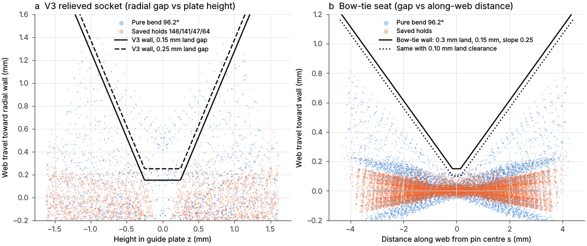

# Evening Engineering Report — 2026-11-18

**Edition:** Evening Report (scheduled 20:01 US Eastern Time).
**Run start:** 2026-11-18 20:02:32 EST (2026-11-19 01:02:32 UTC). **Budget deadline:** 2026-11-18 22:02:32 EST (2026-11-19 03:02:32 UTC).
**Reporting interval:** 2026-11-17 20:02:32 EST (2026-11-18 01:02:32 UTC) to the run start above, the cutoff for repository updates. Results produced during this run are reported separately below.
**Working branch:** `claude/great-goodall-1wf2yh`, fast-forwarded to `59ed561` (codex/guide-validation, which contains `main` at `4e1992e`). Execution model: see the completion message.

[Evidence and commands](../../simulations/u4m2/lanes_20261113/evening_20261118/README.md) · [Next-run handoff](../../simulations/u4m2/lanes_20261113/evening_20261118/HANDOFF.md) · [500 g validation plan](../../docs/500g_validation_plan.md) · [Same-day M5 joint test (test 1)](../projects/m5_structure/M5_Joint_Test_2026_11_18.md)

## 1. Summary

This run carried out **stage 1 of test 2** of the validation plan: the retained guide on the real ribs. It turned the ideal rotating seat from today's large-rotation study into concrete cavity and retainer requirements on the actual M5 ±12 mm mounting webs. All results are simulations.

- **The V3 socket shape cannot host a rotating seat.** The mounting web crosses the 3.2 mm guide plate at 34.2°. V3's land is flat in plate height, so it contains web material up to about 1.1 mm from the pivot along the web, and seat rotation swings that material into the radial walls. With the 0.15 mm land gap, all six load cases interfere, by 0.065–0.636 mm. The 0.25 mm variant still fails record 47 (−0.017 mm) and both 96° pure bends (about −0.5 mm).
- **A bow-tie seat clears every case.** The cavity has a 0.3 mm land along the web, 0.15 mm running clearance and walls flaring at a slope of 0.25. Its minimum clearance is +0.032 to +0.057 mm on the 0.025 mm² mesh, and the middle-to-fine mesh change is ≤ 0.004 mm. A 0.10 mm running clearance fails by 0.012–0.018 mm in five of six cases. The limit comes from 4.7–5.8° out-of-plane tilt of the 3 mm-thick web at the pivot.
- **The retainer must carry a reversing along-web force.** It reaches 12.3 N in the saved 500 g holds and 24.7 N in the 96° pure bend, while allowing about 10.4° in-plane rotation plus about 5° tilt. A slot cannot provide this, and neither can a cylindrical pin along the rib normal.
- **Pinned seat.** A Ø0.6 mm pin through the web, modelled as a perfectly fitting rigid ring with a spherical release, gives a mesh-converged hole-edge strain of 2.4–2.7% in the saved holds and the pure bends (fine-mesh change ≤ 0.18 points). The rigid-band idealisation used so far has a non-converging 7.1% corner singularity. The pin changes the 96° holding couple by −1.2%, but raises seat rotation to 11.3° and tilt to 6.6°, so the pinned seat needs 0.20 mm running clearance at the land (margins +0.058 to +0.107 mm).

## 2. Repository updates in the reporting interval

Previously completed work, counted once even where it appears on several branches:

| Time (ET / UTC) | Revision | Branch | Change |
|---|---|---|---|
| 2026-11-17 20:32:27 EST / 2026-11-18 01:32:27 UTC | `f53a346` | claude/great-goodall-1wf2yh, merged by PR #30 (`c458329`, 22:25:19 EST / 03:25:19 UTC) | 17 November Evening Report: linear rib-level model of the M5 ±12 mm guide joint. The rigid bond adds +10.4% EI and +11.8% GJ, and an ideal rotating seat would need about 12.5° of rotation. |
| 2026-11-18 10:26:23 EST / 15:26:23 UTC | `f6db2c2` | codex/guide-validation, merged by PR #31 (`4e1992e`, 10:28:41 EST / 15:28:41 UTC) | Five-test [validation plan](../../docs/500g_validation_plan.md) for the 500 g front, plus updates to the limitations and roadmap. |
| 2026-11-18 11:56:37 EST / 16:56:37 UTC | `59ed561` | codex/guide-validation (not yet in `main`) | [Test 1: large-rotation M5 joint](../projects/m5_structure/M5_Joint_Test_2026_11_18.md). Geometrically nonlinear shell model at the 96.19° pure bend. Holding couple: bare 743.3 N·mm, rotating seat 761.5 N·mm (−5.8% vs bond), bond 808.2 N·mm. Seat land force 24.78 N, 4.67× the linear estimate. Saved holds 146, 141, 47 and 64 give up to 15.40 N, 5.03° and 0.330 mm socket travel. 45 discretization runs with refinement checks. |

No other branch had engineering commits in the interval. `codex/kevin`, `codex/reach-extension-study`, `codex/internal-rope-guides` and `copilot/review-outdated-prototype-files` were last changed 6–14 November. This run fast-forwarded the working branch to `59ed561`, so today's test-1 study is now on `claude/great-goodall-1wf2yh` as well. Nothing was merged into `main`.

**Change from the previous plan.** The 17 November handoff asked for a large-rotation check (now done as test 1) and then a seat CAD check. The plan's test 2 says to "size the candidate from the large-rotation result" before drawing it. This run does that sizing on the nonlinear states, and it found that the V3 cavity shape itself is unsuitable. That changes what the CAD should be, so the CAD drawing moves to the next run.

## 3. New work in this run

### 3.1 Reproducing the source study

The rotating-seat (`point`) cases were re-solved with `study.py` and their checkpoints were kept. These were the 0.18 mm² sweeps for both pure bends and records 146, 141, 47 and 64, each refined to 0.055 and 0.025 mm² with `refine.py`. Maximum land force and rotation match the archived coarse case files exactly, and distal-moment differences are below 3e-8 N·mm. The 0.025 mm² endpoints reproduce the archived `fine_0p025` values, for example record 146 at 15.25 N and 5.03°. The archived solver code was not changed.

### 3.2 Socket envelope (new `seat_envelope.py`)

For every mounting-web node in the ±1.62 mm socket window, both shell faces are expressed in the moving guide frame relative to the moving pivot and compared with the undeformed web faces. The measured web geometry is 34.2° from radial, 2.667 mm radial width in the plate, 1.500 mm perpendicular width and 3.0 mm thickness. The web slope is fitted by minimising the band width. A principal-axis fit was tried first and rejected, because it was biased by the oblique window cuts and gave false 1.2 mm intrusions. Two wall definitions were scored: V3 (gap versus plate height) and bow-tie (gap versus along-web distance from the pivot).

| Case (0.025 mm²) | V3 0.15 | V3 0.25 | Bow-tie 0.3/0.15/0.25 | Same, c 0.10 | Same, k 0.10 | Rotation total / tilt (°) |
|---|---:|---:|---:|---:|---:|---:|
| Pure bend 67.5° axis | −0.551 | −0.451 | **+0.038** | −0.012 | −0.224 | 10.44 / 5.83 |
| Pure bend 0° axis | −0.636 | −0.536 | **+0.038** | −0.012 | −0.277 | 10.35 / 5.47 |
| Record 146 | −0.067 | +0.033 | **+0.033** | −0.017 | +0.033 | 5.03 / 4.67 |
| Record 141 | −0.068 | +0.032 | **+0.032** | −0.018 | +0.032 | 4.83 / 4.72 |
| Record 47 | −0.117 | −0.017 | **+0.057** | +0.007 | +0.057 | 4.34 / 3.57 |
| Record 64 | −0.065 | +0.035 | **+0.032** | −0.018 | +0.032 | 4.85 / 4.70 |

Values are minimum clearances in mm. Bow-tie clearance at 0.18 / 0.055 / 0.025 mm² is +0.045 / +0.040 / +0.038 for the 67.5° bend and +0.054 / +0.037 / +0.033 for record 146. The full table for all meshes is in the [evidence README](../../simulations/u4m2/lanes_20261113/evening_20261118/README.md).

### 3.3 Retainer loads in seat axes

| Case (0.025 mm²) | Land force | Along web | Perpendicular | Tangential |
|---|---:|---:|---:|---:|
| Pure bend 67.5° | 24.95 N | 24.71 N | 3.48 N | 3.47 N |
| Pure bend 0° | 18.26 N | 17.90 N | 3.22 N | 4.61 N |
| Record 146 | 15.25 N | 12.27 N | 8.71 N | 7.90 N |
| Record 141 | 15.40 N | 12.24 N | 8.80 N | 8.01 N |
| Record 47 | 5.69 N | 5.14 N | 2.10 N | 4.97 N |
| Record 64 | 14.88 N | 11.56 N | 7.94 N | 7.73 N |

Each column is an independent maximum over the eight lands, and the along-web force takes both signs in every case. A **Ø0.6 mm hardened steel pin** along the rib normal would see a nominal bearing pressure on the 3.0 mm PA12 web of 24.95 N / 1.8 mm² = **13.9 MPa** in the pure bend and **8.6 MPa** in the holds. Its double-shear stress would be about 44 MPa. These are hand estimates only.

### 3.4 Pinned seat: Ø0.6 mm hole (new `pin_seat.py`)

The archived solver was run with the 0.5 mm oblique rigid land band replaced by a Ø0.6 mm hole at the same land centre. The hole edge is a rigid ring tied to the ideal pivot with all rotations free, representing a perfectly fitting pin with a spherical release. All six cases were solved on 0.18, 0.055 and 0.025 mm² meshes, each seeded from the coarser one; all converged with a minimum oriented-area ratio of 0.939 or more.

| Case | Peak strain within 0.6 mm of pin centre, 0.18 / 0.055 / 0.025 mm² | Band-patch reference, peak within 2 mm, same meshes | Land force, pin vs band (N) | Seat rotation, pin vs band (°) |
|---|---|---|---:|---:|
| Pure bend 67.5° | −2.83 / −2.65 / **−2.61%** (hole edge) | −2.75 / −3.18 / −3.74% (band corner) | 24.05 vs 24.95 | 11.29 vs 10.44 |
| Pure bend 0° | −2.58 / −2.41 / **−2.37%** (hole edge) | −3.33 / −3.84 / −4.52% | 17.60 vs 18.26 | 11.38 vs 10.35 |
| Record 146 | −2.70 / −2.68 / **+2.67%** | +4.29 / +5.90 / +7.09% | 14.84 vs 15.25 | 5.18 vs 5.03 |
| Record 141 | −2.76 / −2.74 / **+2.73%** | +4.36 / +6.00 / +7.23% | 14.95 vs 15.40 | 5.25 vs 4.83 |
| Record 47 | −1.52 / −1.43 / **−1.40%** (hole edge) | +1.42 / +2.50 / +2.87% | 5.47 vs 5.69 | 4.44 vs 4.34 |
| Record 64 | −2.46 / −2.44 / **+2.44%** | +3.83 / +5.32 / +6.41% | 14.31 vs 14.88 | 5.31 vs 4.85 |

- **Hole-edge strain converges.** The peak strain within 0.6 mm of the pin changes by at most 0.18 percentage points from the middle to the fine mesh. In the saved holds the change is at most 0.02 points. For records 146, 141 and 64 the reported peak changes sign between meshes while its magnitude agrees within 0.03 points, which means the tensile and compressive extremes there are nearly equal. The band-patch reference has its local peak at the corners of the rigid band (1.77–1.85 mm from the centre). That peak grows with every refinement (4.3 → 5.9 → 7.1% for record 146), which is the signature of a geometric singularity. It is therefore not a valid strength comparison, and the archived ideal seat overstates local strain at those corners.
- Within 2 mm of the centre, the pinned model peaks at 3.8% (records 146, 141 and 64; 0.025 mm²). That point is 1.83 mm from the pin on the web edge at the socket-window line, not at the hole.
- **Whole-module effect is small.** On the 0.025 mm² mesh the 96.19° holding couple is 760.1 N·mm with the pin against 769.1 N·mm with the band seat (−1.2%). The land force falls by 2.7–3.6%. The seat must rotate about 0.85° further in pure bend, and tilt rises to 6.56° in pure bend and 5.28° in the holds.
- **Bow-tie re-check with the pinned states.** The 0.15 mm-clearance candidate keeps positive but thin margins of +0.008 to +0.057 mm. At the land, a **0.20 mm** clearance gives **+0.058 to +0.107 mm** on 0.025 mm² (+0.059 to +0.109 on 0.055 mm²). With a pin, the pin locates all translations, so the larger wall clearance no longer sets rattle in the plane of the rib. Along the pin axis, location still depends on the tangential walls or a pin shoulder.
- Hand check, PA12 at 1,530 MPa: 2.7% linear strain corresponds to about 41 MPa nominal, against the 50 MPa ISO 527 tensile strength quoted for EOS PA 2200 in the test-1 report. This linear-elastic number is only an indicator, not a strength margin. Printed PA12 near a drilled or printed hole in vertical build orientation is unmeasured.

## 4. Failed checks and rejected variants

- The V3 relieved socket with a 0.15 mm land gap, used as a rotating seat, fails 6/6 cases. With a 0.25 mm land gap it fails 3/6 (record 47 and both pure bends).
- Bow-tie with 0.10 mm running clearance: fails 5/6 cases on the fine mesh. Bow-tie with flare slope 0.10: fails both pure bends.
- The principal-axis web-direction fit was rejected (see §3.2), and so was the first along-web binning of the envelope, which mixed web edges with different extents. Neither is used in the reported numbers.
- No run failed to converge. All accepted states have a positive oriented-area ratio (minimum 0.932).

## 5. Limitations

- This is an isolated M5 rib fixture with prescribed poses and rope loads. There is no backbone, no outer ±24 mm stations, no body weight and no friction.
- The seat is an ideal pivot, so the clearance numbers are geometric travel, not contact. Rattle inside the running clearance, wall loads and bore-position uncertainty (up to about ±0.15 mm) are not modelled.
- The pin is a perfectly fitting rigid ring with a spherical release. Pin clearance, cylindrical-pin binding and pin bending are not modelled, and printed PA12 strength at the hole is unknown.
- No seat CAD was generated, and assembly access and print tolerance remain open. Only M5 ±12 mm was checked. Nothing here is hardware evidence, and no physical accuracy or manufacturing readiness is claimed. The full-motion cycle replay (test 5) was not run.

## 6. Next-run handoff (top three)

1. **Seat CAD on the real webs.** Build a bow-tie cavity (0.3 mm land, **0.20 mm** running clearance, slope 0.25) with a Ø0.6 mm spherical or crowned pin, plus its cap and retention. Accept when the parts are closed, watertight and connected to the frame, the straight bore centres are unchanged, `seat_envelope.py` re-run against the exported cavity is positive in all six cases, and the straight-state Booleans show no overlap.
2. **Realistic pin contact.** Add pin clearance with unilateral contact, or a cylindrical-only release, and recompute land forces, moments, hole-edge strain and bearing pressure on two meshes. The current pin release is ideal.
3. **M6 and the ±24 mm stations, then 217 × 8 screening** with the actual cavity.

The full acceptance checks and resources are in [HANDOFF.md](../../simulations/u4m2/lanes_20261113/evening_20261118/HANDOFF.md).
