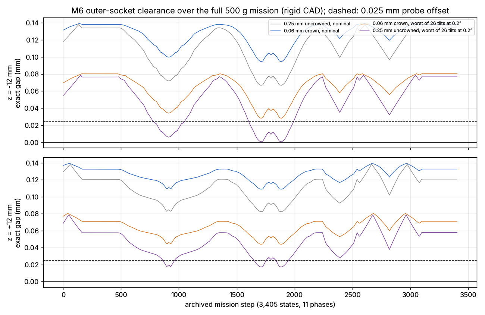

# Evening Engineering Report — 2026-11-21

**Edition:** Evening Report (scheduled for 20:01 US Eastern Time).
**Run start:** 2026-11-21 20:02:23 EST (2026-11-22 01:02:23 UTC). **Budget deadline:** 2026-11-21 22:02:23 EST (2026-11-22 03:02:23 UTC).
**Reporting interval:** 2026-11-20 20:02:23 EST (2026-11-21 01:02:23 UTC) to the run start above. The run start is the cutoff for repository updates. Section 3 reports the results produced during this run.
**Working branch:** `claude/great-goodall-1wf2yh`. Its previous head, `c1e2e7e`, was already in `main` through PR #40, so the branch was fast-forwarded to `origin/main` at `5919f10` (PR #41). No merge commit was needed. The execution model is given in the completion message.

[Evidence and commands](../../simulations/u4m2/lanes_20261113/evening_20261121/README.md) · [Next-run handoff](../../simulations/u4m2/lanes_20261113/evening_20261121/HANDOFF.md) · [Crowned-land CAD](../../cad/lanes_u4m2/m6_crowned_land_20261120/README.md) · [Previous Evening Report](Evening_Report_2026_11_20.md)

## 1. Summary

The M6 outer guide sockets remain the tightest rigid guide/body interface of the 500 g U4+M2 front. On 20 November, a 0.06 mm crown on the 0.25 mm bond land was proposed. It was screened on 1,217 low-margin steps, and its tilt tolerance was measured only at the two governing left-yaw steps. Tonight's run completed the open simulation item from that handoff. No CAD or solver input was changed.

- **Full-mission nominal certification.** The run reused the Round 2 all-step method unchanged: actual M6 body, 0.5 mm axial refinement, certified swept crop and exact FCL distances. It covered all 3,405 archived steps (2,796 exactly unique shapes) and all 11 phases at both stations. The crowned candidate has **zero contacts**, with minimum gaps of **0.09451 mm (z = −12 mm)** and **0.10892 mm (z = +12 mm)**, both at step 1,709. The 5,593 steps not screened on 20 November have minima of 0.1139 and 0.1137 mm. The crown never reduced the gap of any part at any step. The uncrowned rerun reproduces the archived Round 2 table exactly (difference 0.0 mm).
- **Full-mission 0.2° tilt certification (new).** At every unique shape, the guide, caps and wire envelope were tilted rigidly by ±0.2° about 12 in-plane axes and CAD z (26 tilts). The crowned land keeps **0.02829 / 0.04400 mm**, and **no step** falls below the Round 2 0.025 mm probe offset. The uncrowned land keeps 0.00070 / 0.01719 mm, with **665 / 317 steps below the offset**, all in the right and left yaw excursions and their returns. The Round 2 assembly probe (0.025 mm + 0.2°) is therefore satisfied over the whole mission only by the crowned land.
- **Tilt bracket.** The crowned land at 0.25° keeps 0.01171 / 0.02775 mm with no contact. At **0.30°** it **contacts at 138 left-yaw steps** (1,674–1,921) at z = −12 mm. z = +12 mm stays clear at 0.30°. The mission-wide first contact therefore lies between 0.25° and 0.30°, consistent with the 0.289° bisection at step 1,710.
- **Limits.** These are rigid CAD results. Bond compliance, guide bending, the printed crown, bonded tilt and bond tractions in the non-uniform layer are unmodelled or unmeasured. This is not a manufacturing release.

## 2. Repository updates in the reporting interval

Each commit is listed once by content, even where it appears on several branches. Times are commit times.

| Time (EST / UTC) | Revision | Work | Where it is now |
|---|---|---|---|
| 20 Nov 20:17 / 21 Nov 01:17 and 20:43 / 01:43 | `8ec2092`, `c1e2e7e` | Previous evening run: 0.06 mm crowned M6 bond land, tilt bisection at the governing steps, screen of 787 + 430 low-margin steps. [Evening Report 2026-11-20](Evening_Report_2026_11_20.md) | `main` via PR #39 (`c6a65b0`, 20:34 EST / 01:34 UTC) and PR #40 (`da90edb`, 21 Nov 02:43 EST / 07:43 UTC) |
| 21 Nov 03:45 / 08:45 and 04:20 / 09:20 | `a1a3518`, `b8684c3` | Offline single-file 500 g design and simulation handover (HTML, 89.4 MiB) and its hosted interactive edition, featured at the top of the README. Its Clearance view reported crowned M6 gaps only at the steps evaluated in CAD. Tonight's run closes that gap. | `main` via PR #41 (`5919f10`, 04:22 EST / 09:22 UTC) |
| 21 Nov 07:24–07:54 / 12:24–12:54 | `99437fc` … `34d0dee` (17 commits) | Codex: export of the active-reset equilibrium states and per-hole guide loads, ranking of M5 force/moment candidates, an active-reset M5 pin stress screen that rejects incomplete replays, tests, and CI workflows (`m5-active-reset-stress.yml`). **No result files are committed.** | `codex/m5-active-reset-load-export` only (not in `main`) |

There was no Morning Report for 21 November in the repository at the cutoff. `codex/guide-validation` holds no commits beyond `main`. `codex/reach-extension-study`, `codex/internal-rope-guides`, `codex/kevin` and `copilot/review-outdated-prototype-files` had no commits in the interval.

**Plan changes.** The 20 November handoff ranked (1) bench measurements (hardware, not possible here), (2) full-mission certification of the crowned land and (3) bond tractions for the crowned layer. This run took item 2. Using the Round 2 swept-crop method (about 2 min per station) instead of the per-step screen estimated in the handoff at 1.5–2 h left time to extend the item. The run added the decisive full-mission check of the assembly-tilt probe, which had been evaluated only at the governing steps. Item 3 was not started and remains in the handoff. The Codex M5 active-reset screen was not run, to avoid duplicating another agent's open work.

## 3. New work in this run

### 3.1 Nominal full-mission certification

`full_mission.py` imports Round 2 [`m6_full.py`](../../simulations/u4m2/extreme_tests/round2_20261119/m6_full.py) and parameterises only the CAD folder and the output location.

| Station | Part | 0.25 mm uncrowned min (step) | 0.06 mm crown min (step) | Crown − uncrowned, min–max over 3,405 steps |
|---|---|---:|---:|---|
| z = −12 mm | guide | 0.06674 (1,709) | **0.09451 (1,709)** | +0.00039 to +0.02806 mm |
| | caps | 0.08530 (1,885) | 0.11093 (1,885) | +0.00088 to +0.02564 mm |
| | wire envelope | 0.18300 (1,709) | 0.18300 (1,709) | 0 (unchanged part) |
| z = +12 mm | guide | 0.08239 (1,709) | **0.10892 (1,709)** | +0.00037 to +0.02653 mm |
| | caps | 0.08920 (1,885) | 0.11392 (1,885) | +0.00100 to +0.02472 mm |
| | wire envelope | 0.20010 (1,709) | 0.20010 (1,709) | 0 |

The crowned minimum by phase at z = −12 mm is: straightening 0.1314, entry/exit 0.1381, right yaw out/return 0.0997/0.0999, left yaw out/return 0.0945/0.0945, pitch up 0.1214, pitch down 0.1195 mm. The crowned values match the 20 November screen to within its 10⁻⁶ mm CSV rounding at all 1,217 screened steps.

### 3.2 Rigid tilt at every mission step

`tilt_mission.py` (new) rotates guide, caps and wire envelope together about the station origin for every unique shape. It rebuilds the certified crop from the union of all tilted parts. A part is skipped for a tilt only when the rigorous bound gap_nominal − r_max·θ proves that it cannot be the minimum. The exact gap at a tilt equals the largest rigid translation in any direction that stays contact-free at that tilt. Cross-check: at step 1,709/1,710, z = −12 mm, the result is 0.02829 mm here, against 0.0290 mm from the 20 November bisection at a finer 0.25 mm refinement, on the same axis.

| Variant, tilt | z = −12 mm min (step, axis) | steps < 0.025 mm | contacts | z = +12 mm min (step, axis) | steps < 0.025 mm | contacts |
|---|---|---:|---:|---|---:|---:|
| 0.25 mm uncrowned, 0.20° | 0.00070 (1,709, 165° +) | 665 | 0 | 0.01719 (1,709, 165° −) | 317 | 0 |
| **0.06 mm crown, 0.20°** | **0.02829** (1,709, 165° +) | **0** | 0 | **0.04400** (1,709, 165° −) | **0** | 0 |
| 0.06 mm crown, 0.25° | 0.01171 (1,709, 165° +) | 463 | 0 | 0.02775 (1,709, 165° −) | 0 | 0 |
| 0.06 mm crown, 0.30° | 0 (1,674, 150° +) | 816 | **138** | 0.01149 (1,709, 165° −) | 804 | 0 |

The uncrowned steps below 0.025 mm at 0.2° all lie in the yaw excursions. At z = −12 mm there are 195 left out, 196 left return, 137 right out and 137 right return. At z = +12 mm there are 106, 110, 52 and 49. The guide body limits every step, never a cap or the wire envelope. At 0.30° the crowned contacts at z = −12 mm lie in left yaw out (steps 1,674–1,741, 68 steps) and left return (1,852–1,921, 70 steps), mostly about the 150° axis.

### 3.3 Mounting stiffness, guide positions and solver consistency

No CAD, guide position, rope bore, station, mass or solver input changed. The six crowned STL hashes match the 20 November validation record. The archived mission places each guide at its ideal rod position. The tilt is a rigid assembly error applied only to the clearance check; it is not fed back into rope lengths or tensions. A 0.2° tilt moves a bore by at most about 0.07 mm at a 20 mm radius. Bond compliance, guide bending and the crowned layer's tractions are not modelled. The Round 2 uniform-layer witness motion (0.0028 mm) is well below the 0.0283 mm allowance, but it has not been recomputed for the crowned layer. No backbone end ferrule was added. The head payload remains 500 g.

### 3.4 Validation

[`validate.py`](../../simulations/u4m2/lanes_20261113/evening_20261121/validate.py) checks the following and writes [validation.json](../../simulations/u4m2/lanes_20261113/evening_20261121/results/validation.json):

- the CAD hashes;
- exact reproduction of Round 2;
- agreement with the 20 November screen;
- coverage of 3,405 steps and 11 phases at both stations;
- zero nominal contacts;
- that the crown never reduces a gap;
- complete coverage of the 0.2° tilt check with no contact;
- every relative link in the study README, the HANDOFF, this report and the root README.

## 4. Failed checks, rejected variants and incomplete work

- **Failed (design check): the uncrowned 0.25 mm candidate fails the 0.025 mm + 0.2° probe at 665 (z = −12 mm) and 317 (z = +12 mm) steps.** The failure is not limited to the governing left-yaw steps: it also covers most of the right-yaw excursion. Without the crown, a bonded tilt of 0.2° would have to be paired with an offset well below 0.001 mm at z = −12 mm.
- **Failed (tolerance bracket): the crowned land contacts at 0.30° tilt** during left yaw at z = −12 mm (138 steps). Its tilt tolerance is not unlimited. The 0.2° assembly specification must be held.
- **Not done:** bond tractions and witness motion for the non-uniform crowned layer (handoff item 2), a finer tilt axis spacing than 15° and a mission-wide first-contact bisection (item 3), and combined bond deformation with tilt.
- **Interrupted starts:** the first four launches failed before producing any result. The causes were missing `python-fcl` in the active interpreter, missing `clarabel` (imported indirectly through the shared-bore module), and a broken system `PIL`. All were reinstalled with `python -m pip` and rerun, and the failed logs were overwritten. A 0.04 mm crown was not re-examined; it was already rejected on 20 November.
- **Unmeasured:** the as-printed land profile, the bonded tilt, the adhesive and the bond strength.

## 5. Next-run handoff (summary)

1. **Bench:** print and measure the crowned M6 land profile (0.01 mm) and the bonded tilt (0.05°). Accept a tilt of ≤ 0.20° with an offset of ≤ 0.025 mm at both stations.
2. **Simulation:** compute bond tractions and witness motion for the non-uniform 0.25–0.31 mm crowned layer at 500/1,500 MPa, for steps 1,709, 1,710 and 1,885.
3. **Simulation:** bisect the mission-wide first-contact tilt at 5° axis spacing on the 254 crowned shapes whose 0.25° gap is below 0.02 mm, to turn the 0.25–0.30° bracket into a number.

Details, acceptance checks and resources: [HANDOFF.md](../../simulations/u4m2/lanes_20261113/evening_20261121/HANDOFF.md).

## 6. Reproducibility

Source revision `5919f10`. Software: Python 3.11.18, numpy 2.3.5, scipy 1.17.0, trimesh 5.2.0, python-fcl 0.7.0.10, pandas 3.1.1, matplotlib 3.10.8, numba 0.68.1, clarabel 0.11.1. The run used 4 cores, with less than 1 GB per process. The [study README](../../simulations/u4m2/lanes_20261113/evening_20261121/README.md) has the commands, and [results/](../../simulations/u4m2/lanes_20261113/evening_20261121/results/) has the per-step tables, shards and logs. Total compute was about 4 min for the nominal runs and about 22 min for the four tilt passes (two shards per station, four processes in parallel).
