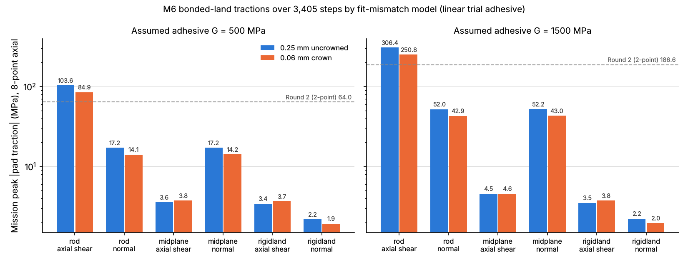

# Evening Engineering Report — 2026-11-22

**Run:** scheduled evening run. Started **2026-11-22 20:02:21 EST (2026-11-23 01:02:21 UTC)**. Budget deadline **22:02:21 EST (03:02:21 UTC)**.
**Reporting interval:** 2026-11-21 20:02:21 EST (2026-11-22 01:02:21 UTC) to the cutoff at this run's start, 2026-11-22 20:02:21 EST (2026-11-23 01:02:21 UTC), plus the work done in this run.
**Branch:** `claude/great-goodall-1wf2yh`. It was fast-forwarded to `origin/main` at `88f7dcc` before any work started.

[Evidence and commands](../../simulations/u4m2/lanes_20261113/evening_20261122/README.md) · [Next-run handoff](../../simulations/u4m2/lanes_20261113/evening_20261122/HANDOFF.md) · [Crowned-land CAD](../../cad/lanes_u4m2/m6_crowned_land_20261120/README.md) · [Previous Evening Report](Evening_Report_2026_11_21.md)

## 1. Summary

The 0.06 mm crowned M6 outer-socket land was certified as rigid CAD over the full mission on 21 November. Its bond, however, had only been modelled as a uniform 0.25 mm layer. This run completed handoff item 2: a variable-thickness bond model of the crowned layer, the bond tractions, the guide-to-web witness motion, and an exact CAD clearance check with the bond motion and a 0.2° assembly tilt combined. No CAD or solver input changed.

- **The bond motion does not consume the crowned margin.** At the governing steps (1,709, 1,710 and 1,885) the modelled bond motion was combined with the worst of 26 rigid 0.2° tilts. The crowned land keeps **0.02839 mm (z = −12 mm)** and **0.04237 mm (z = +12 mm)** under all three fit-mismatch models and both assumed adhesive moduli. Both values are above the 0.025 mm probe offset. The bond motion shifts the tilted allowance by only −0.0016 to +0.0008 mm. The uncrowned land still fails, at 0.00074 / 0.01554 mm.
- **The archived Round 2 bond traction (63.96 MPa axial shear) is mostly a modelling artifact.**
  - About 97% of it is imposed kinematics. The homogenised rod map forces about 18% axial strain into the 0.5 mm solid PA12 land.
  - The value is not converged: the traction field is linear across the land, so the peak rises from 63.96 MPa (2 axial points) to 103.6 MPa (8 points).
  - Transmitted load alone produces only 2–4 MPa.
  - The real bond demand therefore lies somewhere between about 3 MPa and about 100 MPa (at G = 500 MPa), depending on how the web actually strains at the land. This is now the main open question for the bond.
- **Effect of the crown on tractions.** The crown lowers kinematic peaks by about 18% (103.6 → 84.9 MPa at G = 500 MPa; 306 → 251 MPa at 1,500 MPa). It raises the load-driven axial-shear peak by about 7% (3.44 → 3.67 MPa). The witness motion (0.0013–0.0029 mm) and the guide-to-web rotation (0.016–0.067°) hardly change.
- **Limits.** The adhesive modulus and strength are assumed, and the model is a linear trial. The combined probe covers three steps, not the full mission. This is not a manufacturing release.

## 2. Repository updates in the reporting interval

Each change is listed once, even where it appears on several branches. Times are commit times.

| Time (EST / UTC) | Revision | Work | Where it is now |
|---|---|---|---|
| 21 Nov 20:14–20:36 / 22 Nov 01:14–01:36 | `8afd18a`, `408d60d`, `043dc75`, `1e41617` | Previous evening run: full-mission nominal and 0.2° tilt certification of the crowned M6 land. Already reported in full in the [Evening Report 2026-11-21](Evening_Report_2026_11_21.md), so not counted again here. | `main` via PR #43 |
| 22 Nov 10:03 / 15:03 | `88f7dcc` | Merge of PR #43 (`claude/great-goodall-1wf2yh` → `main`). No content beyond the four commits above. | `main` |

There was no Morning Report for 22 November in the repository at the cutoff. No other branch received commits in the interval:

- `codex/guide-validation` and `codex/reach-extension-study` had no new commits.
- `codex/internal-rope-guides`, `codex/kevin` and `copilot/review-outdated-prototype-files` had no new commits.
- `codex/m5-active-reset-load-export` was last updated on 21 November at 07:54 EST. It is still unmerged and has no committed results.

**Plan changes.** The 21 November handoff ranked:

1. bench measurements (hardware, not possible here);
2. bond tractions for the crowned layer;
3. a finer-axis tilt bisection.

This run took item 2. While doing so it found that the Round 2 traction was dominated by imposed rod kinematics. Two further mismatch models (`midplane`, `rigidland`) were therefore added to bracket the demand, and the handoff now ranks a local solid rib model above the bisection. Item 3 was not started.

## 3. New work in this run

### 3.1 Variable-thickness bond model

[`crowned_bond.py`](../../simulations/u4m2/lanes_20261113/evening_20261122/crowned_bond.py) imports the Round 2 bonded-land structure ([`m6_support.py`](../../simulations/u4m2/extreme_tests/round2_20261119/m6_support.py)) unchanged. It changes three things:

- The axial Gauss order can be 2, 4 or 8.
- The layer thickness at each point is t(z) = 0.25 + 0.06·(z/0.25)² mm. The area mean is 0.27 mm, which matches the CAD record.
- There are three fit-mismatch models:
  - `rod`: Round 2 as archived;
  - `midplane`: the web is axially inextensible over the land;
  - `rigidland`: each land follows the rigid part of the rod field over its footprint.

The shear modulus G = 500 / 1,500 MPa is assumed. The uncrowned nh = 2 `rod` case reproduces the archived witness motion, closure and guide increments to 4·10⁻¹³. Land-wrench closure is below 2·10⁻⁵ in all 216 cases.

### 3.2 Where the Round 2 traction comes from

At step 1,709, z = −12 mm, G = 500 MPa, nh = 8, uncrowned:

| Load case | Peak axial shear | Mean axial shear |
|---|---:|---:|
| Station wrenches only | 3.12 MPa | 1.79 MPa |
| Fit mismatch only (`rod`) | 103.04 MPa | 30.54 MPa |
| Both | 103.53 MPa | 30.75 MPa |

At the 247.5° land, the rod map's axial displacement differs by ±0.027 mm between the two Gauss points 0.29 mm apart. That is about 18% strain inside a solid web; it is the smeared strain of the compliant cells. The normal (peel) peak, 17.2 MPa at step 1,114 under the `midplane` model, is also kinematic: 1.1 MPa comes from loads alone. It comes from the transverse rod-map variation across the land, which `midplane` keeps and `rigidland` removes.

### 3.3 Mission envelope, 3,405 steps

Peak |traction| in MPa, nh = 8; the Round 2 2-point values are in brackets.

| Model, G (MPa) | Axial shear, uncrowned / crowned | Normal, uncrowned / crowned |
|---|---|---|
| `rod`, 500 | 103.6 (63.96) / 84.9 | 17.2 / 14.1 |
| `rod`, 1,500 | 306.4 (186.6) / 250.8 | 52.0 / 42.9 |
| `midplane`, 500 | 3.6 / 3.8 | 17.2 / 14.2 |
| `rigidland`, 500 | 3.4 / 3.7 | 2.2 / 1.9 |
| `rigidland`, 1,500 | 3.5 / 3.8 | 2.2 / 2.0 |

The 2-point `rod` run reproduces the archived mission peak of 63.958695 MPa exactly.

### 3.4 Bond motion plus 0.2° tilt (exact CAD)

[`bond_tilt_probe.py`](../../simulations/u4m2/lanes_20261113/evening_20261122/bond_tilt_probe.py) first applies the bond-model guide motion relative to its witness web, using the Round 2 probe transform. It then adds the 26 rigid ±0.2° tilts from 21 November. The body is the actual M6 STL with 0.5 mm refinement, a certified swept crop and exact FCL distances.

| Station | Variant | Ideal + 0.2° | Bond + 0.2°, worst of 3 models × 2 G × 3 steps |
|---|---|---:|---:|
| z = −12 mm | uncrowned | 0.00070 | 0.00074 |
| | **crowned** | 0.02829 | **0.02839** (step 1,709, 165° +, `midplane`, G 1,500) |
| z = +12 mm | uncrowned | 0.01719 | 0.01554 |
| | **crowned** | 0.04400 | **0.04237** (step 1,885, 165° −, `rigidland`, G 1,500) |

The ideal-position rows reproduce the 21 November values to better than 10⁻⁵ mm. Without tilt, the bond motion leaves at least 0.09461 / 0.10729 mm for the crowned land.

### 3.5 Mounting stiffness, guide positions and solver consistency

No CAD, guide position, bore, station, mass, rope routing or solver input changed. The bond model changes only the assumed mounting compliance used for the bond and clearance checks. The mission still places the guide at its ideal rod position, and the bond increment is not fed back into rope lengths or tensions. The guide-to-web rotation (≤ 0.067°) adds to any bonded assembly tilt. This was tested only at the governing steps, where the combined allowance stays at or above 0.0284 mm.

### 3.6 Validation

[`validate.py`](../../simulations/u4m2/lanes_20261113/evening_20261122/validate.py) writes [`validation.json`](../../simulations/u4m2/lanes_20261113/evening_20261122/results/validation.json). It checks:

- exact Round 2 reproduction for the cases and for the mission peak;
- case and probe coverage;
- land-wrench closure;
- the crowned mean layer;
- agreement of the ideal-position tilt with 21 November;
- the crowned CAD hashes against the 20 November record;
- that all duty runs are complete (3,405 steps);
- the relative links in the study README, the HANDOFF, this report and the root README.

## 4. Failed checks, rejected variants and incomplete work

- **Failed (design check, unchanged): the uncrowned 0.25 mm land fails the 0.025 mm + 0.2° probe** even with the bond motion included (0.00074 mm at z = −12 mm).
- **Rejected (method): the Round 2 2-point bond traction as a strength demand.** It is a non-converged Gauss-point sample of a kinematically imposed field. The `strength.py` demand row that cites it (63.96 MPa) should not be used without a local model. The archived file was left unchanged.
- **Unresolved:** which mismatch model is physical. The bond demand ranges from about 3 MPa to about 100 MPa at G = 500 MPa. The peel (normal) traction is unresolved in the same way, at 2–17 MPa.
- **Not done:** the bond-plus-tilt check over the full mission (only the three governing steps), the finer-axis first-contact bisection (previous item 3), and any adhesive failure law.
- **Interrupted starts:** the first launches failed on missing packages: `numpy` and the rest of the stack, then `vtk`, `shapely`/`triangle`, and `networkx`. The system `PIL` was broken. All were installed with `python -m pip` and the scripts rerun; the failed attempts left no results. A background wait loop was stopped once its jobs had finished; its exit condition miscounted the probe log lines, and no simulation was affected.
- **Unmeasured:** the adhesive modulus and strength, the as-printed crown, the bonded tilt and the web strain at the land.

## 5. Next-run handoff (summary)

1. **Bench:** the land profile and bonded tilt as before (tilt ≤ 0.20°, offset ≤ 0.025 mm), plus a lap-shear coupon of the adhesive on PA12 at a 0.25–0.31 mm gap, and, if possible, a strain measurement of the web next to the land.
2. **Simulation:** a local solid model of the 247.5° M6 rib with its crowned bonded land at steps 1,709 and 1,885, to decide between the `rod`, `midplane` and `rigidland` bond demands.
3. **Simulation:** the mission-wide first-contact tilt at 5° axis spacing, optionally with the bond transform pre-applied.

Details, acceptance checks and resources: [HANDOFF.md](../../simulations/u4m2/lanes_20261113/evening_20261122/HANDOFF.md).

## 6. Reproducibility

Source revision `88f7dcc`. Software: Python 3.11.18, numpy 2.3.5, scipy 1.17.0, trimesh 5.2.0, python-fcl 0.7.0.10, clarabel 0.11.1, vtk 9.7.2, pillow 13.0.0 and matplotlib 3.10.8, plus shapely, triangle, manifold3d and networkx.

Compute on 4 cores, using less than 1.2 GB per process:

- bond cases: about 25 s;
- mission duty runs: 250 s and 134 s;
- the two probes: about 5 min each, run in parallel.

Commands are in the [study README](../../simulations/u4m2/lanes_20261113/evening_20261122/README.md).
