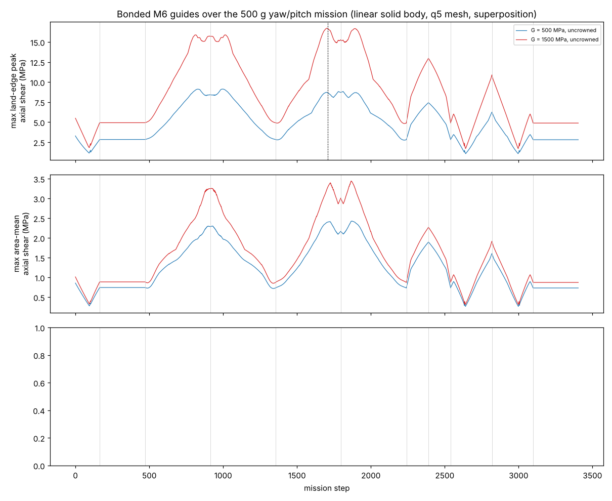

# Evening Engineering Report — 2026-11-25

**Run:** scheduled evening run. Started **2026-11-25 20:02:23 EST (2026-11-26 01:02:23 UTC)**. Budget deadline **22:02:23 EST (03:02:23 UTC)**; expensive work was to stop by 21:37 EST (02:37 UTC).
**Reporting interval:** from 2026-11-24 20:02:23 EST (2026-11-25 01:02:23 UTC) to the cutoff at this run's start, 2026-11-25 20:02:23 EST (2026-11-26 01:02:23 UTC), plus the work done in this run.
**Branch:** `claude/great-goodall-1wf2yh`. It held the 24 Nov evening work (`20decfa`, `9e876c1`), which is not yet in `main`; `origin/main` (`8ef0fe0`) was merged into it (`2eff981`, merge commit, no force-push) before any work started.
**Execution model:** the task requested Claude Opus 5.5. The session-metadata tool (`get_session`) was not available in this run, so the serving model could not be verified from metadata; the session was configured for `claude-opus-5-5`.

[Evidence and commands](../../simulations/u4m2/lanes_20261113/evening_20261125/README.md) · [Next-run handoff](../../simulations/u4m2/lanes_20261113/evening_20261125/HANDOFF.md) · [Previous Evening Report](Evening_Report_2026_11_24.md) · [24 Nov solid-body study](../../simulations/u4m2/lanes_20261113/evening_20261124/README.md)

## 1. Summary

The 24 November run built and validated a whole-body solid model of the M6 rib lattice with both guides bonded through the distributed crowned adhesive layer, but evaluated it at only two governing steps (1,709 and 1,885). Its handoff item 1 asked for the whole-mission envelope by linear superposition. This run did that, and extended the same superposition to the body-strain validity check.

- **Bond demand is closed out over all 3,405 mission states.** The mission maxima (finer q3 mesh) exceed the two-step values by at most **4.4% (area-mean axial shear)**, **4.3% (land-edge peak axial shear)** and **0% (peak normal traction)**: area-mean axial **2.48 / 3.60 MPa**, land-edge peak axial **9.0 / 16.8 MPa** uncrowned and **7.8 / 14.5 MPa** crowned, peak normal **21.2 / 36.4 MPa** at assumed G = 500 / 1,500 MPa. Steps 1,709 / 1,885 were representative.
- **The governing land depends on the yaw direction.** During right yaw the off-plane lands (157.5° / 337.5°) at z = −12 mm carry about twice their step-1,709 peak, but remain inside the envelope set by the bending-plane lands during left yaw.
- **Tilt clearance against the solid arm over the mission.** SWEEP_SUMMARY
- **Hub strain is mission-wide (FAIL, kept visible).** The linear peak body strain reaches **3.81% at step 1,869** (left return), 2% above step 1,709, at the same hub/arm element (r = 8.47 mm, z = −17.9 mm). **615 of 3,405 states exceed 3%** and 1,124 exceed 2%. The pitch excursions reach 2.3–2.5%. The land bands stay at or below 0.68%. Whether PA12 tolerates this is not established; the model has no NiTi backbone yet.
- **Exactness checks passed.** Superposition reproduces the archived 24 Nov direct solves (all eight lands, all traction/slip/rotation/socket metrics) to < 10⁻⁵ relative on both meshes, and the archived probe gaps and strain peak exactly.
- **No design change.** No CAD, guide position, rope bore, station, mass or solver input changed. The 500 g head payload and U4+M2 are kept; no backbone end ferrule was added.

## 2. Repository updates in the reporting interval

Each change is listed once, even where it appears on several branches. Times are commit times.

| Time (EST / UTC) | Revision(s) | Work | Where it is now |
|---|---|---|---|
| 24 Nov 20:42 / 25 Nov 01:42 and 21:04 / 02:04 | `20decfa`, `9e876c1` | Previous evening run (whole-body solid M6 model). Reported in full in the [Evening Report 2026-11-24](Evening_Report_2026_11_24.md); not counted again. | `claude/great-goodall-1wf2yh` only (not yet in `main`) |
| 24 Nov 23:01–23:33 / 25 Nov 04:01–04:33 | `98f48b9` … `36b4cbc` (4) | [NiTi manufacturing plan for PolyU IC](../niti_manufacturing_polyu_report.md): two NiTi parts (16 U-module leaf springs, two Ø1.80 × 96 mm M-module backbones); PolyU IC facility review (metal laser, 4-axis wire EDM Robofil 240SL, waterjet, 5-axis mill); a test-coupon-first route; NiTi is not on any published machine material list. | `main` |
| 25 Nov 02:16–02:36 / 07:16–07:36 | `605ebaa` … `eb846aa` (28) | [`cad/manufacturing_setup`](../../cad/manufacturing_setup/README.md): four isolated U-leaf-spring STEP solids (no geometric change), a 147-vertex profile DXF of leaf 01 (+0.05% area vs the STEP section), geometry audit, manufacturing checklist, Robofil wire-EDM CAM job sheet and a CAM post feasibility review (no machine code emitted; the generic FreeCAD WEDM post is not a Robofil post). Several follow-up commits corrected the section-axis interpretation (constant 6 mm width, 94 × 5 mm profile, 110.34 mm² section). | `main` |
| 25 Nov 08:30–08:31 / 13:30–13:31 | `50c05eb` … `30978fb` (4) | Corrected NiTi spring geometry / CAM post status; documented the PEPS Wire EDM post archive and its verification boundary ([guide](../../docs/niti_file_to_machine_setup.md)). | `main` |
| 25 Nov 11:28–11:29 / 16:28–16:29 | `135879b` … `8ef0fe0` (12) | [U4+M2 design-limit sweep](../projects/extreme_tests/Free_Space_and_Service_Life_2026_11_20.md#component-demand-and-threshold-sensitivity-sweep-25-november-2026) ([`design_limit_sweep.py`](../../simulations/u4m2/extreme_tests/design_limit_sweep.py) + 3 tests): post-processing of saved Round 2 / free-space demands into eight component demand channels with 1.5× / 2× targets (e.g. M6 adhesive land axial load 3.04 N, M6 pad elastic stress 63.96 MPa, U NiTi blade strain 0.981%, M5 remote PA12 web strain 8.55%), pin-yield and web-strain sensitivities, a 46-channel fatigue-demand table and conditional Basquin illustrations. Explicitly not measured resistance or life. One commit also dropped the 21–23 Nov rows from [`reports/README.md`](../README.md) although the reports still exist; this run's merge restored them. | `main` |

There was no Morning Report for 25 November in the repository at the cutoff. No other branch received commits in the interval: `codex/guide-validation` (last 21 Nov), `codex/m5-active-reset-load-export` (last 21 Nov; still unmerged, no committed results), `codex/internal-rope-guides`, `codex/kevin`, `codex/reach-extension-study` and `copilot/review-outdated-prototype-files` unchanged.

**Relation to tonight's work.** The design-limit sweep's "M6 adhesive pad elastic stress 63.96 MPa" is taken from the archived Round 2 bonded-pad model (trial G = 500 MPa, 0.25 mm layer). The 22–25 Nov distributed-layer models of the real land walls give 2.4–3.6 MPa area-mean and 7–17 MPa land-edge peak tractions over the same mission. The two are different stress measures from different models, so they are not directly comparable, but the sweep's M6 channel should not be read as the current best estimate of bond stress. The sweep's own tests pass on the merged branch (3/3).

**Plan changes.** The 24 November handoff was followed: item 1 (mission envelope) was completed and extended to the body-strain envelope because the strain is linear in the same unit fields (2 min extra). Item 2 (backbone + hub strain) is now the top next-run item, with sharper evidence. Item 3 (bench) is hardware and is not reported as done.

## 3. New work in this run

### 3.1 Method: superposition of 15 unit solutions

The 24 Nov bonded body (`body_bond.Body`) has two step inputs: the rod's relative D0 → D1 rotation imposed on the D1 master, and the two archived station wrenches. The run:

1. evaluated the rod rotations for all 3,405 archived states ([`rod_steps.py`](../../simulations/u4m2/lanes_20261113/evening_20261125/rod_steps.py); 4 s on 4 processes; steps 1,709 / 1,885 reproduce the archive to < 10⁻⁹°);
2. factorised the bonded system once per (G, crown) and solved 15 unit right-hand sides ([`mission_envelope.py`](../../simulations/u4m2/lanes_20261113/evening_20261125/mission_envelope.py); about 60 s per case on q5, 90 s on q3);
3. stored every recovered quantity (layer tractions, slip, guide − land rotation, socket non-rigid motion, body-relative-to-guide motion of the clearance patch) as a linear (quantity × 15) map and combined it per step with c = [s·ω, W₋₁₂, W₊₁₂] — exactly the 24 Nov "local" total field.

Coverage: the archived yaw/pitch replay, all 3,405 states — straighten (0–165) → entry (166–472) → right out (473–913) → right return (914–1,355) → left out (1,356–1,796) → left return (1,797–2,240) → pitch up / return (2,241–2,540) → pitch down / return (2,541–3,098) → exit (3,099–3,404).

### 3.2 Bond demand over the mission

q3 mesh (188,766 P2 tets, 1.08 M DOF); maximum over the eight lands.

| G, crown | Land-edge peak axial shear: mission max (step) / step 1,709 | Area-mean axial: max / 1,709 | Peak normal: max / 1,709 | Max slip | Guide − land rotation |
|---|---|---|---|---:|---:|
| 500 MPa, none | **9.04** (1,010, right return) / 8.71 MPa | **2.48** / 2.45 | 21.2 / 21.2 | 5.8 µm | 0.058° |
| 500 MPa, 0.06 mm crown | **7.76** (1,010) / 7.43 | **2.42** / 2.40 | 18.3 / 18.3 | 6.1 µm | 0.062° |
| 1,500 MPa, none | **16.83** (809, right out) / 16.82 | **3.60** / 3.45 | 36.4 / 36.4 | 3.6 µm | 0.024° |
| 1,500 MPa, 0.06 mm crown | **14.49** (809) / 14.32 | **3.50** / 3.36 | 31.7 / 31.7 | 3.8 µm | 0.026° |

- Against the 24 Nov two-step result (area-mean 1.0–3.5 MPa, peaks 3.6–16.8 MPa) the envelope is **area-mean ≤ 3.6 MPa and peak ≤ 16.8 MPa**.
- q5 → q3 changes the mission maxima by −3.9% to +4.7%; on q5 the peak-axial ratio to step 1,709 reaches 1.07 (G 500, crowned).
- The crown lowers the mission peak axial shear by 14% and the area-mean by 2–3%.
- Off-plane lands during right yaw (z = −12 mm, 157.5° / 337.5°, steps ≈ 800–1,020): 8.1–9.0 MPa peak at G 500 against 4.2–4.6 MPa at step 1,709.

### 3.3 Tilt clearance against the solid arm

SWEEP_SECTION

### 3.4 Body strain over the mission

[`strain_envelope.py`](../../simulations/u4m2/lanes_20261113/evening_20261125/strain_envelope.py): q5, G 500, crowned, end rotation + both wrenches (the 24 Nov `strain_check.py` case), exact per-step peak |principal strain| (Frobenius-norm screening, 421,926 eigen-evaluations, 129 s).

| Phase | Peak (step) |
|---|---:|
| straighten / entry / exit | 0.95% / 0.59% / 0.59% |
| right out / return | 3.70% (900) / 3.71% (930) |
| left out / return | 3.80% (1,726) / **3.81% (1,869)** |
| pitch up / return | 2.49% / 2.48% |
| pitch down / return | 2.28% / 2.27% |

615 states > 3%, 1,124 > 2%; land bands ≤ 0.68% (step 809). Step 1,709 reproduces the archived 3.736% exactly. The 24 Nov total-Lagrangian check (geometric effect about 1%) applies to step 1,709 only.

### 3.5 Validation

VALIDATION_SECTION

## 4. Failed checks, unsuccessful variants and incomplete work

- **Small-strain validity (FAIL, carried over and extended):** hub/arm strain 3.81% peak and > 3% on 615 states; linearised rotations up to about 0.85 rad. The 1% geometric-nonlinearity bound is established at step 1,709 only.
- **No failed numerical check.** All validation checks passed (§ 3.5).
- **Sampled, not certified:** the tilt sweep covers every 5th state plus 13 targeted states per land variant and station; unsampled steps are bracketed, not proven.
- **Not committed:** `results/patch_q5/patch_units.npz` (13.5 MB unit patch fields) and the duplicate `results/patch_q5/mission_G500_*.npz`; both are regenerated in 156 s by the command in the [study README](../../simulations/u4m2/lanes_20261113/evening_20261125/README.md#method).
- No study was interrupted. No hardware, calibration or measurement exists for the adhesive, land, tilt or PA12 strain limit.

## 5. Remaining limitations

- Linear small-strain FE; the adhesive moduli are assumed; the NiTi backbone is not in the body model.
- Ropes, rope contact, friction, adhesive failure, PA12 yield/fatigue and dynamics are not modelled. Positive quasi-static stiffness is not dynamic stability, and controller settling in the archived replay is not physical accuracy.
- Rigid-CAD clearance of nominal parts with rigid ±0.2° tilts; no contact mechanics or as-printed geometry.
- The crowned land remains a candidate, not a manufacturing release.

## 6. Next-run handoff (also in [HANDOFF.md](../../simulations/u4m2/lanes_20261113/evening_20261125/HANDOFF.md))

1. **Hub-junction strain with the NiTi backbone (about 60 min).** Add the Ø1.8 mm, 40 GPa backbone between the end masters; decide and justify kinematic (rod rotation) vs load-controlled (rod moment) end conditions; refine at r ≈ 8.5 mm, z ≈ −17.9 mm; re-run the strain envelope by superposition. *Acceptance:* converged peak at steps 1,709 / 1,869, states above 2% / 3%, body/backbone moment split, comparison with a cited PA12 strain/fatigue figure, land tractions within ±20% or explained.
2. **Close the tilt sweep at stride 1 around its minima (about 20 min).** *Acceptance:* stride-1 minimum per station/variant; no unsampled step lower by > 0.001 mm.
3. **Bench (hardware).** Tilt/offset measurement, adhesive lap-shear on PA12 at 0.25–0.31 mm gap, strain gauge/DIC at the land and the hub/arm junction at the step-1,869 curvature. Not to be reported as done in simulation.

Resources: 4 cores / 15 GB; one FE job at a time; q2 bonded model does not fit. See the handoff for install notes.
