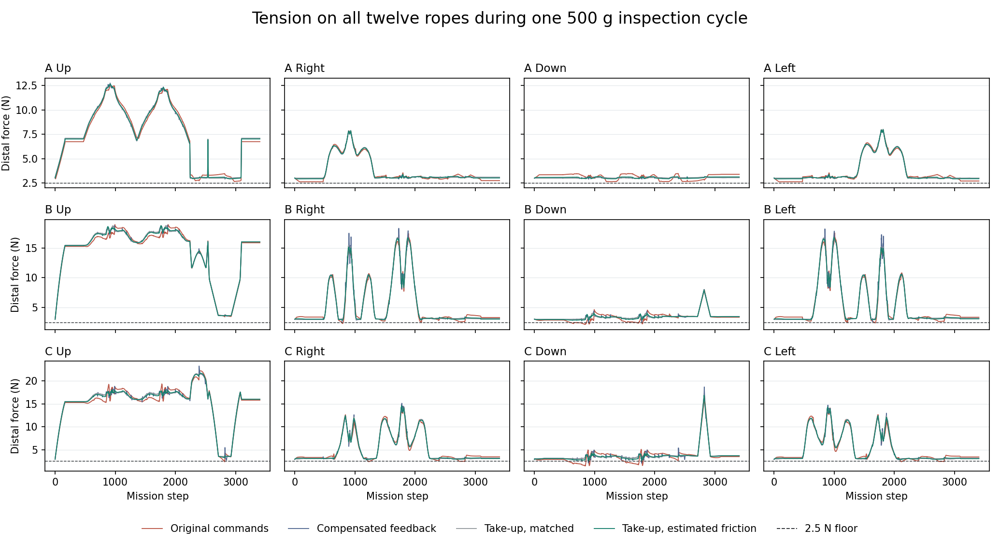
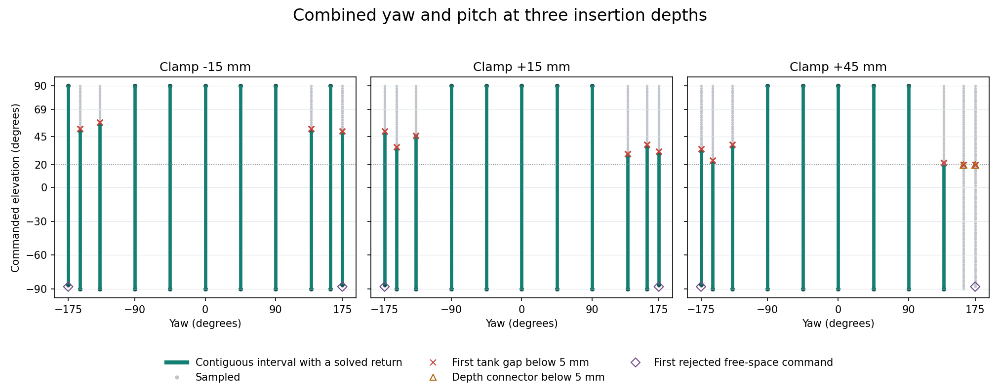

# Extreme Simulation Report — 500 g U4+M2, Round 2

Manual engineering study opened on 19 November 2026, US Eastern time. The source revision is `d0938c309db9da552ebfeeaac07fc8b5da1693c3`. This round uses the archived 500 g mission, the evening M6 bond-gap candidate and the retained M5 seat. It preserves the two separate Ø1.8 mm M backbones, the four blades per U unit, all twelve Ø2 mm ropes and their 21/24/28 mm lanes.

Repository review was recorded at 22:54:40 EST on 19 November (03:54:40 UTC on 20 November). This report was compiled at 2026-11-20 00:27:15 EST (2026-11-20 05:27:15 UTC).

The revised reversal sequence kept all twelve distal ropes above 2.5 N and the head within 1° throughout both free-rod replays. The proposed 0.25 mm M6 guide cleared the nominal body in all 3,405 states. At three loaded holds its flexible support moved the rope bores enough to require new winch lengths. The immediate structural test is the M5 pin, which reached 372.6 MPa in service. Its grade and the resistance of the printed web still require measurement. [Methods, raw results and reproduction](../../simulations/u4m2/lanes_20261113/extreme_round2_20261119/README.md) · [Test programme](../../nextstep/README.md)

## M6 guide position, bond and rope path

The previous evening checked 787 negative and 430 positive station records. This round covers every one of the 3,405 substeps at both stations, all eleven phases, and the guide, caps and lockwire envelope at each station. The swept crop accounts for every archived M6 geometry before the exact FCL query. The 1,217 independently published overlap records match within 1.9e-12 mm.

| Station | Minimum guide gap | Minimum cap gap | Minimum wire gap | Surface contacts |
|---|---:|---:|---:|---:|
| -12 mm | 0.066735 mm at 1,709 | 0.085296 mm | 0.182995 mm | 0 |
| +12 mm | 0.082393 mm at 1,709 | 0.089200 mm | 0.200097 mm | 0 |

At the governing step 1,709 the finer 0.125 mm axial mesh gives 0.067301 mm at -12 mm, 0.082839 mm at +12 mm. These resolutions apply to CAD triangles. The rod retains eight cells per module. [Per-step evidence](../../simulations/u4m2/lanes_20261113/extreme_round2_20261119/results/m6_all_steps.csv.gz) · [Refinement](../../simulations/u4m2/lanes_20261113/extreme_round2_20261119/results/m6_fine_exact.json)

The eight-rib PA12 submodel has a bare-body bending rigidity of 46,708 N·mm² and a torsional rigidity of 43,299 N·mm². With the 0.25 mm bond and assumed adhesive shear moduli of 0.5 and 1.5 GPa, these rise to 51,452–51,550 N·mm² in bending and 48,259–48,381 N·mm² in torsion. The stiffness calculation excludes the NiTi core and assumes fixed incremental disk positions for the load-sharing calculation. The largest individual land resultant in the three service cases was 3.037 N.

At steps 1,709, 1,710 and 1,885 the greatest guide-to-web witness motion is 0.0028 mm on the first shell mesh and 0.0028 mm on the refined shell mesh. The 0.017 mm design target applies to displacement from the ideal guide location. The largest absolute witness motion relative to the ideal routing frame is 2.168 mm and 2.242 mm respectively, exceeding that target. The plate and its web share much of this motion. Adding 0.025 mm of assembly offset toward the web and an adverse 0.2° tilt causes contact in the local rigid-patch probes. Full nonlinear bonded assembly motion and actual post-cure tilt need measurement. [Land wrenches and combined tolerance probes](../../simulations/u4m2/lanes_20261113/extreme_round2_20261119/results/m6_support.json) · [Refined support mesh](../../simulations/u4m2/lanes_20261113/extreme_round2_20261119/results/m6_support_refined.json)

The C-rope hole centres move 2.07–2.18 mm. Leaving the original rope against the moved bore gives a signed interference in all 48 tested combinations. Recentring the rope on the moved holes leaves at least 0.193 mm of envelope clearance. The three affected spans shorten by 0.224–0.431 mm. With original winch lengths the six whole-rod cases give 1.509°–1.563° pointing error. Local feedback in increments of at most 0.25 mm reduces this to 0.028°–0.197°. This feedback result covers three holds, both assumed adhesive moduli and a one-way support displacement. [Bore geometry](../../simulations/u4m2/lanes_20261113/extreme_round2_20261119/results/m6_bores.json) · [Winch corrections and loads](../../simulations/u4m2/lanes_20261113/extreme_round2_20261119/results/disturbed_holds.json)

## Twelve-rope reversal over the full mission

The cable model stores the material length on each side of a friction site and retains that state after a reversal. Each of the three 3,405-step runs below re-equilibrates the entire rod under all twelve distal tensions. The assumed static and sliding coefficients are both 0.15, with 0.10 mm total drum play. The frictionless reference has a 2.901 N minimum. With friction the unchanged commands first breach the 2.5 N threshold at +45.56° outward yaw and put C-down at its minimum at +165.34° outward yaw. Both are at +20° pitch and the +15 mm clamp datum. The fixed-shape sweep also tests unequal static and sliding coefficients and three drum-play widths.

| Winch strategy | Minimum distal force and location | States below 2.5 N | First failing step | Largest 3-D pointing error | Smallest tank gap after allowance |
|---|---|---:|---:|---:|---:|
| Archived commands | 1.444 N, C-down at 846 | 794 | 549 | 2.751° | 7.842 mm |
| Delayed distal force feedback | 1.926 N, C-right at 2,393 | 92 | 904 | 21.686° | 8.770 mm |
| Estimated friction and feedback | 2.051 N, C-down at 1,780 | 11 | 705 | 1.558° | 8.119 mm |

With estimated friction and feedback the highest proximal tension is 25.93 N. The largest M5 +12 mm resultant is 27.81 N. The independent check recovered 36 of 36 selected equilibria against their exported tank gaps and pointing errors. The smallest recovered fixed-command branch tangent eigenvalue is 0.21032 in the solver coordinates. Dynamic response depends on inertia, damping and the winch loop. [Active-branch equilibrium checks](../../simulations/u4m2/lanes_20261113/extreme_round2_20261119/results/replay_tangents.json) · [Coefficient and backlash sensitivity](../../simulations/u4m2/lanes_20261113/extreme_round2_20261119/results/transmission_sensitivity.json)

**Change tested at reversal.** Hold the preceding pose while the drum takes up the new friction direction, then advance the target. With model-matched friction and play, 950 take-up steps and 2,729 motion subdivisions keep the maximum command increment at 0.244 mm. Minimum distal force is 2.901 N. The actual 3,405 original endpoint residuals stay below 3.3e-07. With assumed friction 0.12 or 0.18 against a 0.15 plant, the fixed-path minima are 2.809 and 2.887 N. The schedule generator interpolates prescribed shapes between archive states. Their elapsed time, distributed friction and the motor torque limit still need a timed drive test. [Take-up cases](../../simulations/u4m2/lanes_20261113/extreme_round2_20261119/results/takeup.json)

Each precomputed take-up schedule was then replayed on a freely equilibrating rod at every substep, including take-up and intermediate motion. Both use 0.15 actual static and sliding friction with 0.10 mm actual drum play. All twelve proximal and distal forces, M5 resultants, the actual pointing error and tank gap are saved.

| Controller assumptions | Equilibria solved / expected | Minimum distal tension | Samples below 2.5 N | Peak pointing error | Minimum tank gap |
|---|---:|---:|---:|---:|---:|
| Friction 0.15, play 0.10 mm | 7,084 / 7,084 | 2.901 N | 0 | 0.507° | 8.056 mm |
| Friction 0.12, play 0.08 mm | 10,102 / 10,102 | 2.622 N | 0 | 0.819° | 8.057 mm |

The friction directions use the original route wrap. Both cases omit a measured motor acceleration and per-guide friction law. [Matched free-rod substeps](../../simulations/u4m2/lanes_20261113/extreme_round2_20261119/results/takeup_plant_mu0.15.csv.gz) · [Mismatched free-rod substeps](../../simulations/u4m2/lanes_20261113/extreme_round2_20261119/results/takeup_plant_mu0.12.csv.gz)

## Structural load sharing and overload

**U1, compliant bending at step 1,510.** The previous rigid-tab test imposed the disk motion and predicted 593 N of net blade tension. The effective module delivered 92.3 N of compression in its distal cell. The new axial model allows both tabs of each of the four real curved blades to slide elastically and lets the cage carry part of the imposed resultant. At 250 N/mm per tab and 10% of the CAD-based cage stiffness bound, the disk correction is -0.320 mm. The blades carry -41.53 N and the cage -50.79 N, totalling -92.33 N. The largest elastic tab motion is 0.121 mm. Trial peak tensile blade strain falls from 1.586% to 0.492%.

The 36 combinations cover two U1 events and the U3 compliant-axis event, four tab stiffnesses and three cage stiffness fractions. 36 have a force-balanced solution in the solved blade range. The 0.5 mm section integration gives 1303.8 N/mm for the trial constrained-displacement cage bound. Four independent off-grid nonlinear solutions differ from the interpolated axial blade forces by at most 0.13 N, and their peak tensile strain differs by at most 0.007 percentage points. Tab stiffness and cage response are unmeasured, and the remaining disk motion components stay prescribed. [Axial sharing and tab slip](../../simulations/u4m2/lanes_20261113/extreme_round2_20261119/results/u_assembly.json) · [Direct checks](../../simulations/u4m2/lanes_20261113/extreme_round2_20261119/results/u_interpolation_check.json)

**M5, retained pin.** The shell transfers the +12 mm force-dominant event on the return from left yaw (−167.27°, +20° pitch) and the −12 mm moment-dominant event on that return (−90°, +20° pitch) to their moving pin axes. The local study retains the relieved PA12 coupon, steel pin, threaded cap and clamped fixture. The table shows the fine mesh. Load factors scale the recovered vector in its event orientation.

| Step and station | Applied load factor | 95th-percentile PA12 tensile strain | Peak PA12 tensile strain | Peak clear-shaft bending stress |
|---|---:|---:|---:|---:|
| 1,843, +12 mm | 0.5 | 0.207% | 2.178% | 187.0 MPa |
| 1,843, +12 mm | 1.0 | 0.416% | 3.804% | 372.6 MPa |
| 1,843, +12 mm | 1.5 | 0.621% | 5.065% | 556.1 MPa |
| 1,843, +12 mm | 2.0 | 0.827% | 6.105% | 739.2 MPa |
| 2,059, -12 mm | 0.5 | 0.070% | 1.042% | 72.6 MPa |
| 2,059, -12 mm | 1.0 | 0.142% | 1.732% | 147.4 MPa |
| 2,059, -12 mm | 1.5 | 0.215% | 2.522% | 223.2 MPa |
| 2,059, -12 mm | 2.0 | 0.287% | 3.125% | 299.6 MPa |

16/16 contact solutions converged across the two meshes. The strongest pin load in the original shell is 14.51 N. An 8.55% remote shell tensile hotspot at step 1,843 remains a separate failure candidate. The contact model assumes elastic PA12 and steel. Local peaks are mesh-sensitive and the actual pin grade, PA12 allowable and first-crack load remain unmeasured. [Both meshes and contact residuals](../../simulations/u4m2/lanes_20261113/extreme_round2_20261119/results/m5_local.json) · [Test vector in the moving frame](../../simulations/u4m2/lanes_20261113/extreme_round2_20261119/results/m5_moving_frames.json)

## Combined motion, return and timed disturbances

Each of eleven yaw slices starts at +20° elevation. The solver follows upward and downward branches at intervals no greater than 2° and reverses the accepted winch commands. The table lists the contiguous lower and upper sampled elevations for which the controller can reconnect to the initial yaw pose at that clamp coordinate. A blank endpoint means the initial depth connector or starting pose already failed. A solution farther along a branch can exist past a gap violation. At +175° yaw on descent the original Newton trial left the supported bellmouth tangent domain. The rerun retained the same bore geometry and backtracked from the last admissible state before testing the next command.

| Yaw | Clamp −15 mm | Clamp +15 mm | Clamp +45 mm |
|---:|---:|---:|---:|
| -175° | -86° to 90° | -86° to 48° | -86° to 32° |
| -160° | -90° to 50° | -90° to 34° | -90° to 22° |
| -135° | -90° to 56° | -90° to 45° | -90° to 36° |
| -90° | -90° to 90° | -90° to 90° | -90° to 90° |
| -45° | -90° to 90° | -90° to 90° | -90° to 90° |
| +0° | -90° to 90° | -90° to 90° | -90° to 90° |
| +45° | -90° to 90° | -90° to 90° | -90° to 90° |
| +90° | -90° to 90° | -90° to 90° | -90° to 90° |
| +135° | -90° to 50° | -90° to 28° | -90° to 20° |
| +160° | -90° to 90° | -90° to 36° | — |
| +175° | -86° to 48° | -86° to 30° | — |

The following free-space command branches reached a model or equilibrium limit. For the others, any shorter installed interval in the table is set by the tank margin.

With yaw held at +175°, the first rejected downward pitch target on the main grid was −88° (equilibrium trial exceeded the finite rope routing domain). Last passing / first failing targets were -87° and -88°. This bounds the tested control branch.

With yaw held at −175°, the first rejected downward pitch target on the main grid was −88° (equilibrium trial exceeded the finite rope routing domain). Last passing / first failing targets were -87° and -88°. This bounds the tested control branch.

The independent depth checks cover the body envelope and actual six-millimetre adapter at 1 mm spacing from −15 to +45 mm on selected sections. They record 7 adjacent pass/fail transitions across those sections. In 22 of 22 branches, the return commands and tensions reconnect to the nominal withdrawal route ending at the original −750 mm clamp datum. The sweep samples the selected yaw angles, clamp positions and elastic winch trajectories. Intermediate three-dimensional command paths and the finished head/harness contour require additional evidence. [All motion samples and rope commands](../../simulations/u4m2/lanes_20261113/extreme_round2_20261119/results/pose_steps.csv.gz) · [Boundary and withdrawal connections](../../simulations/u4m2/lanes_20261113/extreme_round2_20261119/results/pose_boundary_checks.json)

At 1,030 paired outward and return points the twelve winch commands agree to 0 mm. The largest corresponding rope-force difference is 6.7e-08 N and the largest tank-gap difference over all three depths is 9.9e-09 mm.

At unchanged winch commands, a trial lateral harness force of ±2 N gives up to 44.26° error across the two tested holds. Releasing the most heavily loaded rope gives up to 59.00° and zero tension on that rope. The timed small-signal runs at steps 1,709 and 2,432 give conditional first frequencies of 0.58 and 1.40 Hz. A 0.25 mm C-up pull was applied over 0.1, 0.5 and 2.0 s, followed by a hold and return. Disk inertias, damping ratios, delays and actuator lag are trial inputs. The 24/48-mode comparison and finite observation window are recorded for each case. [Disturbed holds](../../simulations/u4m2/lanes_20261113/extreme_round2_20261119/results/disturbed_holds.json) · [Timed responses](../../simulations/u4m2/lanes_20261113/extreme_round2_20261119/results/timed_response.json)

Tilting the fixture by +2° at step 1,709 leaves 4.463 mm after allowance, below the 5 mm operating margin. A transverse head centre-of-mass shift of +10 mm gives 15.38° pointing error at step 1,709. Both tests keep the head at 500 g and leave the winches at their original commands.

In 6 of the 12 48-mode trials the tip still exceeded the 5% residual-motion band during the final sample of the three-second window after unloading. The largest tip tracking error across these trials was 0.994 mm.

## Fatigue, wear and safety factors

One open mission contains 3,405 samples, 46 signed load/strain histories and 5,377 individual rainflow entries. Each row retains the mean, range and count, including residual half cycles. The starting hanging pose and final withdrawn neutral pose differ. Returning to the initial hanging pose, time at rest, printing orientation and the real inspection duty must be measured to assemble a repeatable service block.

| Fixed material location or rope | Minimum | Maximum | Largest range |
|---|---:|---:|---:|
| U1 blade, approximate | -0.522% | 0.297% | 0.819% |
| M5 round NiTi backbone | -1.392% | 1.445% | 2.837% |
| M6 round NiTi backbone | -1.097% | 0.662% | 1.759% |
| M5 build-direction kinematic gauge | -32.081% | 49.784% | 81.865% |
| M6 pad axial shear | -38.591 MPa | 63.959 MPa | 102.550 MPa |
| C-up winch, compensated loop | 2.635 N | 25.927 N | 23.292 N |

The M5 build-direction reading spans the motion of two rod-mapped points on the perforated web. Its very large range cannot be used as a local PA12 fatigue strain. The material-endurance field is left empty for this gauge. The remote shell at step 1,843 instead puts the peak principal strain at 8.55% and the maximum build-direction tension at 6.43%. The M6 pad shear is a trial linear traction at one integration point. Its high magnitude calls for a nonlinear, measured joint law before assigning a bond life.

The greatest simulated material transfer at the effective friction site is 489.5 mm on C-up. Drum travel and material transfer are separate wear exposures. The dwell table gives N·h per rope at four turning poses, each evaluated for 1, 10 and 60 minutes. The inverse endurance table reports the fully alternating reference amplitude at one million cycles that would support 10,000 such open traces under trial exponents 3, 5 and 8. It applies no experimentally identified mean-stress, wear or creep law. Absolute service life and replacement interval remain open. [Rainflow ranges and means](../../simulations/u4m2/lanes_20261113/extreme_round2_20261119/results/rainflow.csv.gz) · [Duty, material travel and dwell](../../simulations/u4m2/lanes_20261113/extreme_round2_20261119/results/duty.json) · [Required reference amplitudes](../../simulations/u4m2/lanes_20261113/extreme_round2_20261119/results/endurance_requirements.csv.gz)

| Component and quantity | Highest tested demand | Resistance for 1.5× demand | Resistance for 2.0× demand |
|---|---:|---:|---:|
| Rope plus termination, proximal tensile force | 25.93 N | 38.89 N | 51.85 N |
| M6 adhesive land, resultant transmitted at one saddle | 3.037 N | 4.556 N | 6.074 N |
| U blade tab, single blade end reaction | 213.6 N | 320.4 N | 427.2 N |
| U NiTi blade, local tensile engineering strain | 0.9811 percent | 1.472 percent | 1.962 percent |
| M5 supported pin and relieved PA12 coupon, p95 volume tensile principal strain | 0.00416 strain | 0.00624 strain | 0.00832 strain |
| M5 supported pin and relieved PA12 coupon, maximum clear shaft bending MPa | 372.6 MPa | 558.9 MPa | 745.2 MPa |
| M5 remote PA12 web, shell peak principal tensile strain | 8.552 percent | 12.83 percent | 17.1 percent |
| M6 adhesive pad, absolute axial shear at the fixed maximum-range site | 63.96 MPa | 95.94 MPa | 127.9 MPa |

One conditional material comparison uses the database value of 205 MPa yield for annealed SS304, originally entered for a backbone material. If the fitted pin had that same proof strength, its clear-shaft bending yield ratio at step 1,843 would be **0.55**. The actual pin grade is unspecified. [Conditional pin factor](../../simulations/u4m2/lanes_20261113/extreme_round2_20261119/results/conditional_pin_factor.json)

For step 1,843 at +12 mm, the contact solutions bracket that same 205 MPa bending demand between 0.541 and 0.557 of the service pin vector (7.84–8.07 N). The two bounding elastic stresses are 202.2 and 208.1 MPa. [Conditional yield brackets](../../simulations/u4m2/lanes_20261113/extreme_round2_20261119/results/pin_yield_brackets.json)

For step 2,059 at -12 mm, the contact solutions bracket that same 205 MPa bending demand between 1.372 and 1.388 of the service pin vector (8.88–8.99 N). The two bounding elastic stresses are 203.7 and 206.2 MPa. [Conditional yield brackets](../../simulations/u4m2/lanes_20261113/extreme_round2_20261119/results/pin_yield_brackets.json)

The resistance table scales each service demand. The M5 proof-load table separately recomputes nonlinear contact at 1.5× and 2× force. An evidence-backed physical factor needs a lower-bound specimen resistance in the same failure mode and units. Actual first irreversible change, fracture load and missions to failure remain unmeasured. [Resistance requirements](../../simulations/u4m2/lanes_20261113/extreme_round2_20261119/results/required_strength.csv.gz) · [Re-solved proof loads](../../simulations/u4m2/lanes_20261113/extreme_round2_20261119/results/proof_loads.json)

## Handoff

1. Build one bonded M6 and measure both plate position and local web motion during the three critical disk poses. Measure bore-centre motion and post-cure tilt together. Use them to replace the one-way local support assumptions, then repeat the closed-loop trajectory with moving guides.
2. Instrument both ends of the C lines and B-down. Compare reversal with and without the take-up hold. Record actual play, traction, drum travel, timing, motor limits and tip motion, including the return through +69°.
3. Test a complete U cage and four blades with controlled axial load and both bending axes. At M5, use the separate 1,843 and 2,059 pin vectors and measure the remote shell hotspot independently. Use matched PA12, NiTi, adhesive, rope/crimp and pin specimens for first-damage and rupture data. Rebuild the duty block with measured dwell, then calibrate and validate life on held-out specimens.

Seven second-round unit checks, three first-round tests and eight full-cycle controller regression tests passed. The [validation archive](../../simulations/u4m2/lanes_20261113/extreme_round2_20261119/results/validation.json) records input hashes, environment, independent numerical checks and accepted coverage. The [study directory](../../simulations/u4m2/lanes_20261113/extreme_round2_20261119/README.md#reproduction) contains the reproduction commands.

The outgoing English-language checks covered 73 paths relative to the reviewed main revision and 107 relative to the earlier guide branch. Both comparisons checked complete names and file contents, including decompressed tables, escaped text, image metadata and rendered figure labels. All 170 relative documentation links and anchors resolved.
