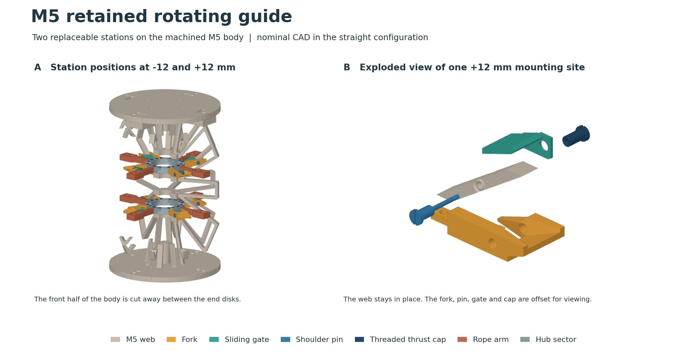
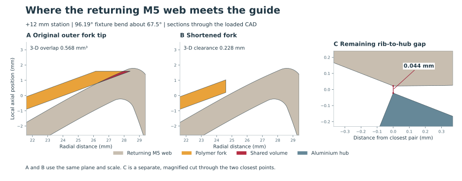
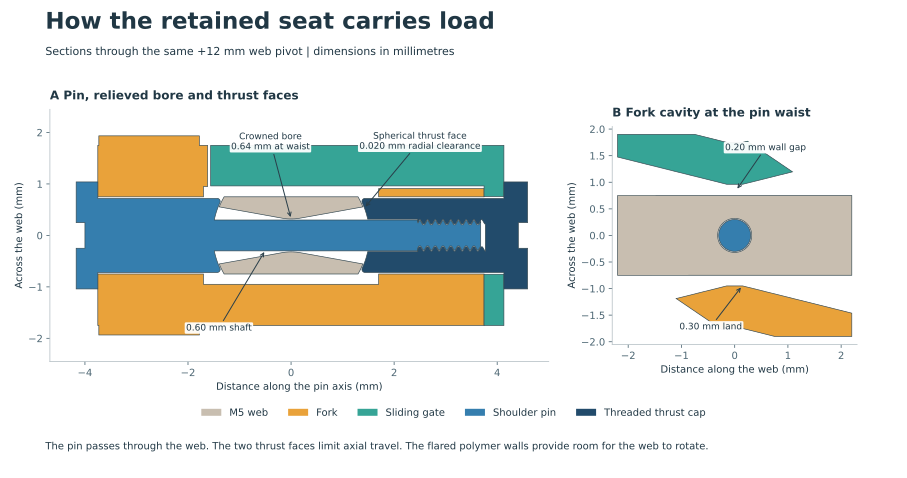

# M5 retained guide on the actual webs — 18 November 2026

**Test 2, stage 2 · manual engineering follow-up.** Started 18 November 2026 at 22:10:17 EST (19 November 2026 at 03:10:17 UTC). Source revision `1c101887e4c6c84e66a660d2d2460594a741fd54` includes the evening seat-sizing study. The front is U4+M2 with a 500 g head and its independent Ø1.8 mm NiTi backbone. The present work covers M5 at z = −12 and +12 mm. Numerical results closed on 18 November 2026 at 23:28:18 EST (19 November 2026 at 04:28:18 UTC).

**Decision.** Keep the shortened fork as the test geometry and build a single-web coupon before duplicating the seats. In the 96.19° fixture bend the first physical fork collided with the returning leg of the web at both stations. The shortened fork clears those two locations by 0.224 and 0.228 mm. The narrowest clearance elsewhere is only 0.044 mm. The local web strain and pin stress need material evidence, and the hub still needs a workable installation tool. The assembled module has no manufacturing release.

[Inspectable CAD and assembly sequence](../../cad/lanes_u4m2/retained_seat_20261118/README.md) · [Simulation methods and reproduction](../../simulations/u4m2/lanes_20261113/m5_retained_seat_20261118/README.md) · [Six-case results](../../simulations/u4m2/lanes_20261113/m5_retained_seat_20261118/results/case_summary.csv) · [Previous Evening Report](Evening_Report_2026_11_18.md)

## What changed in the module

The previous evening's V3 wall-profile screen found interference at all six endpoints for the 0.15 mm gap. Increasing the V3 gap to 0.25 mm still left 0.451 and 0.536 mm penetration in the two fixture bends and 0.017 mm in record 47. Its proposed pivot-centred, flared cavity gave 0.058–0.107 mm clearance in the ideal-pivot calculation. This stage places the cavity, retainer and rope arms on the actual webs and also checks the rest of the M5 body. [Previous profile comparison](Evening_Report_2026_11_18.md)

The rib now passes between a fork and a removable gate. A 0.60 mm steel shaft crosses the machined web, with a positive head on one end and a threaded thrust cap on the other. The hole has a 0.64 mm waist and widens toward both faces so the web can tilt. The steel shoulders have spherical bearing surfaces that match the relieved web and a 0.060 mm rim fillet. The 0.020 mm radial play at the shaft is separate from the 0.20 mm running gap between the polymer fork walls and the web. The latter opens out with a slope of 0.25 from a 0.30 mm land.

A plain Ø0.60 mm pin in a straight 3 mm thick web would need approximately 0.35 mm of extra bore diameter to tilt by the archived maximum of 6.565°. The relieved bore provides that angular freedom while retaining a close fit at its centre. The spherical shoulders carry the axial component of load; the cylindrical shaft carries the in-plane component. Both directions of the published forces were retained in the calculation.

Each station has eight overlapping hub sectors, eight lap screws, four forks, four gates, four shoulder pins, four thrust caps, four rope arms and eight tongue screws. The sectors enter the existing body individually. The root of each fork is offset to let the tilted web enter through its open mouth before the gate and cap go on. The B/C rope arms retain their paired bellmouths at 24 and 28 mm on the four cardinal axes. The backbone retains its ferrule-free installation.

In the straight CAD, all 12 distinct part meshes, including the machined body, are closed single solids. The two stations have 1,980 component-pair checks in total, with zero solid intersections above 0.0000001 mm³. Each of the two rope passages on each of four arms at both stations was sectioned at three heights, giving 48 comparisons. The largest changes from the archived V3 centre and equivalent diameter were both below 0.000001 mm. A 7.80 mm central hub radius leaves the Ø1.8 mm backbone its independent passage. [Part topology](../../cad/lanes_u4m2/retained_seat_20261118/parts/parts.json) · [Straight checks](../../simulations/u4m2/lanes_20261113/m5_retained_seat_20261118/results/straight.json)

With the archived PA12 and steel densities and an assumed aluminium density of 2.70 g/cm³, each station grows from 2.4192 g to 3.5307 g. Removing material at the eight web seats recovers 0.01984 g. The net change for the two installed stations is **+2.2031 g**, in the M5 body assembly. The head payload remains 500 g.

## Collision that the local socket check missed

The inclined web has a second leg that returns toward the guide in a deep bend. In the 96.19° bend about 67.5°, that leg reaches the *outside tip* of the untrimmed fork even though the web nearest the pin clears the fork walls. The intersection was found by checking the remaining body after the small socket windows had been analysed.

At −12 and +12 mm the original outer fork tips occupied 0.597995 and 0.568240 mm³ of the returning web, respectively. Limiting the fork to a 24.60 mm radius removes both intersections on the refined 0.25 mm body surface. The respective gaps to that web are 0.223779 and 0.228016 mm. A different pair now governs the whole-body margin, between rib 7 and hub sector 0 at +12 mm. Its 0.044042 mm nominal gap leaves only 44 micrometres to share among print error, machining error, assembly position and model error. The two station-enclosing volumes remain at least 1.157 mm apart across the six endpoints. [Before/after solids and closest points](../../simulations/u4m2/lanes_20261113/m5_retained_seat_20261118/results/remaining_body_fine.json)

The source shell was re-equilibrated at two mesh densities. The maximum discrepancies against the archived endpoints were 0.000000852 mm for tip translation, 0.00000620 N for site force and 0.00000658° for site rotation. The CAD mapping uses the rigid guide frame, shell mid-surface positions and through-thickness directors. Separate CAD surface spacings vary the interpolation and collision geometry. The full-body check covers the two end disks and integral anchor lugs, four coupling rings and the remaining ribs. Both station assemblies enter the guide-to-guide envelope check.

## What the six loaded endpoints show

The four records select different challenges in the saved 500 g motion. Record 146 has the largest M5 curvature, 141 the largest station force, 47 the largest station moment and 64 is the +175° head-yaw hold. Their end-disk displacements and all 16 simultaneous M5 bore-force vectors enter through the archived shell study. The two fixture cases impose the same 96.19° M5 bend about different axes.

| Endpoint | Ideal wall margin (mm) | Nominal local gap (mm) | Corrected local gap (mm) | Remaining body gap or bound (mm) | Peak local tensile strain | Peak nodal pressure (MPa) |
|---|---:|---:|---:|---:|---:|---:|
| 96.19° bend, 67.5° axis | 0.0657 | 0.0845 | 0.0788 | **0.0440** | **6.058%** | **242.2** |
| 96.19° bend, 0° axis | 0.0583 | 0.0756 | **0.0732** | 0.1170 | 5.180% | 200.7 |
| 146, highest M5 curvature | 0.0683 | 0.0875 | 0.0797 | 0.4350 | 4.954% | 167.7 |
| 141, highest station force | 0.0661 | 0.0862 | 0.0866 | 0.3070 | 4.837% | 160.3 |
| 47, highest station moment | 0.1066 | 0.1149 | 0.1122 | 1.0035 | 2.655% | 93.1 |
| 64, +175° head yaw | 0.0637 | 0.0859 | 0.0866 | 0.3413 | 4.179% | 138.7 |

The first clearance column comes from the evening ideal-pivot wall profile. The nominal CAD column measures real guide parts against machined web surfaces. The contact-corrected column reapplies each site's local translation and elastic displacement to its own web. The remaining-body column gives a direct distance when a piece lies near a station and an enclosing-slab lower bound for distant pieces. The two bearing surfaces can carry compressive contact and are recorded separately from unintended clearance.

Reducing the global shell target area from 0.055 to 0.025 mm² changed the nearest local unintended gap by at most 0.00336 mm. Reducing the local CAD surface spacing from 0.20 to 0.10 mm reproduced those minima at the reported precision. For the two pure bends the remaining-body check used 0.25 mm surfaces. The four saved holds used 0.45 mm. The controller's 217-hold trajectory, rope friction, capstan losses and dynamics remain outside this endpoint study.

The finer CAD windows have 704,700 vertices. The triangle finder marked 246,872 projected points for extrapolation at the shell boundary. Just 448 lay more than 0.001 mm outside their nearest source triangle, all on the unmounted webs where the archived shell has dummy pin holes and the actual CAD is solid. There the greatest source-triangle distance was 0.29866 mm. On the mounted webs the maximum was 0.00077 mm. [Shell footprint and solid-mesh registration](../../simulations/u4m2/lanes_20261113/m5_retained_seat_20261118/results/transfer_sensitivity.json)

The smallest corrected local polymer gap is 0.073210 mm. No unintended solid pair overlapped in the transferred local geometry. At the **intended** steel/web bearing, the independently transferred CAD surfaces still overlap by up to 0.0005303 mm³. The local contact solver balances force to within 0.000131 N. Its separately discretized contact constraint and the CAD transfer have different numerical accuracy. A single rigid station fitted to the four independently translated pivots leaves up to 0.071137 mm incompatibility. The largest fitted rope-bore shift is 0.035746 mm. Both values are diagnostics of the missing common-guide equilibrium. [Corrected surfaces, pivot residuals and bore shifts](../../simulations/u4m2/lanes_20261113/m5_retained_seat_20261118/results/corrected_edge0p15.json)

On the representative web the largest distance from a CAD vertex to the regular finite-element reference mesh was 0.13909 mm, on the transition outside the bearing. Aligning the radial mesh with the machined relief reduced it to 0.02060 mm. Within 0.73 mm of the bore axis both meshes were within 0.00418 mm. Changing the interpolation within one mesh changed displacement by at most 0.00120 mm across 48 input loads. Re-solving four sites on the feature-aligned mesh changed the transferred correction by up to 0.00595 mm. As-built clearance uncertainty requires hardware measurements. [CAD transfer sensitivity](../../simulations/u4m2/lanes_20261113/m5_retained_seat_20261118/results/transfer_sensitivity.json)

## Strength, retention and numerical uncertainty

The local solid model has a finite web, a frictionless steel shaft and two finite thrust faces. A 3-D small-strain PA12 model balances the simultaneous load at each site after its archived rotation is applied. It permits separation and reactions of either sign along the pin through opposing thrust faces. The model holds the two cut ends of the local patch in their rotated frame. The results capture the incremental local bearing strain. The evening 2.4–2.7% hole-edge strain was computed with a perfectly fitting, rigidly distributed hole-edge reaction and includes the global shell response. Each figure describes its own boundary condition and length scale.

All 48 paired sites reached contact equilibrium at both 2,112 and 6,528 nodes. In the 67.5°-axis fixture bend the +12 mm, 157.5° web carries 24.05 N, moves 0.06324 mm and reaches 6.058% peak incremental tensile strain and 242.2 MPa peak nodal pressure on the fine mesh. Among the elements with centres within 2 mm of the bore axis, the volume-weighted 95th-percentile tensile strain at that site is 0.604%. The peak is localized at the bearing. The same bend's largest tilt, 6.565°, belongs to the **67.5° web**, which carries 20.59 N. The two extremes would produce a fictitious paired load if combined. The greatest fine-mesh strain in the four 500 g holds is 4.954% in record 146.

The negative and positive thrust faces each develop a compressive reaction in 26 of the 48 cases, counting both faces when both engage. The largest contact moment about the ideal pivot is 2.13 N·mm. For a simply supported Ø0.60 mm circular shaft with the modeled contact loading, the largest nominal bending stress is **805 MPa**. The material grade, allowable stress, cut-thread root, preload and fatigue strength are still open. The model treats the steel as rigid when computing its contact pressures.

The acceptance check requires both the local peak pressure and peak tensile strain to change by less than 5% under refinement. **0 of 48** sites met it from the middle to the fine meshes. Of 12 selected sites carried to 14,720 nodes, **1 of 12** met it from fine to finer. At the 24.05 N site the fine-to-finer result moved from 6.058% to 6.126% and from 242.2 to 233.4 MPa. At the higher-tilt site strain moved from 4.713% to 5.302%. The results identify where to measure damage and guide deformation; they do not establish a material failure threshold.

Two design and boundary sensitivities matter for a coupon. Increasing the bore crown radius from 1 to 2 mm on the four selected loads lowered the largest paired site's fine-mesh strain from 6.058% to 4.703% and pressure from 242.2 to 185.9 MPa. The remaining nominal radial freedom at 6.565° tilt falls from 0.01142 to 0.00482 mm. At the 157.5° site in record 146, strain rose from 2.279% to 2.391%. The R2 geometry is a coupon comparison only. Extending the clamped patch half-length from 2.7 to 3.6 mm raised the 24.05 N site's prediction to 6.305% and 266.7 MPa. At the original 2.7 mm half-length the feature-aligned mesh gave 5.449% and 217.1 MPa for that site. [Crown comparison](../../simulations/u4m2/lanes_20261113/m5_retained_seat_20261118/results/alternative_crown_2mm/) · [Cut-boundary change](../../simulations/u4m2/lanes_20261113/m5_retained_seat_20261118/results/longer_local_patch/) · [Feature-aligned contact](../../simulations/u4m2/lanes_20261113/m5_retained_seat_20261118/results/feature_fitted_patch/)

## Assembly and manufacturing decision

The two ordered installations placed 88 components. They evaluated 192 translations and 40 screw paths at 15,928 poses against the machined body and the hardware already installed. No sampled pose had solid overlap above 0.0000001 mm³. Clearance bounds certified the translation subintervals away from contact. In 16 translation stages the unverified subintervals contained at most 0.04922 mm of possible surface travel. Screw rotations were sampled at 22.5° or less. Continuous screw/thread contact and seating at the remaining subintervals still require an assembly trial. A larger, pre-trim fork enclosed the final fork throughout these motions. [−12 mm installation journal](../../simulations/u4m2/lanes_20261113/m5_retained_seat_20261118/results/assembly_-12.json) · [+12 mm installation journal](../../simulations/u4m2/lanes_20261113/m5_retained_seat_20261118/results/assembly_+12.json)

The coaxial Ø1.0 mm probe cleared 70 mm on both sides of all eight pin/cap assemblies. At the lap screws a Ø0.92 mm coaxial shaft met the cage after only 3.45 mm at −12 and 3.69 mm at +12. Three side-drive exteriors were therefore checked against the real assembly sequence. Each exterior used 72 directions per screw, a continuous 55 mm side entry and the complete 1.60 mm tightening stroke. The 2.50 mm diameter, 1.55 mm high housing with Ø1.10 mm lateral shaft had no clear direction at any of the 16 screws. A 1.70 mm diameter housing of the same height and a Ø0.90 mm shaft cleared all 16, with a minimum of 0.0288 mm. Keeping a 2.50 mm diameter, lowering it to **1.15 mm**, and reducing the shaft to **Ø0.80 mm** gave **0.1342 mm** at −12 and **0.2820 mm** at +12. Only 8 of the 72 directions per screw cleared at −12 even with this low housing. The result defines a target tool exterior. Its blade, transmission and torque still require a physical trial. [Coaxial access](../../simulations/u4m2/lanes_20261113/m5_retained_seat_20261118/results/tool_access.json) · [Side-drive sweeps](../../simulations/u4m2/lanes_20261113/m5_retained_seat_20261118/results/side_drive.json)

The 1 mm bore crown leaves a nominal 0.1952 mm side ligament at the opening of the 1.50 mm wide web. The 2 mm crown would leave 0.2102 mm. The shank, threaded tail, gates, lap joints, arm roots, printed hole orientation, material allowables and long-term cap retention need their own evidence. The added station mass, contact compliance and bore motion have yet to enter a newly equilibrated whole-arm trajectory.

## Next tests

1. Measure the relieved web, minimum material bridge and shoulder radii on a matched PA12 coupon. Apply the paired force/tilt cases for the largest pin force, the largest tilt and record 146, in both loading directions. Measure translation, permanent set and damage and compare the contact law with the local predictions.
2. Demonstrate the 1.15 mm high side drive and its screw-holding fixture inside a real M5 cage. Check the 0.044 mm nominal rib-to-hub location under bend and measure its total error budget. Verify cap engagement, installation torque and simultaneous access to both pin ends. Record the assembled mass and location of the B/C holes.
3. Give the four seats a shared guide motion in the global model using measured stiffness and backlash. Recheck the critical pure bends and saved holds with that coupling before extending the geometry to M6, the ±24 mm stations or the full 217-hold motion.

Three paired fixture targets come directly from the 0.025 mm² shell and fine solid model. Components are guide-on-web force along the web, across the web in its plane and perpendicular to its plane. The full archived rotation vector should be used when setting up the coupon. Tilt below is a scalar summary.

| Source at +12 mm | Web azimuth | Paired force components (N) | Force (N) | Tilt | Predicted 3-D pivot translation (mm) |
|---|---:|---|---:|---:|---:|
| 67.5° fixture axis, largest force | 157.5° | +23.836, −3.166, 0.000 | 24.05 | 0.000° | 0.0632 |
| Same fixture, greatest tilt | 67.5° | −20.281, +0.748, +3.486 | 20.59 | 6.565° | 0.0544 |
| Record 146, largest saved-hold strain | 67.5° | +12.342, −7.887, −2.405 | 14.84 | 3.066° | 0.0552 |

## Verification

All seven retained-seat tests and nine tests of the source shell model passed. These include the solid-element affine patch, rounded thrust normal, side-drive sweep, finite rotation, CAD transfer, consistent tangent and paired source loads. Regenerating the CAD from source reproduced the 12 binary STLs and their topology manifest byte-for-byte. OpenSCAD parsed the complete module with 89 part instances. Repeating the refined whole-body calculation reproduced its archived JSON byte-for-byte. The loaded-section drawing uses that same fine mesh. Its generator verifies the old intersection volume, the revised fork gap and the hub gap before saving the drawing.

Publication checks cover the complete contents and names of the 128 outgoing paths relative to the previous Codex branch tip. They include decoded text, structured data, numerical mesh headers and image metadata. All five outgoing figures were visually reviewed, including both embedded PNG layers in the earlier evening SVG. The English publication check passed. The 200 relative documentation references, including 14 heading fragments, resolved.

[Source revision](https://github.com/KevinQianjin/ASRC_snake_body_design/commit/1c101887e4c6c84e66a660d2d2460594a741fd54) · [Run inputs and versions](../../simulations/u4m2/lanes_20261113/m5_retained_seat_20261118/results/provenance.json) · [Numerical comparison and checks](../../simulations/u4m2/lanes_20261113/m5_retained_seat_20261118/results/summary.json)
