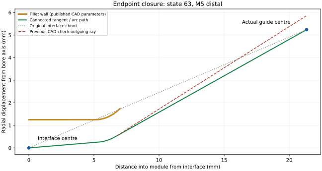
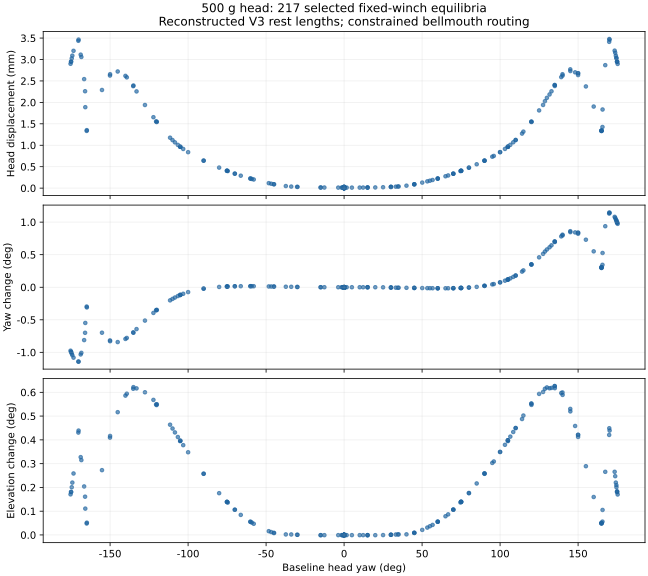

# Morning Engineering Report — 2026-11-16

**Edition: Morning Report.** Actual agent start and reporting cutoff:
**16 November 2026 07:19:33 EST (12:19:33 UTC)**. The two-hour deadline is
**09:19:33 EST (14:19:33 UTC)**. Report preparation: **16 November 2026 08:04:21 EST (16 November 2026 13:04:21 UTC)**.

## Outcome and decision

The existing M5/M6 bellmouth CAD now has an **opt-in, constrained frictionless
rope model inside the equilibrium solver**, using a path that actually reaches
the prescribed guide centres. The same path supplies energy derivatives,
rigid-end moments, guide/fillet loads and finite-rope CAD checks. The head remains
**500 g**; U4+M2, the 21/24/28 mm lanes, guide stations and backbone are retained.
No CAD geometry was changed and no backbone end ferrule was added.

All **217 selected fixed-winch equilibria** solve. The new rope-end screen has
**0 failures in 5208 checks**, and all selected 63 mm tank-envelope checks pass.
However, the previous reconstructed winch settings move the head by as much as
**3.479 mm**, with **1.147° yaw** and
**0.626° elevation** changes. The V3 guide joint
still interferes with the body: all **six targeted outer-saddle checks remain
positive at 0.25 mm CAD surface resolution**, up to **0.009765 mm³**.

**Do not release for manufacture.** This closes a specific routing/equilibrium
mismatch, not the complete physical contact problem. Shared-bore sliding,
mount stiffness, friction, printed strength and hardware evidence remain open.
No new full closed-loop trajectory is claimed.

## Reporting period and repository review

The review interval is **15 November 2026 07:19:33 EST to 16 November 2026
07:19:33 EST**, equivalent to **15 November 2026 12:19:33 UTC to 16 November
2026 12:19:33 UTC**, followed by the work produced in this run.

The clean working branch was `73b0b51`; it was fast-forwarded to the fetched
`origin/main` revision **`e9c4858524fc21db2e1a19d1d748836c3a1eb28e`**. This includes
Claude's evening revision `e804068` and PR #28. No concurrent simulation
processes were found. Historical morning/evening evidence was preserved.

The preceding 24 hours contain these unique commits (merge rows are integration
events, not additional engineering experiments):

| Commit | Committed time (Eastern / UTC) | Update |
|---|---|---|
| `e309668` | 11-15 08:13:02 EST / 11-15 13:13:02 UTC | Refine guide contact screening and document V3 saddle development |
| `b5ea768` | 11-15 09:18:31 EST / 11-15 14:18:31 UTC | Merge pull request #25 from KevinQianjin/codex/guide-validation |
| `76e87d6` | 11-15 09:43:10 EST / 11-15 14:43:10 UTC | Normalize project timestamps to US Eastern Time and UTC |
| `386b20e` | 11-15 09:49:05 EST / 11-15 14:49:05 UTC | Merge pull request #26 from KevinQianjin/codex/guide-validation |
| `73b0b51` | 11-15 10:26:39 EST / 11-15 15:26:39 UTC | Label engineering updates as Morning Report with Eastern and UTC times |
| `d705505` | 11-15 10:29:56 EST / 11-15 15:29:56 UTC | Merge pull request #27 from KevinQianjin/codex/guide-validation |
| `e804068` | 11-15 20:35:30 EST / 11-16 01:35:30 UTC | Evening Report 2026-11-15: finite-rope end exits and M5/M6 bellmouth candidate |
| `e9c4858` | 11-15 21:32:30 EST / 11-16 02:32:30 UTC | Merge pull request #28 from KevinQianjin/claude/great-goodall-1wf2yh |

The [15 November Morning Report](Morning_Report_2026_11_15.md) established the
refined V3 saddle evidence. The [Evening Report](Evening_Report_2026_11_15.md)
added finite-rope checks and the bellmouth bodies, but did not re-solve their
routing. That newer evidence changed this morning's first priority from the
older advisory plan to the missing solver integration.

Requested runtime: GPT-6 Astra, xhigh. Actual runtime model metadata was not
available and is **not claimed as verified**. Exact run context and versions
are in the [evidence folder](../../simulations/u4m2/lanes_20261113/morning_20261116/README.md).

## 1. Connect the contact path to the actual guide

The evening CAD check constructed a bearing arc and outgoing ray from an
estimated exit angle. It did not enforce that the outgoing ray intersects the
solver's prescribed guide centre. On the same 217 saved geometries, the maximum
perpendicular ray-to-guide miss is **0.586111 mm**;
**4803 of 5208** rays miss by more than
0.3 mm, the nominal radial play of a 2 mm rope in a 2.6 mm guide bore. This is
an endpoint-constraint mismatch, not by itself a physical guide-contact verdict.
The old 0/5208 end-region result remains valid only for its constructed rays.

The new model reads the actual published fillet dimensions. In the bend plane,
its rope-centre offset circle has:

- axial centre `s0 = end_depth - wall_radius * sin(design_wrap)`;
- radial centre `wall_radius + hole_radius`;
- radius `wall_radius + rope_radius`.

It solves both tangency points from the interface hole centre and the actual
adjacent guide. A non-contacting span remains straight; a contacting span is
incoming tangent + circular arc + outgoing tangent. Analytic energy gradients
include the moment applied to the rigid end frame. The path is continuous and
tangent at the arc boundaries and reaches the prescribed guide centre.

**Boundary-condition limit:** interface hole centres remain ideal routing
constraints. The rope is not free to slide laterally through the complete
shared bore across an inter-module joint. Rigid end geometry follows the
interface frame, while the rod retains its previous homogenised stiffness;
rigid-to-flexible body transitions and support stiffness are not newly solved.
U4 end exits and finite guide-mouth contact are outside this new end model.

The code is in [`end_bellmouth_kernel.py`](../../simulations/u4m2/lanes_20261113/end_bellmouth_kernel.py)
and [`bellmouth_model.py`](../../simulations/u4m2/lanes_20261113/bellmouth_model.py).
Existing lane/controller pipelines retain their original routing unless
`apply_bellmouth()` is explicitly used. The bellmouth cuts remove **0.043337 g**
of PA12 from M5+M6; this small mass change is included in the new solver inputs.

## 2. Re-solved 500 g fixed-winch holds

For each saved V3 equilibrium, unstretched lengths are reconstructed from its
geometry and tensions using the existing elastic rope law and **1 m free rope**.
Those lengths are held fixed while the corrected route and CAD-adjusted mass
are solved. These are **reconstructed V3 commands**, not a replay of the original
archived controller commands.

| Metric | New selected-state result |
|---|---:|
| Solved records / unique equilibria | 217 / 199 |
| New unique solves / validated probe solutions reused | 195 / 4 |
| Maximum equilibrium residual | 2e-08 |
| Minimum scaled fixed-winch tangent eigenvalue | 0.225526 |
| Nonpositive fixed-winch tangents | 0 |
| Maximum head-position change | 3.478548 mm |
| Maximum absolute yaw / elevation change | 1.147100° / 0.626278° |
| Tension range | 2.882692–18.732424 N |
| Maximum rod axial strain | 0.096072% |
| Minimum sampled tank-envelope clearance | 9.187012 mm |
| Minimum clearance after existing 1.5 mm allowance | 7.687012 mm |

All selected strain, rod-geometry, 2.5–250 N tension and allowance-adjusted
5 mm tank-clearance checks pass. Positive quasi-static tangent stiffness is
**not proof of dynamic stability**. The provisional head envelope is still
63 mm; actual head/harness CAD, manufacturing tolerance and actuator dynamics
are not included.

Coverage by source phase: **startup: 29, inverse: 36, entry: 4, exit: 4, left_out: 36, left_return: 34, right_out: 34, right_return: 34, straighten: 6**. Recorded clamp depths are used for
152 records; the 29 startup holds are explicitly placed at −750 mm and the
36 inverse holds at +15 mm, matching the established study convention.
These points sample all required path phases but do not cover every command,
transition, feedback correction or intermediate collision state.

**Fixed-tension diagnostic:** the first attempt stopped after 38 solved records
when an unguarded trial left the supported tangent domain. A safeguarded Newton
probe then solved source states 64 and 146, but did not converge at states 38
and 39 (approximately 45° and 50° yaw). Thus 40 of 42 distinct diagnostic states
were solved; this is not proof that the other equilibria do not exist. At the
175° hold, retaining the old tensions moved the head by 18.33 mm. The completed
217-record result uses fixed reconstructed lengths instead. Failed attempts
and their residual traces remain in the evidence folder.

## 3. Finite rope, guide loads and remaining mounting contact

The actual bellmouth STL is queried against the **same connected rope curves**
used by the new solver. Sampling is at most 0.02 mm, covering the rigid-end-frame
region through `|CAD z| >= 38 mm`. Endpoint closure is checked for every curve.

| End-region metric | Result |
|---|---:|
| Rope-exit checks / failures | 5208 / 0 |
| Smallest sampled rope-surface clearance | -0.0004246 mm |
| Mesh-faceting acceptance tolerance | 0.005 mm |
| Recorded curve endpoint error | 0 mm |
| Maximum exit angle | 18.247438° |
| Smallest margin below the design wrap | 3.241928° (required: 1°) |
| Maximum ideal fillet resultant | 4.841473 N |

The small negative distance is within the declared mesh tolerance at intended
bearing. It is **not a positive manufacturing clearance**, a continuous contact
proof or a wear/strength pass. The rigid-end-frame screen does not validate the
unresolved deformation transition to the flexible webs.

| Load over the same selected records | Previous V3 routing | New routing and mass |
|---|---:|---:|
| Maximum guide-hole force | 5.521632 N | 5.718505 N |
| Maximum station resultant | 27.442081 N | 28.449191 N |
| Maximum station moment | 60.845173 N mm | 61.121935 N mm |

The maxima need not occur together. Use the exported simultaneous vectors in
`guide_holes.csv`, `guide_stations.csv` and `rope_exits.csv`, not a combination
of unrelated maxima, when modelling the joint.

Six representative poses (source records 0, 38, 48, 63, 64 and 146) receive
**48 complete-body guide checks at 0.5 mm axial CAD resolution**. Six checks
fail, all at M5 outer saddles in records 63, 64 and 146. The worst overlap is
**0.010655 mm³**, compared with 0.008959 mm³ at the previous worst source record.

All six failing combinations are then checked at **0.25 mm**: all still fail,
and the maximum is **0.009765 mm³**. The maximum decreases about 8.35% between
these two surface resolutions; this is refinement evidence, not a converged
physical error bound. The 217 updated poses have **not** all received a new
rigid-guide Boolean audit.

The finer study loads only the required **complete M5 body** and runs
sequentially, without cropping. It completes in **65.78 s**,
with observed peak RSS **3.503 GiB** under
a **6 GiB virtual-memory cap**. This provides six results where the previous
concurrent 0.25 mm attempt had returned none. Historical failed results remain
unchanged.

## 4. Rod discretisation check

Five holds are independently re-solved at 16 cells/module with the **same
reconstructed rest lengths** and physical guide stations as the eight-cell
model. All five solve and retain positive fixed-winch tangents.

| Source record | Head difference (mm) | Yaw difference (deg) | Elevation difference (deg) |
|---|---:|---:|---:|
| 38 | 0.1433 | +0.0053 | -0.0039 |
| 48 | 0.1519 | -0.0003 | -0.0168 |
| 63 | 0.3323 | -0.0958 | -0.0316 |
| 64 | 0.2806 | -0.0851 | -0.0138 |
| 146 | 0.3323 | +0.0962 | -0.0312 |

These differences are specific to the new constrained fixed-winch model and
five selected holds. They do not retroactively resolve the older 0.359°
fixed-tension discrepancy or validate a 0.2° physical accuracy claim. CAD
surface refinement and rod equilibrium refinement are separate numerical tests.

## Validation and reproducibility

- **45 distinct tests pass:** 16 existing guide/refinement tests, five existing
  bellmouth geometry tests, ten new routing/gradient/load tests and 14 existing
  rope/control tests. New tests cover curve closure and tangency, contact
  transition continuity, rigid-frame virtual work, energy and elastic tangent
  derivatives, force/moment balance, unchanged straight routing, CAD mass and
  periodic heading comparisons.
- Default lane-kernel equivalence remains within 1.43e−14 energy and 1.12e−16
  gradient difference in the recorded regression; directional gradient errors
  are below 2.30e−8. New-route tests use the documented 2e−7 directional-energy
  tolerance and 2e−5 elastic-tangent absolute tolerance.
- A missing `pytest` executable initially blocked that runner. The same tests
  were executed with standard-library `unittest`, wrapping the five function
  tests; no test was silently skipped and no extra dependency was required.
- One heading comparison crossed a 360° unwrap branch. Reported differences
  now use the shortest signed angle; raw rod headings and equilibria are
  retained. This changes comparison formatting, not the solved state.
- All 217 saved equilibrium residuals, reconstructed rest lengths and tension
  arrays were independently rechecked by the saved-artifact validator. CSV
  counts and source CAD hashes agree; eleven configuration checks pass.
- Exact source/input hashes, dependency versions, checkpoint coverage,
  publication language checks and relative-link checks are recorded in the
  [evidence README](../../simulations/u4m2/lanes_20261113/morning_20261116/README.md).
  The outgoing publication set contains **119 files**, including the evening
  files newly integrated onto this branch. Their full contents/names pass the
  initial English-only gate, and **178 relative Markdown paths** exist. Numeric
  binary payloads are inspected by format and both figures were rendered and
  reviewed. The final staged and committed sets are checked again before
  publication. This is an outgoing-file check, not a historical repository-wide
  audit. External-link availability and legacy heading fragments are not certified.

## Remaining limitations and next run

1. **Resolve the guide-to-web joint.** The 0.25 mm study still finds overlap.
   Use the real V3 webs/saddles and simultaneous new loads to design and model
   an articulated/compliant or otherwise compatible attachment. Quantify
   support motion and its effect on module stiffness; the 0.5 mm bonding land
   has no qualified strength or fatigue evidence.
2. **Remove remaining ideal contact assumptions.** Check U4 exits, shared-bore
   lateral freedom, guide mouths, rigid-to-flexible end transitions and friction.
   Interface-centre constraints and homogeneous rod stiffness must not be
   mistaken for a fully coupled physical contact model. Rope D/d and wear remain
   unqualified.
3. **Recalibrate control only against the resulting consistent model.** The
   previous reconstructed commands show up to 1.15° yaw change. Preserve loaded
   startup, insertion, both yaw excursions and returns, and withdrawal when a
   complete closed-loop run becomes justified. Expand mesh/uncertainty checks;
   do not claim physical accuracy from numerical settling.

The [next-run handoff](../../simulations/u4m2/lanes_20261113/morning_20261116/HANDOFF.md)
is advisory. The next morning must fetch current GitHub results, including any
newer evening work, before choosing priorities.
