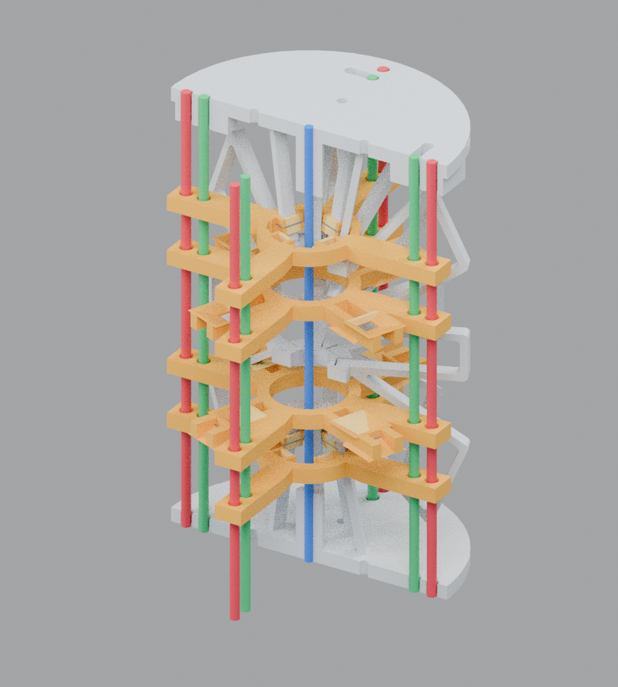

# Daily engineering report — 15 November 2026

## Outcome and decision

The 500 g U4+M2 study now refines the actual CAD surface before nonlinear beam
mapping. This corrects an important discretisation error in the 14 November
guide/body collision screen. A new **V3 flared-socket guide candidate** reduces
the remaining outer-saddle interference while preserving the rope lanes,
station locations, backbone and head payload.

The corrected final candidate has **96 failing guide-part checks out of 1736**, across **55 of 217 selected equilibrium records**. Its largest returned overlap is **0.008959 mm³**. The remaining contact is concentrated near the short fixed land; mouth relief alone does not establish mounting compatibility.

The design is **not released for manufacture**. The finite end-region rope
contact problem remains, and the much shorter proposed bonding land has no
validated strength or stiffness model. Today's results establish a geometric
improvement and updated ideal equilibria, not a physically validated complete
inspection cycle.

## Reporting period and repository state

- Review interval: **14 November 2026 07:01:11 to 15 November 2026 07:01:11
  EST (America/New_York, UTC−05:00)**, equivalent to **14 November 2026 12:01:11
  to 15 November 2026 12:01:11 UTC**, followed by the work produced during this run.
- Actual run start: **15 November 2026 07:01:11 EST (12:01:11 UTC)**.
  Execution deadline for this historical run: **15 November 2026 08:31:11 EST
  (13:31:11 UTC)**. Publication-preparation time and duration
  are recorded in [run context](../../simulations/u4m2/lanes_20261113/guided_refinement_20261115/run_context.json).
- Working-branch baseline: `a98f7f3c512df6d282dea746701de514c45f06a4` on
  `codex/guide-validation`.
- Latest checked `origin/main`: `3f56248ed0680606b8d32b6275dc5c0aacbbba12`,
  which merged the previous guide validation through PR #24. Its file tree was
  identical to the working branch. No newer commits were found on these
  checked refs within the review interval; the merge predates the interval.
- The initial working tree was clean and no concurrent simulation processes
  were found. Historical 14 November evidence is preserved.
- Requested execution model: GPT-6 Astra, xhigh. Actual runtime model metadata
  was unavailable and is **not claimed as verified**.

## 1. Correct the CAD deformation screen before changing the part

The original M5/M6 STL includes triangles spanning **24.598 mm axially**. The old
screen moved only their original vertices using the Cosserat-rod material
frames. Long planar triangles then represented curved material surfaces as
chords, which substantially distorted the guide/body intersection volumes.

The new conforming axial refinement splits shared edges and retriangulates
every adjacent face consistently. It preserves the undeformed CAD surface,
volume, orientation and closed topology. Surface resolution is independent of
the equilibrium mesh: these checks still use **eight rod cells per module**.
Refining a CAD surface does not refine the rod equilibrium or establish solid
deformation physics.

The same V2 parts and saved 500 g poses were screened at original, 2, 1 and
0.5 mm maximum axial triangle spans:

| Held yaw | Original STL: failures / 8 | Original largest overlap, mm³ | 2 mm largest, mm³ | 1 mm largest, mm³ | 0.5 mm largest, mm³ | 0.5 mm failures / 8 |
|---|---:|---:|---:|---:|---:|---:|
| 0° | 4 | 4.95995 | 0.01368 | 0.00974 | 0.00939 | 2 |
| 90° | 8 | 25.57525 | 2.08544 | 2.06158 | 2.05963 | 4 |
| 175° | 8 | 31.10193 | 5.95243 | 5.96191 | 5.96551 | 4 |

At 0.5 mm surface resolution the remaining contacts in these three poses are
at the **±12 mm outer-web saddles**. The ±24 mm inner-web frames are clear in
these poses. Zero yaw is a loaded, bent configuration, not straight CAD.

The reduction from 31.10 to 5.97 mm³ is mainly a **correction of the numerical
screen**, not a mechanical improvement. The mechanical comparison below uses
the refined surface for both designs.

The final Boolean path keeps complete deformed bodies, transfers coordinates
in float64 and checks Manifold error status. A cropping shortcut was rejected
after a roughly 0.001 mm³ discrepancy from the full-body calculation. The
kernel also shows approximately 0.001 mm³ variation under rigid coordinate
transforms for a near-degenerate intersection; its regression check requires
0.1% agreement in positive volume. That numerical comparison tolerance is
**not allowable hardware interference**. Positive intersections above the
1e-6 mm³ reporting threshold remain failures; a returned zero does not provide
a manufacturing-clearance margin.

[Resolution evidence](../../simulations/u4m2/lanes_20261113/guided_refinement_20261115/mount_convergence_float64/summary.json)
· [Refinement implementation](../../simulations/u4m2/lanes_20261113/cad_surface_refinement.py)
· [Numerical and design comparison](../../simulations/u4m2/lanes_20261113/guided_refinement_20261115/comparison.png)

## 2. V3 outer-saddle relief and a corrected CAD land

The retained engineering candidate has a nominal **0.15 mm gap**, an explicit
**0.5 mm axial land**, and a **1.5:1 radial/tangential relief slope** outside
that land. Its gap law is `0.15 + 1.5 × max(abs(z) − 0.25, 0)` mm, reaching
**2.205 mm** at the ±1.62 mm socket faces. The socket wall remains 0.85 mm.
Inner-web saddles, rope lanes, eyelets and guide stations retain their V2 sizes.

This run preserved the rejected variants rather than promoting a three-pose
pass to a full design pass:

| Candidate | Evidence | Decision |
|---|---|---|
| V2, no relief | Refined 175° maximum 5.9655 mm³ | Contact remains |
| Early V3 slopes 0.3 / 0.6 | Three-pose maxima about 1.882 / 0.720 mm³ | Reject |
| Early V3 slope 1.0 | Zero in three screening poses, but **17/181** expanded records fail; maximum **0.079759 mm³** | Reject as a contact-free design |
| Early V3 slope 1.5, nine-section loft | Outer cap files split into eight components instead of four | Reject before equilibrium promotion |
| Corrected V3 slope 1.5, explicit land breakpoints | Straight assembly/part checks pass; **55/217** selected records still have guide contact | Retain as a documented engineering candidate; no release |

The matched saved-tension comparison uses the same 0.5 mm CAD resolution for
both designs. V3 is re-solved with its updated CAD mass; the last column records
that small equilibrium change rather than implying identical imposed shapes.

| Source inverse hold | V2 largest overlap, mm³ | Final V3 largest overlap, mm³ | Head change with V3 mass, mm |
|---|---:|---:|---:|
| 0° | 0.009388 | 0.000000 | 0.009782 |
| 90° | 2.059632 | 0.000000 | 0.019331 |
| 175° | 5.965513 | 0.002215 | 0.007609 |

The original nine axial loft sections missed the land boundaries at ±0.25 mm.
Consequently the early variants did not actually contain the intended constant
0.15 mm gap over the whole 0.5 mm land. With larger relief, the retaining groove
could sever a cap. Adding the exact land breakpoints fixes that construction
error. The final CAD uses eleven section planes at the outer stations;
**112 rays measured from actual source-CAD web faces** verify its exported gap
profile, with maximum error **1.53e-6 mm** against the nominal law. This is a
numerical CAD check, not a printer tolerance or bond qualification.

All eight final frames are watertight single components; cap and lockwire files
each contain four components. All eight straight assemblies return zero
guide/body intersection. Zero relief reproduces **all 24 V2 frame/cap/wire
STLs byte-for-byte**. The published candidate STLs and mass file match the
variant used for the final calculations.

The head remains **500 g**; lanes remain **21/24/28 mm** and stations remain
**−24/−12/+12/+24 mm**. Rope bore/mouth diameters remain Ø2.6/Ø3.0 mm and the
plate remains 3.2 mm thick. The central Ø1.8 mm NiTi backbone remains independent;
no end ferrule is added. Bodies, disks and anchors are the unchanged V2 parts.

The cutaway hides part of the body; it does not prove installation access.

[CAD and installation limits](../../cad/lanes_u4m2/guides_v3/README.md)
· [Straight checks](../../cad/lanes_u4m2/guides_v3/geometry_check.json)
· [Actual gap measurements](../../simulations/u4m2/lanes_20261113/guided_refinement_20261115/socket_gap_verification.json)
· [V2 reproduction hashes](../../simulations/u4m2/lanes_20261113/guided_refinement_20261115/v2_reproduction.json)

## 3. Updated mass and selected-path equilibria

The final geometry changes the CAD mass estimate by **0.04866 g total**
relative to V2. Adhesive, closure tails and real harness mass remain excluded;
mass is distributed uniformly along the rod cells and the prior homogenised
stiffness is retained. The unchanged head is a separate 500 g payload.

The final set contains **217 records / 199 unique geometries**.
It includes the original targeted 181 records (startup, inverse holds,
left/right outward and return phases, insertion/exit, phase boundaries and
recorded extrema), plus **36 distinct motion geometries not used by that
initial selection**, chosen deterministically with seed 20261115 before the
final CAD checks. This is not the full 2,526-state motion archive.

| Metric | Final candidate |
|---|---:|
| Equilibria solved at saved tensions | 217 / 217 |
| Largest head position change from V2 | 0.30184 mm |
| Largest absolute yaw change | 0.14321° |
| Largest absolute elevation change | 0.03880° |
| Minimum scaled fixed-winch tangent eigenvalue | 0.207403 |
| Largest equilibrium residual | 3.05e-13 |
| Saved tension range | 2.99520–18.06428 N |
| Guide-part Boolean checks at 0.5 mm CAD resolution | 1736 |
| Checks returning positive overlap above 1e-6 mm³ | 96 |
| Records with at least one guide/body overlap | 55 / 217 |
| Largest guide/body overlap | 0.008959 mm³ |

Rod geometry checks pass: **True**. All selected fixed-winch
tangents are positive: **True**. These statements concern
the ideal quasi-static rod, not the physical guide mounting. The mass study
holds tensions fixed; **the closed-loop controller and full tank-envelope
cycle were not replayed**. Positive tangent stiffness is not dynamic stability.

The [consolidated pose table](../../simulations/u4m2/lanes_20261113/guided_refinement_20261115/selected_pose_metrics.csv.gz)
contains provenance, phase, head pose/material frame, internal geometric rope
lengths, tensions, guide overlaps and rope contact results. It is a table of
re-solved equilibria, not a new time history or winch command sequence.

[Selection](../../simulations/u4m2/lanes_20261113/guided_refinement_20261115/contact_subset_final/selection_summary.json)
· [Mass equilibria](../../simulations/u4m2/lanes_20261113/guided_refinement_20261115/v3_final_mass_holds/summary.json)
· [Complete selected-state contact results](../../simulations/u4m2/lanes_20261113/guided_refinement_20261115/v3_final_contact/summary.json)

## 4. Rope contact is still a blocker

The final 217 equilibria were checked against the unchanged V2 M bodies at
0.5 mm axial CAD resolution with rope sample intervals no greater than 1 mm.

| Metric | Final selected records |
|---|---:|
| Minimum sampled middle-flexure clearance after rope radius/sampling allowance | 4.89050 mm |
| Middle-flexure screen failures | 0 / 217 |
| Records with end-region rope-centre penetration | **57 / 217** |
| Largest sampled centre penetration | **0.24064 mm** |
| Largest single-hole force | 5.52163 N |
| Largest station resultant force | 27.44208 N |
| Largest station resultant moment | 60.84517 N mm |

The independent 36-hold resolution comparison found nine penetrating holds at
both 1 and 0.5 mm resolution; maximum depth changed from 0.23858 to 0.23931 mm.
The end-region failure persists after correcting the long-triangle error.

These are sampled rope-centre penetrations, not a finite-radius contact-force
solution. The middle-flexure figure subtracts a 1 mm rope radius and a 0.5 mm
sampling allowance; it does not bound CAD deformation error or manufacturing
tolerance. Finite guide-mouth, disk and anchor contact/friction remain unresolved.

[Rope/load evidence](../../simulations/u4m2/lanes_20261113/guided_refinement_20261115/v3_final_path/summary.json)
· [Preliminary load requirements](../../simulations/u4m2/lanes_20261113/guided_refinement_20261115/v3_final_design_loads.json)

## 5. What remains unproven

1. **Bonded mounting and structural stiffness.** The proposed outer-saddle
   bonding area falls from approximately 36.27 to 5.67 mm² per saddle, an
   84.4% reduction. The flared mouths must remain unbonded to retain their
   relief. Adhesive selection, PA12 preparation, actual gap, joint strength,
   creep and cyclic wear are unvalidated. Four webs still connect to one rigid
   frame; the narrow land is not a validated hinge or compliant support.
2. **Finite end routing.** Rope centres still enter disk/anchor material.
   Enlarging adjacent bores without checking the existing thin bridges would
   exchange a routing failure for an unsupported strength claim.
3. **Numerical and physical accuracy.** The earlier 8-to-16-cell comparison at
   175° had a 0.359° elevation discrepancy. Today's CAD surface refinement does
   not resolve that equilibrium-mesh discrepancy or establish 0.2° physical
   control accuracy.
4. **Unmodelled behaviour.** Actual support/contact compliance, rope friction,
   backlash, NiTi hysteresis/fatigue, motor dynamics, sensor noise/delay, real
   head shape and harness geometry remain unvalidated.

The factor-of-three load multiplier is a preliminary test/design assumption,
not a demonstrated safety factor. The existing rectangular-arm calculation
does not represent the relieved saddle, cap, adhesive or printed anisotropy.

## 6. Verification and next-run handoff

- **30 distinct tests passed:** 16 archive/geometry/load/refinement tests and
  14 existing numerical/control tests. Refinement tests check closed topology,
  volume preservation, an analytical curved-surface error, actual CAD and
  Boolean invariance/known volume/error rejection.
- **11 configuration JSON files validated.** All 24 V2 STL reproduction hashes
  match. Input hashes, environment versions, source-state coverage and logs
  are retained in the [evidence folder](../../simulations/u4m2/lanes_20261113/guided_refinement_20261115/README.md).
- Failed candidate slopes and the rejected cropping/test diagnostics remain
  distinguishable from the final accepted numerical checks. No hardware
  measurements or manufacturing approval are claimed.

An attempted 0.25 mm two-pose refinement ran concurrently with the main
0.5 mm contact audit and exceeded the cloud environment's **8 GiB memory
limit**. The cgroup recorded two OOM kills. The main audit had saved **193
complete records / 1,544 part checks**; only the missing 24 records were
computed afterward, sequentially. Input hashes and unique coverage are checked
when consolidating those checkpoints. Original interrupted results are retained.
The 0.25 mm attempt completed **zero checks** and is not evidence of convergence.
Final V3 overlap values therefore remain **0.5 mm surface-resolution results**;
a memory-bounded finer-resolution confirmation remains necessary. The existing
V2 2/1/0.5 mm comparison is separate and completed successfully.

The next run should first assess the shortened saddle joint with an explicit
local structural/contact model, using simultaneous guide forces and moments.
Determine whether a qualified bond or a genuinely articulated/compliant
attachment can retain the guide coordinates without materially changing
module stiffness. In parallel planning, revise finite end-hole/anchor routing
and include the full Ø2 mm rope envelope (1 mm radius) in its contact gate. Update the rod model and
rerun the complete closed-loop cycle only after a physically defensible
mounting/routing candidate is available. Keep the head payload at **500 g**.

Reproduction commands and file roles are in the
[dated evidence README](../../simulations/u4m2/lanes_20261113/guided_refinement_20261115/README.md).
