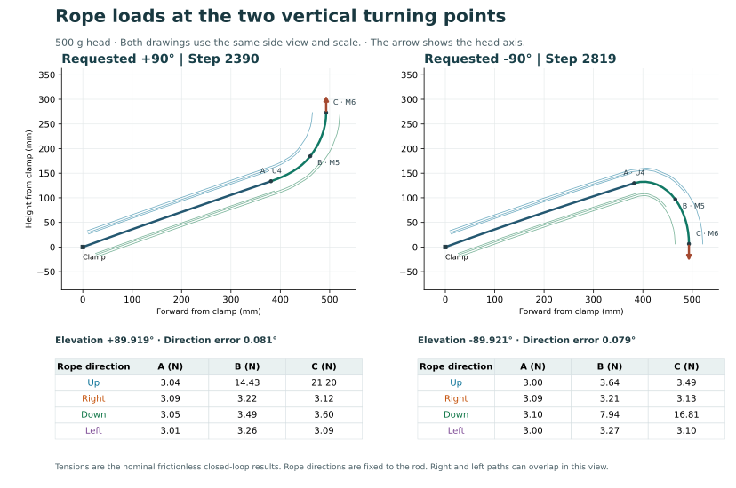

# Full-cycle validation of ±90° pitch with twelve-rope tension

Manual engineering report, 19 November 2026. Work began at 01:13 EST (06:13 UTC) on source revision `a147217`. The subsequently fetched main-branch merge `7cbf0b4` has the same tree. The preceding bench and shared-bore work is documented separately. [Previous report](M5_Seat_and_Shared_Bore_2026_11_19.md)

## Mission result

The 500 g U4+M2 model completed **1,380 of 1,380 reference targets** and reached both requested vertical directions. The combined record contains **3,405 motion states and 40,860 individual rope readings**, with twelve simultaneous forces at each state. The mission covered loaded startup, full insertion, both yaw excursions, both pitch excursions, four steering returns and final withdrawal. The nominal eight-cell run **passed**. There were 0 failed operating substeps and 0 unsettled or failed targets.

| Turning point | Step | Requested direction | Actual yaw | Actual elevation | 3-D pointing error | Tank clearance after allowance |
|---|---:|---:|---:|---:|---:|---:|
| Right turn | 913 | +175° yaw, +20° elevation | +175.002° | +20.001° | 0.002° | 11.581 mm |
| Left turn | 1,796 | −175° yaw, +20° elevation | -175.172° | +19.940° | 0.173° | 24.522 mm |
| Pitch up | 2,390 | +90° elevation | — | +89.919° | 0.081° | 21.146 mm |
| Pitch down | 2,819 | −90° elevation | — | -89.921° | 0.079° | 35.129 mm |
| Withdraw | 3,404 | 0° yaw, +20° elevation | -0.005° | +19.938° | 0.063° | 91.544 mm |

The pitch commands use laboratory horizontal as zero. The camera points straight up at +90° and straight down at −90°. The neutral inspection pose is 20° up. At either vertical pole, rotating the numerical azimuth can leave the pointing direction nearly unchanged. The pitch controller therefore uses the lateral component of the head axis and its signed angle in the forward/up plane. The independent acceptance calculation uses the angle between the actual and requested three-dimensional unit vectors. Roll is recorded in the head quaternion and has no commanded target in this study.

## Twelve simultaneous tensions

Values in the table are the simulated endpoint tensions in newtons. A anchors at U4 at 21 mm radius, B at M5 at 24 mm and C at M6 at 28 mm. “Up”, “right”, “down” and “left” follow the rod frame through the bend. In the straight CAD cross-section, up/right/down/left correspond to +Y/−X/−Y/+X. The two dominant pitch cables are the C-up and C-down lanes at (0, +28) mm and (0, −28) mm on M6. [CAD ray directions](../../cad/lanes_u4m2/end_bellmouth_v1/design.json)

| Rope direction | +90° A | +90° B | +90° C | −90° A | −90° B | −90° C |
|---|---:|---:|---:|---:|---:|---:|
| Up | 3.04 | 14.43 | 21.20 | 3.00 | 3.64 | 3.49 |
| Right | 3.09 | 3.22 | 3.12 | 3.09 | 3.21 | 3.13 |
| Down | 3.05 | 3.49 | 3.60 | 3.10 | 7.94 | 16.81 |
| Left | 3.01 | 3.26 | 3.09 | 3.00 | 3.27 | 3.10 |

Over the entire trace the lowest tension was **2.901 N on C down** at step 0 (straighten). The highest was **21.554 N on C up** at step 2,432 (pitch up return). These extrema can occur between the turning points. At the +69° command, the same C-up rope reached 21.553809 N on the outward sweep and on the return (steps 2,348 and 2,432). The difference between those peaks was below 0.000001 N.

The event table includes the loaded start, completion of straightening and insertion, both yaw limits, both vertical limits, each return and final withdrawal. Select an event in the viewer and click a force to highlight its rope and anchor. The CSV has all twelve unstretched winch lengths, internal route lengths and tensions at every accepted feedforward or feedback substep. Tension denotes the uniform force in the nominal frictionless model. Distal force sensitivity under sliding is reported below. [Event table and full-cycle figure](../../simulations/u4m2/lanes_20261113/cycle_closeout_20261119/results/yaw_pitch/ROPE_TENSIONS.md) · [Rotatable 3-D viewer, download to use offline](../../simulations/u4m2/lanes_20261113/cycle_closeout_20261119/results/yaw_pitch/motion_viewer.html) · [Full-precision step CSV](../../simulations/u4m2/lanes_20261113/cycle_closeout_20261119/results/yaw_pitch/rope_tensions_every_step.csv.gz) · [All per-channel phase extrema](../../simulations/u4m2/lanes_20261113/cycle_closeout_20261119/results/yaw_pitch/rope_tensions_by_phase.csv)

## How the motion was built and scored

1. The plant keeps six 96 mm modules and a 500 g total head load, including the adapter. Two Ø1.8 mm NiTi M backbones and twelve Ø2 mm ropes follow the published layout. The four C ropes cross the M5/M6 shared bore on their free lateral paths. The retained inner M5 guides add 2.2170 g before the 0.01984 g web removal, giving a net 2.19717 g increase. Other guide masses and the homogenized module stiffness use the published model.
2. The original 1,200 targets provide a yaw-only comparison on this plant. The combined run reuses the identical 941 settled targets through left return. The controller continues with the actual equilibrium, twelve applied winch lengths, feedback offsets and damping before adding 35 up, 35 back, 55 down and 55 back targets. The full withdrawal runs from the resulting neutral state.
3. The pitch-reference search compared two force allocations. In the fixed-centre planning model, the height-priority strategy approached 250.00 N up and 247.25 N down. Redistributing antagonistic loads lowered the peak over each outward reference to 21.03 N and 16.98 N. The new head path reduced the minimum allowance-adjusted planned gap to 21.19 mm up and 35.12 mm down. The closed loop uses the lower-tension plan. The commanded winch feeds and gains are independent of the updated shared-bore plant and mass.
4. Each accepted motion substep must satisfy rod geometry, at most 5% axial strain, 2.5–250 N rope tension, a positive local fixed-winch tangent above the numerical threshold, no more than 4.5 mm node travel, at least 5 mm body clearance after a 1.5 mm allowance and at most 1° controlled error. The settling target is 0.2°. Startup has its own pre-control record. These checks describe quasi-static equilibria.

The yaw-only comparison executed 1,200 targets. Its minimum adjusted tank gap was 8.056 mm and the controlled motion tension range was 2.950–18.720 N. Adding pitch raised the maximum tension by 2.833 N (15.1%). With pitch added, the minimum body-to-tank gap was **8.056 mm after allowance**. The largest node step was 2.500 mm, the largest controlled angular-coordinate error in motion was 0.388°, the largest pitch-phase pointing error was 0.081°, the smallest fixed-winch tangent eigenvalue was 0.21855 in model coordinates and the largest residual during controlled motion was 3.29e-10. Loaded startup began at -48.08° and 2.901 N minimum rope tension. Its pre-control residual was 3.30e-07 against the 2e−6 acceptance limit.

Returning to a specified direction also allows a check of tip location. At the same 15 mm clamp station, the neutral head after the up/down sweeps differed from the pre-pitch neutral by 0.044/0.050 mm respectively. At the fully withdrawn clamp position, the tip differed from the end of startup straightening by 0.101 mm, and the pointing direction differed by 0.064°. The controller specifies pointing and rope tension bounds. These translations are simulation outputs.

[Phase-by-phase checks](../../simulations/u4m2/lanes_20261113/cycle_closeout_20261119/results/yaw_pitch/phase_results.csv) · [Neutral return comparisons](../../simulations/u4m2/lanes_20261113/cycle_closeout_20261119/results/yaw_pitch/neutral_returns.json) · [Reproduction commands and input definitions](../../simulations/u4m2/lanes_20261113/cycle_closeout_20261119/README.md)

## Mesh resolution, guide loads and clearance

At identical actual winch commands, the mesh was refined from eight to sixteen cells per module. Pitch up changed by **0.00017°** and 0.081 mm at the tip. Its refined error to the requested vertical was 0.081° and the largest rope-tension change was 0.008 N. Pitch down changed by **0.00051°** and 0.072 mm at the tip. Its refined error to the requested vertical was 0.079° and the largest rope-tension change was 0.019 N. The 0.2° stopping rule therefore describes the controller on its specified mesh. Physical uncertainty also includes the actual module and rope properties.

Two published stiffness perturbations were applied to each actual vertical winch command. The same nominal pitch gains were then allowed up to sixteen corrections at fixed clamp position. This is targeted endpoint coverage.

| Change | Turn | Initial pointing error | Final pointing error | Last observed tension range | Settled and mechanical checks |
|---|---|---:|---:|---:|---|
| M backbone modulus 75 GPa | Pitch up | 0.691° | 0.007° | 2.98–24.57 N | pass |
| Rope axial stiffness -20% | Pitch up | 0.750° | 0.750° | 1.39–19.04 N | fail |
| M backbone modulus 75 GPa | Pitch down | 0.586° | 0.003° | 2.99–20.57 N | pass |
| Rope axial stiffness -20% | Pitch down | 0.419° | 0.004° | 2.95–16.18 N | pass |

For the pitch up command with ropes 20% softer, C-down fell to 1.389 N before correction. The controller could not find a correction satisfying its 3 N tension target within its 0.25 mm winch increment.

At the pitch up endpoint a separate length calculation assumed the lower axial stiffness was known. Its largest length adjustment was 0.784 mm over 4 increments. After 4 solved increments the largest error from the nominal twelve force targets was 1.47e-11 N. Across all 5 states, including the initial state, 3 had a rope below 2.5 N. This fixed-hold comparison uses simulated axial stiffness.

At the pitch down endpoint a separate length calculation assumed the lower axial stiffness was known. Its largest length adjustment was 0.615 mm over 3 increments. After 3 solved increments the largest error from the nominal twelve force targets was 3.23e-12 N. Across all 4 states, including the initial state, 2 had a rope below 2.5 N. This fixed-hold comparison uses simulated axial stiffness.

All 27,240 simultaneous guide-station resultants and 163,440 hole reactions are archived. The largest station force was 27.64 N on M5 at +12 mm (step 1,843). The largest station moment was 61.37 N·mm on M5 at -12 mm (step 2,059). At those two states the simultaneous companion moment/force was 19.13 N·mm and 11.20 N respectively. The maximum common-wall normal-force residual was 1.78e-03 N.

On the 217 archived holds, the full-surface checks at the controlling poses of six V3 stations narrowed the closest gap to 0.02042 mm at M6 −12 mm. The extended motion screen contains 20,430 station/step records, with a worst sampled lower bound of 0.01824 mm. Whole-body 0.5 mm axial surface refinement at one controlling motion step for each station gives a minimum of **0.02047 mm** at M6_z-12 (guide, step 1,710), and maximum Boolean overlap 0.0000000 mm³. The actual machined M5 body and the M6 bellmouth body were used. The print tolerance and mounting deflection at the closest pair remain unmeasured. The two retained inner M5 stations have earlier coupled structural evidence on six selected cases. Full mission structural coverage of those seats and loaded M6 ribs remains open.

At 13 distinct mission events, 312 finite-rope/end checks gave a minimum signed gap of -0.00226 mm for C_down at M6 proximal (Left turn). 0 checks fell below the −0.005 mm allowance for mesh faceting at intended contact. The smallest fillet design-angle margin was 6.313°, with 0 checks below 1°. The adapter-to-tank mesh check covered 3,405 poses. Minimum sampled plate clearance was 10.130 mm. The lower bound for interpolating adjacent plate poses was 8.946 mm before allowance. 0 segment bounds fell below the 5 mm criterion after allowance.

The adapter is the actual six-millimetre plate on M6. The sensor housing and cable harness still need registered geometry. A positive tangent measures local static stiffness. Actuator bandwidth, drift, gravity response during acceleration and stability of a timed motion remain open. [Endpoint stiffness variations](../../simulations/u4m2/lanes_20261113/cycle_closeout_20261119/results/yaw_pitch/perturbed_poles.json) · [Fixed-command mesh study](../../simulations/u4m2/lanes_20261113/cycle_closeout_20261119/results/yaw_pitch/mesh_poles.json) · [Guide load vectors](../../simulations/u4m2/lanes_20261113/cycle_closeout_20261119/results/yaw_pitch/guide_station_loads.csv.gz) · [Complete guide-mesh witnesses](../../simulations/u4m2/lanes_20261113/cycle_closeout_20261119/results/yaw_pitch/solid_motion_0p5.json) · [Adapter sweep](../../simulations/u4m2/lanes_20261113/cycle_closeout_20261119/results/yaw_pitch/adapter_clearance.json) · [Finite-rope clearance at selected events](../../simulations/u4m2/lanes_20261113/cycle_closeout_20261119/results/yaw_pitch/rope_end_events.json)

## How friction could change these readings

The frozen-geometry screen reconstructs all 40,860 complete rope paths across the combined trace. Maximum internal length mismatch was 0.000012 mm. The table gives limiting fully sliding results at the assumed coefficient. The nominal closed loop above uses uniform tension.

| Assumed μ | Lowest possible distal tension with winch side tight | Motion states with any rope below 2.5 N |
|---:|---:|---:|
| 0.00 | 2.901 N | 0 / 3,405 |
| 0.05 | 2.652 N | 0 / 3,405 |
| 0.15 | 2.072 N | 1,212 / 3,405 |
| 0.30 | 1.431 N | 2,256 / 3,405 |

At the 217 previously rebalanced holds, 114 holds could fall below the 2.5 N distal floor at assumed μ = 0.15 with geometry frozen. When C-down alone was allowed to slide and all winches were held fixed, the rod re-equilibrated in all 18 cases at holds 52, 63 and 146. The winch-tight branch gave distal tensions of 2.516, 2.572 and 2.708 N at μ = 0.15. At μ = 0.30 these fell to 2.097, 2.009 and 2.116 N. At μ = 0.15 tip shift across both directions ranged from 0.274 to 0.436 mm. Using these estimates to predict a physical reading requires the measured friction and slip direction at each contact.

At the four executed yaw/pitch turning commands, simultaneous sliding laws for all twelve ropes converged in 16/16 targeted solves. Approach and departure signs follow the adjacent actual winch command changes. At μ = 0.15, the lowest computed distal tension was 1.152 N and the largest change in head direction relative to the frictionless endpoint was 6.408°. The two pitch turns reached changes of 0.445/0.668° in the approach/departure comparisons. These scenarios impose steady sliding at fixed winch commands. Identifying which contacts stick through reversal and how feedback responds requires measured friction and actuation.

At the two vertical commands the loaded cable changes force when its direction of sliding reverses. The table uses the same 500 g head and fixed winch commands in each approach/departure pair. Values assume μ = 0.15.

| Vertical target | Steady sliding signs | Rope | Winch-side tension | Distal tension | Weakest distal rope in the same state |
|---|---|---|---:|---:|---|
| +90° | Approach | C up | 22.79 N | 19.05 N | C left at 2.63 N |
| +90° | Departure | C up | 19.55 N | 23.45 N | B down at 2.27 N |
| −90° | Approach | C down | 19.12 N | 14.48 N | C up at 2.06 N |
| −90° | Departure | C down | 14.30 N | 18.94 N | B up at 2.45 N |

[Each rope and step at three assumed friction coefficients](../../simulations/u4m2/lanes_20261113/cycle_closeout_20261119/results/yaw_pitch/rope_winch_distal_envelopes.csv.gz) · [Full-motion directional sensitivity](../../simulations/u4m2/lanes_20261113/cycle_closeout_20261119/results/yaw_pitch/transmission_motion.json) · [Winch versus distal force, twelve channels](../../simulations/u4m2/lanes_20261113/cycle_closeout_20261119/results/yaw_pitch/sliding_turn_tensions.csv) · [Four-turn simultaneous sliding cases](../../simulations/u4m2/lanes_20261113/cycle_closeout_20261119/results/yaw_pitch/sliding_turns.json) · [One-rope re-equilibrated holds](../../simulations/u4m2/lanes_20261113/cycle_closeout_20261119/results/sliding.json)

## P3 fixture and physical closeout

The revised coupon-test carriage reduces both pilot bores from Ø1.50 to Ø1.46 mm. Actual CAD sections give 0.05964 versus 0.01966 mm of free reversal along the P3 load, a 67.0% reduction. All 729 sampled pin/cap installation poses were free of positive-volume collision. The full threaded helix still has finite sample spacing. Across 38 steel-pin/web contact solutions, the finest clamped support predicts 0.1152 mm stage travel and 0.1043 mm coupon travel relative to the shaft. The alternative free-slope support rotates the head into the carriage cheek. The Ø1.46 combination gives a conditional stage reversal of 0.1344 mm when opposite pilot seating is included. There are zero physical witness rows. [Revised fixture STL and registration](../../cad/lanes_u4m2/p3_pin_fixture_20261119/README.md) · [Bench reduction and forms](../../simulations/u4m2/lanes_20261113/p3_pin_fixture_20261119/README.md)

1. Use the supplied load targets to measure winch-side and distal tension on approach, at reversal and on return. Calibrate rope friction and backlash, compare measured traces with the twelve-channel data, and repeat the mission with measured actuator and sensor timing.
2. Measure the P3 steel support, web travel and guide-body gaps on printed parts. Transfer the actual mission loads to retained M5 and remaining M6/outer-station models or matched modules. Resolve any rope/end or guide clearance failures above and check assembly tolerances, retention, PA12 strength and NiTi hysteresis/fatigue.
3. Register the actual 500 g sensor housing, harness and rear support to the existing adapter. Repeat the clearance and full physical cycle with the matched configuration, instrument all twelve rope channels, and compare direction and head position independently. [500 g validation plan](../../docs/500g_validation_plan.md)

The regression suites passed 40 tests covering the existing controller, the archived shared-bore and fixture models, the P3 mechanics, the new pitch coordinate and checkpoint continuity. The independent data audit passed 30 checks. It matched every winch-tension column and every rest-length column to its solver arrays. It re-evaluated 27 equilibria including both poles. Maximum witness force difference was 0.00e+00 N. The twelve animated anchor positions agree with the rod frames within the declared 0.1 mm display quantization. The English-only check covered the full contents and names of 113 outgoing files, including packed numerical data, CAD headers, SVG labels and chart renders. All 223 relative documentation links resolved. The interactive playback, phase selection, individual rope highlighting and narrow-screen layout were exercised in Chromium.

[Solver inputs and file hashes](../../simulations/u4m2/lanes_20261113/cycle_closeout_20261119/results/provenance.json) · [Independent validation](../../simulations/u4m2/lanes_20261113/cycle_closeout_20261119/results/validation.json)
