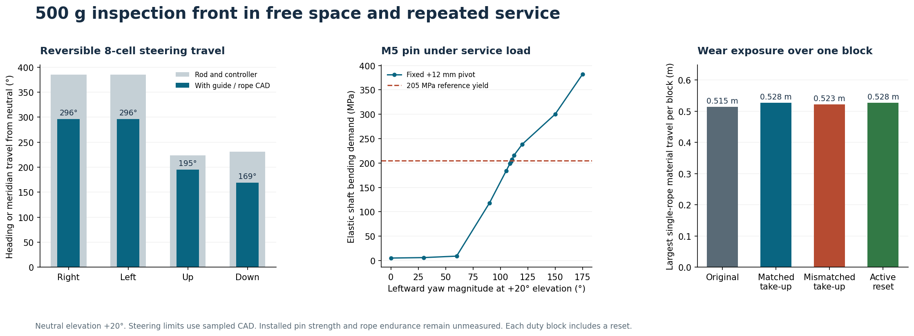

# Free-space steering, fracture limits and service life of the 500 g front

Manual engineering study, 20 November 2026. Started at 09:40 EST (14:40 UTC). Results compiled at 11:04 EST (16:04 UTC). Source revision bbed30bde93a03fc8d7135533bc2b4c7fac02eec.

The 8-cell steering model with sampled CAD screening reached +296° and -296° in heading and +215° and -149° in pitch. Neutral elevation is +20°. These are direction- and controller-specific results for a 500 g payload. The moving-pivot analysis ties elastic steel demand to head angle. The repeated mission exposes a tension-floor failure during a simple reset and tests a direction-aware alternative. Installed fracture angle and service life remain unmeasured.

## Free-space steering envelope

The clamp orientation, gravity, twelve Ø2 mm ropes, 21/24/28 mm lanes and guide locations are retained. Only the external tank and its 5 mm acceptance margin are removed. The right and left branches change heading while holding +20° elevation. The up and down branches change signed meridian angle at zero yaw. A down command of −90° is 110° of travel from neutral. The four mixed branches start at an already reached yaw pose. The archive provides the approach to each seed and the final return to neutral. The six-station, 24-exit sweep below covers the new extensions and their returns. Earlier approach segments retain their published level of CAD coverage, including the full-mission M6 inner-guide check and selected finite-end events.

| Route | Rod only, last | With 8-cell geometry, last | First rejected | First limiting check | Peak ideal rope force on screened route (N) | 16-cell / 0.25 mm at last |
|---|---|---|---|---|---|---|
| Right yaw | +385° | +296° | +297° | M6 distal C left wrap allowance | 60.03 | pass |
| Left yaw | -385° | -296° | -297° | M6 distal C right wrap allowance | 60.07 | pass |
| Upward pitch | +244° | +215° | +216° | M5 distal C up wrap allowance | 55.08 | pass |
| Downward pitch | -211° | -149° | -150° | M5 proximal C down wrap allowance | 33.24 | pass |
| Pitch up at +175° yaw | +160° | +113° | +114° | M5 proximal C up wrap allowance | 113.49 | fail |
| Pitch down at +175° yaw | -59° | -7° | -8° | M5 proximal C left wrap allowance | 36.20 | pass |
| Pitch up at −175° yaw | +161° | +115° | +116° | M5 proximal C up wrap allowance | 110.18 | fail |
| Pitch down at −175° yaw | -59° | -7° | -8° | M5 proximal C right wrap allowance | 36.37 | pass |
| Antipode at +180° yaw | -20° | -19° | -20° | M5 distal C up wrap allowance | 47.29 | pass |

The first rejected command can be a remaining wrap allowance, a rope surface clearance, a rigid-part contact, a conservative envelope or a solver-domain limit. A 1° bracket belongs to that route and discretization. Search targets are indicated where no failure was requested farther along that branch. Peak forces include the archived approach and the accepted extension. Endpoint forces appear in the next table and can be lower than the peak along the path. The 250 N controller ceiling supplies no actuator or rope rating. [All twelve rope commands, lengths, tensions and per-module geometry](../../../simulations/u4m2/extreme_tests/free_space_20261120/results/angles/) · [Per-state guide and rope checks](../../../simulations/u4m2/extreme_tests/free_space_20261120/results/geometry/)

On the right branch the first limit is M6 distal C left wrap allowance. Its remaining wrap is 1.033° at +296° and 0.804° at +297°. The required reserve is 1°. The corresponding wall gaps after subtracting the 1 mm rope radius are -0.000305 and -0.000329 mm. Both are within the archived 0.005 mm faceting allowance.

| Last screened command | Angle | Highest tension | Lowest tension | Smallest cell bend radius |
|---|---|---|---|---|
| Right yaw | +296° | A_right · 60.03 N | B_down · 2.85 N | 50.00 mm · M5 cell 5 |
| Left yaw | -296° | A_left · 60.07 N | B_down · 2.85 N | 49.88 mm · M5 cell 5 |
| Upward pitch | +215° | C_right · 39.90 N | C_down · 2.85 N | 43.65 mm · M5 cell 5 |
| Downward pitch | -149° | C_down · 33.24 N | C_left · 2.85 N | 45.22 mm · M5 cell 1 |

On right yaw the highest force occurs in A-right while the limiting exit belongs to C-left. A tension-only test on the tightest cable would miss this exit condition.

Head travel is spread across the six modules. The table gives the angle between the end tangents of each individual module at the last 8-cell screened command. These spatial angles are unsigned. The three-dimensional rotations compose in sequence, so adding these six magnitudes does not in general reproduce the head heading.

| Route endpoint | U1 (°) | U2 (°) | U3 (°) | U4 (°) | M5 (°) | M6 (°) |
|---|---|---|---|---|---|---|
| Right yaw | 6.6 | 6.7 | 6.4 | 5.9 | 100.0 | 97.5 |
| Left yaw | 6.6 | 6.7 | 6.4 | 6.0 | 100.2 | 97.7 |
| Upward pitch | 0.2 | 0.1 | 0.1 | 0.2 | 116.4 | 78.5 |
| Downward pitch | 0.9 | 0.7 | 0.6 | 0.4 | 105.5 | 60.9 |

The largest possible angle between two pointing directions is 180°. Heading can accumulate past 180° as the head follows a cone. The separately tested antipode heads toward yaw +180°, elevation −20°, directly opposite the original clamp axis. Its largest accepted, sampled head-to-clamp separation on the extension is 178.99653°. The finer fixed-command solve at its last screened pose gives 179.01511°. The per-module bend and twist columns identify where the physical shape changes.

Across the nine primary directions the largest screened 8-cell pointing separation is 179.99331° on the Upward pitch route. This is a lower bound on the best achieved pointing separation on the tested routes, with a mathematical upper bound of 180°.

The +200° straight-up meridian is also exactly opposite the +20° neutral axis in target space. A separate trim commanded that orientation on each mesh, then restored the saved +200° winch lengths and repeated the same CAD checks. The table gives actual head-axis separation from neutral. The 8-cell extension reuses the archived upward approach and reconnects to its neutral return. The 16-cell result covers the local trim and recovery. These pointing errors describe numerical tracking in the model. [Both trim commands, exact axes, twelve loads and clearance checks](../../../simulations/u4m2/extreme_tests/free_space_20261120/results/mesh/opposite_axis.json)

| Rod cells per module | CAD axial step (mm) | Achieved axis separation (°) | Miss to exact opposite (°) | Largest rope trim (mm) | Geometry and rod | Returned state difference |
|---|---|---|---|---|---|---|
| 8 | 0.50 | 179.999984 | 0.000016 | 0.00390 | pass | 6.9e-14 |
| 16 | 0.25 | 179.999965 | 0.000035 | 0.03269 | pass | 7.7e-13 |

Command allocation changes mixed-angle reach. The published 2° schedules at ±175° yaw had reached −87° and first failed at −88° in the earlier rod-only tests. The new 4° allocations reached −59° and first failed at −60°. Both start at the same archived equilibria. After recomputing 108 outward winch states and screening the CAD prefixes of the earlier schedules, their last passing pitch angles were -44° at +175° yaw and -39° at −175° yaw. These additional tests bound two specific controllers. [Alternative path, forces and return checks](../../../simulations/u4m2/extreme_tests/free_space_20261120/results/allocation/allocation.json)

## Reversal, CAD coverage and numerical sensitivity

The study stored 637 pose/command records and 18 additional 8-cell geometry probes. Each full screen checks eighteen guide/cap/wire-to-web pairs, 24 finite rope exits and the actual adapter's nonlocal body-envelope bound. The structural shell includes the two retained M5 ±12 mm stations. The local moving-pin stresses below cover one selected +12 mm pivot. All 312 finite-end distances at the archived baseline events reproduced to within 3.6e-15 mm. The 0.5 mm axial CAD refinement uses the actual M5 machined and M6 bellmouth bodies. Distances reaching 0.6 mm in the bounded guide search are lower bounds.

Each available screened endpoint was independently reversed before the first obstruction. Across 198 accepted reverse commands, the maximum scaled rod-state difference against the screened outward state was 1.71e-10, and the greatest rope-force difference was 2.04e-08 N. Each leg rejoins its original winch state and published return to neutral. Positive tangent stiffness is a quasi-static local property. [Reverse traces and archive handover](../../../simulations/u4m2/extreme_tests/free_space_20261120/results/return/)

The 16-cell check applied the exact candidate M6 guide-mass change, approximately −0.00312 g in total, retaining the 500 g head. It tested 45 equilibria on 0.25 mm axial CAD and recorded 0 unresolved probes. 36 passed all sampled gates. These are fixed-command spot checks. The full 8-cell path and controller were not reoptimized on the finer mesh. [Fine geometry, actual axes and all gaps](../../../simulations/u4m2/extreme_tests/free_space_20261120/results/mesh/fine_geometry.csv.gz)

| Route | Inward check | Coarse last | Coarse first geometric stop | Axis error at coarse last (°) | Fine geometry failure at coarse last |
|---|---|---|---|---|---|
| Right yaw | +292° pass | +296° pass | +297° pass | 0.033 | — |
| Left yaw | -292° pass | -296° pass | -297° pass | 0.032 | — |
| Upward pitch | +208° pass | +215° pass | +216° fail | 0.012 | — |
| Downward pitch | -142° pass | -149° pass | -150° fail | 0.006 | — |
| Pitch up at +175° yaw | +108° pass | +113° fail | +114° fail | 0.032 | M5 proximal C up wrap allowance |
| Pitch down at +175° yaw | +0° pass | -7° pass | -8° fail | 0.077 | — |
| Pitch up at −175° yaw | +108° pass | +115° fail | +116° fail | 0.030 | M5 proximal C up wrap allowance |
| Pitch down at −175° yaw | +0° pass | -7° pass | -8° fail | 0.077 | — |
| Antipode at +180° yaw | -12° pass | -19° pass | -20° fail | 0.046 | — |

At right and left yaw the fine mesh still passed the first command rejected by the coarse model. At ±175° yaw, the higher mixed upward endpoints failed earlier on the fine model. A local one-degree continuation ran 4 additional fine rod and CAD solves to locate those transitions. It retains the same winch allocation from the coarse path or reconstructs it from the nearest saved inward state. These are local fixed-command checks on the 16-cell rod. The 8-cell rod supplies the continuous outward and reverse paths. [Fine transition limits and outcomes](../../../simulations/u4m2/extreme_tests/free_space_20261120/results/mesh/refined_transitions.json) · [Additional 16-cell commands, tensions and gaps](../../../simulations/u4m2/extreme_tests/free_space_20261120/results/mesh/refined_transitions.csv.gz)

| Route | 8-cell last pass | 8-cell first fail | 16-cell last pass | 16-cell first fail | Fine limiting check |
|---|---|---|---|---|---|
| Right yaw | +296° | +297° | +297° | +298° | M6 distal C left wrap allowance |
| Left yaw | -296° | -297° | -297° | -298° | M6 distal C right wrap allowance |
| Upward pitch | +215° | +216° | +215° | +216° | M5 distal C up wrap allowance |
| Downward pitch | -149° | -150° | -149° | -150° | M5 proximal C down wrap allowance |
| Pitch up at +175° yaw | +113° | +114° | +112° | +113° | M5 proximal C up wrap allowance |
| Pitch down at +175° yaw | -7° | -8° | -7° | -8° | M5 proximal C left wrap allowance |
| Pitch up at −175° yaw | +115° | +116° | +114° | +115° | M5 proximal C up wrap allowance |
| Pitch down at −175° yaw | -7° | -8° | -7° | -8° | M5 proximal C right wrap allowance |
| Antipode at +180° yaw | -19° | -20° | -19° | -20° | M5 distal C up wrap allowance |

## Permanent set, first crack and rupture

For the left-out heading sweep at +20° elevation, sixteen simultaneous hole forces and the prescribed end-disk pose drive the finite-rotation M5 shell. The global-to-local transfer is one way. Local damage cannot redistribute forces in the elastic rod. The fine local contact solve uses the moving force vector and moving web-to-pin orientation at the +12 mm station, 67.5° rib. All points keep the same 500 g head. The 205 MPa comparator comes from the repository's annealed-304 catalogue case. Its specified product form differs from the installed 0.60 mm pin, whose grade is unknown.

| Archive step | Commanded yaw | Pin bending (MPa) | Peak web tensile strain (%) | Web hotspot rib (°) |
|---|---|---|---|---|
| 1355 | +0° | 5.2 | 1.41 | 67.5 |
| 1407 | -30° | 6.1 | 2.04 | 157.5 |
| 1462 | -60° | 9.1 | 3.55 | 157.5 |
| 1535 | -90° | 118.0 | 4.79 | 202.5 |
| 1581 | -105.312° | 184.2 | 5.37 | 247.5 |
| 1592 | -108.75° | 199.2 | 5.50 | 247.5 |
| 1595 | -109.688° | 203.3 | 5.58 | 247.5 |
| 1598 | -110.625° | 207.6 | 5.65 | 247.5 |
| 1604 | -112.5° | 216.1 | 5.79 | 247.5 |
| 1628 | -120° | 238.7 | 6.33 | 247.5 |
| 1701 | -150° | 300.2 | 8.18 | 247.5 |
| 1796 | -175° | 382.1 | 8.92 | 247.5 |

The first detected left-out crossing of the fixed pin reference is between -109.688° (203.3 MPa) and -110.625° (207.6 MPa) on this leg. The initial 30° sampling does not resolve a narrow unobserved peak elsewhere. Other locations and motion histories can govern earlier. The earlier fine-shell/fine-contact result on left return was 372.6 MPa at step 1,843 at approximately −167.3° yaw, with an 8.55% tensile hotspot on a different web. Plastic residual strain, crack propagation and final separation remain outside the elastic model. [Shell and pin states](../../../simulations/u4m2/extreme_tests/free_space_20261120/results/strength/pin_area_0.1_fine.json)

At the end of the same outward leg, -175°, predicted bending at this fixed pin reached 382.1 MPa. The ratio of 205 MPa proof stress to that elastic demand is 0.54. The shell's maximum local tensile strain at that state was 8.92% on the 247.5° rib. Once yielding or cracking starts, a calibrated inelastic model is needed for further damage and redistribution.

Two lookups make a future destructive test actionable. For finished ropes and crimps, the table gives the first sampled angle at which any of the twelve simulated tensions reaches the indicated trial rupture or pullout resistance. A measured installed capacity can be substituted when one is available. For the printed shell, it asks when any rib first exceeds a trial tensile strain. The applied thresholds below are explicit sensitivity inputs, with no assigned production material rating.

| Trial installed resistance (N) | Rightward route | Adjacent sampled headings | Governing rope |
|---|---|---|---|
| 20 | crossed | +180° to +184° | C_up |
| 40 | crossed | +252° to +256° | B_right |
| 60 | crossed | +292° to +296° | A_right |
| 80 | not reached on samples | — | — |

| Trial web tensile strain | First sampled left-out crossing | Rib at crossing |
|---|---|---|
| 2% | +0° to -30° | 157.5 |
| 4% | -60° to -90° | 202.5 |
| 6% | -112.5° to -120° | 247.5 |
| 8% | -120° to -150° | 247.5 |
| 10% | Not crossed | — |

A printed part can crack before an intact rope separates, and a crimp can slip without rope fracture. Matching the observed failure mode, local orientation, force vector and conditioning is necessary to use either lookup. [All nine routes and trial rope capacities](../../../simulations/u4m2/extreme_tests/free_space_20261120/results/strength/pull_capacity_lookup.csv.gz) · [Web threshold lookup](../../../simulations/u4m2/extreme_tests/free_space_20261120/results/strength/limits.json)

## Repeated normal duty and working life

A mission includes loaded startup, insertion, both ±175° yaw excursions and returns, both ±90° pitch excursions and returns, and withdrawal. Each appended reset executes at the withdrawn clamp. The second mission starts with the actual material allocation and effective drum lengths left by the first reset. The simulated transmission uses an assumed friction coefficient of 0.15 and 0.10 mm of play. The mismatched controller assumes 0.12 and 0.08 mm. The source provides equilibrium steps without a measured time interval.

| Commands / reset | First mission samples | First mission below 2.5 N | Second block minimum (N) | Second block below 2.5 N | Largest per-rope travel (mm) | Required reference amplitude (N) |
|---|---|---|---|---|---|---|
| Original commands | 3405 | 794 | 1.444 | 794 | 514.7 | 4.660 |
| Endpoint compensation | 3405 | 11 | — | — | — | — |
| Matched take-up, reversed startup | 7084 | 0 | 2.305 | 186 | 527.6 | 5.722 |
| Matched take-up, active reset | 7084 | 0 | 2.901 | 0 | 527.7 | 5.722 |
| Mismatched take-up, reversed startup | 10102 | 0 | 2.385 | 228 | 522.7 | 5.192 |

The original friction replay first lost the tension floor at archived step 549 (right_out). Matched take-up met it on the first open mission. Simply reversing startup left a minimum of 2.305 N in block two. The active reset preloads each transmission for the new direction, brings each proximal force back to its initial value and removes the command bias. The active second block had 0 tension-floor breaches, 0 steps over 1° and a maximum pointing error of 0.507°. Its governing travel channel was C_up. A tension-floor breach is a functional event, independent of fatigue fracture. [Reset command history and repeated equilibria](../../../simulations/u4m2/extreme_tests/free_space_20261120/results/service/)

The last withdrawn state after the simply reversed first reset differed from the initial distal material allocation by up to 0.100 mm. With the active reset that difference was 5.99e-08 mm. The greatest difference between the two active reset-end material states was 1.4e-11 mm. The active second mission recorded 0 floor violations over 7084 steps, and its reset recorded 0 over 499. These are modelled histories. Sensor accuracy, actuator margins and actual service duration need measurements.

For the active reset, the three largest contributions to sliding of that rope were right_return (70.8 mm), left_return (70.8 mm), right_out (70.8 mm). Sliding and drum travel measure different physical movements. [All twelve phase exposures](../../../simulations/u4m2/extreme_tests/free_space_20261120/results/fatigue/phase_exposure.csv.gz)

For 10,000 active-reset blocks the governing axial-force reference is C_up at the winch end. At a reference count of one million cycles, the required amplitude is 4.789 N for slope 3, 5.722 N for slope 5 and 6.795 N for slope 8 at this location. As a conditional example only, a finished assembly that sustains a 5 N alternating amplitude for one million cycles at matched mean load and bend radius would give approximately 5,095 blocks for this axial-force mode under the slope-5 linear damage law. That illustrative resistance is unmeasured. Wear, termination slip, creep, NiTi fatigue, pin and web fatigue, and bond loss can shorten system life.

At the governing C_up winch measurement point the full two-block force history spans 2.437–25.686 N. The largest counted force range was 23.249 N at a mean of 14.062 N, between right_return and reset. An endurance specimen should reproduce the force means and the exit or termination geometry. At fixed assumed resistance the slope-5 model magnifies errors in the alternating load to the fifth power.

| Fixed nominal material channel | Largest signed excursion (percentage points) | Turning phases | Required strain amplitude at 10⁶ cycles, slope 5 |
|---|---|---|---|
| M5_backbone_strain | 2.837 | left_out / pitch_down | 0.576% |
| M6_backbone_strain | 1.759 | right_return / pitch_down | 0.359% |
| U1_linear_blade_strain | 0.819 | right_out / left_out | 0.165% |

The structural channels use the reference rod geometry with a retraced reset. The M5 kinematic gauge across a hole has no coupon-equivalent fatigue amplitude. Real material curves at the recorded means, dwell and operating frequency are unavailable. Calendar hours and a rated replacement interval therefore remain open. [Full rainflow ranges and signed means](../../../simulations/u4m2/extreme_tests/free_space_20261120/results/fatigue/force_spectra.csv.gz) · [Endurance demand, all channels](../../../simulations/u4m2/extreme_tests/free_space_20261120/results/fatigue/endurance_channels.csv.gz) · [Phase allocation of range exposure](../../../simulations/u4m2/extreme_tests/free_space_20261120/results/fatigue/phase_range_dose.csv.gz)

## Measurements that would settle the design limits

1. Measure the installed distal C exit and guide motion at the last passing and first rejected steering commands. Log head orientation, all twelve winch strokes and simultaneous proximal and distal forces on the affected routes. Repeat after changing direction. The guide samples assume nominal alignment and the real sensor envelope still needs registration.

2. Identify the pin alloy and condition. Test the resolved moving-frame pin/web loads on matched PA12 prints. Unload and measure permanent set, inspect the first crack, then record ultimate load or separation. Test every installed rope/crimp process at its working curvature. Validate fitted limits on specimens reserved for that purpose.

3. Run the full mission including reset on independent assemblies with measured friction and play. Record rope wear and pullout, drift, NiTi strain, web and adhesive damage, censored runouts, dwell and elapsed time. Fit strain-life or force-life curves and report uncertainty before assigning a service limit.

The 5 versioned measurement sheets inspected at the source revision contain 0 data rows. The assembly has no measured fracture angle or rated life in this dataset. [Reproduction commands, scope and definitions](../../../simulations/u4m2/extreme_tests/free_space_20261120/README.md) · [Verification, input hashes and versions](../../../simulations/u4m2/extreme_tests/free_space_20261120/results/verification.json)

The study and three existing regression suites passed all 26 tests. All 343 relative documentation links and anchors in the outgoing Markdown files resolved. The outgoing English-language audit covered names and full contents of 139 files, including decompressed tables, NPZ members, plot metadata and visual review of the rendered figure.
