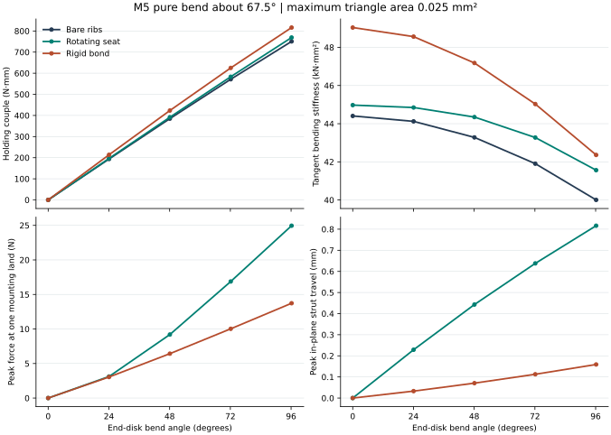

# M5 guide joint under large rotation

**Test 1 engineering report, 18 November 2026.** Run started at 10:31:04 EST (15:31:04 UTC). The 500 g U4+M2 design supplied four previously solved poses and the rope forces at those poses. The new calculation isolates the M5 PA12 rib geometry and the guides at ±12 mm. [Validation protocol](../../../docs/500g_validation_plan.md) · [Input revision](https://github.com/KevinQianjin/ASRC_snake_body_design/commit/4e1992e56460559967e102809668701e3d6942f9)

## Design result

At 96.19° of pure bending about the 67.5° axis, the rotating seat needed **761.5 N·mm**, compared with **808.2 N·mm** for the bond and **743.3 N·mm** for the bare body. The seat reduced the required couple by **5.8%** relative to the bond. It allowed **10.42°** of relative land rotation and **0.816 mm** of in-plane midsurface travel. These values use the same 0.015 mm² mesh-area limit in all three cases.

At each mounting land the seat constrains three translations and releases all three rotations. The local pivot moment is therefore zero by construction. Its largest individual land force in this pure bend was **24.78 N**, compared with **13.66 N** for the bond. The bond had a peak land moment of **111.36 N·mm**. A physical retainer must carry the individual land force while allowing the required rotation. Individual force and moment vectors are saved at every sampled land. [14 case families and refinement checks](../../../simulations/u4m2/lanes_20261113/m5_large_rotation_20261118/summary.json)

The earlier linear extrapolation predicted about 12.5° of in-plane land rotation and 0.917 mm of strut travel. On this nonlinear model the corresponding in-plane maxima are 10.42° and 0.816 mm. These are motion demands for a seat geometry check. [Earlier linear comparison](../../daily/Evening_Report_2026_11_17.md)

The earlier linear extrapolation ranked the seat below the bond in peak land force (5.30 versus 11.17 N). An independent derivative of the new straight-state shell gives 5.44 N for the seat when scaled linearly to exactly the same 96.19° bend. Evaluating both sides of zero at two perturbation sizes changes that inferred force by less than 0.00001 N. Solving the large rotations reverses the force ranking and raises the seat peak to **4.67 times** the archived linear estimate. Use the nonlinear per-land vectors to load a retained-seat candidate. [Independent land-force slope check](../../../simulations/u4m2/lanes_20261113/m5_large_rotation_20261118/linear_land_check.json)

Carry the rotating seat forward to a retained-seat CAD and contact check. Across the two bending axes the seat takes less holding moment than the bond. The size of the terminal tangent-stiffness advantage is evaluated separately below. For retainer sizing, use the land force, rotation and direction from the same saved case. Printed bearing strength and running clearance remain open.

## Pure bending

Six sweeps cover three joint models and two bending axes. Each sweep samples the unloaded state and 25%, 50%, 75% and 100% of 0.01748791 rad/mm. The archived test extrapolated a small-rotation solution to this curvature. This run solves finite rotations and force equilibrium at each sampled state. The table gives the incremental stiffness at full bend. The moment column gives the computed couple required to hold the prescribed angle.

| Axis | Max. triangle area (mm²) | Joint | Couple (N·mm) | Tangent EI (kN·mm²) | Tangent GJ (kN·mm²) | Peak absolute principal strain |
|---:|---:|---|---:|---:|---:|---:|
| 0° | 0.025 | Bare ribs | 750.6 | 40.00 | 73.16 | 7.64% |
| 0° | 0.025 | Rotating seat | 765.0 | 41.06 | 74.88 | 7.83% |
| 0° | 0.025 | Rigid bond | 817.1 | 42.28 | 79.38 | 8.38% |
| 67.5° | 0.015 | Bare ribs | 743.3 | 39.62 | 72.35 | 7.91% |
| 67.5° | 0.015 | Rotating seat | 761.5 | 41.16 | 74.77 | 8.22% |
| 67.5° | 0.015 | Rigid bond | 808.2 | 41.95 | 78.35 | 8.73% |

At the straight configuration the bond raises tangent bending stiffness by 10.4% over bare ribs on the 67.5° axis. At full bend that increase is 5.9%. For the rotating seat the corresponding increases are 1.3% and 3.9%. A constant joint stiffness multiplier would miss this dependence on bend angle.

The load curves show how the force ranking changes as the ribs bend. At 24.05°, the peak land forces in the two mounts are close (3.12 N rotating and 3.05 N bonded). At 72.14° they are 16.87 N and 10.03 N, respectively. A pivot releases local moment while its position constraint still transmits force.

## Installed guides at four saved poses

Each row applies 16 simultaneous hole forces, eight from the B/C rope lanes at each guide. Both end disks follow the saved M5 pose. Record 146 supplies the largest M5 curvature, 141 the largest station force, 47 the largest station moment and 64 the +175° head-yaw hold. The source station force and moment are paired at the identified station. Output columns give independent maxima across the eight lands. Their locations can differ within the same pose.

The two ways of specifying the bend have different physical meanings. Multiplying the reference curvature from record 146 by the full 96 mm length gives 96.19° for the pure-bend comparison. Imposing record 146's actual end disks gives a relative M5 rotation of 89.93°. The +175° label on record 64 refers to commanded yaw of the entire head.

| Record | M5 disk angle | Source station and force / moment (N / N·mm) | Mesh area (mm²) | Bond land force / moment (N / N·mm) | Seat land force (N) | Seat rotation | Seat in-plane / 3D travel (mm) |
|---|---:|---|---:|---:|---:|---:|---:|
| 146 | 89.93° | +12 mm, 27.54 / 25.95 | 0.025 | 10.01 / 64.84 | 15.25 | 5.03° | 0.320 / 0.321 |
| 141 | 89.13° | +12 mm, 28.45 / 22.04 | 0.025 | 9.96 / 62.59 | 15.40 | 4.83° | 0.329 / 0.330 |
| 47 | 56.35° | -12 mm, 11.11 / 61.12 | 0.025 | 6.63 / 52.01 | 5.69 | 4.34° | 0.267 / 0.282 |
| 64 | 89.70° | +12 mm, 28.20 / 18.12 | 0.025 | 9.21 / 62.47 | 14.88 | 4.85° | 0.302 / 0.318 |

Two paired loads can be applied directly in the retained-seat check. Each row gives force, rotation and relative strut motion at the same land in the same equilibrium. Force is guide-on-rib in the fixed proximal CAD axes. A free-body model of the guide uses the opposite reaction.

| Seat loading | Station / rib | Force components X, Y, Z (N) | Magnitude (N) | Relative rotation | 3D strut travel (mm) |
|---|---|---|---:|---:|---:|
| [Reference pure bend](../../../simulations/u4m2/lanes_20261113/m5_large_rotation_20261118/results/critical_0p015/point_bend67.5.json) | +12 mm / 157.5° | +0.36, -0.15, +24.78 | 24.78 | 10.41° | 0.816 |
| [Highest land force across installed poses, record 141](../../../simulations/u4m2/lanes_20261113/m5_large_rotation_20261118/results/fine_0p025/point_141.json) | +12 mm / 67.5° | +3.62, +8.19, -12.53 | 15.40 | 3.23° | 0.330 |

The following reactions are at the prescribed distal M5 disk. The raw case files also contain the three signed force and three signed moment components at both disks, referred to the proximal CAD axes.

| Record | Bond disk force / moment (N / N·mm) | Seat disk force / moment (N / N·mm) |
|---|---:|---:|
| 146 | 30.99 / 1594.4 | 30.82 / 1575.1 |
| 141 | 31.79 / 1607.2 | 31.61 / 1587.8 |
| 47 | 13.75 / 880.5 | 13.69 / 861.2 |
| 64 | 31.61 / 1604.0 | 31.43 / 1583.7 |

The published per-hole loads reproduce the source station resultants within 7.1e-15 N and 7.5e-14 N·mm at the archived guide lever arms. The local fixture then lets the lever arms rotate with the ideal guide. Each bore force contributes once to the applied load. [Transformed loads and source poses](../../../simulations/u4m2/lanes_20261113/m5_large_rotation_20261118/load_cases.json)

**Where the guide holes move.** With identical prescribed disk poses and rope loads, switching from the bond to the rotating seat moved a bore centre by up to 0.523 mm (record 47, +12 mm, C-right). Across the four poses the largest rotating-seat bore difference from the original whole-arm rod path was 5.67 mm (record 64). The isolated rib fixture omits the backbone and outer stations and keeps the rope forces prescribed. This comparison measures sensitivity to those modelling assumptions. A coupled assembly solve is needed to predict the installed rope path.

On the preceding 0.055 mm² mesh, the corresponding maxima were 0.534 mm between the two mounts and 5.47 mm between the rotating mount and the whole-arm source. The 0.025 mm² refinement changed these comparisons by 0.011 mm and 0.20 mm, respectively.

The exported guide frames pair each land pivot with its rotation vector, reacting force and moment in the moving guide axes. At all 16 solved guides, the four land reactions balance the eight simultaneous bore loads about the moving guide centre within 5.4e-09 N and 1.3e-06 N·mm. [Posed B/C bores and paired guide-frame reactions](../../../simulations/u4m2/lanes_20261113/m5_large_rotation_20261118/installed_guides.json)

## Numerical checks and confidence in the ranking

The evidence contains 45 completed discretization runs across 14 joint and loading combinations (14 at 0.18 mm², 14 at 0.055 mm², 14 at 0.025 mm², 3 at 0.015 mm², maximum triangle area). The coarse-mesh orientation audit independently reconstructed 272 saved states including each unloaded state. The finest paired curves and the finest paired full-bend endpoints use the mesh sizes printed on the chart and in the table.

At the 0° axis, the full-bend bond-minus-seat tangent EI is 1.221 kN·mm² on the finer mesh. Changing the area limit from 0.055 to 0.025 mm² changes that paired difference by 0.018 kN·mm². The two individual stiffness ranges are separated on these meshes. The paired holding-couple difference is 52.13 N·mm, with a change of 1.41 N·mm between these two meshes.

At the 67.5° axis, the full-bend bond-minus-seat tangent EI is 0.792 kN·mm² on the finer mesh. Changing the area limit from 0.025 to 0.015 mm² changes that paired difference by 0.005 kN·mm². The two individual stiffness ranges are separated on these meshes. The paired holding-couple difference is 46.65 N·mm, with a change of 0.58 N·mm between these two meshes.

The unloaded shell recovers the independent archived small-bend reference at the same 1,530 MPa modulus. Across the six pure-bending families, the largest absolute differences on their respective finest meshes are 1.86% in EI and 1.00% in GJ. The earlier linear 67.5° extrapolation gave peak strains of 7.78% bare, 7.81% rotating and 8.65% bonded. [Archived 0.01 mm² linear mesh and inputs](../../../simulations/u4m2/lanes_20261113/evening_20261117/rib_joint_3d/rib_joint_3d_results.json)

Across 11 paired last-increment repeats, splitting the last 6.25% increment in two changed the appreciable stiffness/reaction magnitudes by at most 8.2e-05% and the peak seat rotation by at most 1.39e-06°. Separate signed ±0.001 rad twist probes checked the tangent torsional response. Their largest relative difference was 6.16e-05%.

At the full-load endpoint, 14/14 case families met all applicable final mesh-pair checks for bending stiffness, appreciable reaction magnitude (5%) and seat rotation (0.5°). Forces below 0.1 N and moments below 1 N·mm are listed by absolute difference. Percent changes use the finer result as denominator. The archive includes every common sampled fraction, separate EI/GJ and socket changes, and the mesh area for each comparison.

Every intermediate bending comparison met its applicable stiffness, reaction and rotation thresholds on the finest mesh pair available at that fraction.

At the endpoints the largest mesh-pair change in peak absolute principal strain is 0.76 percentage points and the largest change in 3D socket travel is 0.013 mm. Peak strain at a sharp shell or rigid-patch transition needs a solid or coupon comparison before strength sizing.

Nine regression tests cover the element, the assembled rotating joint, source-frame loads and boundary interpolation. Across released reporting samples the largest global equilibrium errors are 3.72e-05 N and 0.000931 N·mm. The lowest signed area ratio is 0.9274. A negative ratio identifies a locally folded triangle even when Newton residuals are small.

The rejected nearest-vertex transfer gave a signed area ratio of −0.829 at half bend. A preliminary coarse bonded 0° endpoint also folded a triangle. The retained calculations preserve affine motion at boundary nodes and check orientation. Failed or interrupted attempts remain separately identifiable in the evidence. [Rejected transfer](../../../simulations/u4m2/lanes_20261113/m5_large_rotation_20261118/results/rejected_transfer/) · [Rejected coarse endpoint](../../../simulations/u4m2/lanes_20261113/m5_large_rotation_20261118/results/rejected_orientation/) · [Per-case comparisons](../../../simulations/u4m2/lanes_20261113/m5_large_rotation_20261118/summary.json)

On the finest common mesh for each comparison, the largest tensile principal strain is 9.60% (Rigid bond, 146, 247.5° rib, radius 9.60 mm, axial position -20.29 mm), at 55.7° to build Z. The most negative is -8.73% (Rigid bond, bend67.5, 337.5° rib, radius 11.95 mm, axial position -5.20 mm). The largest tensile build-Z component is 6.33% (Bare ribs, bend0), approximately 6.14% engineering extension under the shell kinematics. These are local face values.

The publication check covered the names and full contents of all 67 outgoing files, including decoded JSON and Python strings and a visual review of the rendered figure. All passed the English publication check. All 148 relative links in the edited Markdown resolved.

## What the strain says about printed PA12

The build guide calls for SLS or MJF PA12, 0.10 mm layers and a vertical module axis. The shell uses the 1,530 MPa isotropic modulus fitted to the earlier module stiffness data. An orientation-specific comparison is available for dry, 100 µm EOS PA 2200 Performance SLS coupons. Under ISO 527, EOS gives 1,700 MPa tensile modulus, 50 MPa tensile strength and nominal elongation at break of 10% in build Z and 20% in X/Y. The supplier's 10% is an ultimate engineering strain on a tensile coupon. The model calculates a local multiaxial surface strain in constrained ribs. The raw outputs give the signed principal strains, their directions relative to build Z, and the positive and negative build-Z components separately. The actual print lot, its elastic and cyclic response in build Z, and the selected SLS or MJF process remain to be measured. [Build orientation](../../../cad/lanes_u4m2/BUILD_GUIDE.md) · [EOS PA 2200 Performance process data sheet](https://www.eos.info/polymer-solutions/data-sheets/pds-pa-2200-performance?pdf=1&topdf=%2Fpolymer-solutions%2Fdata-sheets%2Fpds-pa-2200-performance)

## Reusing the results

The local 96 mm M5 fixture contains eight nominally identical CAD-derived PA12 ribs, rigid inner rings/end disks and the two inner guide stations. The local model uses ideal joints. The four end poses and signed hole forces come from the saved U4+M2, 500 g equilibrium. Guide forces keep their source spatial directions while their moment arms follow the local guide. The 500 g head, the 1.8 mm NiTi backbone and the outer ±24 mm guide stations are present in the source whole-arm design. The local fixture applies end-disk boundary conditions and the two inner stations' hole loads. This study traces quasi-static equilibria. Local buckling, equilibrium branch stability and actuator dynamics require additional checks. Head pose, force redistribution along the complete ropes, clearance at a retained seat and whole-arm stability require the corresponding full-system and contact models. [Fixture and reproducible commands](../../../simulations/u4m2/lanes_20261113/m5_large_rotation_20261118/README.md) · [Previous linear reference](../../daily/Evening_Report_2026_11_17.md)

Socket travel measures how far the strut midsurface sweeps through the ideal guide's seat window. A 0.25 mm nominal bond gap measures a separation between two CAD surfaces. Determining the running clearance of a real rotating joint requires its bearing surfaces, retention feature, deformed strut and print tolerance in one contact calculation. The next CAD check should use the paired land force and moment from each individual equilibrium and the rotation at that same land. A printed, vertically oriented M5 and matched material coupons are needed before assigning a strength or fatigue margin. [Retained-seat test and subsequent validation](../../../docs/500g_validation_plan.md#2-check-a-retained-guide-on-the-real-ribs)
