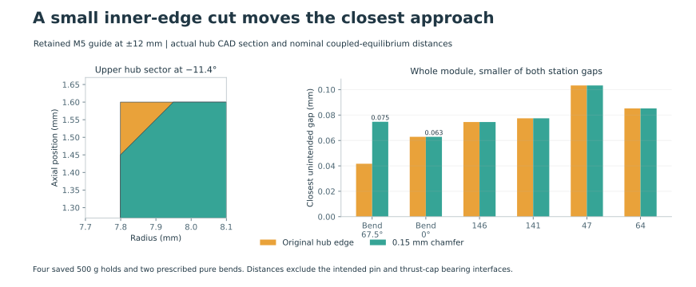
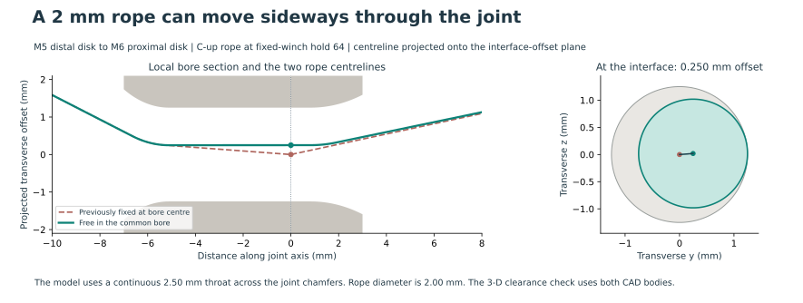

# M5 seat testing and the shared M5/M6 rope bore

**Engineering validation update for 19 November 2026.** Manual follow-up on the 500 g U4+M2 prototype. The review covers 18 November 00:04:38 to 19 November 00:04:38 EST (05:04:38 to 05:04:38 UTC on the respective dates) and the calculations completed in this session. The latest main revision at the cutoff incorporates the pinned M5 guide, earlier large-rotation work and the evening joint-sizing study. [Source snapshot](https://github.com/KevinQianjin/ASRC_snake_body_design/commit/d62f83a8a67f56a3d1d57508935ae61ac2ac37ce) · [Previous retained-seat report](../m5_structure/M5_Retained_Seat_2026_11_18.md) · [Previous evening report](../../daily/Evening_Report_2026_11_18.md)

Four engineering commits landed during the preceding 24 hours, with four merge commits bringing them into main. The validation plan (`f6db2c2`) set the five tests. The large-rotation model (`59ed561`) supplied simultaneous web loads. The evening seat-sizing study (`ff8494d`) selected the pivot-centred release. The retained assembly (`e950339`) added explicit pins and caps and exposed the tight return-web gap. This follow-up uses all four.

## Decision

Make the real M5 web coupon and measure reversal and damage before qualifying the seat for the complete arm. A 0.15 mm inside-edge chamfer on the guide hub is the smallest tested change that shifts the limiting contact to another part in the critical bend. It can be compared with the original in the same cage. The shared-bore model and a two-ended pulling procedure are ready to use a measured rope friction law. Nominal assembly clearance, model accuracy and physical durability have separate acceptance conditions. [Coupon and fixture files](../../../cad/lanes_u4m2/m5_seat_bench_20261119/README.md) · [Alternative hub sectors](../../../cad/lanes_u4m2/m5_hub_relief_20261119/README.md)

## First item — retained seats on one moving guide

The two inner M5 guides each connect four actual mounting webs to one rigid plate. At both −12 and +12 mm, the large-rotation shell supplies the distorted cut faces and the coincident 3-D force to a solid contact model of the machined web, pin and thrust shoulders. In return, the contact solution supplies the relative translation and moment at that seat. The shell and the eight contacts are solved together. The earlier study fit one rigid guide after computing four independent movements and found up to 0.0711 mm of incompatibility. The new residual measures how closely the shell and solid contact models agree at all eight seats. [Method, bounds and inputs](../../../simulations/u4m2/lanes_20261113/m5_seat_bench_20261119/README.md)

Across six load cases, both structural resolutions met the interface criteria at all eight bearing sites. The table uses the finer structural mesh and the full six-case CAD comparison. Gaps exclude the intended shaft and thrust contacts. Bore displacement and bearing-force changes use the earlier ideal pinned support at the same prescribed endpoint as their reference.

| Endpoint | Maximum hole shift from ideal (mm) | Maximum change of one web force (N) | Smallest original gap, both stations (mm) | Smallest chamfered gap, both stations (mm) |
|---|---:|---:|---:|---:|
| 96.19° bend about 67.5° | 0.2298 | 13.916 | 0.04168 | 0.07472 |
| 96.19° bend about 0° | 0.2727 | 9.988 | 0.06286 | 0.06286 |
| Hold 146 | 0.0524 | 2.412 | 0.07450 | 0.07450 |
| Hold 141 | 0.0551 | 2.003 | 0.07745 | 0.07745 |
| Hold 47 | 0.0470 | 2.614 | 0.10326 | 0.10326 |
| Hold 64 | 0.0528 | 1.420 | 0.08522 | 0.08522 |

In the 67.5°-axis bend, the ideal bearing gave a 760.14 N·mm holding couple. Matching the real contact to the common guide gives 755.21 N·mm. Among the four archived 500 g holds, the largest predicted bore shift is 0.0551 mm. The most heavily loaded individual bearing in these six cases carries 13.75 N. Refining the structural model changes an individual bearing force by up to 0.448 N. The maximum fine-model residuals over all sites are 0.000721 mm in translation, 0.01753 N·mm in bearing moment and 0.00429 N in contact force. These are solver checks.

Only **0/48** site/case pairs kept *both* peak contact pressure and peak tensile strain within 5% of their preceding mesh values. Peak strain alone met the 5% comparison at 2/48 sites and peak contact pressure at 0/48. The greatest fine-model local strain is 7.15%, and the largest nodal pressure is 203.3 MPa. Treat these as indicators of where to inspect the coupon. Material strength and cycle life still require real PA12 data.

In the pure bend about the 67.5° axis, some webs lie in a symmetry plane. A pilot asking for all three forces could not determine the normal position inside the unloaded thrust gap. It stalled with 0.0102 mm translation mismatch. The revised model prescribes the normal displacement on the symmetry plane and checks the recovered normal force against the shell. The six-case comparison keeps that pilot as a failed result. Fine-mesh hold 47 presented a different problem. A force-controlled local normal update did not converge within 34 iterations, even though its resultant force was within 0.00019 N. Restarting from the last accepted state with normal displacement prescribed and normal force matched in the outer solve converged at iteration 15. Its maximum force mismatch was 0.00430 N, translation mismatch 0.000047 mm and moment mismatch 0.00082 N·mm. The acceptance thresholds and geometry were unchanged. [Original intermediate failure](../../../simulations/u4m2/lanes_20261113/m5_seat_bench_20261119/results/recovery/47_force_control.json)

The tests use simulated nominal PA12, rigid metal and frictionless bearing surfaces. Measured backlash, real web anisotropy, individual cut-face traction continuity and fatigue remain open. [Force-only pilot](../../../simulations/u4m2/lanes_20261113/m5_seat_bench_20261119/results/force_only_pilot.json) · [Coupled endpoint records](../../../simulations/u4m2/lanes_20261113/m5_seat_bench_20261119/results/coupled_fine/)

### Hub and returning web

At the most tightly bent +12 mm return web, compare the options on the *same archived pose*. An inside chamfer of 0 / 0.15 / 0.30 / 0.45 mm gives a rib-to-hub distance of 0.0440 / 0.1002 / 0.1567 / 0.2144 mm. The table above then evaluates the entire assembly after the common-guide equilibrium changes the pose. A larger chamfer would remove more metal after a fork has already become the limiting neighbour in this bend.

On the finer structural solution, a separate surface refinement used 0.10 mm local edges and 0.18 mm elsewhere. In the 67.5°-axis bend the −12 mm gap changes from **0.04278 to 0.07472 mm**, and the +12 mm gap from **0.04152 to 0.07483 mm**. The closest pair moves from the returning rib and hub rim to a rib and fork at both stations. At hold 146 the nearest pair already involves a fork or gate, so its 0.07450 mm (−12) and 0.10953 mm (+12) gaps are unchanged. The minimum of the six cases after chamfering occurs in the 0°-axis bend at -12 mm. Its tightly remeshed gap is **0.06286 mm** between rib 7 and fork 0. Both hub options give the same value there. Across the three doubly sampled cases and both options, refining the surface alone changes the reported clearance by at most 0.00016 mm. [Governing bend refinement](../../../simulations/u4m2/lanes_20261113/m5_seat_bench_20261119/results/coupled_cad_refined_transverse.json)

The six-case audit found 0 unintended positive-volume contacts above 10⁻⁷ mm³. The separate intended steel/web interfaces give up to 0.000426 mm³ of apparent overlap on the independently meshed surfaces. The solid/shell difference within the 0.18 mm join band reaches 0.00505 mm, and the conservative rigid-station bounding envelopes stay at least 0.982 mm apart. The physical margin must still absorb print, machining, assembly, compliance and measurement uncertainty.

At each station the option removes 1.10084 mm³ of aluminium, reducing the calculated station mass from 3.53071 to 3.52774 g. A 2.90 mm inner band and the screw and fork socket envelopes remain. All 1,980 straight assembly pairs were checked. At the bench, register the bent cage and measure the rib/hub pair and the closest fork or gate in both bend orientations. Subtract the measurement uncertainty and required manufacturing allowance from the smallest measured gap. [Straight assembly and mass](../../../simulations/u4m2/lanes_20261113/m5_seat_bench_20261119/results/straight_relieved.json) · [Section and hardware checks](../../../cad/lanes_u4m2/m5_hub_relief_20261119/parts/manifest.json)

### A test that can be run on real parts

The 5.4 mm working gauge comes from the exported M5 web. Registering the delivered STL to the four positive-station ribs changes at most 0.00000248 mm³ of the gauge volume. The fixture takes the production shoulder pin and cap. Two dowels locate the grip tabs, four M2 bolts clamp them and two independent carriages provide relative rotation and force. Its original grip corner left only 0.0325 mm of sampled clearance. Trimming that corner gives 0.4255 mm on the sampled paths and a conservative 0.0328 mm lower bound between samples. The unloaded assembly has zero positive interior overlaps above 10⁻⁷ mm³ among 94 pairs. The pin-and-cap installation survey found zero sampled solid interferences over 461 poses. The ten-turn thread was sampled every 22.5° and still needs a real torque and retention test. [Bench CAD and drawing](../../../cad/lanes_u4m2/m5_seat_bench_20261119/README.md) · [Fixture clearance and installation](../../../simulations/u4m2/lanes_20261113/m5_seat_bench_20261119/results/fixture_clearance.json)

| Load in the fixed pin frame | Source force | Shaft tilt | Fine / finer predicted peak-to-peak travel | Fine / finer local peak tensile strain |
|---|---:|---:|---:|---:|
| P1, bend axis 67.5°, web 157.5° | 24.05 N | 0.000° | 0.12599 / 0.12431 mm | 5.45 / 5.77% |
| P2, same bend, web 67.5° | 20.59 N | 6.565° | 0.10857 / 0.10860 mm | 4.32 / 4.72% |
| P3, 500 g return hold 146, web 67.5° | 14.84 N | 3.066° | 0.11020 / 0.10755 mm | 4.06 / 3.97% |

Each of the three simultaneous force/orientation pairs from the earlier ideal-pin model has a separate equal-and-opposite lab challenge. The six cycles and 66 commands retain identical reference pairs for comparisons between specimens. Each command specifies the full orientation as a quaternion. The 27 nonzero load settings were solved at each of three mesh resolutions. Reapply the same +1 N reference before and after each cycle so free play at zero load does not masquerade as permanent set. The force-controlled coupon uses rigid end clamps, while the coupled cage submodel receives deforming end faces. Peak contact stress and strain from these boundary conditions answer different questions. None of the loads is a hardware rating. [Load program](../../../simulations/u4m2/lanes_20261113/m5_seat_bench_20261119/results/load_program.csv) · [Predicted travel](../../../simulations/u4m2/lanes_20261113/m5_seat_bench_20261119/results/coupon_travel.svg)

## Second item — the complete rope diameter at the common bore

The free C-rope route runs from the +24 mm M5 guide, through the M5 distal and M6 proximal end regions, to the −24 mm M6 guide. Each of the four rays has its own Ø2.50 mm bore and a Ø2.00 mm rope. The geometry now allows up to 0.25 mm lateral play in the modelled throat. The upstream and downstream portions choose one continuous, least-length passage. Both retain the published bellmouths. Cone constraints account for the full rope radius. The independent clearance check uses both actual CAD surfaces, sampled at 0.02 mm along the rope. [New derivation and reproducible solver](../../../simulations/u4m2/lanes_20261113/shared_bore_20261119/README.md)

- Across all **217 saved poses × 4 rays**, the free path was shorter by up to **0.02935 mm** per shared passage. Interface offset ranged from 0.0070 to 0.2496 mm. The maximum total change of tangent was 25.854°. The minimum exit-angle design reserve was 9.102°.
- Of the **1,736 end-body CAD checks**, 1,427 nominal distances were slightly negative near the bearing surface. The worst was **−0.002293 mm** and zero exceeded the established 0.005 mm mesh allowance. These are surface distances at sampled positions. The result supports the nominal routing geometry and does not establish an as-built clearance allowance.
- For six poses, halving the arc spacing from 0.15 to 0.075 mm changed length by at most 0.000179 mm, interface position by 0.000355 mm, total wrap by 0.0131° and minimum CAD clearance by 0.000540 mm. The frozen-pose wall/endpoint force reconstruction differs by at most 0.00166 N.
- A hypothetical sliding coefficient of 0.15 gives up to a **1.0700 tight/slack tension ratio** at these wraps. Changing pull direction swaps the end carrying the higher tension. The coefficient, the actual tension jump during reversal and the rope's fatigue life have not been measured. The physical procedure uses two load cells and records both directions and uncertainty. The scorer accepts measured wrap and propagates both angular and load-cell uncertainty. A near-zero wrap can still provide a tension ratio but cannot determine friction. [All rope checks and sensitivity](../../../simulations/u4m2/lanes_20261113/shared_bore_20261119/results/summary.json) · [Physical pulling positions](../../../simulations/u4m2/lanes_20261113/shared_bore_20261119/results/fixture_targets.csv)

### Same-winch comparison on the 500 g arm

All **217/217 archived holds** reached equilibrium with the same twelve winch rest lengths (199 distinct input states). Coverage includes 29 startup, 6 straightening, 4 insertion, 4 withdrawal, 34 right-out, 34 right-return, 36 left-out, 34 left-return and 36 inverse holds. The frozen-pose geometry audit above and this re-equilibration are two separate evaluations. The largest reconstructed winch command difference from the archive was 4.44e-13 mm.

| Quantity on the 500 g arm | Rebalanced result |
|---|---:|
| Peak change in tip position from the earlier bore path | 0.3285 mm at hold 57 |
| Peak absolute changes in yaw / elevation | 0.1097° / 0.0991° |
| Rope tension range / largest single-rope change | 2.895 to 18.764 N / 0.1702 N |
| Minimum tank clearance after the 1.5 mm allowance | 7.7375 mm during right return (previously 7.6870 mm) |
| Lowest fixed-winch tangent eigenvalue in the model's scaled coordinates | 0.22362 at hold 62 |
| Shared bore, worst nominal CAD reading / smallest design-angle reserve | -0.002293 mm / 9.087° |

In these saved states, the model meets the archived 2.5–250 N tension, local rod strain, body geometry and tank-clearance criteria. All fixed-winch tangents were positive. The tangent is a local quasi-static check. No new feedback commands were generated between saved holds. The largest equilibrium residual was 1.78e-08. [All hold extrema](../../../simulations/u4m2/lanes_20261113/shared_bore_20261119/results/rebalanced_summary.json)

At hold 64, changing from 8 to 16 rod cells per module with identical **winch rest lengths** changes the tip by 0.2826 mm, yaw by -0.08568°, elevation by -0.01403° and the most affected tension by 0.06877 N. The historical approximately 0.359° elevation discrepancy was evaluated under fixed tensions. A 0.2° controller settling tolerance alone cannot bound a physical pointing error. [Selected mesh comparisons](../../../simulations/u4m2/lanes_20261113/shared_bore_20261119/results/summary.json) · [Independent tangent check](../../../simulations/u4m2/lanes_20261113/shared_bore_20261119/results/tangent_check_64.json)

The new model exports **10,416** simultaneous hole records and **1,736** station resultants over this set. The largest station load is 28.283 N at M5 +12 mm, hold 141. The largest station moment is 61.213 N·mm at M5 −12 mm, hold 47. These extrema occur at different times. The largest combined wall force from the four C ropes at the bolted joint is 17.641 N. At the two M5 inner stations, updated loads differ from the earlier rod archive by up to 0.188 N and 0.216 N·mm. The seat benchmark above deliberately uses its previous simultaneous input loads for a controlled comparison. [Loads by station](../../../simulations/u4m2/lanes_20261113/shared_bore_20261119/results/guide_station_loads.csv) · [Per-hole loads and joint reactions](../../../simulations/u4m2/lanes_20261113/shared_bore_20261119/results/guide_hole_loads.npz)

At **hold 146** the updated whole-arm solution was also transferred back to the retained M5 shell and its eight contacts. The M5 end disk changed by 0.0319 mm and 0.0631°. After applying those end conditions and sixteen updated hole forces, the largest change in a guide-hole centre was 0.0758 mm in the M5 proximal frame. The largest change in one web's reaction was 0.123 N. On the same refined CAD surfaces, the chamfered −12 mm gap was 0.07450 mm before and 0.07521 mm after. At +12 mm the corresponding values were 0.10953 and 0.11011 mm. This is a one-way load transfer for one held pose. [Positions, forces and matched-surface gaps](../../../simulations/u4m2/lanes_20261113/m5_seat_bench_20261119/results/shared_load_case/comparison.json)

The physical guide masses and measured joint stiffness still need to enter the complete arm model together. This comparison holds the earlier rod and masses fixed to isolate the changed rope path. The tank check uses the archived 63 mm front/head envelope. The rear support, actual instrument housing, cable harness and live controller response require their own test. [Per-hold results](../../../simulations/u4m2/lanes_20261113/shared_bore_20261119/results/rebalanced_holds.csv) · [Solved poses, twelve tensions and all winch commands](../../../simulations/u4m2/lanes_20261113/shared_bore_20261119/results/rebalanced_states.npz) · [Tank envelope](../../../simulations/u4m2/lanes_20261113/shared_bore_20261119/results/tank_envelope.json)

## Handoff in execution order

| Next decision | Physical action | Evidence needed to advance |
|---|---|---|
| 1. Does the M5 seat return repeatably and retain the pin? | Measure the free gauge and pin on matched PA12 coupons. Run P1–P3 in both directions with the specified pose. Assemble one real cage and demonstrate torque and cap engagement at both stations. | Raw force, pose and displacement traces, pre/post bias, damage, calibrated torque window, measured gap and uncertainty. Use the [seat, metrology and cage forms](../../../simulations/u4m2/lanes_20261113/m5_seat_bench_20261119/README.md). |
| 2. How much tension is lost on reversal? | Start with hold 64 C-up. Align the two pulling stages with the actual shared bore. Record steady pulls in both directions and inspect the mouths and rope. | Two synchronized tensions, signed speed, creep/wear observations and the measured wrap. [Pull-through form and scoring](../../../simulations/u4m2/lanes_20261113/shared_bore_20261119/README.md). |
| 3. Does a complete module match the calibrated model? | Compare matched bare and mounted M5 modules, with and without the specified backbone. Extend the validated mount to M6 and ±24 mm using their actual web geometry. | Held-out force/rotation data, backlash, NiTi hysteresis, assembled masses and tracked B/C positions. [Module plan](../../../simulations/u4m2/backbone_20261108/M_BACKBONE_TEST_PLAN.md). |
| 4–5. Does the complete inspection system finish the job? | Integrate the measured parameters into the full closed-loop forward/turn/return/withdrawal simulation. Then repeat with the actual 500 g head, routed harness and externally supported rear in the tank fixture. | Every phase and all 12 cable channels, pose, internal and tank clearance, delay and cycle-to-cycle repeatability. [Full validation plan](../../../docs/500g_validation_plan.md). |

The metrology, coupon, cage and pull-through templates contain zero hardware rows at publication. The scoring tools report that measurements are pending. Synthetic unit-test records are constructed in memory only. [Seat hardware status](../../../simulations/u4m2/lanes_20261113/m5_seat_bench_20261119/results/hardware_status.json) · [Rope hardware status](../../../simulations/u4m2/lanes_20261113/shared_bore_20261119/results/hardware_status.json)

## Verification and provenance

- Rebuilt all six delivered STLs and both manifests from source in separate scratch directories. They matched the published geometry and manifest byte for byte. The assembled and exploded OpenSCAD views parsed successfully.
- Ran 31 regression tests covering shell and retained-seat mechanics, coupon contact, measurement handling, directional rope geometry, rebalanced rod gradients, joint virtual work and simultaneous reactions. Verified all 23 data and coverage checks, including both shell/solid resolutions, the 217 saved 12-channel states and the station-force totals. [Machine-readable validation](../../../simulations/u4m2/lanes_20261113/m5_seat_bench_20261119/results/validation.json)
- Checked all 111 outgoing Git paths and their entire file contents for Chinese text, including UTF-8 text, decoded strings, NPZ members and arrays, binary STL headers, figure metadata and visually reviewed drawings. Verified 237 relative documentation links, including 14 heading fragments. [Source revision, CAD checksums and software versions](../../../simulations/u4m2/lanes_20261113/m5_seat_bench_20261119/results/provenance.json) · [Seat commands](../../../simulations/u4m2/lanes_20261113/m5_seat_bench_20261119/README.md#reproduction) · [Rope commands](../../../simulations/u4m2/lanes_20261113/shared_bore_20261119/README.md#reproduction)
