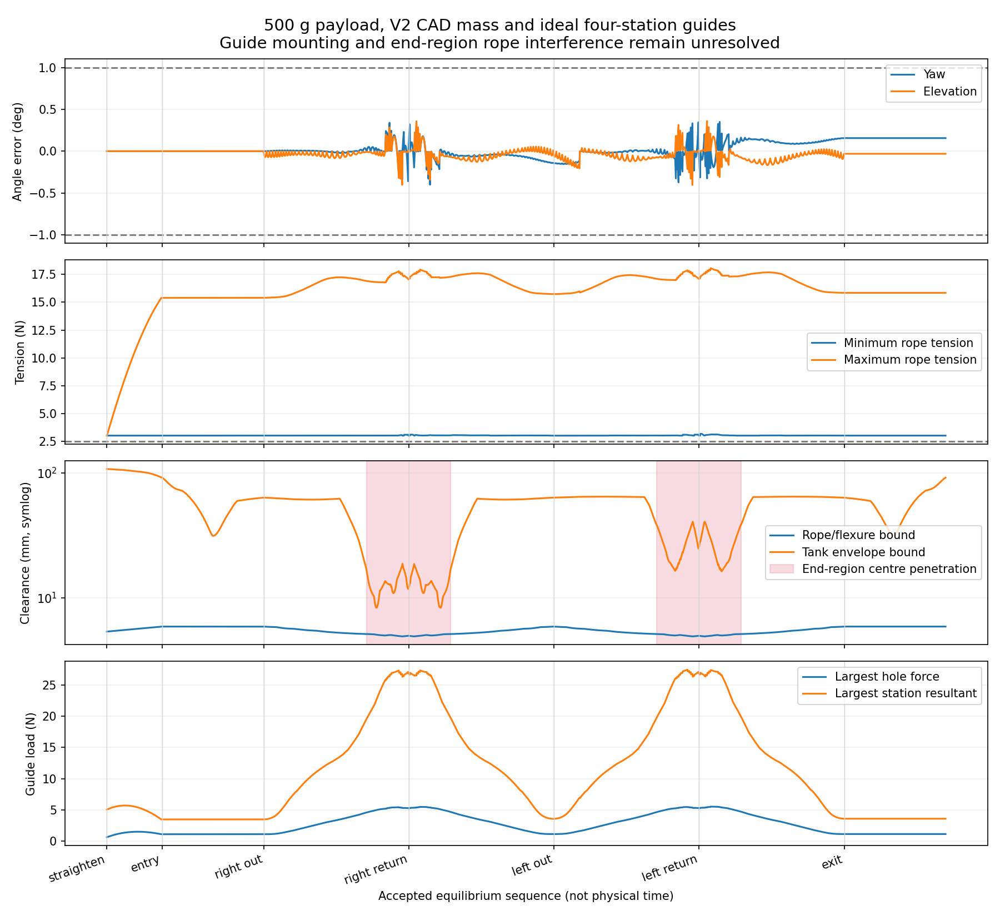
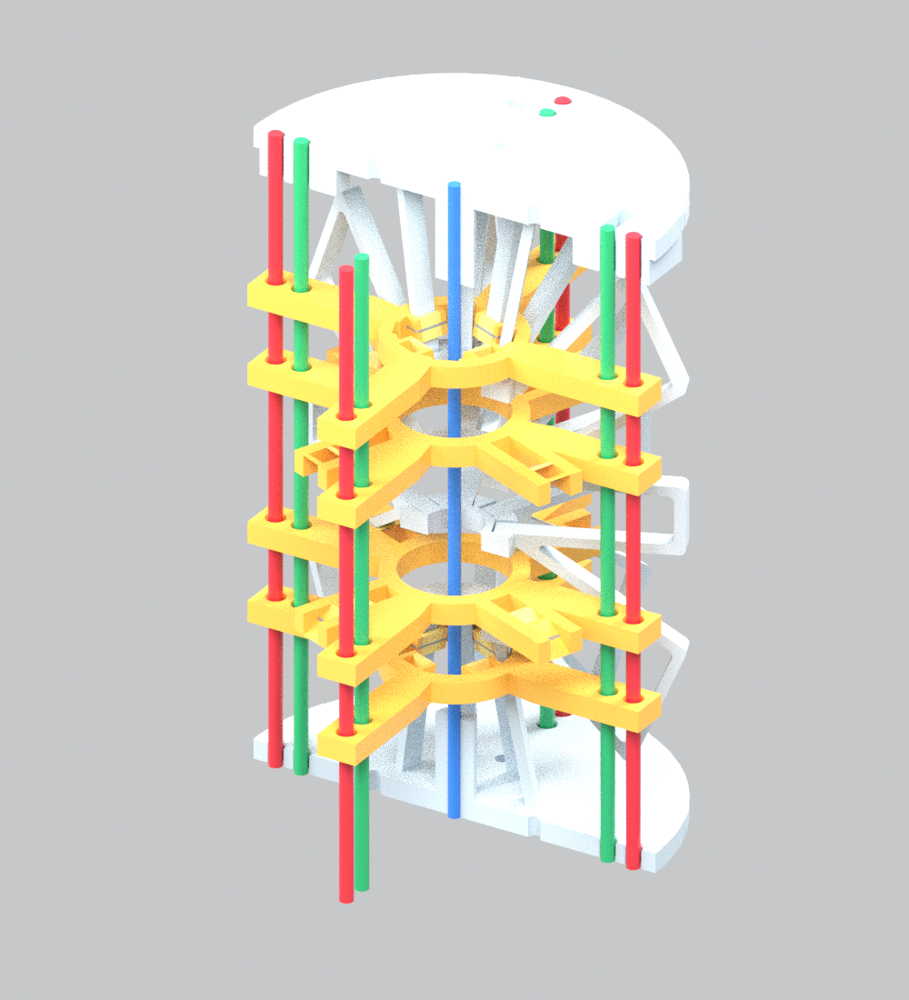

# Four-station rope guides: 500 g path validation and CAD revision

14 November 2026. Work based on repository commit `64a14a6402790f0d353bf07b110cf32853784cbe`.

**The ideal guided-rope simulation and the physical guide assembly have different validation status.** The full-path calculations below assess a frictionless rod with ideal guide locations. The revised physical guide frames pass straight assembly checks but intersect the deformed M-body CAD in selected bent poses. The mounting design is therefore not released for manufacture.

## Scope and corrected coverage

The head payload remains **500 g**. No 550 g payload is used for the new baseline or candidate validation. A legacy 550 g archive is included only in the regression check of the archive reader.

The previous rope-guide screening reader recognised individual `*_z8` keys but silently ignored matrix-form reference (`z`) and settled closed-loop (`closed`) archives. The new reader explicitly supports those formats and motion traces, validates state/force counts and rejects unknown, empty or invalid archives. On the four previously supplied archives the checked count rises from **68 to 2,270**: 32 startup + 36 yaw holds + 1,101 reference + 1,101 settled states. That screening uses old endpoint-only equilibria and is **not** evidence of a rerun with guides.

The closed-loop solver now saves the full rod state, rope rest lengths and tensions for every accepted motion/correction substep, aligned one-for-one with its trace JSON. Each case also has `closed_loop/nominal_motion.csv.gz`: commanded unstretched lengths including the 1 m free-rope segment, internal geometric rope-path lengths excluding that segment, all 12 tensions, head tank position, yaw/elevation, the full head material frame relative to the base, clearance bounds and fixed-winch stability. No longer inspecting only settled samples is essential for finding transient clearance and loading peaks.

The guided kernel follows the actual four stations at local **z = −24, −12, +12, +24 mm**, including on the 16-cell refinement mesh. The five spans are 24 / 12 / 24 / 12 / 24 mm. The earlier refined implementation incorrectly replaced these with evenly spaced guide nodes. Four-cell optimisation remains an approximate seed; accepted eight-cell equilibria and the final candidate's direct fine-grid sweep use the actual stations.

## Models compared

| Input | Guided baseline | V2 candidate |
|---|---|---|
| Head payload | 500 g | 500 g, including head adapter |
| U/M modules | U4 + M2, 96 mm each | Same |
| A/B/C lane radii | 21 / 24 / 27 mm | 21 / 24 / 28 mm |
| M guide stations | −24 / −12 / +12 / +24 mm | Same |
| Module masses | Previous nominal mass model | Regenerated CAD volume estimates, including guides/caps/wire |
| Module stiffness | Existing homogenised stiffness | Same; support-induced stiffness not yet modelled |
| Rope and feedback model | Quasi-static, frictionless, ideal sensing | Same |

The comparison changes lane C and mass together; it is not an isolated sensitivity study of either change. Previous nominal bare module masses are 37.99 g for each U and 25.524 g for each M.

V2 estimated module masses, excluding rope mass already added by the solver: **40.615, 40.615, 40.615, 41.807, 40.689, 41.139 g**. Densities: PA12 0.93 g/cm³, NiTi 6.45 g/cm³ and steel 7.9 g/cm³. A 1.3 g joint hardware allocation per module is an estimate. Each module total is distributed uniformly over its rod cells; individual guide point masses and inertia are not represented. Adhesive, wire closure tails and real harness mass are not included. [Mass inputs](../../../cad/lanes_u4m2/guides_v2/mass_model.json).

## Numerical path and force results

The commanded sequence is **straighten → insert → right sweep to 175° → return → left sweep to −175° → return → withdraw**. Inverse yaw holds target 20° elevation. These are feasible local equilibria; the force optimisation does not establish a global minimum. Startup naturally begins below the working elevation and is checked against its own reference.

<!-- RESULTS_TABLES -->
| Metric | Guided baseline | V2 with CAD mass |
|---|---:|---:|
| Startup / inverse yaw states | 28 / 44 | 29 / 36 |
| Reference states / failed checks | 1115 / 0 | 1200 / 44 |
| Closed-loop settled samples / failed checks | 1115 / 0 | 1200 / 0 |
| Motion trace states, including initial state | 2326 | 2526 |
| Motion trace failed checks, excluding initial state | 0 | 0 |
| Minimum motion tension (N) | 2.995 | 2.995 |
| Peak motion tension (N) | 17.438 | 18.064 |
| Minimum motion tank clearance, before 1.5 mm allowance (mm) | 8.984 | 9.827 |
| Minimum scaled fixed-winch tangent eigenvalue | 0.252610 | 0.207553 |
| Largest accepted node step (mm) | 2.500 | 2.530 |
| Largest settled angle error (deg) | 0.186 | 0.200 |
| Largest motion angle error (deg) | 0.239 | 0.403 |
| Audited records across all five archives | 4628 | 4991 |
| Unique deformed-CAD rope geometries | 2384 | 2661 |
| Minimum rope/flexure clearance bound (mm) | 5.012 | 4.918 |
| Failed rope/flexure records | 0 | 0 |
| Records with rope-centre penetration of end-region material | 530 | 985 |
| Largest sampled rope-centre penetration into end-region material (mm) | 0.220 | 0.229 |
| Largest single-hole force (N) | 5.302 | 5.521 |
| Largest station resultant force (N) | 32.590 | 27.441 |
| Largest station resultant moment (N mm) | 59.212 | 60.841 |

The control/model check columns cover angle, tension, rod geometry/strain, fixed-winch stability and the 63 mm tank envelope; the new CAD contact checks are listed separately. All counts describe recorded equilibria, not physical time samples. The five-archive audit intentionally includes overlapping reference/settled/trace states; the separate unique-geometry count removes exact repeated rod states. A positive eigenvalue refers to the scaled quasi-static fixed-winch tangent, not dynamic controller stability.

[Baseline evidence](guided_validation_20261114/baseline/) · [V2 evidence](guided_validation_20261114/candidate/) · [Motion force and clearance plot](guided_validation_20261114/candidate/path_overview.png)


<!-- END_RESULTS_TABLES -->

## What the collision checks establish

The full-path rope screen deforms the supplied M5/M6 CAD vertices with the rod's material frames and queries every rope span at intervals no greater than 1 mm. Reported clearance subtracts the nominal 1 mm rope radius and an additional 0.5 mm distance-sampling allowance. It checks flexure triangles wholly within local |z| ≤40 mm, excluding end disks and intended anchor contacts from the surface-distance query. A separate point-inside test against the closed full body prevents a rope centre inside flexure material from being reported as positive flexure clearance. Penetrations whose nearest CAD face lies in the end region are counted separately, with depth measured to that full-body face. They are not assigned the distance to a distant flexure surface. It is a **sampled beam-mapped geometric screen**, not a solid deformation/contact simulation. It does not certify rope contact inside finite-thickness eyelets, end disks, real head geometry, external cables or manufacturing tolerances.

**End-region incompatibility is also found.** Some ideal straight spans place rope-centre points inside the finite end-disk/anchor-block material at large yaw. A positive middle-flexure clearance therefore does not certify the whole rope route. This screen identifies actual sampled centre penetrations; it is not a complete finite-radius contact or wear analysis. The finite bore entry/exit geometry and effective guide locations must be revised or modelled with contact before the ideal path can represent the hardware. [Candidate example points](guided_validation_20261114/candidate/path_audit/end_region_example.json) identify the rope, module, local station, nearest CAD face and penetration depth.

Tank clearance is the existing sampled 63 mm envelope check. Its bound subtracts 1.5 mm and must retain a 5 mm margin. Actual source CAD reaches radius 31.66 mm, slightly greater than the 31.5 mm envelope; the envelope and real-head limitations remain.

A separate Boolean check positions each **rigid** guide assembly on the corresponding material frame and intersects it with the beam-mapped M-body mesh at selected 0°, 90° and 175° holds. Positive volume is a mounting incompatibility, not an allowable contact. The computation does not calculate contact loads or the constrained shape that a real bonded guide would impose.

<!-- MOUNT_RESULTS -->
| Held yaw | Interfering guide assemblies / 8 | Largest overlap (mm³) | Location |
|---|---:|---:|---|
| 0° | 4 / 8 | 4.960 | M6_z+12 |
| 90° | 8 / 8 | 25.575 | M5_z+12 |
| 175° | 8 / 8 | 31.102 | M5_z-12 |

[Per-part Boolean results and selected-state coverage](guided_validation_20261114/candidate/mount_audit/summary.json). These are selected-pose checks, not an assertion that every intermediate guide-body configuration was collision-tested. A failure is already sufficient to withhold release.
<!-- END_MOUNT_RESULTS -->

Zero yaw is a loaded held-elevation pose: the M modules are already bent. It is not the undeformed straight CAD configuration used in the assembly check.

The candidate is rejected at this gate. A sliding/articulated or compliant support, additional relief around moving non-mounting webs, and a coupled stiffness/contact model are needed before a manufacturing release. Because the support is already incompatible in checked poses, a positive rope-to-flexure distance does not validate the complete assembly or define a safe hardware yaw envelope.

## CAD changes and installation concept

The original guide used identical clips at radius about 6.9 mm at all four stations. Actual CAD sections show those inner webs only at ±24 mm; the ±12 mm clips had no corresponding inner web to grip. V2 uses eight station-specific frames. At ±24 mm the saddles follow real inner webs at radius about 6.896 mm. At ±12 mm forked arms reach real outer webs at radius about 19.229 mm. Nine sections through each guide thickness define the inclined rectangular socket.

C moves from radius 27 to 28 mm, with matching changes to all through-holes and anchors. The guide is 3.2 mm thick, with Ø2.6 mm throats and Ø3.0 mm rounded mouths. The B–C bridge grows to 1.4 mm at the bore and 1.0 mm at the mouth; the outer C-mouth wall is 1.1 mm. The A–B end-disk wall remains 0.5 mm and needs print qualification.

Four removable inward caps close the web sockets. Ø0.35 mm retaining wire in a 0.45 mm groove is the radial-retention concept; a qualified structural adhesive in a nominal 0.15 mm gap would hold the axial station. The CAD wire is a conservative square-section envelope with closure tails omitted. Bond strength, assembly access, cap retention and fatigue have not been established. The guides do not clamp the central Ø1.8 mm NiTi backbone; no backbone end ferrule is added.

[CAD specification and installation limits](../../../cad/lanes_u4m2/guides_v2/README.md) · [Straight assembly check](../../../cad/lanes_u4m2/guides_v2/geometry_check.json) · [OpenSCAD assembly](../../../cad/lanes_u4m2/guides_v2/assembly.scad)



The image shows the real generated guide and body meshes in the straight configuration. Cylinders illustrate the straight rope and backbone paths; it does not show a successful bent assembly.

## Guide loads and preliminary sizing

For a frictionless rope at one guide, the load applied to the guide is `T × (outgoing unit tangent − incoming unit tangent)`. Each state exports force components for all 48 guide holes (32 in M5 and 16 in M6), along with rope tension and station identity. Station resultant forces and moments include the simultaneous hole loads. Force components are in the local rod frame: x axial, y up, z right; they are not CAD x/y/z coordinates.

<!-- LOAD_RESULTS -->
V2 operating maxima are **5.521 N per hole**, **27.441 N station resultant**, and **60.841 N mm station moment**.

| Preliminary requirement, factor 3 | Value |
|---|---:|
| Single-hole load | 16.56 N |
| Station resultant force | 82.32 N |
| Station resultant moment | 182.52 N mm |
| Sum of absolute hole forces at one station | 82.36 N |
| Nominal cantilever-root normal stress comparison | 52.15 MPa |
| Nominal projected hole-bearing stress comparison | 2.59 MPa |

[Per-hole CSV, gzip](guided_validation_20261114/candidate/path_audit/hole_loads.csv.gz) · [Per-state checks](guided_validation_20261114/candidate/path_audit/path_checks.csv) · [Peak locations](guided_validation_20261114/candidate/path_audit/summary.json) · [Sizing assumptions and requirements](guided_validation_20261114/candidate/design_loads.json)
<!-- END_LOAD_RESULTS -->

A proposed factor of three converts simulated operating loads to preliminary design/test requirements. It is **not a validated safety factor**. The comparison arm calculation assumes a 4 ×3.2 mm rectangular cantilever root at r =7.8 mm; it includes radial force and bending from transverse/axial hole-force components, but excludes holes, stress concentrations, socket load sharing and print anisotropy. No material allowable is assigned and no strength pass is claimed. Local structural FEA and printed-part/bond/wire tests must use the simultaneous per-state loads, since separate maximum force and moment can occur at different states.

## Numerical verification and reproduction

<!-- VERIFICATION_RESULTS -->
Nine new targeted tests and fourteen existing numerical/control tests pass. They cover archive formats and count alignment, actual station placement after refinement, directional energy gradients at 8/16 cells, force-vector balance and rotation, CAD kinematics, solid-inside detection, mass assignment, interleaved hole-load aggregation and accepted-motion trace alignment. Eleven existing configuration files pass the repository validator.

| Hold | 8→16 cell head difference (mm) | Yaw difference (deg) | Elevation difference (deg) |
|---|---:|---:|---:|
| 0° | 0.182 | -0.0000 | -0.0177 |
| 90° | 0.144 | 0.0130 | -0.0121 |
| 175° | 0.778 | -0.0055 | -0.3592 |

[Refinement results](guided_validation_20261114/candidate/mesh_convergence.json). Tensions are held fixed and only three equilibria are refined; this is not a full fine-mesh control replay. The 175° elevation difference exceeds the 0.2° settling target, so accuracy at that target has not been established by mesh convergence.
<!-- END_VERIFICATION_RESULTS -->

Install NumPy, SciPy, numba, trimesh, vtk, manifold3d, shapely, rtree, networkx and mapbox-earcut. CAD rebuilding also requires the repository's OpenCascade dependency. From this simulation folder:

```bash
# Regenerate V2 geometry and the exact mass file before changing its inputs.
python ../../../cad/lanes_u4m2/guides_v2/build.py
python ../../../cad/lanes_u4m2/guides_v2/build_mass.py

# Run each stage in order, with the same options.
python lanes_study.py startup --guide-spacing-mm 24 --radii 21 24 28 --mass-config ../../../cad/lanes_u4m2/guides_v2/mass_model.json --output-root guided_validation_20261114/candidate
# Repeat the preceding command with startup replaced by:
# fine_sweep, reference, gains, cycle
# A stopped fine_sweep can be resumed with --resume; saved states are revalidated.
```

`fine_sweep` directly continues eight-cell equilibria and can reduce a failed 5° step to 1° increments. `reference` refuses to run unless every required 0,5,…,175° hold exists. The baseline used recovered fine-grid continuation at 130° and 166–175° after some coarse seeds failed; solver failure was not silently counted as a passing pose or physical infeasibility. The reference interpolates rope lengths and the feedback solver checks every accepted substep.

The saved baseline was generated with the coarse/fine `sweep`, then `python repair_guided_sweep.py guided_validation_20261114/baseline/inverse --yaw 130` and `python continue_guided_sweep.py guided_validation_20261114/baseline/inverse --start 165`, before `reference`, `gains` and `cycle` using the baseline output root and 21/24/27 mm radii. Its retained optimisation records and logs document the rejected seeds. New optimisation runs can select different local equilibria; saved NPZ files and their hashes define the reported trajectory.

Audit a completed candidate run with:

```bash
python audit_saved_guided_run.py guided_validation_20261114/candidate --radii 21 24 28 --cad ../../../cad/lanes_u4m2/guides_v2
python guide_mount_audit.py guided_validation_20261114/candidate/inverse/minforce_niti18_E40_p20_a456_pre3_exact_smooth1_fromstartup_tol1_states.npz --cad ../../../cad/lanes_u4m2/guides_v2 --out guided_validation_20261114/candidate/mount_audit
python guide_mesh_convergence.py guided_validation_20261114/candidate/inverse/minforce_niti18_E40_p20_a456_pre3_exact_smooth1_fromstartup_tol1_states.npz --mass ../../../cad/lanes_u4m2/guides_v2/mass_model.json --out guided_validation_20261114/candidate/mesh_convergence.json
MPLCONFIGDIR=/tmp/guide-mpl python summarize_guided_validation.py
```

The audit programs are [guide_path_audit.py](guide_path_audit.py), [guide_mount_audit.py](guide_mount_audit.py), [guide_load_design.py](guide_load_design.py) and [guide_mesh_convergence.py](guide_mesh_convergence.py). Run them on the saved states with the corresponding radii and CAD folder; their command-line help gives required arguments.

## Next gate

The simulation/data-reading task now has explicit path and loading evidence. The guide redesign has explicit CAD and installation details, but **motion compatibility remains unresolved**. The next engineering work is to make the support kinematically compatible with the changing web shape and verify its influence on module stiffness and guide coordinates. Finite end-hole/anchor routing must also be made compatible with the bending rope paths. Only after that should the design proceed to printed-module pull, friction, backlash, cyclic bending and wear tests.

Friction, distributed rope contact, NiTi hysteresis/fatigue, actuator dynamics, sensor noise/delay and actual harness/head geometry remain outside the present simulation. Positive quasi-static tangent stiffness does not establish dynamic closed-loop stability.
