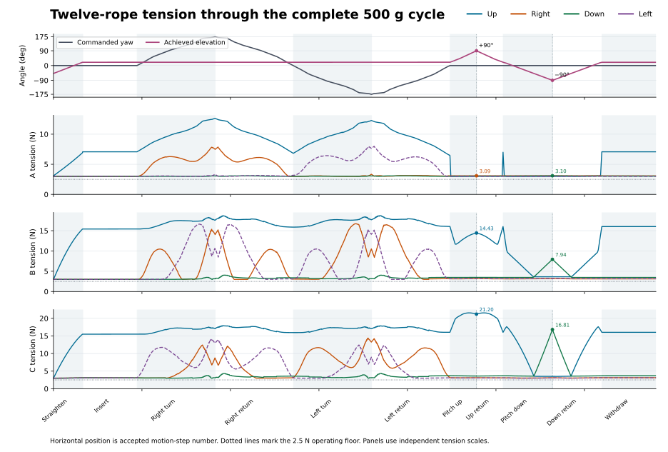
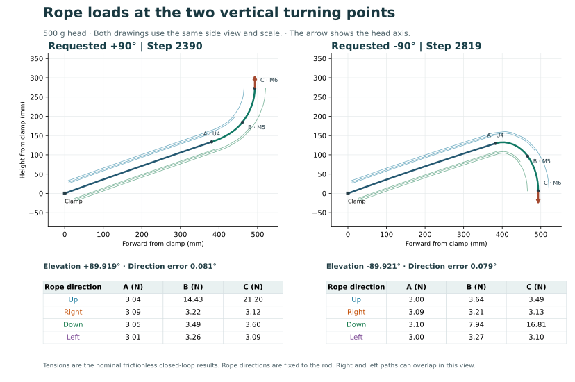

# Twelve-rope tension at the ends of the motion phases

Values are in newtons. A terminates at U4, B at M5 and C at M6. The four directions are fixed in the rod frame. Positive pitch is upwards from horizontal. The nominal frictionless model gives uniform tension along each rope. Actual distal forces depend on friction.

Each group below lists **up / right / down / left**. All twelve individual values are also stored in separate columns in the CSV files.

| Event | Step | Requested yaw / pitch (deg) | Actual elevation (deg) | Pointing error (deg) | A (N) | B (N) | C (N) |
|---|---:|---:|---:|---:|---|---|---|
| Loaded start | 0 | 0.0 / -48.1 | -48.077 | 0.001 | 3.02 / 3.01 / 2.99 / 3.01 | 3.01 / 3.02 / 3.04 / 3.02 | 2.91 / 2.90 / 2.90 / 2.90 |
| Straighten | 165 | 0.0 / 20.0 | 20.002 | 0.002 | 7.07 / 3.00 / 3.00 / 3.00 | 15.41 / 3.00 / 3.00 / 3.00 | 15.50 / 3.10 / 3.10 / 3.10 |
| Insert | 472 | 0.0 / 20.0 | 20.002 | 0.002 | 7.07 / 3.00 / 3.00 / 3.00 | 15.41 / 3.00 / 3.00 / 3.00 | 15.50 / 3.10 / 3.10 / 3.10 |
| Right turn | 913 | 175.0 / 20.0 | 20.001 | 0.002 | 12.63 / 7.48 / 3.05 / 3.35 | 17.61 / 14.04 / 3.16 / 10.51 | 17.07 / 8.74 / 3.14 / 12.99 |
| Right return | 1355 | 0.0 / 20.0 | 19.939 | 0.128 | 6.82 / 3.00 / 3.00 / 3.17 | 15.88 / 3.08 / 3.40 / 3.13 | 15.95 / 3.11 / 3.60 / 3.06 |
| Left turn | 1796 | -175.0 / 20.0 | 19.940 | 0.173 | 12.29 / 3.35 / 3.07 / 7.65 | 17.70 / 10.52 / 3.22 / 14.12 | 17.06 / 13.25 / 3.15 / 8.97 |
| Left return | 2240 | 0.0 / 20.0 | 19.938 | 0.063 | 6.47 / 3.09 / 3.00 / 3.00 | 16.04 / 3.15 / 3.50 / 3.20 | 16.04 / 3.12 / 3.72 / 3.09 |
| Pitch up | 2390 | 0.0 / 90.0 | 89.919 | 0.081 | 3.04 / 3.09 / 3.05 / 3.01 | 14.43 / 3.22 / 3.49 / 3.26 | 21.20 / 3.12 / 3.60 / 3.09 |
| Up return | 2540 | 0.0 / 20.0 | 19.938 | 0.063 | 7.00 / 3.08 / 3.04 / 3.00 | 16.02 / 3.13 / 3.48 / 3.18 | 16.03 / 3.10 / 3.70 / 3.07 |
| Pitch down | 2819 | 0.0 / -90.0 | -89.921 | 0.079 | 3.00 / 3.09 / 3.10 / 3.00 | 3.64 / 3.21 / 7.94 / 3.27 | 3.49 / 3.13 / 16.81 / 3.10 |
| Down return | 3098 | 0.0 / 20.0 | 19.938 | 0.063 | 7.07 / 3.08 / 3.04 / 3.00 | 16.02 / 3.12 / 3.48 / 3.17 | 16.02 / 3.14 / 3.70 / 3.11 |
| Withdraw | 3404 | 0.0 / 20.0 | 19.938 | 0.063 | 7.07 / 3.08 / 3.04 / 3.00 | 16.02 / 3.12 / 3.48 / 3.17 | 16.02 / 3.14 / 3.70 / 3.11 |
| Peak rope tension | 2432 | 0.0 / 69.0 | 68.945 | 0.066 | 3.03 / 3.09 / 3.04 / 3.01 | 13.80 / 3.18 / 3.48 / 3.22 | 21.55 / 3.11 / 3.63 / 3.07 |
| Lowest rope tension | 0 | 0.0 / -48.1 | -48.077 | 0.001 | 3.02 / 3.01 / 2.99 / 3.01 | 3.01 / 3.02 / 3.04 / 3.02 | 2.91 / 2.90 / 2.90 / 2.90 |

The C up rope reached 21.554 N during Pitch up at step 2,348, Up return at step 2,432. Phase peak values within 0.000001 N are grouped here.

At a vertical target the head axis defines pointing accuracy. Azimuth is indeterminate at the pole. The horizontal-plane yaw field in the CSV is retained as a kinematic diagnostic.

[Every accepted substep](rope_tensions_every_step.csv.gz) · [Individual event tensions](rope_tensions_at_events.csv) · [Phase extrema and step numbers](rope_tensions_by_phase.csv) · [Separate winch and anchor forces with assumed friction at four turns](sliding_turn_tensions.csv) · [Cycle summary](summary.json)

## Range of each individual rope over the entire cycle

| Rope | Minimum (N) | Step at minimum | Maximum (N) | Step at maximum | Phase at maximum |
|---|---:|---:|---:|---:|---|
| A up | 2.999 | 2560 | 12.643 | 912 | Right turn |
| A right | 2.996 | 1608 | 7.874 | 930 | Right return |
| A down | 2.993 | 0 | 3.095 | 2819 | Pitch down |
| A left | 2.996 | 728 | 7.997 | 1812 | Left return |
| B up | 3.014 | 0 | 18.720 | 1843 | Left return |
| B right | 2.994 | 1033 | 16.729 | 1709 | Left turn |
| B down | 2.995 | 476 | 7.944 | 2819 | Pitch down |
| B left | 2.994 | 1917 | 16.637 | 825 | Right turn |
| C up | 2.908 | 0 | 21.554 | 2432 | Up return |
| C right | 2.904 | 0 | 14.391 | 1778 | Left turn |
| C down | 2.901 | 0 | 16.815 | 2819 | Pitch down |
| C left | 2.904 | 0 | 14.142 | 894 | Right turn |

[Full-precision ranges for the twelve ropes](rope_tensions_full_range.csv)
