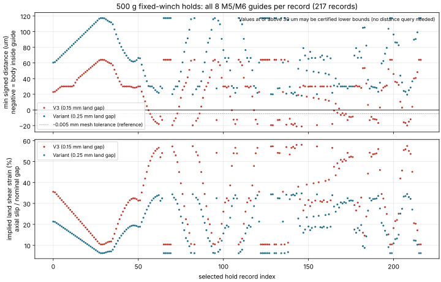

# Evening evidence — 16 November 2026: full-coverage guide/web compatibility

**Edition: Evening Report.** Run start **16 November 2026 20:02:13 EST
(17 November 2026 01:02:13 UTC)**; deadline 22:02:13 EST (03:02:13 UTC).
Exact run context, dependency versions and base revisions are in
[run_context.json](run_context.json). Full narrative:
[Evening Engineering Report — 2026-11-16](../../../../reports/daily/Evening_Report_2026_11_16.md).
Next-run plan: [HANDOFF.md](HANDOFF.md).

**Engineering candidate only; not released for manufacture.** The head remains
500 g; U4+M2, lanes 21/24/28 mm, guide stations −24/−12/+12/+24 mm, rope bores
and the backbone are unchanged. No end ferrule was added.

## What this run did

1. Added a **point-sampled signed-distance screen** that checks every saved
   500 g fixed-winch hold (217 records, 199 unique geometries) against all
   eight M5/M6 guide assemblies (guide + caps + lockwire envelope) — 1736
   guide checks per design — instead of the six representative poses used by
   the Boolean audits. It uses the same beam map and station frames as the
   Boolean audits.
2. **Calibrated it against the manifold Boolean.** The screen reproduces the
   morning 0.5 mm result exactly (the same 6 of 48 checks fail, the same worst
   case). Six additional V3 Boolean checks at 0.25 mm agree in every case,
   including two near-threshold failures (screen −0.00035/−0.00038 mm, Boolean
   1.9e−6/2.0e−6 mm³) and two near-threshold passes (+0.0018/+0.0029 mm,
   Boolean 0).
3. **Found the V3 contact is much wider than the selected-pose screen showed:**
   **59 of 217 records** (103 of 1736 checks) penetrate, all at the M5 ±12 mm
   outer saddles, in insertion holds and both yaw excursions/returns. Worst
   −0.0211 mm (record 146, left return, M5 z+12).
4. **Identified the mechanism:** the homogenised section rotation across the
   socket (module curvature up to 0.0175 rad/mm) moves web points just outside
   the 0.5 mm land axially by up to 0.127 mm into the land-to-flare corner. The
   same motion shears the proposed bond land: up to **0.087 mm axial slip**,
   i.e. **58% implied shear strain** in a 0.15 mm bond line.
5. **Built and checked one variant:** land bond gap 0.15 → **0.25 mm** (land
   0.5 mm and 1.5 relief slope unchanged). All 1736 checks clear (minimum
   +0.0182 mm). Ten 0.25 mm Booleans on the five worst records and 48 Booleans
   at 0.5 mm (both bodies, all eight guides, six poses) return zero overlap.
   The implied land shear strain falls to **35%** — still unqualified.

## Files

| Path | Content |
|---|---|
| [`../guide_web_compatibility.py`](../guide_web_compatibility.py) | New screen: dense body-surface samples, signed distance, Lipschitz pruning, land slip/shear |
| [`../merge_compatibility_shards.py`](../merge_compatibility_shards.py) | Merges shards; rejects mismatched inputs or incomplete coverage |
| [`../test_guide_web_compatibility.py`](../test_guide_web_compatibility.py) | Four new unit tests (sign/value, multi-component minimum, Lipschitz bound, merge rejection) |
| `v3_compatibility/` | Published V3: merged [summary](v3_compatibility/summary.json), all rows, four shards |
| `gap0p25_compatibility/` | 0.25 mm land-gap variant: same layout |
| `cad_v3_gap0p25/` | Variant CAD from `cad/lanes_u4m2/guides_v3/build.py --bond-gap 0.25` (STLs, design, straight check, mass model) |
| `v3_boolean_crosscheck_0p25mm/` | Six V3 Booleans at 0.25 mm (two new deep failures, two near-threshold failures, two near-threshold passes) |
| `gap0p25_boolean_0p25mm/` | Ten variant Booleans at 0.25 mm (records 63, 64, 143, 146, 208; M5 ±12) |
| `gap0p25_boolean_0p5mm/` | 48 variant Booleans at 0.5 mm (records 0, 38, 48, 63, 64, 146; all 8 guides) |
| `sampling_sensitivity/` | 0.015 mm sampling of records 143/146, M5 z+12, both designs |
| [`rope_station_invariance.json`](rope_station_invariance.json) | Bore-region vertices identical in V3 and variant (0.0 mm) |
| [`compatibility_comparison.svg`](compatibility_comparison.svg) | Per-record minimum signed distance and land shear strain |
| `*_resources.json`, `logs/` | Run time, peak RSS, all study and test logs (including failed dependency attempts) |
| `SHA256SUMS` | Hashes of the published evidence files |



## Key numbers

| Metric (217 records × 8 guides) | V3 (0.15 mm) | Variant (0.25 mm) |
|---|---:|---:|
| Straight minimum clearance, outer ±12 / inner ±24 (mm) | 0.0844 / 0.1477 | 0.1406 / 0.2462 |
| Penetrating checks / records | 103 / 59 | 0 / 0 |
| Minimum signed distance (mm) | −0.02111 | +0.01820 |
| Worst record / part | 146 left return, M5 z+12 | 146 left return, M5 z+12 |
| Maximum land axial slip (mm) | 0.0871 | 0.0871 |
| Maximum implied land shear strain | 58.0% | 34.8% |
| Boolean at 0.25 mm, worst records | 8/8 fail (6 morning + 143, 208) | 10/10 clear |
| Boolean at 0.5 mm, six poses × 8 guides | 6/48 fail (morning) | 0/48 fail |
| Guide + caps PA12 per module (g) | 8.2304 (M5) / 8.4948 (M6) | 8.2178 / 8.4822 |

V3 penetration by phase (records penetrating / records): startup 0/29,
straighten 0/6, entry 0/4, exit 0/4, inverse 9/36, right out 12/34, right
return 13/34, left out 10/36, left return 15/34. The variant has 0 in every
phase. Phase labels come from the saved hold metadata; these are holds sampled
from the full path, not a continuous trajectory.

The variant's minimum, +0.0182 mm, is above the 0.005 mm mesh tolerance used
elsewhere but is a **small kinematic margin**, not a manufacturing tolerance
stack. Net module mass changes by about −0.0003 g (guide/caps −0.0126 g,
steel wire envelope +0.0123 g); the 500 g holds were **not** re-solved for this
negligible change. The variant also enlarges the inner ±24 mm socket gaps to
0.25 mm because `bond_gap_mm` is shared; their bond areas are unchanged.

## Method and limits

- Samples: area-weighted random points on the complete, watertight
  bellmouth-body faces near each guide (0.03 mm spacing, seed 7, 0.6 mm
  window), mapped with `guide_path_audit.map_cad` and expressed in the station
  frame used by `mount_refinement_study.py`. Distance:
  `vtkImplicitPolyDataDistance`, minimum over every closed guide/cap/wire
  component.
- Pruning is rigorous: the signed distance is 1-Lipschitz, so a point whose
  straight distance minus its displacement exceeds 0.03 mm is certified clear
  without a query. Reported minima ≥ 0.03 mm may be such lower bounds.
- Halving the spacing changes the worst result by < 0.0001 mm (−0.02108 vs
  −0.02111 mm; +0.0182 mm unchanged).
- The screen detects **body points inside guide parts**. A guide edge piercing
  between body samples could be missed; the Boolean cross-checks found no such
  case, but point sampling is not a proof of zero intersection.
- **Beam-map limitation.** At z = ±12 mm the M body section is four inclined
  struts (16 mm² each, 64 mm² total; checked by slicing the V2 body). The map
  moves each CAD section rigidly with the homogenised rod section. Real strut
  bending and twisting near the guide are not modelled, so slip, shear strain
  and contact depth are kinematic estimates, not strut-level FE results.
- The shear-strain figure is axial slip divided by the nominal gap. It is a
  demand estimate. No adhesive has been selected or tested, and no allowable
  strain, fatigue limit or creep data are claimed.
- A thicker bond line lowers positional stiffness and adds a tolerance stack;
  neither is quantified. Guide stations and rope routing are unchanged by
  construction, but support displacement under load is not modelled.

## Reproduce

From `simulations/u4m2/lanes_20261113` (Python 3.11.18; versions in
`run_context.json`; `OMP_NUM_THREADS=1 OPENBLAS_NUM_THREADS=1`):

```bash
H=morning_20261116/fixed_winch_holds/equilibria_states.npz
B=../../../cad/lanes_u4m2/end_bellmouth_v1
(cd ../../../cad/lanes_u4m2/guides_v3 && python build.py --bond-gap 0.25 --out ../../../simulations/u4m2/lanes_20261113/evening_20261116/cad_v3_gap0p25)
for k in 0 1 2 3; do python guide_web_compatibility.py $H --body-cad $B --guide-cad ../../../cad/lanes_u4m2/guides_v3 --out evening_20261116/v3_compatibility/shard_$k --shard $k 4 --max-seconds 3600 & done; wait
for k in 0 1 2 3; do python guide_web_compatibility.py $H --body-cad $B --guide-cad evening_20261116/cad_v3_gap0p25 --gap 0.25 --out evening_20261116/gap0p25_compatibility/shard_$k --shard $k 4 --max-seconds 3600 & done; wait
python merge_compatibility_shards.py evening_20261116/v3_compatibility --out evening_20261116/v3_compatibility/summary.json
python merge_compatibility_shards.py evening_20261116/gap0p25_compatibility --out evening_20261116/gap0p25_compatibility/summary.json
python mount_refinement_study.py $H --cad $B --guide-cad ../../../cad/lanes_u4m2/guides_v3 --out evening_20261116/v3_boolean_crosscheck_0p25mm --resolutions 0.25 --states 143 208 118 105 168 205 --parts M5_z+12 --max-seconds 1100
python mount_refinement_study.py $H --cad $B --guide-cad evening_20261116/cad_v3_gap0p25 --out evening_20261116/gap0p25_boolean_0p25mm --resolutions 0.25 --states 63 64 143 146 208 --parts M5_z-12 M5_z+12 --max-seconds 1100
python mount_refinement_study.py $H --cad $B --guide-cad evening_20261116/cad_v3_gap0p25 --out evening_20261116/gap0p25_boolean_0p5mm --resolutions 0.5 --states 0 38 48 63 64 146 --max-seconds 1400
python evening_20261116/plot_compatibility.py
```

Each four-shard screen took about 4 minutes (V3) and 2.7 minutes (variant) on
four CPUs. The Boolean runs took 51–83 s with peak RSS 3.1–5.0 GiB, run one at
a time under an 8–10 GiB virtual-memory cap.

## Validation

- 35 geometry tests pass (31 existing + 4 new). The 14 existing control tests
  pass after installing `cadquery-ocp 7.8.1.1.post1`. Earlier attempts failed
  because `OCP` was missing, and then because the 8.0 API lacks
  `TDF_LabelSequence`. Both failure logs are kept.
- `scripts/validate_configs.py`: 11 configuration files valid.
- With default arguments, the modified `guides_v3/build.py` produces files
  byte-identical to the unmodified builder. Both differ from the committed
  STLs only by float noise (maximum relative volume difference 5.8e−12), which
  comes from library versions. The published V3 files were not regenerated.
