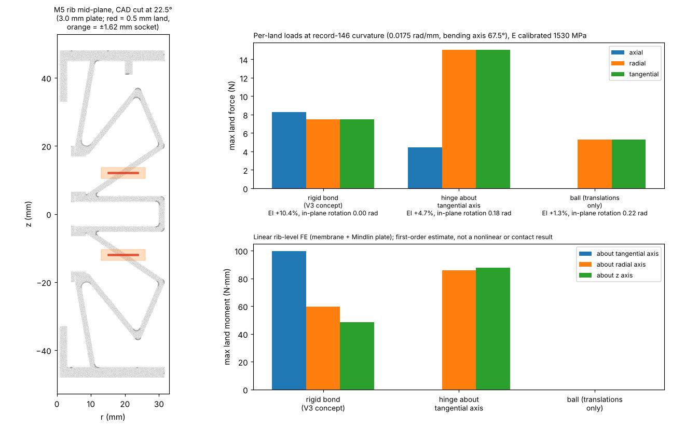

# Evening evidence — 17 November 2026: rib-level model of the ±12 mm guide joint

**Edition: Evening Report.** Run start **17 November 2026 20:02:11 EST
(18 November 2026 01:02:11 UTC)**; deadline 22:02:11 EST (03:02:11 UTC).
Run context, dependency versions and base revisions are in
[run_context.json](run_context.json). Full narrative:
[Evening Engineering Report — 2026-11-17](../../../../reports/daily/Evening_Report_2026_11_17.md).
Next-run plan: [HANDOFF.md](HANDOFF.md).

**Simulation evidence only. No CAD, guide or solver input was changed.** The
head remains 500 g. U4+M2, lanes 21/24/28 mm, guide stations −24/−12/+12/+24 mm,
rope bores and the backbone are unchanged. No end ferrule was added.

## What this run found and built

**The handoff premise was corrected from the CAD.** The 16 November handoff
asked for a model of "four inclined 16 mm² struts". Slicing the actual body
(`cad/lanes_u4m2/end_bellmouth_v1/M5_lane_anchorB.stl`) shows something
different:

- The M body is **eight identical flat radial ribs** at a 45° pitch, with
  mid-planes at 22.5° + k·45°.
- Each rib is a **3.0 mm plate**: ray casting gives a median of 3.000 mm, with
  no missing rays.
- The ribs are joined only by the two end disks and **four small inner rings**
  (r 4.19–8.49 mm at z = ±3.48…6.48 and ±16.97…19.97 mm).
- At z = ±12 mm each rib has one inclined strut, about 1.53 mm wide in the rib
  plane, with an 8.0 mm² z-section. Eight of these make up the 64 mm² total.
- The V3 guide grips the struts of the four ribs at −22.5°, 67.5°, 157.5° and
  247.5° over a 0.5 mm land.

**Model.** [`rib_joint_3d.py`](../rib_joint_3d.py):

- meshes the CAD rib cut (linear triangles);
- models each rib as a **flat plate** with a constant-strain membrane field
  and a Mindlin bending field (5/6 shear factor), using the measured thickness;
- condenses each rib onto rigid disks, rings and the four guide lands, with
  six DOFs per master;
- assembles the eight ribs in 3D;
- solves axial, torsion and pure-moment load cases for four joint idealisations.

The joint idealisations are:

| Variant | Land DOFs tied to the rigid guide | Physical analogue |
|---|---|---|
| `rigid_bond` | all six | the published V3 bonded land (and its 0.25 mm-gap variant) |
| `hinge_t` | all except in-plane rotation β | a pin through the strut along the tangential axis |
| `ball` | the three translations only | a point/ball contact that transmits force but no moment |
| `none` | none | the bare module |

An earlier stage, [`rib_joint_model.py`](../rib_joint_model.py) and
[`rib_joint_variants.py`](../rib_joint_variants.py), modelled only the in-plane
rib stiffness. It is kept as evidence (`rib_joint/`), and its conclusions are
superseded where stated below.

## Validation against the module database

| Quantity (0.01 mm² mesh, E = 1700 MPa) | Model | Database | Ratio | E that matches |
|---|---:|---:|---:|---:|
| EA (N) | 185.40 | 166.694 | 1.112 | 1528 MPa |
| EI (N·mm², all directions) | 48 469 | 44 118 | 1.099 | 1547 MPa |
| GJ rod coefficient (N·mm²) | 47 132 | 41 990 | 1.122 | 1515 MPa |

All three independent stiffnesses are matched by a single PA12 modulus of
**1530 MPa ± 1%**. Here "independent" means one free parameter, three checks.
The database GJ is a whole-module torsion spring T/θ = 0.437396 N·m/rad; as
elsewhere in the repository, it becomes a rod coefficient when multiplied by
0.096 m. All forces below use **E = 1530 MPa** (a factor of 0.900 applied to
the raw 1700 MPa output). Displacements, rotations and strains at an imposed
curvature do not depend on E.

**Mesh convergence.** The two meshes are 29 547 nodes / 54 715 triangles and
55 846 / 105 903. Between them, EI changes by 0.9%, and the largest changes
in land load and rotation are 0.9% and 0.2%.

## Joint results at the worst V3 record

The loading is pure bending at record 146 (left return), the worst record of
the 16 November screen, with M5 curvature 0.01749 rad/mm. The bending axis is
67.5°, the worst of 0°, 22.5° and 67.5°. Results are linear and from the
0.01 mm² mesh. Loads are the maximum over the four mounting ribs and both
±12 mm stations.

| Quantity | rigid bond | hinge_t | ball | none |
|---|---:|---:|---:|---:|
| Module EI change | **+10.4%** | +4.7% | **+1.3%** | 0 (48 469) |
| Module EA change | +4.8% | +3.7% | +3.7% | 0 |
| Module GJ change | +11.8% | +11.8% | 0.0% | 0 |
| Land axial force (N) | 8.29 | 4.46 | 0 | — |
| Land radial / tangential force (N) | 7.49 / 7.49 | 15.05 / 15.05 | **5.30 / 5.30** | — |
| Land moment about tangential / radial / z axis (N·mm) | 99.8 / 59.6 / 48.5 | 0 / 85.8 / 87.6 | 0 | — |
| In-plane rotation the joint must allow (rad) | 0 | 0.182 | 0.219 | — |
| Strut motion in the ±1.62 mm socket relative to guide, in-plane / tangential (mm) | 0.122 / 0.047 | 0.776 / 0.091 | 0.917 / 0.269 | — |
| Peak rib surface principal strain | 8.65% | 8.04% | 7.81% | 7.78% |



**Scaled to all 217 saved holds** ([hold_scaling.json](rib_joint_3d/hold_scaling.json)).
These are upper bounds: each record's M5 curvature magnitude from the
16 November screen is applied about the worst axis, with linear scaling.

| Phase | Records | Max curvature / record-146 | Rigid bond: axial N / moment N·mm | Ball: radial N |
|---|---:|---:|---:|---:|
| startup, straighten | 29, 6 | 0.744 | 6.17 / 74.5 | 3.95 |
| entry, exit | 4, 4 | 0.297 | 2.46 / 29.7 | 1.57 |
| inverse (insertion holds) | 36 | 1.000 | 8.29 / 100.1 | 5.30 |
| right out / return | 34 / 34 | 0.998 / 0.999 | 8.27 / 100.1 | 5.30 |
| left out / return | 36 / 34 | 0.999 / 1.000 | 8.29 / 100.1 | 5.30 |

145 of 217 records exceed half of the record-146 curvature; 52 exceed 90% of it.

## Interpretation

1. **A rigid bonded land fights the module.** At the most-bent holds, each
   bonded land carries about 8 N axial and about 7.5 N radial and tangential
   force, plus moments of up to about 100 N·mm. This is in addition to the
   rope-station loads (selected peak 28.45 N). The bond also stiffens the
   module by about 10% in bending and 12% in torsion. The solver's
   homogenised M stiffness (database values) does not include this
   stiffening. The 16 November 0.25 mm bond-gap variant is still a rigid bond
   in this sense; its extra gap only removed kinematic contact.
2. **The homogenised map understates the joint motion.** The in-plane stage
   found that four freely following lands are 0.535 mm (axially) from any
   common rigid position at record 146. The homogenised plane-section field
   predicts 0.086 mm, a factor of 6.2 lower. The 16 November slip and
   bond-shear estimates (0.087 mm; 35–58%) were therefore optimistic. Any
   compliant bond line would need to absorb several tenths of a millimetre.
3. **Out-of-plane rib stiffness matters.** It supplies about 20% of module EI.
   The in-plane-only stage had suggested that a tangential-axis hinge would be
   load-free. With plate bending included, that hinge carries **15 N** radial
   and tangential force and about 88 N·mm moments, so the earlier conclusion
   is withdrawn.
4. **A translation-only (ball/point) attachment is the least intrusive
   idealisation tested.** It carries about 5.3 N radial and tangential, with
   no axial force and no moments, changes EI by +1.3% and GJ by 0%. It is an
   idealisation, not a design. It needs about 0.22 rad of rotation freedom,
   and strut material inside the present ±1.62 mm socket moves up to 0.92 mm
   in-plane and 0.27 mm tangentially relative to the guide. **The V3 socket
   cannot provide this.** A real point-contact saddle, its retention and its
   axial datum are new CAD for a later run. The radial incompatibility under
   axial load (EA +3.7%) remains with any concept that ties all four radial
   translations.
5. **Rib strain is a separate warning.** The bare module reaches a linear peak
   surface strain of about 7.8% at the record-146 curvature. That is beyond
   the range in which linear PA12 behaviour can be assumed. No allowable is
   claimed. A nonlinear check is needed.

## Method and limits

- **Linear, small rotation.** The record-146 module rotation is about 1.68 rad
  over 96 mm, far outside the linear range. The results are first-order
  local estimates and **not a nonlinear FE result**. Forces are best read
  relative to each other and to the homogenised field.
- Plate theory is approximate for struts narrower (1.53 mm) than the plate
  thickness (3.0 mm). The calibrated E absorbs a uniform stiffness error,
  not a local one.
- Disks, rings and guides are rigid. Bonds and releases are ideal: no
  friction, no clearance, no compliance. Only M5 ±12 mm is tied; the ±24 mm
  inner-web guides and M6 are not modelled. The NiTi backbone runs in
  parallel and is not part of this body model.
- Rope station forces are not applied. Pure bending, pure axial and pure
  torsion cases are solved separately, not combined. The hold scaling uses curvature
  magnitude only, about the worst axis.
- Socket relative motion is a magnitude, not a signed distance to the socket
  surface, so it is not a contact result.
- No adhesive, pin, ball contact or hardware was selected, built or tested.

## Files

| Path | Content |
|---|---|
| [`../rib_joint_3d.py`](../rib_joint_3d.py) | Final model: membrane + Mindlin plate rib superelements, 3D assembly, four joint variants, EA/EI/GJ, loads, rotations, strains |
| [`../rib_joint_model.py`](../rib_joint_model.py) | Shared CAD cut, thickness ray casting, mesh, membrane stiffness, condensation; in-plane-only bonded/free study |
| [`../rib_joint_variants.py`](../rib_joint_variants.py) | In-plane-only joint variants (superseded stage, kept as evidence) |
| [`../test_rib_joint_model.py`](../test_rib_joint_model.py) | Six unit checks: membrane rigid modes and patch test, plate rigid modes from 3D motions, plate bending patch, projections, rigid fit |
| `rib_joint_3d/rib_joint_3d_results.json` | Final results, both meshes, three bending axes, all variants, EA/GJ |
| `rib_joint_3d/hold_scaling.json` | Linear scaling to all 217 holds by phase |
| `rib_joint_3d/rib_joint_summary.png` | Figure above ([script](plot_rib_joint.py)) |
| `rib_joint/` | In-plane-only stage: `rib_joint_results.json` (both meshes, seven axes), `joint_variants.json`, `fine_0p01/` |
| [`scale_to_holds.py`](scale_to_holds.py) | Hold scaling script |
| `logs/` | Run logs for every study, including the superseded stage |
| `SHA256SUMS` | Hashes of the evidence files |

## Reproduce

From `simulations/u4m2/lanes_20261113/`, with the dependencies in
[run_context.json](run_context.json):

```
python rib_joint_3d.py --areas 0.02 0.01 --psi 0 22.5 67.5 --out evening_20261117/rib_joint_3d
python evening_20261117/scale_to_holds.py
python evening_20261117/plot_rib_joint.py
python -m pytest -q test_rib_joint_model.py
# superseded in-plane-only stage
python rib_joint_model.py --areas 0.02 0.01 --out evening_20261117/rib_joint
python rib_joint_variants.py --area 0.02 --out evening_20261117/rib_joint
python rib_joint_variants.py --area 0.01 --psi 67.5 --out evening_20261117/rib_joint/fine_0p01
```

`rib_joint_3d.py` takes about 55 s (0.02 mm²) and 100 s (0.01 mm²) on 4 CPUs.
Peak memory was not recorded.
