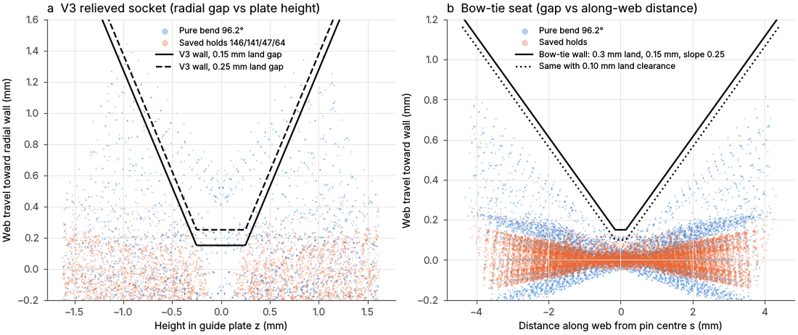

# Retained rotating seat for the M5 ±12 mm guides — stage 1 (Evening, 18 November 2026)

Test 2, stage 1 of the [500 g validation plan](../../../../docs/500g_validation_plan.md#2-check-a-retained-guide-on-the-real-ribs).
Run started **2026-11-18 20:02:32 EST (2026-11-19 01:02:32 UTC)**. Source revision `59ed561` (codex/guide-validation, which fast-forwards `main` at `4e1992e`).
[Evening Report](../../../../reports/daily/Evening_Report_2026_11_18.md) · [Next-run handoff](HANDOFF.md) · [Large-rotation source study](../m5_large_rotation_20261118/README.md)

**Scope.** This is a simulation sizing stage for a physical seat. It works out what cavity and retainer a rotating seat needs. It does not yet contain a CAD part, contact solution, strength check or bench test.

## Questions

1. With the ideal rotating seat from the 18 November study, where does the deformed mounting web move inside the guide socket? Does the existing V3 relieved socket (0.15 or 0.25 mm land gap) leave room for it?
2. Which cavity shape would clear the web, and what running clearance does it need?
3. Which loads must the retainer carry, in which directions? What does the most direct retainer, a pin through the web, do to the web locally?

## Method

All runs use the archived solver in [`../m5_large_rotation_20261118`](../m5_large_rotation_20261118/README.md) without modification. The cases are the rotating-seat (`point`) variant: pure bends of 0.01748791 rad/mm × 96 mm = 96.19° about the 0° and 67.5° axes, plus the saved 500 g records 146, 141, 47 and 64, with prescribed end-disk poses and 16 simultaneous bore forces.

- **Re-run and verification.** The coarse (0.18 mm²) sweeps were re-solved with checkpoints kept, then refined to 0.055 and 0.025 mm² with `refine.py`. The re-run reproduces the archived coarse results to at least 6 significant figures: maximum land force, rotation and distal moment differences are below 3e-8 N·mm. The 0.025 mm² endpoints reproduce the archived `fine_0p025` land forces and rotations, for example record 146 at 15.25 N and 5.03°.
- **Envelope (`seat_envelope.py`).** Every node of the mounting web within the ±1.62 mm socket window has its two shell faces at ±h/2 along the deformed director. They are expressed in the moving guide frame relative to the moving land pivot, then compared with the undeformed web faces. The web crosses the 3.2 mm guide plate at **34.2° from radial** (slope 1.4706 radial per axial). It is 2.667 mm wide radially in the plate plane, 1.500 mm perpendicular to its own axis and 3.0 mm thick. The slope is found by minimising the radial band width, so it is independent of window clipping. Two cavity definitions are scored:
  - **V3 definition** (as in [`verify_socket_land.py`](../../../../cad/lanes_u4m2/guides_v3/verify_socket_land.py)): the radial and tangential gap is `g(z) = g0 + 1.5·max(|z| − 0.25, 0)` as a function of plate height z.
  - **Bow-tie definition**: the perpendicular and tangential gap is `g(s) = c + k·max(|s| − ℓ/2, 0)`, a function of the distance s along the web from the pivot.
- **Pinned seat (`pin_seat.py`).** The same solver and mesh generator are used, except that the 0.5 mm oblique rigid land band is replaced by a **Ø0.6 mm hole** at the same land centre (r = 19.229 mm, z = ±12 mm; 64-segment edge). The hole edge is a rigid ring tied to the same ideal pivot with all three rotations free. This represents a perfectly fitting rigid pin with a spherical rotation release. Unmounted ribs get the same hole with a free rigid insert, as the archived model gave them a free rigid band. The local strain is the peak face principal strain within 2 mm of a land centre on the four mounted ribs.

## Results

### 1. The existing socket shape cannot host a rotating seat

On the 0.025 mm² mesh, the minimum clearance to a V3-type wall is listed below. A negative value means the deformed web reaches the wall.

| Case | V3, 0.15 mm land | V3, 0.25 mm land | Largest radial travel (mm) | Rotation total / out-of-plane tilt (°) |
|---|---:|---:|---:|---:|
| Pure bend, 67.5° axis | −0.551 | −0.451 | 1.366 | 10.44 / 5.83 |
| Pure bend, 0° axis | −0.636 | −0.536 | 1.447 | 10.35 / 5.47 |
| Record 146 | −0.067 | +0.033 | 0.294 | 5.03 / 4.67 |
| Record 141 | −0.068 | +0.032 | 0.284 | 4.83 / 4.72 |
| Record 47 | −0.117 | −0.017 | 0.471 | 4.34 / 3.57 |
| Record 64 | −0.065 | +0.035 | 0.337 | 4.85 / 4.70 |

The cause is geometric. The V3 land is flat in plate height z, but the web crosses the plate at 34°. The 0.5 mm-high land therefore contains web material up to about 1.1 mm from the pivot along the web. When the web rotates in its own plane, those ends swing into the radial walls, even at z ≈ 0, where the land has no relief. The V3 relief was designed for a bonded land, and the bond is then the joint. It is not a seat that can rotate.

### 2. A bow-tie cavity centred on the pivot clears every case

Candidate: **ℓ = 0.3 mm land along the web, c = 0.15 mm running clearance, flare slope k = 0.25 (14°)** on the perpendicular and tangential walls.

| Case | 0.18 mm² | 0.055 mm² | 0.025 mm² | Same, c = 0.10 mm (0.025 mm²) | Same, k = 0.10 (0.025 mm²) |
|---|---:|---:|---:|---:|---:|
| Pure bend, 67.5° axis | +0.045 | +0.040 | +0.038 | −0.012 | −0.224 |
| Pure bend, 0° axis | +0.056 | +0.039 | +0.038 | −0.012 | −0.277 |
| Record 146 | +0.054 | +0.037 | +0.033 | −0.017 | +0.033 |
| Record 141 | +0.053 | +0.036 | +0.032 | −0.018 | +0.032 |
| Record 47 | +0.064 | +0.059 | +0.057 | +0.007 | +0.057 |
| Record 64 | +0.051 | +0.035 | +0.032 | −0.018 | +0.032 |

- The limiting point is always at the land (|s| < 0.15 mm), in the perpendicular direction. Out-of-plane tilt of up to 4.7° in the saved holds (5.8° in pure bend) moves the corners of the 3.0 mm-thick web face by about 1.5 mm × sin(tilt) ≈ 0.12 mm. Running clearance below about 0.12 mm therefore fails, whatever the flare. Crowning the land across the thickness would reduce this demand. That option has not been modelled.
- The flare only matters for the 96° pure bends. These need k ≥ 0.20, while the saved 500 g holds already clear with k = 0.10.
- The minimum clearance changes by 0.016–0.022 mm from the coarse to the middle mesh, and by at most 0.004 mm from the middle to the fine mesh.
- A 0.15 mm running clearance allows the web to translate by up to ±0.15 mm inside the seat. That adds a positional uncertainty of the same order at the guide bores, which the ideal-pivot model does not contain.



[Vector figure](seat_clearance.svg) · [Envelope data](envelope/) · [Summary](summary.json)

### 3. The seat must carry a reversing load along the web

Here the solved guide-on-rib land forces are resolved into the moving guide frame (0.025 mm² mesh).

| Case | Land force (N) | Along web (N) | Perpendicular in plane (N) | Tangential (N) |
|---|---:|---:|---:|---:|
| Pure bend, 67.5° | 24.95 | 24.71 | 3.48 | 3.47 |
| Pure bend, 0° | 18.26 | 17.90 | 3.22 | 4.61 |
| Record 146 | 15.25 | 12.27 | 8.71 | 7.90 |
| Record 141 | 15.40 | 12.24 | 8.80 | 8.01 |
| Record 47 | 5.69 | 5.14 | 2.10 | 4.97 |
| Record 64 | 14.88 | 11.56 | 7.94 | 7.73 |

Each column is an independent maximum over the eight lands. In every case the along-web component appears with both signs across the lands. The bow-tie walls only locate the web perpendicular to its axis and through its thickness, so a slot alone cannot provide this location. The retainer needs a **bidirectional stop along the web**, able to carry about 25 N in the pure bend and 12.3 N in the saved holds, while allowing about 10.4° in-plane rotation and 4.7–5.8° out-of-plane tilt. A cylindrical pin along the rib normal releases only the in-plane rotation. The 17 November linear model found 15 N and 88 N·mm for such a pin. A spherical (crowned) pin seat or an equivalent clearance is required.

### 4. Pinned seat: local effect of a Ø0.6 mm hole

The archived solver was run with the 0.5 mm oblique rigid land band replaced by a Ø0.6 mm hole at the same land centre. The hole edge is a rigid ring tied to the ideal pivot with all rotations free, representing a perfectly fitting pin with a spherical release. All six cases were solved on 0.18, 0.055 and 0.025 mm² meshes, each seeded from the coarser one; all converged with a minimum oriented-area ratio of 0.939 or more.

| Case | Peak strain within 0.6 mm of pin centre, 0.18 / 0.055 / 0.025 mm² | Band-patch reference, peak within 2 mm, same meshes | Land force, pin vs band (N) | Seat rotation, pin vs band (°) |
|---|---|---|---:|---:|
| Pure bend 67.5° | −2.83 / −2.65 / **−2.61%** (hole edge) | −2.75 / −3.18 / −3.74% (band corner) | 24.05 vs 24.95 | 11.29 vs 10.44 |
| Pure bend 0° | −2.58 / −2.41 / **−2.37%** (hole edge) | −3.33 / −3.84 / −4.52% | 17.60 vs 18.26 | 11.38 vs 10.35 |
| Record 146 | −2.70 / −2.68 / **+2.67%** | +4.29 / +5.90 / +7.09% | 14.84 vs 15.25 | 5.18 vs 5.03 |
| Record 141 | −2.76 / −2.74 / **+2.73%** | +4.36 / +6.00 / +7.23% | 14.95 vs 15.40 | 5.25 vs 4.83 |
| Record 47 | −1.52 / −1.43 / **−1.40%** (hole edge) | +1.42 / +2.50 / +2.87% | 5.47 vs 5.69 | 4.44 vs 4.34 |
| Record 64 | −2.46 / −2.44 / **+2.44%** | +3.83 / +5.32 / +6.41% | 14.31 vs 14.88 | 5.31 vs 4.85 |

- **Hole-edge strain converges.** The peak strain within 0.6 mm of the pin changes by at most 0.18 percentage points from the middle to the fine mesh. In the saved holds the change is at most 0.02 points. For records 146, 141 and 64 the reported peak changes sign between meshes while its magnitude agrees within 0.03 points, which means the tensile and compressive extremes there are nearly equal. The band-patch reference has its local peak at the corners of the rigid band (1.77–1.85 mm from the centre). That peak grows with every refinement (4.3 → 5.9 → 7.1% for record 146), which is the signature of a geometric singularity. It is therefore not a valid strength comparison, and the archived ideal seat overstates local strain at those corners.
- Within 2 mm of the centre, the pinned model peaks at 3.8% (records 146, 141 and 64; 0.025 mm²). That point is 1.83 mm from the pin on the web edge at the socket-window line, not at the hole.
- **Whole-module effect is small.** On the 0.025 mm² mesh the 96.19° holding couple is 760.1 N·mm with the pin against 769.1 N·mm with the band seat (−1.2%). The land force falls by 2.7–3.6%. The seat must rotate about 0.85° further in pure bend, and tilt rises to 6.56° in pure bend and 5.28° in the holds.
- **Bow-tie re-check with the pinned states.** The 0.15 mm-clearance candidate keeps positive but thin margins of +0.008 to +0.057 mm. At the land, a **0.20 mm** clearance gives **+0.058 to +0.107 mm** on 0.025 mm² (+0.059 to +0.109 on 0.055 mm²). With a pin, the pin locates all translations, so the larger wall clearance no longer sets rattle in the plane of the rib. Along the pin axis, location still depends on the tangential walls or a pin shoulder.
- Hand check, PA12 at 1,530 MPa: 2.7% linear strain corresponds to about 41 MPa nominal, against the 50 MPa ISO 527 tensile strength quoted for EOS PA 2200 in the [test-1 report](../../../../reports/projects/m5_structure/M5_Joint_Test_2026_11_18.md). This linear-elastic number is only an indicator, not a strength margin. Printed PA12 near a drilled or printed hole in vertical build orientation is unmeasured.

Pinned-seat case files: [`pin_seat/pin_r0p30/`](pin_seat/pin_r0p30/). Band-patch reference strain summaries: [`pin_seat/band_reference/`](pin_seat/band_reference/). Pinned-state envelopes: `envelope/envelope_pin_r0p30_*.json`.

## Limitations

- The rib fixture omits the backbone, the outer ±24 mm stations, body weight, friction and the redistribution of rope tension along the arm. Its poses and loads are prescribed from the saved whole-arm equilibria. See the [source study](../m5_large_rotation_20261118/README.md).
- The seat is an ideal pivot. Clearances are geometric travel of the deformed web relative to the guide, not a contact solution. The walls carry no load in this model. Rattle inside the 0.15 mm running clearance is not simulated.
- The pin model uses a perfectly fitting rigid pin with a spherical release. It has no clearance, pin bending or edge contact. Strain is the linear-elastic shell surface strain. Strength, creep and fatigue of printed PA12 at a hole edge are not established.
- No guide CAD has been generated for the bow-tie seat or the pin. Assembly access, print tolerance and the effect on bore positions remain open.
- Only M5 at ±12 mm was checked. M6 and the ±24 mm stations remain open.

## Reproduction

Python 3.13.18 with numpy 2.3.5, scipy 1.17.0, shapely 2.2.0, trimesh 5.2.0, triangle 20250106, numba 0.68.1, matplotlib 3.10.8, cvxopt 1.3.3, rtree 1.4.1 and networkx 3.7. Use `OPENBLAS_NUM_THREADS=1`. `$W` is a scratch directory. Run the case groups `"bend67.5 bend0"`, `"146 141"` and `"47 64"` in parallel as separate jobs (`$c`, `$n` = group with `_`).

```sh
cd ../m5_large_rotation_20261118
python study.py  --area .18  --step .0625 --variants point --cases $c --cache $W/c18_$n  --out $W/r18_$n
python refine.py --area .055 --variants point --cases $c --seed $W/c18_$n  --cache $W/c055_$n --out $W/r055_$n
python refine.py --area .025 --variants point --cases $c --seed $W/c055_$n --cache $W/c025_$n --out $W/r025_$n
cd ../evening_20261118
python seat_envelope.py --area .18 --cache $W/c18_* --results $W/r18_* --out envelope/envelope_0p18.json
python seat_envelope.py --area .055 --fractions 1.0 --cache $W/c055_* --results $W/r055_* --out envelope/envelope_0p055.json
python seat_envelope.py --area .025 --fractions 1.0 --cache $W/c025_* --results $W/r025_* --out envelope/envelope_0p025.json
python pin_seat.py --area .18  --hole-radius 0.3 --cases $c --cache $W/p18_$n  --out $W/pr18_$n
python pin_seat.py --area .055 --hole-radius 0.3 --cases $c --seed $W/p18_$n  --cache $W/p055_$n --out $W/pr055_$n
python pin_seat.py --area .025 --hole-radius 0.3 --cases $c --seed $W/p055_$n --cache $W/p025_$n --out $W/pr025_$n
python pin_seat.py --area .025 --cases $c --cache $W/c025_$n --out $W/r025_$n --post-only   # band-patch reference strain (repeat for .18/.055)
python seat_envelope.py --hole-radius 0.3 --area .025 --fractions 1.0 --cache $W/p025_* --results $W/pr025_* --out envelope/envelope_pin_r0p30_0p025.json   # and .055
python collect.py && python make_figure.py
```

Folder contents: `seat_envelope.py`, `pin_seat.py`, `collect.py` and `make_figure.py` are the scripts. `envelope/` holds the per-mesh JSON and NPZ point clouds. `pin_seat/` holds the pinned-seat and reference case files plus their summaries. `summary.json` and `run_context.json` hold the reductions and provenance.
