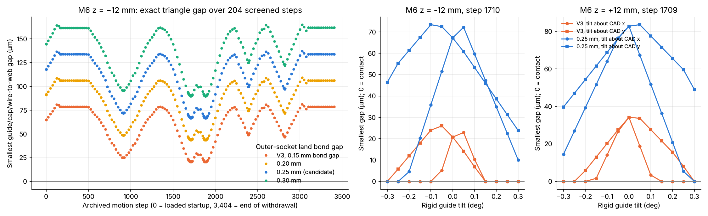

# M6 outer-socket bond gap — 19 November 2026 evening study

**Question.** Round 1 of the extreme tests found the smallest guide/body gap of the 500 g mission at the M6 z = −12 mm guide: **0.020932 mm** on the finest surface at step 1,710, and contact after a 0.025 mm rigid shift. Can a change to the guide CAD alone, keeping the rope bores, guide stations, webs and solver inputs, give a gap that a printed and bonded part can plausibly hold?

**Answer (simulation only).** Widening the radial/tangential gap of the bonded 0.5 mm land in the four M6 outer-web sockets from **0.15 to 0.25 mm** raises the smallest exact triangle gap to **0.06733 mm at z = −12 mm** and **0.08284 mm at z = +12 mm** (fine surface, governing steps). That is 3.2× and 2.4× the V3 values. The candidate stays clear for a rigid guide tilt of **±0.2° about every axis** at both stations. V3 touches at **−0.1°** about CAD x at z = −12 mm. The rope bores, land length, flare, wall thickness and station positions are unchanged. The candidate is in [cad/lanes_u4m2/m6_bond_gap_20261119](../../../../cad/lanes_u4m2/m6_bond_gap_20261119/README.md).

[Evening Report](../../../../reports/daily/Evening_Report_2026_11_19.md) · [Next-run handoff](HANDOFF.md) · [Round-1 M6 check](../extreme_round1_20261119/README.md#m6-guide-to-web-clearance) · [Validation record](results/validation.json)



## Method

The source is `main` at `e285061`. The deformed geometry comes from the archived 500 g yaw/pitch mission: 3,405 equilibrium states covering loaded startup and straightening, insertion, right yaw and return, left yaw and return, pitch up and return, pitch down and return, and withdrawal. No new motion was simulated, and the mission was not re-run (see *Solver inputs*).

`m6_socket_screen.py` follows the round-1 `m6_clearance.py` method. It refines the actual `M6_lane_anchorC.stl` body axially, deforms it with the archived state and checks exact triangle distances with python-fcl. One deformed body per step is checked against every guide variant, so all variants see identical body geometry. The crop window is 0.6 mm around the union of all variant parts, and each reported distance is certified to lie inside it.

| Variant | Outer-land bond gap | Built with | Straight result |
|---|---:|---|---|
| V3 (current) | 0.15 mm | committed `guides_v3` | clear, gap 0.08438 mm |
| g020 | 0.20 mm | `guides_v3/build.py --bond-gap 0.20` | clear, 0.11250 mm |
| **g025 (candidate)** | **0.25 mm** | `--bond-gap 0.25` | clear, 0.14063 mm |
| g030 | 0.30 mm | `--bond-gap 0.30` | clear, 0.16875 mm |
| land 0.3 mm | 0.15 / 0.20 mm | `--land 0.3` (± `--bond-gap 0.20`) | **rejected**: the 0.45 mm lockwire groove splits each cap into two pieces (8 cap bodies per station instead of 4) |
| flare slope 2.0 | 0.15 mm | `--slope 2.0` | gap at step 1,710 identical to V3 (0.020468 mm). The witness lies on the land edge, not on the flare |

**Steps screened (0.5 mm axial span).** For each M6 outer station: the 60 steps with the smallest archived sampled lower bound, the per-phase minimum in all 11 phases, and every 25th step from 0 to 3,404 (plus 3,404). In total, **204 steps at z = −12 mm and 202 at z = +12 mm**, 406 station-steps and 1,648 variant checks. The governing steps were re-checked on the 0.125 mm surface (8,134,290 refined body triangles).

## Results

| Station | Variant | Smallest gap, screened steps (0.5 mm) | Governing step, fine 0.125 mm | Contacts |
|---|---|---:|---:|---:|
| z = −12 mm | V3 | 0.02047 mm (step 1,710) | **0.020932 mm** (1,710), 0.020933 mm (1,885) | 0 |
| | g020 | 0.04361 mm | 0.044137 mm | 0 |
| | **g025** | **0.06676 mm** | **0.06733 mm** | 0 |
| | g030 | 0.08991 mm | 0.090514 mm | 0 |
| z = +12 mm | V3 | 0.03396 mm (step 1,709) | **0.03431 mm** (1,709) | 0 |
| | g020 | 0.05817 mm | 0.058587 mm | 0 |
| | **g025** | **0.08239 mm** | **0.08284 mm** | 0 |
| | g030 | 0.10661 mm | 0.107091 mm | 0 |

- The guide body, not the caps or the lockwire envelope, has the smallest gap in every variant. The witness stays at the land edge (local z = ∓0.25 mm), about 21.2 mm from the axis near the 67.5° web. The closure direction is mostly axial, (−0.177, −0.428, −0.886) in CAD axes.
- In every screened step, the 0.25 mm bond gap adds between 0.0463 and 0.0571 mm to the V3 gap. The two outer stations reach their minima on the left-yaw outward and return passes (steps 1,690–1,726 and 1,868–1,894).
- The V3 fine value reproduces round 1 to 1e-9 mm, and so does the straight gap.

### Angular misalignment (new)

Round 1 checked only rigid translations. `m6_tilt.py` rotates the guide, caps and wire together about the station origin at the governing step (0.25 mm surface), in steps of 0.05° up to ±0.3°.

| Station, step | Axis | V3: contact-free tilt | 0.25 mm candidate: contact-free tilt | Candidate smallest gap within ±0.2° |
|---|---|---|---|---:|
| −12 mm, 1,710 | CAD x | −0.05° to +0.10° | −0.20° to +0.30° | 0.0046 mm |
| | CAD y | −0.25° to +0.10° | −0.30° to +0.30° | 0.0386 mm |
| | CAD z (clocking) | ±0.30° | ±0.30° | 0.0649 mm |
| +12 mm, 1,709 | CAD x | −0.15° to +0.10° | −0.30° to +0.25° | 0.0209 mm |
| | CAD y | −0.20° to +0.25° | −0.30° to +0.30° | 0.0543 mm |
| | CAD z | ±0.30° | ±0.30° | 0.0803 mm |

**Tilt about the plate axes, not translation, uses up most of the gap.** The witness is about 21 mm from the axis, so 0.1° of tilt moves it by roughly 0.037 mm. That exceeds the whole V3 margin at z = −12 mm. With the candidate, a tilt of up to 0.2° remains clear. Whether a bonded PA12 guide can be assembled and held within 0.2° of its nominal plane is a **measurement question**. These are rigid-body sensitivities. They exclude bond deformation, guide bending and as-printed form error.

### Coverage limit

3,201 (z = −12 mm) and 3,203 (z = +12 mm) steps were not checked with exact triangles. In those steps the archived sampled lower bound is at least 0.02116 mm and 0.03340 mm. In the screened steps it differed from the exact 0.5 mm triangle gap by up to 0.0034 mm in either direction, so it is an estimate, not a strict bound. Together with the smallest increase of 0.0463 mm, this suggests the candidate gap in unscreened steps is about 0.064 mm or more. **That is an estimate. A full exact screen was not run**: it would take about 10 CPU-hours at the 0.5 mm span.

## Mounting stiffness, bond and solver inputs

- **Bond.** The bonded land keeps its 0.5 mm length and nominal projected area (5.67 mm² per saddle). A 0.25 mm adhesive layer is thicker, so its shear stiffness, which scales as G·A/t, is about **0.6×** that of the 0.15 mm layer. Over the whole mission the land's largest axial movement relative to the web is 0.0545 mm at z = −12 mm (step 1,709) and 0.0467 mm at z = +12 mm. If the bond carried that movement, its nominal shear strain would fall from **36% to 22%** at z = −12 mm. Both values are far beyond typical rigid-epoxy capability, so a compliant adhesive or a non-bonded retention may still be required. Adhesive selection and coupon tests are open.
- **Solver.** The archived mission models M6 with its homogenised database stiffness and places the guide stations at their ideal rod positions. Guide bond compliance is not in that model. The 17 November rib model found that a rigid bond stiffens M5 by about 10% (EI) and 12% (GJ). The thinner, more compliant bond moves M6 toward the bare homogenised model the mission already uses. It does not move M6 away from it, but this was not quantified for M6. The guide-and-cap mass changes by −0.0047 g and the conservative wire envelope by +0.0031 g, a net **−0.0016 g per station**. That is negligible against the mission mass model, so the archived states remain the applicable deformation input. The rope bores, lanes, anchors and station z positions are unchanged, so the rope lengths and tensions are unchanged.
- **Ferrule.** No backbone end ferrule was added. The payload stays at 500 g.

## Reproduce

Use the round-1 environment (Python 3.11, numpy 2.3.5, scipy 1.17.0, trimesh 5.2.0, python-fcl 0.7.0.10, manifold3d 3.5.5, shapely 2.2.0, matplotlib 3.10.8, clarabel 0.11.1, cvxopt 1.3.3). The [validation record](results/validation.json) lists the exact versions. Run from this folder. Each screen took about 5.5 s per step on one core, and each fine step about 1 min.

```bash
export OPENBLAS_NUM_THREADS=1 OMP_NUM_THREADS=1
V3=../../../../cad/lanes_u4m2/guides_v3; C=../../../../cad/lanes_u4m2/m6_bond_gap_20261119
for g in 20 25 30; do python $V3/build.py --out /tmp/g0$g --bond-gap 0.$g; done
python m6_socket_screen.py --out /tmp/screen.json --variant v3=$V3 g020=/tmp/g020 g025=/tmp/g025 g030=/tmp/g030 \
    --steps-minus 1710 1885 --steps-plus 1709 1885          # step lists: see results/screen/*.json
python m6_socket_screen.py --out results/fine_governing_minus12.json --variant V3=$V3 bond_gap_0p25=$C --steps-minus 1710 1885 --spacing 0.125
python m6_socket_screen.py --out results/fine_governing_plus12.json  --variant V3=$V3 bond_gap_0p25=$C --steps-plus 1709 1885 --spacing 0.125
python m6_tilt.py --out results/tilt_minus12_step1710.json --variant V3=$V3 bond_gap_0p25=$C --station -12 --step 1710 --angles 0.05 0.1 0.15 0.2 0.25 0.3
python m6_tilt.py --out results/tilt_plus12_step1709.json  --variant V3=$V3 bond_gap_0p25=$C --station 12 --step 1709 --angles 0.05 0.1 0.15 0.2 0.25 0.3
python summarize.py   # coverage_screen.csv, coverage_summary.json, m6_socket_gap.png
python validate.py    # results/validation.json
```

Results: [per-step gaps for all variants](results/coverage_screen.csv) · [coverage summary](results/coverage_summary.json) · [raw screens with step lists](results/screen/) · [fine governing checks](results/fine_governing_minus12.json) ([+12 mm](results/fine_governing_plus12.json)) · [tilt sensitivities](results/tilt_minus12_step1710.json) ([+12 mm](results/tilt_plus12_step1709.json))
