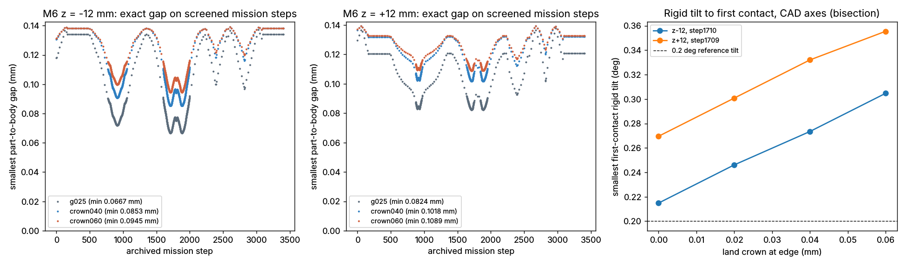

# M6 crowned bond land — 20 November 2026 evening study

**Question.** The 0.25 mm M6 outer-socket candidate clears the nominal body over the full 500 g mission, but rigid tilt of the bonded plate governs its margin. The 19 November grid put first contact at about −0.25° (z = −12 mm), and Round 2 found contact when a 0.025 mm assembly offset was combined with a 0.2° adverse tilt. Can a CAD-only change to the bonded land, keeping the 0.25 mm bond datum, the rope bores, the stations and the solver inputs, raise the tilt tolerance?

**Answer (rigid-CAD simulation only).** Crowning the 0.5 mm land, so that its gap rises quadratically from 0.25 mm at mid-land to 0.25 mm + crown at each edge, moves the land-edge witness away from the deformed web. With a **0.06 mm crown**:

| Quantity | Station, step | 0.25 mm candidate | 0.06 mm crown |
|---|---|---:|---:|
| Exact gap at the governing step (0.25 mm surface) | z = −12 mm, 1,710 | 0.06724 mm | 0.09512 mm |
| | z = +12 mm, 1,709 | 0.08276 mm | 0.10917 mm |
| Smallest first-contact rigid tilt, in-plane axes every 15° (bisection) | z = −12 mm, 1,710 | 0.207° (axis 150°, +) | **0.289°** (axis 165°, +) |
| | z = +12 mm, 1,709 | 0.258° (axis 150°, −) | **0.340°** (axis 150°, −) |
| Smallest gap at 0.2° tilt over those axes (= rigid translation allowance) | z = −12 mm | 0.0013 mm | **0.0290 mm** |
| | z = +12 mm | 0.0176 mm | **0.0443 mm** |
| Mission screen (0.5 mm surface), smallest gap / contacts | z = −12 mm, 787 steps | 0.06674 mm / 0 | **0.09451 mm / 0** |
| | z = +12 mm, 430 steps | 0.08239 mm / 0 | **0.10892 mm / 0** |

The candidate CAD is in [cad/lanes_u4m2/m6_crowned_land_20261120](../../../../cad/lanes_u4m2/m6_crowned_land_20261120/README.md). [Evening Report](../../../../reports/daily/Evening_Report_2026_11_20.md) · [Next-run handoff](HANDOFF.md) · [Previous evening study](../evening_20261119/README.md) · [Validation record](results/validation.json)



## Method

The source revision is `0d914ab` (`origin/codex/guide-validation`, which contains `main` at `ef7e9fb`). No new motion was simulated. The deformed body comes from the archived 3,405-state 500 g mission (loaded startup and straightening, insertion, right yaw and return, left yaw and return, pitch up and return, pitch down and return, withdrawal), read through the round-1 inputs.

1. **CAD.** `guides_v2/build.py` gained an optional `socket_land_crown_mm` design key, and `guides_v3/build.py` a `--crown` option. With crown 0 (the default) the builders add no sections and produce the committed 0.25 mm candidate with identical vertices and volumes (checked in `validate.py`). With a crown, three extra sections per half-land resolve the quadratic profile. Variants 0.02, 0.04 and 0.06 mm were built at bond gap 0.25 mm. All are single closed guide bodies with four closed caps and four wire envelopes and zero straight overlap.
2. **Tilt.** `m6_tilt.py` (19 November) swept a 0.05° grid to ±0.5°. The new `tilt_bisect.py` bisects the first-contact rigid tilt about each CAD axis and sign, and optionally about in-plane axes every 15°, to 1/256 of 1° (0.0039°) on the same 0.25 mm axially refined, deformed M6 body at the governing steps (z = −12 mm step 1,710; z = +12 mm step 1,709). Guide, caps and wire rotate together about the station origin. It also records the exact gap at ±0.2°, which equals the largest rigid translation in any direction that stays contact-free at that tilt.
3. **Mission screen.** `m6_socket_screen.py` (19 November, unchanged) checked the uncrowned candidate and the 0.04 and 0.06 mm crowns against the same deformed body at every step of the 19 November screen and closure sets: 787 steps at z = −12 mm and 430 at z = +12 mm, all 11 phases, including every step whose archived sampled bound is below 0.040 mm. The crown also moves the caps outward, so the caps were checked rather than assumed.

## Results

**Mission screen.** No variant contacts the body at any of the 787 (z = −12 mm) and 430 (z = +12 mm) screened steps, which cover all 11 phases. The uncrowned values reproduce the 19 November closure minima exactly (0.06674 and 0.08239 mm at step 1,709). Every part was checked: guide, caps and wire envelope.

| Station | Variant | Smallest gap (step) | Gain over uncrowned, min–max | Smallest cap gap | Contacts |
|---|---|---|---|---:|---:|
| z = −12 mm | 0.25 mm (uncrowned) | 0.06674 mm (1,709) | — | 0.08530 mm | 0 |
| | 0.04 mm crown | 0.08525 mm (1,709) | 0.0016–0.0198 mm | 0.10500 mm | 0 |
| | **0.06 mm crown** | **0.09451 mm (1,709)** | 0.0016–0.0281 mm | 0.11093 mm | 0 |
| z = +12 mm | 0.25 mm (uncrowned) | 0.08239 mm (1,709) | — | 0.08920 mm | 0 |
| | 0.04 mm crown | 0.10177 mm (1,709) | 0.0012–0.0198 mm | 0.10900 mm | 0 |
| | **0.06 mm crown** | **0.10892 mm (1,709)** | 0.0012–0.0265 mm | 0.11392 mm | 0 |

The crown never reduced a gap. The gain is smallest (about 0.001–0.002 mm) at steps where the witness lies near mid-land, where the 0.25 mm datum is kept, and largest where it lies on the land edge, which includes the governing left-yaw steps. The straight (undeformed) gap stays 0.1406 mm, set by the mid-land datum. The guide body remains the governing part; the caps, which move outward with the crown, gain clearance. [Per-step gaps](results/screen_steps.csv) · [Summary](results/summary.json)

**Tilt about sampled in-plane axes.** Axes in the plate (CAD x–y) plane were sampled every 15° from CAD x toward CAD y, in both senses (`--inplane`), for the uncrowned part and the 0.06 mm crown. The worst axes lie 150–165° from CAD x, close to but not on CAD x. The table above gives their minima. A finer axis spacing could lower these minima slightly. [In-plane bisection](results/tilt/inplane_zm12_step1710.json) ([+12 mm](results/tilt/inplane_zp12_step1709.json))

**Tilt about the CAD axes.** About CAD x each 0.02 mm of crown adds about 0.03° of first-contact tilt at both stations. About CAD y and z the first contact moves from ±0.47°/±0.68° to ±0.49°/±0.70° with any crown, and does not change further between 0.02 and 0.06 mm. `plateau_probe.py` identifies the limit: with a crown, the witness about y and z moves to the **mid-land side wall** of another web socket (z = 0 to ±0.17 mm, radius 20.6–20.9 mm), where the 0.25 mm bond datum is deliberately kept. Pure clocking (CAD z) is therefore limited at about 0.25 mm / 20.6 mm ≈ 0.69°, independent of crown. The x+ limit at z = −12 mm and the x− limit at z = +12 mm are set by a **cap** (radius 17.3–17.5 mm), not the guide land. [Grid](results/tilt/) · [Bisection](results/tilt/bisect_zm12_step1710.json) ([+12 mm](results/tilt/bisect_zp12_step1709.json)) · [Limiting feature](results/tilt/plateau_zm12_step1710.json) ([+12 mm](results/tilt/plateau_zp12_step1709.json))

| Crown (mm) | z = −12 mm first contact, x− / x+ (°) | z = +12 mm first contact, x− / x+ (°) | Gap at 0.2°, −12 / +12 mm (mm) |
|---:|---|---|---|
| 0 | −0.215 / +0.344 | −0.359 / +0.270 | 0.0046 / 0.0209 |
| 0.02 | −0.246 / +0.383 | −0.402 / +0.301 | 0.0138 / 0.0305 |
| 0.04 | −0.273 / +0.422 | −0.438 / +0.332 | 0.0230 / 0.0402 |
| 0.06 | −0.305 / +0.441 | −0.453 / +0.355 | 0.0323 / 0.0475 |

The 0.04 mm crown does not clear the Round 2 combined probe (0.025 mm offset with 0.2° tilt) at z = −12 mm: its CAD-x allowance alone is 0.0230 mm. The 0.06 mm crown does at both stations, also over the sampled in-plane axes (0.0290 and 0.0443 mm). The 0.06 mm crown was therefore selected. Larger crowns were not tested.

## Mounting stiffness, bond and solver inputs

- **Bond layer.** The mid-land datum stays at 0.25 mm. The layer is 0.31 mm thick at each land edge and 0.27 mm on average. For a uniform-shear layer, the stiffness ∫G/t dz falls to 0.930 of the uncrowned value. Bond area is unchanged (5.67 mm² nominal per saddle). The nominal shear strain for the 0.0545 mm worst land movement is 22% at mid-land and 18% at the edge. These remain far beyond typical rigid-epoxy capability, so the 19 November conclusion stands: a compliant adhesive or a non-bonded retention may be needed.
- **Edge stress.** A layer that thickens toward its ends usually lowers the end peak of the shear traction. Round 2's trial linear pad traction peaked at 63.96 MPa at a single point. This run did not recompute the tractions, so no reduction is claimed.
- **Solver.** The archived mission and the Round 2 support model both place the guide at its ideal rod position. The stiffness change (≈7%) lies inside the 500–1,500 MPa adhesive-modulus bracket of Round 2. The rope bores, lanes, anchors and station positions are unchanged (17/17 sections per station), and the mass changes by −0.0021 g per station, so the archived rope lengths and tensions remain applicable.
- **Rigid model.** The tilt is rigid-body. Bond deformation, guide bending and as-printed form error are excluded. Whether a 0.06 mm crown on a 0.5 mm land can be printed in PA12 is doubtful; see the [CAD README](../../../../cad/lanes_u4m2/m6_crowned_land_20261120/README.md).
- **Ferrule and payload.** No backbone end ferrule was added. The head payload remains 500 g.

## Reproduce

Python 3.11.18 with numpy 2.3.5, scipy 1.17.0, trimesh 5.2.0, python-fcl 0.7.0.10, manifold3d 3.5.5, shapely 2.2.0, matplotlib 3.10.8, numba 0.68.1, vtk 9.7.2 (exact versions in [validation.json](results/validation.json)). Run on 4 cores, about 5 s per step per core for three variants; each bisection about 20 s per variant.

```bash
export OPENBLAS_NUM_THREADS=1 OMP_NUM_THREADS=1
V3=../../../../cad/lanes_u4m2/guides_v3
for c in 0 0.02 0.04 0.06; do python $V3/build.py --out /tmp/c$c --bond-gap 0.25 --crown $c; done
V="g025=/tmp/c0 crown020=/tmp/c0.02 crown040=/tmp/c0.04 crown060=/tmp/c0.06"
python tilt_bisect.py --out results/tilt/bisect_zm12_step1710.json --station -12 --step 1710 --variant $V
python tilt_bisect.py --out results/tilt/bisect_zp12_step1709.json --station 12 --step 1709 --variant $V
python tilt_bisect.py --out results/tilt/inplane_zm12_step1710.json --station -12 --step 1710 \
    --variant g025=/tmp/c0 crown060=/tmp/c0.06 --inplane 15 30 45 60 75 105 120 135 150 165   # and +12 mm, step 1709
python plateau_probe.py --bisect results/tilt/bisect_zm12_step1710.json --variant g025=/tmp/c0 crown060=/tmp/c0.06 \
    --out results/tilt/plateau_zm12_step1710.json      # and the +12 mm bisection
cd ../evening_20261119
python m6_tilt.py --out ../evening_20261120/results/tilt/tilt_zm12_step1710.json --station -12 --step 1710 \
    --angles 0.05 0.1 0.15 0.2 0.25 0.3 0.35 0.4 0.5 --variant $V          # and --station 12 --step 1709
# mission screen: the 787/430 steps of results/screen/*.json and results/closure/*.json, in 4 shards
python m6_socket_screen.py --out ../evening_20261120/results/screen/shard0.json \
    --variant g025=/tmp/c0 crown040=/tmp/c0.04 crown060=/tmp/c0.06 --steps-minus ... --steps-plus ...
cd ../evening_20261120 && python summarize.py && python validate.py
```

The exact step list of each shard is stored in its JSON rows. Results: [per-step gaps](results/screen_steps.csv) · [summary](results/summary.json) · [raw shards](results/screen/) · [run times and revisions](results/run_context.json)
