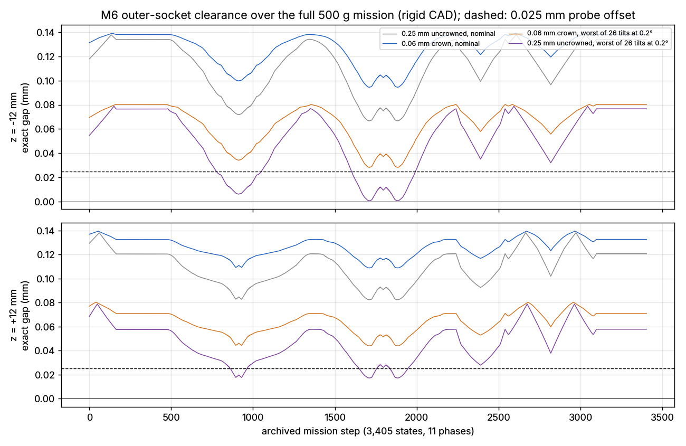

# Crowned M6 land: full-mission certification, nominal and tilted (21 November 2026 evening)

**Question.** The 20 November evening run proposed a 0.06 mm crown on the 0.25 mm M6 outer-socket bond land. It screened the crowned land on only 787 (z = −12 mm) and 430 (z = +12 mm) low-margin steps, and it checked rigid plate tilt only at the two governing left-yaw steps. Does the crowned candidate clear the deformed M6 body at **every** archived mission step? Does the Round 2 assembly probe (0.025 mm offset combined with 0.2° adverse tilt) stay clear at every step, or only at the governing ones?

**Answer (rigid CAD simulation only).** Yes to both, within this rigid model.

| Check over all 3,405 archived steps (2,796 exactly unique M6 shapes), 11 phases, per station | 0.25 mm uncrowned | 0.06 mm crown |
|---|---:|---:|
| Nominal exact gap: minimum (step), z = −12 mm | 0.06674 mm (1,709) | **0.09451 mm (1,709)** |
| Nominal exact gap: minimum (step), z = +12 mm | 0.08239 mm (1,709) | **0.10892 mm (1,709)** |
| Nominal contacts, both stations | 0 | **0** |
| Worst of 26 rigid tilts at 0.2°: minimum gap (step, axis), z = −12 mm | 0.00070 mm (1,709, in-plane 165° +) | **0.02829 mm** (1,709, in-plane 165° +) |
| Worst of 26 rigid tilts at 0.2°: minimum gap (step, axis), z = +12 mm | 0.01719 mm (1,709, in-plane 165° −) | **0.04400 mm** (1,709, in-plane 165° −) |
| Steps whose 0.2° tilted gap is below the 0.025 mm probe offset, z = −12 / +12 mm | **665 / 317** (right and left yaw out and return) | **0 / 0** |
| Contacts at 0.2° tilt | 0 | 0 |

The governing step found by the targeted 20 November study (left yaw, step 1,709/1,710) is also the global minimum over the whole mission, for both the nominal and the tilted checks. The crown never reduced a gap of any part at any step. Its tilted gain is 0.0010–0.0281 mm (z = −12 mm) and 0.0010–0.0268 mm (z = +12 mm).

The uncrowned rerun reproduces the archived Round 2 all-step table **exactly** (maximum difference 0.0 mm for every part and step). The crowned nominal values match the 20 November screen to within its 10⁻⁶ mm CSV rounding at all 1,217 screened steps.



[Evening Report](../../../../reports/daily/Evening_Report_2026_11_21.md) · [Next-run handoff](HANDOFF.md) · [Previous study (20 Nov evening)](../evening_20261120/README.md) · [Crowned-land CAD](../../../../cad/lanes_u4m2/m6_crowned_land_20261120/README.md) · [Summary](results/summary.json) · [Validation](results/validation.json)

## Larger tilts (crowned candidate)

The same 26-tilt check was repeated for the crowned candidate at 0.25° and 0.30°, again over all 3,405 steps at both stations. It brackets the first-contact tilt across the mission, not only at the governing step.

| Tilt | z = −12 mm: minimum gap (step, axis) | steps < 0.025 mm | contacts | z = +12 mm: minimum gap (step, axis) | steps < 0.025 mm | contacts |
|---:|---|---:|---:|---|---:|---:|
| 0.20° | 0.02829 mm (1,709, 165° +) | 0 | 0 | 0.04400 mm (1,709, 165° −) | 0 | 0 |
| 0.25° | 0.01171 mm (1,709, 165° +) | 463 | 0 | 0.02775 mm (1,709, 165° −) | 0 | 0 |
| 0.30° | **0** (1,674, 150° +) | 816 | **138** (left yaw out and return, steps 1,674–1,921) | 0.01149 mm (1,709, 165° −) | 804 | 0 |

At z = −12 mm, the 0.30° contacts all occur in the left-yaw excursion and its return, about in-plane axes 150° (124 steps) and 165° (14 steps). This agrees with the 20 November bisection at step 1,710 (first contact 0.289°, axis 165°). Within this rigid model, the mission-wide crowned tolerance is therefore:

- **≤ 0.2° tilt with ≤ 0.028 mm offset at both stations.** This clears the Round 2 0.025 mm + 0.2° probe at every step.
- **0.25° tilt only with an offset ≤ 0.0117 mm at z = −12 mm.**
- **First contact between 0.25° and 0.30° at z = −12 mm**, during left yaw.

z = +12 mm stays contact-free at 0.30°. Axes were sampled every 15°; a finer axis spacing could lower these minima slightly ([handoff](HANDOFF.md) item 3).

## Method

Source revision: `5919f10` (`origin/main`, PR #41), which contains the 20 November evening work. No new motion was simulated. The deformed M6 body comes from the archived 3,405-state 500 g mission: loaded startup and straightening → insertion → right yaw excursion and return → left yaw excursion and return → pitch up and return → pitch down and return → withdrawal. It is read through the Round 1/Round 2 inputs. The CAD is the committed [crowned-land candidate](../../../../cad/lanes_u4m2/m6_crowned_land_20261120/README.md); its six STL hashes are checked against the 20 November validation record.

1. **Nominal, every step** (`full_mission.py`). This applies the Round 2 all-step method of [`m6_full.py`](../../extreme_tests/round2_20261119/m6_full.py) without change. The actual M6 body STL is refined to a 0.5 mm axial edge span. A certified swept crop keeps every triangle that could come within 0.6 mm of any part at any archived strain state. The map is affine per exactly unique final-module strain. FCL then computes exact triangle collision and distance for the guide, the four caps and the wire envelope. Only the CAD folder and the output location are parameters. Each run took 84–124 s on one core.
2. **Rigid tilt, every step** (`tilt_mission.py`). For every unique shape, the guide, caps and wire envelope rotate together about the station origin by ±0.2°. The rotation axes are 12 in-plane axes spaced every 15° from CAD x toward CAD y (0° = CAD x, 90° = CAD y) and CAD z, giving 26 tilts. These are the axes of the 20 November bisection. The crop is rebuilt from the union of all tilted parts, so it remains certified. Each exact gap at a tilt equals the largest rigid translation, in any direction, that stays contact-free at that tilt. A part is skipped for one tilt only when the rigorous bound gap_nominal − r_max·θ (r_max = 30.79 mm) shows that it cannot be the minimum. About 36% of the part queries were skipped this way. The run used four shards (two per station), each taking 4–6 min.
3. **Cross-checks.** At step 1,709/1,710, z = −12 mm, the 0.2° tilted gap is 0.02829 mm here at 0.5 mm refinement, compared with 0.0290 mm from the 20 November bisection at 0.25 mm refinement. The axis is the same (in-plane 165°, +). The coarser surface is therefore slightly conservative here ([check](results/tilt/check_crown060_zm12.json)).

## Mounting stiffness, guide position and solver inputs

- No CAD, guide position, rope bore, station, mass or solver input changed in this run. The archived mission places each guide at its ideal rod position, and the tilt is a rigid assembly error applied **only** to the clearance check. A 0.2° tilt moves the rope bores by at most about 0.07 mm at a 20 mm radius. This run did not propagate that motion into the rope lengths or tensions.
- Bond-layer compliance, guide bending, as-printed form error, and the tractions in the non-uniform (0.25–0.31 mm) crowned layer are **not** included. The Round 2 support model witness motion (0.0028 mm, uniform layer) is far below the 0.0283 mm tilt allowance, but it has not been recomputed for the crowned layer (handoff item 2).
- The result is a rigid CAD clearance certification, not a manufacturing release. Whether a 0.06 mm crown can be produced on a 0.5 mm PA12 land is unmeasured.
- No backbone end ferrule was added. The head payload remains 500 g.

## Reproduce

Python 3.11.18, numpy 2.3.5, scipy 1.17.0, trimesh 5.2.0, python-fcl 0.7.0.10, pandas 3.1.1, matplotlib 3.10.8, numba 0.68.1, clarabel 0.11.1 (needed by the imported shared-bore module). Exact versions are in [validation.json](results/validation.json). The run used 4 cores, less than 1 GB per process.

```bash
export OPENBLAS_NUM_THREADS=1 OMP_NUM_THREADS=1
C=../../../../cad/lanes_u4m2
for s in -12 12; do
  python full_mission.py --candidate $C/m6_crowned_land_20261120 --name crown060 --stations $s
  python full_mission.py --candidate $C/m6_bond_gap_20261119   --name g025     --stations $s
  for k in 0 1; do
    python tilt_mission.py --candidate $C/m6_crowned_land_20261120 --name crown060 --station $s \
        --shard $k --nshards 2 --out results/tilt/crown060_z${s}_shard$k.json
    python tilt_mission.py --candidate $C/m6_bond_gap_20261119 --name g025 --station $s \
        --shard $k --nshards 2 --out results/tilt/g025_z${s}_shard$k.json
    for a in 025 030; do python tilt_mission.py --candidate $C/m6_crowned_land_20261120 \
        --name crown060_a$a --angle 0.${a#0} --station $s --shard $k --nshards 2 \
        --out results/tilt/crown060_a${a}_z${s}_shard$k.json; done
  done
done
python tilt_mission.py --candidate $C/m6_crowned_land_20261120 --name crown060 --station -12 \
    --steps 1709 1710 --out results/tilt/check_crown060_zm12.json
gzip -9 results/tilt/*_shard*.json   # shards are archived compressed
python summarize.py && python validate.py
```

Results: [nominal per-step tables](results/full/) · [tilted per-step tables](results/) (`tilt_steps_*.csv.gz`, one column per tilt) · [raw shards](results/tilt/) · [logs](results/logs/) · [summary](results/summary.json)
