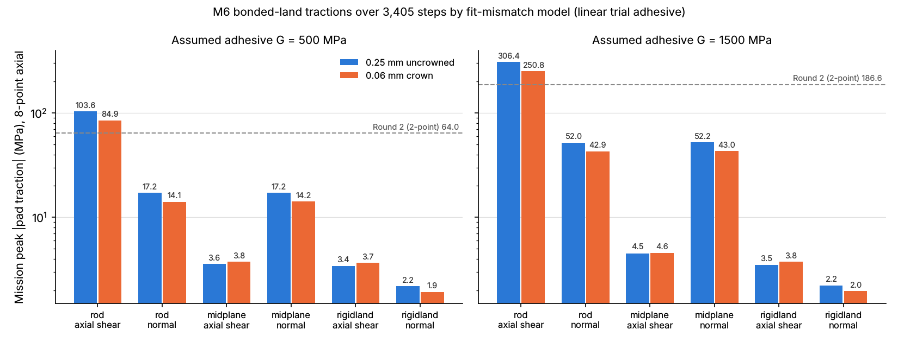

# M6 crowned bond layer: tractions, witness motion and bond-motion + tilt clearance — evening, 22 November 2026

[Evening Report](../../../../reports/daily/Evening_Report_2026_11_22.md) · [Next-run handoff](HANDOFF.md) · [Previous study (21 Nov evening)](../evening_20261121/README.md) · [Round 2 bonded-land model](../../extreme_tests/round2_20261119/README.md) · [Crowned-land CAD](../../../../cad/lanes_u4m2/m6_crowned_land_20261120/README.md)

Handoff item 2 of the [21 November evening run](../evening_20261121/HANDOFF.md). Simulation only. No CAD, guide position, rope bore, station, mass or solver input changed. The head payload stays 500 g, U4+M2 is kept, and no backbone end ferrule was added.

## What was done

1. **Variable-thickness bond model** ([`crowned_bond.py`](crowned_bond.py)). This reuses the Round 2 bonded-land structure ([`m6_support.py`](../../extreme_tests/round2_20261119/m6_support.py): eight condensed CAD rib plates, two rigid guide plates and four side-wall pads per seat). The only changes are:
   - an axial Gauss order `nh` of 2, 4 or 8 over the 0.5 mm land (Round 2 used 2);
   - a layer thickness at each point of t(z) = 0.25 + crown·(z/0.25)² mm, so the crowned layer is 0.25 mm at mid-land, 0.31 mm at the edges, with an area mean of 0.27 mm;
   - three fit-mismatch models (below).

   Both station wrenches and the mismatch act together, and the incremental disk motion stays fixed, as in Round 2. The shear modulus G is **assumed** at 500 or 1,500 MPa (ν = 0.35), not measured.
2. **Governing steps** 1,709, 1,710 and 1,885, both stations: land wrenches, peak and area-mean pad tractions, the guide's motion relative to its witness web, and the guide-to-web rotation ([`bond_cases.json`](results/bond_cases.json), 216 rows).
3. **Mission envelope** of pad tractions over all 3,405 archived steps (generalised Round 2 `duty.bond_duty`) ([`bond_duty_nh2-8.json`](results/bond_duty_nh2-8.json), [`rigidland/bond_duty_nh2-8.json`](results/rigidland/bond_duty_nh2-8.json)).
4. **Bond motion plus 0.2° tilt, exact CAD gap** ([`bond_tilt_probe.py`](bond_tilt_probe.py)). The bond-model guide motion relative to its witness web is applied with the Round 2 local-probe transform. The same 26 rigid tilts as the 21 November full-mission check are then added on top. The model uses the actual M6 body with 0.5 mm axial refinement, a certified swept crop and exact FCL distance ([`bond_tilt_probe_z-12.json`](results/bond_tilt_probe_z-12.json), [`bond_tilt_probe_z12.json`](results/bond_tilt_probe_z12.json)).

### Fit-mismatch models

| Model | Meaning |
|---|---|
| `rod` | Round 2 unchanged. The homogenised rod map is evaluated at every bond point, so the rod's smeared axial and shear strain is imposed **inside** the 0.5 mm PA12 land. |
| `midplane` | The axial component is taken at the land mid-plane, so the web is axially inextensible over the land. Transverse variation is kept. |
| `rigidland` | Each land follows the least-squares rigid motion of the `rod` field over its own footprint. Only land-to-land incompatibility and the station wrenches load the bond. |

## Results

### Diagnosis of the Round 2 traction (step 1,709, z = −12 mm, G = 500 MPa, nh = 8, uncrowned)

| Load case | Peak axial shear | Mean axial shear | Peak normal (step 1,114, `midplane` mismatch) |
|---|---:|---:|---:|
| Station wrenches only | 3.12 MPa | 1.79 MPa | 1.12 MPa |
| Mismatch only | 103.04 MPa (`rod`) | 30.54 MPa (`rod`) | 17.51 MPa |
| Both | 103.53 MPa | 30.75 MPa | 17.21 MPa |

- About 97% of the Round 2 bond traction comes from imposed kinematics, not from transmitted load.
- The `rod` mismatch differs by up to ±0.027 mm axially between the two Gauss points (0.29 mm apart) of the 247.5° land. That is about **18% axial strain inside a solid PA12 web**. It is the smeared strain of the compliant cells, not a strain the web can carry.
- The traction field is linear across the land, so the peak grows with axial sampling: 63.96 (2 points), 93.3 (4 points), 103.6 MPa (8 points). The archived 63.96 MPa is the value at the 2-point Gauss station (z = ±0.144 mm), not the land-edge value.

### Mission envelope, all 3,405 steps (peak |traction|, MPa, nh = 8; Round 2 nh = 2 in brackets)

| Model, G | Uncrowned axial shear | Crowned axial shear | Uncrowned normal | Crowned normal |
|---|---:|---:|---:|---:|
| `rod`, 500 | 103.6 (63.96) | 84.9 (59.4) | 17.2 (9.5) | 14.1 (8.9) |
| `rod`, 1,500 | 306.4 (186.6) | 250.8 (173.0) | 52.0 (27.2) | 42.9 (25.3) |
| `midplane`, 500 | 3.6 | 3.8 | 17.2 | 14.2 |
| `midplane`, 1,500 | 4.5 | 4.6 | 52.2 | 43.0 |
| `rigidland`, 500 | 3.4 | 3.7 | 2.2 | 1.9 |
| `rigidland`, 1,500 | 3.5 | 3.8 | 2.2 | 2.0 |

- **Kinematic peaks** (`rod`, and the `midplane` normal component) scale with G/t. The crown lowers them by about 18%, matching the edge thickness ratio of 0.25/0.305.
- **Load-driven tractions** (`rigidland`) are 2–4 MPa and almost independent of G. The crown raises the axial-shear peak slightly, by about 7% (3.44 → 3.67 MPa), because load concentrates at the thinner mid-land.



### Witness motion and rotation (governing steps, all three models)

- The guide moves 0.0013–0.0029 mm relative to its witness web, with a normal closure between −0.0021 and +0.0017 mm.
- The guide-to-web rotation is 0.054–0.067° at G = 500 MPa and 0.016–0.024° at 1,500 MPa.
- The crown raises the rotation by about 0.004°.
- Neither quantity changes materially between the mismatch models.

### Bond motion plus 0.2° tilt, exact CAD gap (worst of 26 tilts, steps 1,709/1,710/1,885, both G, all models)

| Station | Variant | Ideal position + 0.2° (21 Nov reference) | Bond motion + 0.2°, worst case | Bond motion, no tilt |
|---|---|---:|---:|---:|
| z = −12 mm | 0.25 mm uncrowned | 0.00070 | 0.00074 (`midplane`, G 1,500) | 0.06677 |
| | **0.06 mm crown** | 0.02829 | **0.02839** (`midplane`, G 1,500, step 1,709, 165° +) | 0.09461 |
| z = +12 mm | 0.25 mm uncrowned | 0.01719 | 0.01554 (`rigidland`, G 1,500) | 0.08074 |
| | **0.06 mm crown** | 0.04400 | **0.04237** (`rigidland`, G 1,500, step 1,885, 165° −) | 0.10729 |

The modelled bond motion changes the tilted allowance by −0.0016 to +0.0008 mm. **At the three governing steps the crowned land stays above the 0.025 mm probe offset with the bond motion included.** The uncrowned land still fails the probe. The ideal-position rows reproduce the 21 November full-mission tilt values at these steps (difference < 10⁻⁵ mm).

## Limits

- The adhesive modulus, thickness control and strength are unmeasured. The tractions are a linear trial, not a strength verdict. No adhesive failure law, nonlinearity or creep is modelled.
- The three mismatch models bracket rather than determine the real web strain at the land. Which one applies needs a local solid model of the M6 rib or a bench strain or offset measurement. The `rod` model is very likely conservative: it imposes about 18% axial strain inside a solid web.
- The bond-plus-tilt probe covers only the three governing steps, not the full mission. The bond motion is a small-displacement increment about the ideal pose, and it is not fed back into rope lengths or tensions.
- Only the witness web's motion is applied to the CAD. Other webs can move differently, as in Round 2.

## Reproduce

Python 3.11.18, numpy 2.3.5, scipy 1.17.0, trimesh 5.2.0, python-fcl 0.7.0.10, clarabel 0.11.1, vtk 9.7.2, shapely, triangle, manifold3d, networkx, pillow 13.0.0, matplotlib 3.10.8. Source revision `88f7dcc`.

```
python crowned_bond.py cases                                      # 216 rows, ~25 s
python crowned_bond.py duty --nh 2 8 --mismatch rod midplane      # ~4 min
python crowned_bond.py duty --nh 2 8 --mismatch rigidland --out results/rigidland   # ~2 min
python bond_tilt_probe.py --station -12 --out results/bond_tilt_probe_z-12.json   # ~5 min
python bond_tilt_probe.py --station 12  --out results/bond_tilt_probe_z12.json
python summarize.py && python validate.py
```

The default `duty` call runs all three models. This run ran `rod`/`midplane` and `rigidland` separately, because `rigidland` was added after the first diagnosis. Logs are in [`results/logs/`](results/logs/).
