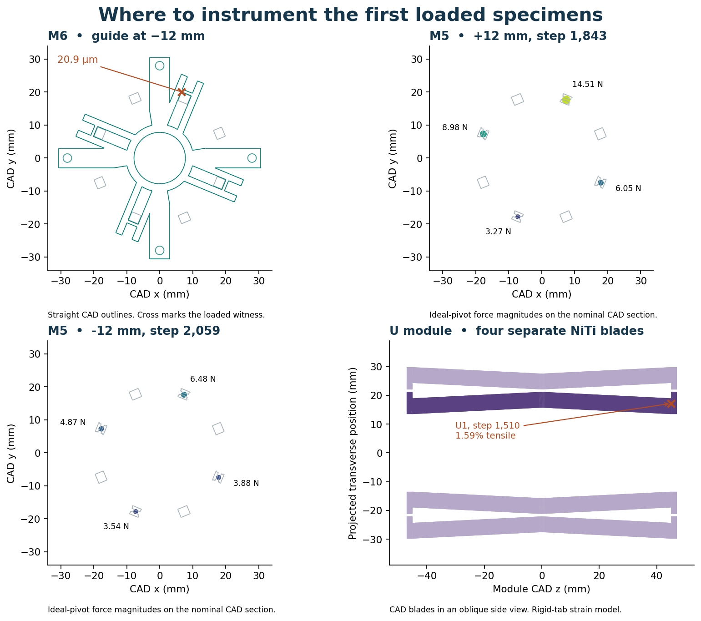
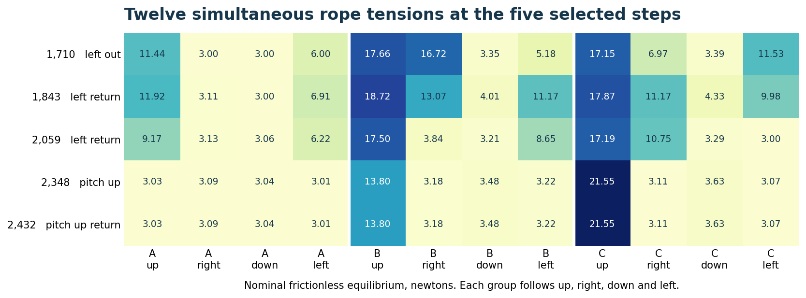

# Extreme tests, round 1 — 500 g U4+M2

Three observations determine the next bench setup. At M6, a 0.025 mm rigid offset toward the nearest web produced triangle contact at an executed left-turn pose. On the return through +69° pitch a directional sliding model lost the 2.5 N distal tension floor between friction coefficients 0.16 and 0.17, with pointing error still under 1°. In the U module the fully clamped blade model put its highest longitudinal strain at a bonded-seat transition. These are numerical results on the current geometry. This round establishes bench positions and loads. Breaking loads, fatigue lives and hardware safety factors remain open.

[Full extreme-test programme](../../../../nextstep/README.md) · [19 November mission and controller](../cycle_closeout_20261119/README.md) · [Numerical checks, source hashes and versions](results/validation.json)



## Coverage and nominal loads

The source is [main at 89b32a9](https://github.com/KevinQianjin/ASRC_snake_body_design/tree/89b32a97c40b39ec5a988f716d2a5e70a262dc21). The head and adapter total 500 g. All 3,405 archived equilibrium states were screened across startup, insertion, ±175° yaw, ±90° pitch, the returns and withdrawal. We checked 40,860 rope readings against the controller arrays, summed every simultaneous per-hole wrench and compared all 27,240 station results with the archived CSV. We also ranked 20,430 fixed-guide sample bounds and 163,440 cell curvatures. The new structural and friction solves below use selected motion steps.

| Motion step | Phase and reference | Reason for selection |
|---:|---|---|
| 1,710 | Left outward, −155.625° yaw | M6 at −12 mm had the smallest local sampled clearance bound. Check full triangles here. |
| 1,843 | Left return, −167.27° yaw | M5 +12 mm had the highest station force, **27.635 N** with **19.13 N·mm** at that step. |
| 2,059 | Left return, −90° yaw | M5 −12 mm had the highest station moment, **61.368 N·mm** with **11.20 N** at that step. |
| 2,348 and 2,432 | +69° pitch outward and return | Both have C-up at **21.554 N** in the nominal calculation. The saved feedforward substeps have opposite C-up winch motion. |

The tightest allowance-adjusted body/tank gap remains 8.056 mm at step 814. Peak cell bending curvature was 0.017465 rad/mm of deformed length in M5 cell 5 at step 1,796. These occur at different steps from the weakest local guide gap. Step zero is the loaded pre-control state. [Global and per-phase rankings](results/phase_extremes.csv) · [Five complete poses, twelve tensions and commanded and geometric lengths](results/five_step_poses_and_ropes.csv) · [Signed per-station wrenches](results/five_step_station_wrenches.csv) · [Individual hole loads](results/five_step_hole_wrenches.csv)



## M6 guide-to-web clearance

At step 1,710 we translated the rigid guide, four caps and wire envelopes together relative to the **already bent** M6 surface. The unperturbed bent model and a separate straight CAD assembly were checked first. Axial refinement subdivides the actual STL before the archived eight-cell deformation is applied. Every source body triangle contributes to the refinement. We discard a deformed triangle only when its box lies outside the component boxes padded by 0.6 mm. Every reported nearest distance plus the applied coordinate shift stays within that bound.

| Geometry | Guide to body | Caps to body | Wire envelopes to body |
|---|---:|---:|---:|
| Straight CAD, nominal registration | 0.084376 mm | 0.084377 mm | 0.206877 mm |
| Bent, maximum axial edge span 0.50 mm | 0.020468 mm | 0.036032 mm | 0.136730 mm |
| Bent, 0.25 mm | 0.020778 mm | 0.035431 mm | 0.137155 mm |
| Bent, 0.125 mm | **0.020932 mm** | 0.035372 mm | 0.137269 mm |

On the finest surface the guide witness is at local CAD (6.681, 20.049, −0.250) mm. The unit vector from that point toward the body is (−0.178, −0.430, −0.885). Along it, **0.020832 mm was clear and 0.021032 mm produced intersection**. At 0.025 mm the guide also touches for a shift in negative CAD z, but remains clear for that magnitude along either CAD x direction. Nominal clearance decreased about 75% from straight to bent. An arbitrary rigid translation smaller than the nominal nearest distance cannot close this particular gap. Equal adverse surface displacements of about 0.0105 mm each would exhaust it if they add along the closing direction. That is a tolerance budget to measure on the assembly. It excludes bond deformation, support flexibility, angular misalignment and part-to-part variability. The finest check refined 8,134,290 body triangles. [All translation directions, component gaps and contact flags](results/m6_clearance.json) · [Archived 0.50 mm whole-body comparison](../cycle_closeout_20261119/results/yaw_pitch/solid_motion_0p5.json)

## M5 rotating-seat loads

At each step we transferred the distal disk pose relative to the M5 proximal disk and the sixteen B/C bore forces on the two inner stations into the existing eight-rib, finite-rotation shell. The pin centres use the existing Ø0.60 mm ideal rotating support. The applied forces and moments in the station CSV use local guide CAD axes. The individual pivot reaction vectors use M5 proximal CAD axes and act from the guide on the rib. The hole moments were independently verified as the cross product of bore offset and bore force. Forces at both stations enter one solution for each pose.

| Motion step | Highest individual pivot force, coarse to fine | Location on fine model | Maximum tensile shell strain, coarse to fine |
|---:|---|---|---|
| 1,843 | 14.653 → **14.506 N** | +12 mm station, 67.5° rib | 8.84% → **8.55%** |
| 2,059 | 6.652 → **6.476 N** | -12 mm station, 67.5° rib | 4.81% → **4.84%** |

The two shell meshes use maximum triangle areas of 0.100 and 0.055 mm². The peak force changed by 1.01% and 2.71% at the two steps, and both meshes picked the same pivot in each case. At step 1,843 the fine mesh located its largest tensile surface strain on the **247.5° rib**, at reference radius 9.62 mm and axial coordinate −20.27 mm. Instrument this rib as well as the 67.5° pin. Their peaks occur in different places. The shell uses the CAD rib mid-surface, linearly elastic PA12 at 1.53 GPa and ideal pin-edge restraints. The resolved reactions set a test range for the relieved web and retained hardware. The printed PA12 damage law, local pin fit, slip, thread seating and adhesive stiffness require measurements. The shell strain gives a location to inspect and cannot by itself establish that a crack formed. [Fine force-dominant case](results/m5_step_1843_area_0p055.json) · [Fine moment-dominant case](results/m5_step_2059_area_0p055.json) · [Existing finite-pin coupon model and measurement procedure](../p3_pin_fixture_20261119/README.md)

## Force transmission at +69° pitch

For each crossing we used its actual motion-substep winch lengths. The incoming change from the preceding accepted substep selected pull, payout or uniform force separately for each of the twelve ropes, with a 0.001 mm deadband. We solved the twelve steady-sliding force laws and global rod equilibrium together at the fixed commands for twelve friction coefficients per crossing. The reference head elevation was +69° on both passes. This test does not include feedback correction after a friction-induced pose error, local stick-slip history or a measured coefficient.

| Result | Outward, step 2,348 | Return, step 2,432 |
|---|---:|---:|
| C-up winch / distal tension at μ = 0.15 | 22.58 / 19.92 N | 20.51 / 23.30 N |
| Weakest distal rope at μ = 0.15 | C-left, 2.750 N | B-down, 2.591 N |
| 3-D pointing error at μ = 0.15 | 0.329° | 0.228° |
| Last sampled μ above the floor | 0.275, minimum 2.508 N | 0.16, minimum 2.533 N |
| First sampled μ below the floor | 0.30, minimum 2.462 N | 0.17, minimum 2.474 N |
| Pointing error at the first below-floor sample | 0.588° | 0.265° |

A separate full-cycle sensitivity holds shapes and reference winch loads fixed. Applying the adverse capstan bound to each line gives an earliest **coefficient** threshold of 0.07384 for C-down at step 1,779. At μ = 0.15, the lower bound drops below 2.5 N for at least one rope in 1,212 of 3,405 states. Those counts describe a conservative fixed-geometry envelope. The two directional +69° solutions above and the [previous four turning-point solutions](../cycle_closeout_20261119/results/yaw_pitch/sliding_turns.json) describe other specified force and motion assumptions. At the four endpoints the previously reported minimum was 1.152 N at μ = 0.15. The full-cycle operating limit in hardware depends on measured traction, stretch and controller response. [Coupled pitch sweep](results/pitch_sliding.json) · [All twelve winch and distal forces for every solved case](results/pitch_sliding_channels.csv) · [Full-cycle sensitivity](results/cycle_screen.json)

## U leaf springs and bonded ends

We ranked all eight cells of all four U modules at every saved step on the stiff and compliant axes. The detailed cases are U1 in both directions and U3 at the greatest compliant-axis curvature. Each case retains its simultaneous axial compression, twist and biaxial bending. The orientation and position of both end disks prescribe the ends of **four separate curved blades**, using the free-span centrelines and sections from the installed STL immediately inside z = ±45 mm. This matches the dark-purple spring pairs in the [installation guide](../../../../docs/installation_guide.md#2-install-the-u-module-leaf-springs).

| Module, direction and step | Largest tensile / compressive outer-fibre strain | Largest resultant force on a single strip end, trial E = 40 GPa |
|---|---|---:|
| U1, stiff-axis case at 2,819 | +0.521% / −0.377% | 173 N |
| U1, compliant-axis case at 1,510 | **+1.586% / −1.104%** | **583 N** |
| U3, compliant-axis case at 1,498 | +1.222% / −0.836% | 466 N |

At step 1,510 the critical U1 blade lies at **negative CAD x, positive CAD y, at the distal tab transition**. For that blade the distance between imposed ends exceeds its initial material centreline length by **0.1953%**. With no tab slip, the mean extension of this material line must be at least 0.1953%. The larger 1.586% peak also includes bending at an ideally clamped end. The geometrically nonlinear beam uses an elastic trial NiTi modulus of 40 GPa and Poisson ratio 0.33. It includes axial extension, bending in both directions and torsion. It omits phase transformation, movable bond seats, blade/cage contact and feedback of individual blade forces into the homogenized whole-arm model. The end reaction scales with the assumed modulus for these displacement-controlled cases. The material's breaking strain and the bond's allowable load are unmeasured.

At this same U1 pose the four-strip trial model requires **593 N axial tension in total** at the distal disk. The homogenized U element gives **92.3 N axial compression** in its last cell. One value covers blades with prescribed end motion, the other the effective whole U section. The missing load balance through the PA12 cage and actual end restraints is large enough to warrant a unit-level force/rotation test before specifying glue loads or applying the trial forces to a specimen. All 36 blade solutions converged on the 2, 1 and 0.5 mm discretizations. Two intermediate continuation attempts required a smaller increment. The greatest change in peak tensile strain between 1 and 0.5 mm was below 0.000006 percentage points across these cases. This comparison checks spatial integration under the shared end constraints. Independent straight-strip extension and pure-moment solutions exercise both bending axes. [U-axis event rankings](results/u_axis_ranking.csv) · [Blade and end-load solutions](results/u_blades.json) · [Beam and rigid-CAD checks](test_extremes.py)

## Bench handoff

1. **M6.** Register the −12 mm guide and measure the relative guide/web gap in the straight fixture and at the step-1,710 disk pose. Resolve changes on the order of 0.02 mm. Report uncertainty, guide motion and rubbing separately. A straight fit alone leaves the loaded gap open.
2. **M5 and U.** Prepare the M5 force-dominant and moment-dominant loads as distinct cases. Instrument the 67.5° pin region and the remote rib hotspot with independent displacement/strain readings. Use gradual loading on the existing P3 fixture. On a single U, measure disk force, rotation and tab slip with the actual cage, springs and adhesive in both bending directions. Compare the signed disk response and blade strains on an independent specimen before controlled overload.
3. **Ropes.** Instrument both ends of C-up and the weak return channel B-down. Repeat the two +69° passes at the same 500 g mass, record travel and force at approach and return, and add the governing C-down left-turn pose. A reliable motion rating also requires combined-axis reach, as-built tolerances, the real harness and a controlled retreat. The next stages cover fracture, durability and safety factors in the [approved programme](../../../../nextstep/README.md).

## Verification and reproduction

Three new checks exercised rigid translation/contact, axial strip extension and pure bending about both section axes. All eight existing full-cycle tests passed. The result validator checked 25 input blobs against the base commit, the holes and stations against the same-step rope archive, the zero-friction solution, force and moment closure and spatial refinement. English text, both figures, all six PDF pages and the relative documentation links in the outgoing set were reviewed before publication.

Use the dependencies in the [cycle](../cycle_closeout_20261119/README.md#reproduce) and [M5 bench](../m5_seat_bench_20261119/README.md) environments. The [validation record](results/validation.json) names the exact Python packages and hashes the archived inputs. Run the commands from this directory with a fresh output folder. Each script reads the published mission without overwriting it. Limit BLAS to one thread for the shell solves.

```bash
out=$(mktemp -d)
export OPENBLAS_NUM_THREADS=1 OMP_NUM_THREADS=1
python rank_cycle.py --out "$out"
python m6_clearance.py --out "$out"
python m5_seats.py --out "$out" --area 0.1
python m5_seats.py --out "$out" --area 0.055
python pitch_sliding.py --out "$out"
python u_springs.py --out "$out"
python -m unittest -v test_extremes
python validate_round1.py --out "$out"
python figures.py --out "$out"
```
