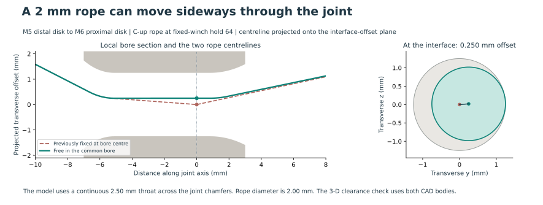

# Free C-rope travel through the shared M5/M6 bore

The four Ø2 mm C ropes pass through the bolted joint between M5 and M6 before anchoring in M6. On 16 November, each end fillet joined its neighbouring guide but both curves had to meet at the exact centre of the common hole. This study lets each C rope choose its lateral passage through the hole and feeds the resulting length and endpoint forces back into the 500 g rod model. B ropes terminate at M5. The study concerns the shared C passage only. [Shared guide-to-guide section](results/shared_route.svg) · [Numerical summary](results/summary.json) · [Previous origin-constrained routing](../morning_20261116/README.md)



## Geometry and loads

The endpoints are the archived M5 +24 mm and M6 −24 mm guide-hole centres. Use the common interface frame, x distally along the shaft, y upwards in the local rod frame and z to local right. The rod-to-CAD map is `(−z, y, x)` with the actual lane offset and the appropriate end-disk axial origin. The four C rays are at a radius of 28 mm. M5 distal has a 7 mm end region, 3.9 mm wall fillet and 29° design angle. M6 proximal has 3 mm, 7.0 mm and 18°. Rope radius is 1 mm and throat radius is 1.25 mm. The Ø2.5 mm cylindrical throat conservatively spans the clearance added by the outer mating-face chamfers. [Published end CAD and dimensions](../../../../cad/lanes_u4m2/end_bellmouth_v1/README.md)

At each axial station the centreline is restricted to a disk equal to the wall profile offset by the rope radius. The fillet centreline radius is the wall radius plus 1 mm. A linear tangent beyond the design wrap conservatively closes the constraint until a full rope radius past the outer edge. The optimal path minimizes the sum of 3-D segment lengths. Convex second-order cones bound segment length and radial travel. Arc chord limits include a curvature-based inward allowance. The rope can load any side of the bore and cross the interface without a fictitious centre support.

The .15 mm axial arc spacing is compared with .075 mm on six saved poses. Every checked centreline is sampled at intervals of at most .02 mm along arc length and tested at both ends against both actual CAD bodies over the specified end regions. The check includes one rope radius on the far side of the mating plane. The historical −.005 mm mesh tolerance and 1° design-angle reserve are retained. A negative sampled clearance remains in the values even when it falls inside that tolerance. Local loads follow the optimal endpoint directions and their change. Reconstructed wall normals give an independent force-balance residual. [All 217 saved geometries](results/shared_217.json) · [Refined comparison](results/refinement_comparison.csv)

The static sliding sensitivity uses the ideal capstan relation `T_high / T_low = exp(mu × total absolute wrap)` at assumed coefficients 0, 0.05, 0.15 and 0.30. The sign of sliding assigns the tight end to M5 or M6. The frozen-route table reports the resulting ratios and an example taking the archived tension at the low end. The actual coefficient, wear, stick-slip and rope bending stiffness require measurements. Friction changes the boundary forces on a real arm. The rebalanced rod uses the frictionless route with uniform tension along each rope.

## Fixed-winch equilibrium

The hold solver replaces just these two C-rope span lengths and their generalized gradients in the existing bellmouth rod. The derivative of minimized string length at each endpoint is the outward unit tangent. Transform it through the two endpoint kinematics to obtain the correction to the rod gradient and cable Jacobian. Compliance of the 1 m free rope, gravity, nominal V3 guide masses, all other routes, and the 500 g head retain their archived values to isolate the effect of freeing the bore. The retained-seat shell and the rod use different levels of structural detail. Coupling measured guide stiffness and all four physical stations remains a subsequent integration step.

All 12 reconstructed winch rest lengths are held fixed. Source commands must reproduce the archived 8-cell equilibrium lengths and tensions. The solver checks local endpoint kinematics against the complete rod and checks the length gradient independently. Each accepted state saves the solved tension and head pose, route length, local CAD result and minimum fixed-winch tangent eigenvalue. A positive eigenvalue supports local quasi-static stability. Finite actuator response, sampling delays and closed-loop trajectory error require time-domain testing. The per-record data describe saved equilibria. [Six detailed 8-cell cases](results/fixed_winch_8/) · [Independent 16-cell hold 64](results/fixed_winch_16/) · [Full fixed-winch results](results/rebalanced_summary.json) · [12-channel data and states](results/rebalanced_states.npz)

## Loads delivered to the real guide locations

The [station load table](results/guide_station_loads.csv) gives the simultaneous force and moment from all attached ropes at each of eight M5/M6 stations. The [per-hole archive](results/guide_hole_loads.npz) contains all 48 guide-hole loads and the forces and moments on the combined M5/M6 bore wall from its four C ropes at each hold. In each entry the first three-vector is force in N and the second is moment about the station or joint centre in N mm. Vectors use that deformed part's local CAD x, y, z axes. Keys in the archive identify every station, family and ray.

Both neighbouring rope tangents enter each guide's hole force. At M5 +24 and M6 −24 the new shared route supplies one tangent for each C rope. The other tangent comes from the span to the next guide. The surface reaction on the bolted bore pair balances the forces and moments at the two guide endpoints. Its force is independently compared with the sum of the constraint-normal reactions. A six-direction virtual displacement of the shared bore also checks its force and moment at hold 64 C-up. An individual end-disk load split and actual contact pressure require a measured or mechanically resolved load path. [Load extrema and verification](results/guide_load_summary.json)

## Pull-through test on the bench

1. Assemble matched M5 distal and M6 proximal pieces in their actual bolted alignment. Record the print lot, rope construction/lot, conditioning, diameters, bore alignment and surface finish. Preserve the as-built joint datum. Set up the C-up ray at hold 64 first using the reference drawing. Repeat at other rays and holds to sample wrap and build variation.
2. Set the two pulling fixtures to [fixture_targets.csv](results/fixture_targets.csv). Coordinates are absolute in the shared CAD frame (joint z = 0), in mm. Each unit axis points out towards its pulling end along the free span. The load cells must sense the two free-span tensions adjacent to the test section. Document and remove fixture roller/guide drag with a fixture-only calibration. If the setup includes other loaded guides in the force path, identify them before interpreting an effective coefficient.
3. Establish a common reference preload and use hardware-qualified force and travel limits. Record continuous tension on both ends, signed speed and reversal events. Positive speed pulls toward M6. At each setting obtain steady sliding in both directions and preserve the onset/rest data separately. Inspect each rope and both mouths for damage before and after a cycle.
4. Enter real samples in [pullthrough_measurements.csv](pullthrough_measurements.csv). Specify both tension uncertainties and the signed velocity for each steady interval. Measure the total absolute turn angle of the rope through both mouths and the bore, with its uncertainty. Enter both optional angle fields in degrees. The estimator uses the measured angle when provided and reports `ln(T_pull / T_pay) / wrap` with bounds from both tensions and the angle. If the angle is indistinguishable from zero, it preserves the tension ratio and leaves the coefficient unresolved. A reversed tension order or a difference smaller than the measurement uncertainty is flagged. With both angle fields empty, coefficients are explicitly conditional on the simulated wrap. [Physical evidence status](results/hardware_status.json)

## Reproduction

From the repository root, use the [recorded versions](../m5_seat_bench_20261119/results/provenance.json) including Clarabel, CVXOPT, Numba and VTK. The public inputs are the two actual end CAD meshes, the 16 November fixed-winch equilibrium archive and its companion records and mass model.

```sh
export OPENBLAS_NUM_THREADS=1 OMP_NUM_THREADS=1
study=simulations/u4m2/lanes_20261113/shared_bore_20261119
scratch_dir=/tmp/asrc-rope-reproduction
mkdir -p "$scratch_dir/results"
python "$study/shared_bore.py" --step .15 --cad --out "$scratch_dir/results/shared_217.json"
python "$study/shared_bore.py" --step .075 --cad --cases 0 47 48 64 141 146 --out "$scratch_dir/results/refined_six.json"
python "$study/rebalance.py" --cells 8 --cases 64 146 47 48 141 0 --out "$scratch_dir/results/fixed_winch_8"
python "$study/rebalance.py" --cells 16 --cases 64 --seed "$scratch_dir/results/fixed_winch_8" --out "$scratch_dir/results/fixed_winch_16"
python "$study/rebalance.py" --all --resume --reuse "$scratch_dir/results/fixed_winch_8" --out "$scratch_dir/checkpoints"
python "$study/check_tangent.py" --results "$scratch_dir/results"
python "$study/pack_holds.py" --cache "$scratch_dir/checkpoints" --out "$scratch_dir/results"
python "$study/guide_loads.py" --states "$scratch_dir/results/rebalanced_states.npz" --out "$scratch_dir/results"
python "$study/summarize.py" --results "$scratch_dir/results"
python "$study/setup_figure.py" --out "$scratch_dir/results"
python "$study/pullthrough.py" --input "$study/pullthrough_measurements.csv" --geometry "$scratch_dir/results/shared_217.json" --out "$scratch_dir/results/hardware_status.json"
python -m unittest discover -s "$study" -p test_shared.py -v
```

The complete feedback-controlled travel cycle, physical pull-through loss, outer guide-mouth contact, B return paths, rope-on-rope contact elsewhere, print strength and service life still require dedicated evidence. The four C ropes here are in four different bores. Calibrate the force loss first, then use that range in a coupled motion replay.
